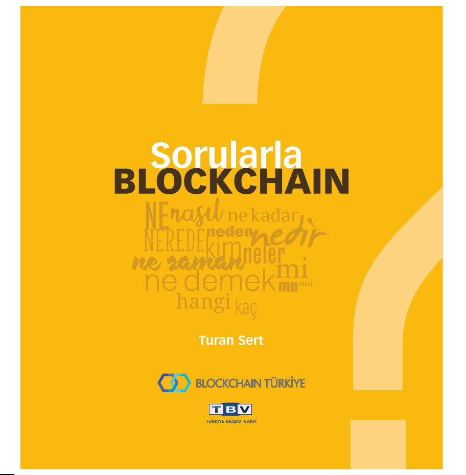

## Kitap hakkında

*Sorularla Blockchain*, Turan Sert'in ilk kitabı; blokzincir (blockchain) teknolojisini soru-cevap biçiminde anlatıyor. 2019'da BCTR ve TBV ortak yayını olarak çıktı. Kitap, yazarın Medium'da yazdığı yazılardan derlendi. Kitabın ana bölümleri:

- Nedir bu Blockchain ve beni nasıl etkileyecek: finans, tedarik zinciri, sağlık, çevre, seyahat, tahmin piyasaları ve sanat
- Blockchain her derde deva mı, değişen girişimcilik ve yatırımcılık, ICO ve token dünyası
- Teknik olarak Blockchain: şifreleme ve uzlaşma mekanizmaları
- Blockchain'in geleceği
- Bitcoin; Ethereum ve diğer kripto paralar; sabit paralar
- BCTR çalışma grupları tarafından hazırlanan raporlar

Kitabın tamamını üye olmadan, çevrimiçi ve ücretsiz olarak [buradan](/Sorularla_Blockchain/oku/) okuyabilirsiniz.

Yayın: BCTR ve TBV, Eylül 2019.

## İçindekiler {#icindekiler}

Kitabın tam metnini bölüm bölüm aşağıdan okuyabilirsiniz.


