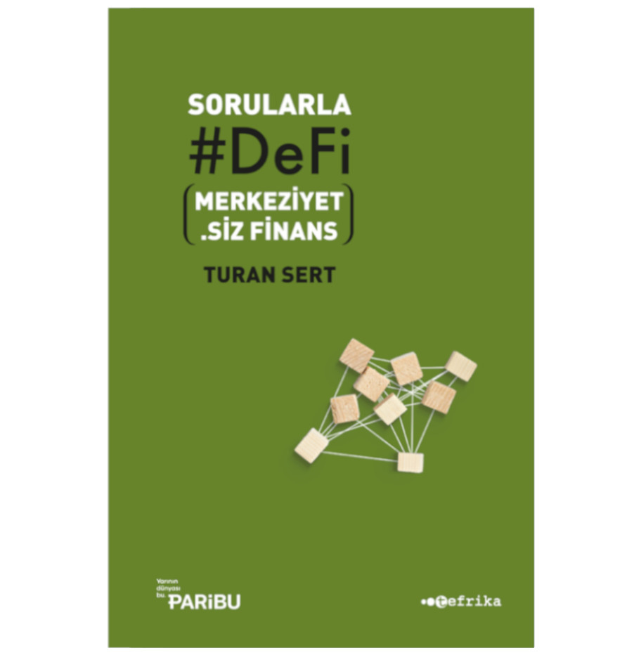

## Kitap hakkında

*Sorularla DeFi - Merkeziyetsiz Finans*, Turan Sert'in ikinci kitabı. Blokzincir teknolojisinin finans alanındaki uygulamalarını, yani DeFi'yi (merkeziyetsiz finans) soru-cevap biçiminde anlatıyor. Kitabın ana bölümleri:

- Nedir DeFi?: blokzincirin çıkış felsefesi, DeFi'nin temel özellikleri, riskleri ve regülasyon
- DeFi dünyasının aktörleri: MakerDAO, Compound, Uniswap, Yearn Finance, Synthetix, Hegic ve Nexus Mutual
- DeFi'nin altyapı taşları: Ethereum, Chainlink, The Graph, Filecoin, Aragon ve stabil paralar
- DeFi dünyasına adım atacaklar için pratik bilgiler: elektronik cüzdan, token alımı ve portföy takibi

Kitabın tamamını üye olmadan, çevrimiçi ve ücretsiz olarak [buradan](/Sorularla_DeFi/oku/) okuyabilirsiniz.

Tefrika Yayıncılık, 3. baskı Temmuz 2022. ISBN 978-605-73998-6-1.

## İçindekiler {#icindekiler}

Kitabın tam metnini bölüm bölüm aşağıdan okuyabilirsiniz.


