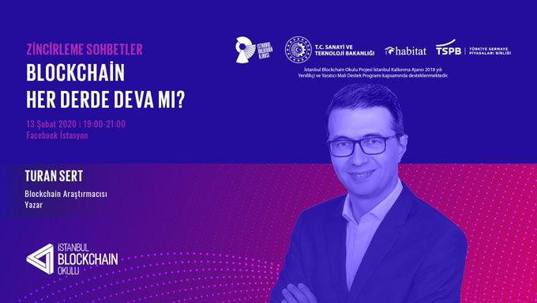
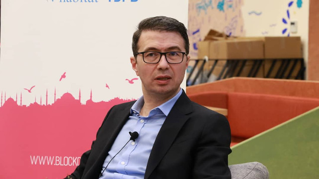
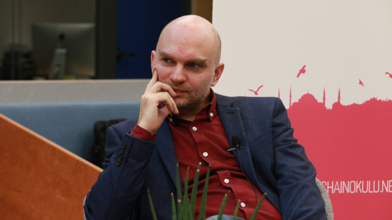

 13 Şubat 2020'de İstanbul Blockchain Okulu'nun Maslak Facebook İstasyon'da düzenlediği "Zincirleme Sohbetler" dizisine "Blockchain Her Derde Deva mı?" isimli sohbette sevgili Ozan Onat'ın konuğu oldum. Birkaç kareyi ekte paylaşıyorum:

 

&nbsp;

<table><tr><td style="width:50%">

</td>
<td style="width:70%">

   </td></tr>
<tr><td style="width:50%; vertical-align:top">

"Blockchain her derde deva değil"

</td>
<td style="width:50%; vertical-align:top">

 Ozan Onat

</td></tr>
</table>
