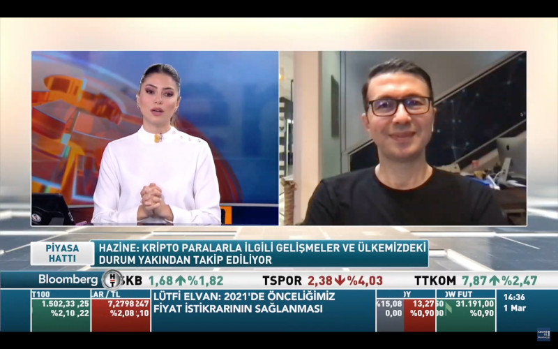
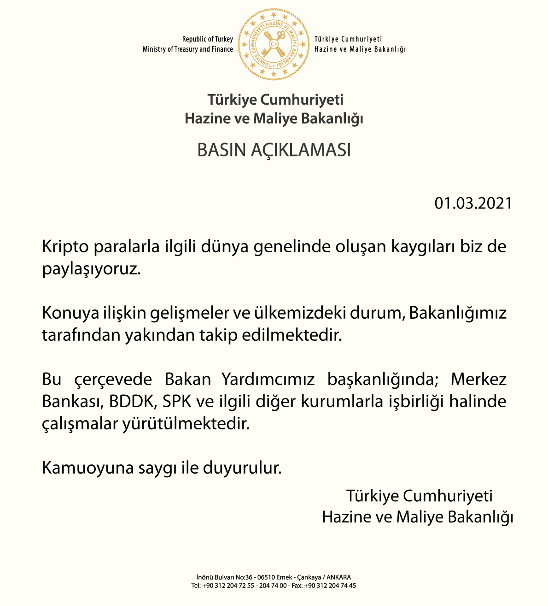

 BloombergHT Piyasa Hattı programında, [Güzem Yılmaz Ertem](https://twitter.com/guzemyilmaz)'in konuğu olarak Hazine ve Maliye Bakanlığı'nın 1 Mart tarihinde yayınladığı kriptoparalar ile ilgili bildiriyi konuştuk.  
&nbsp;

<table><tr><td style="width:50%">

</td>
<td style="width:50%">
<iframe loading="lazy" title="İş dünyası kademeli normalleşmeden ne bekliyor? - Piyasa Hattı | 01.03.2021" width="224" height="126" src="https://www.youtube-nocookie.com/embed/b_zJXfPPxFE?t=1911" frameborder="0" allowfullscreen></iframe></td></tr>
<tr><td style="width:50%; vertical-align:top">

Bakanlık bildirisi...  

</td>
<td style="width:50%; vertical-align:top">

Bu da yayının YouTube linkiç Konuşma 31:50'de başlıyor

</td></tr> 
</table>
