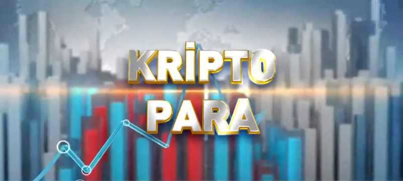
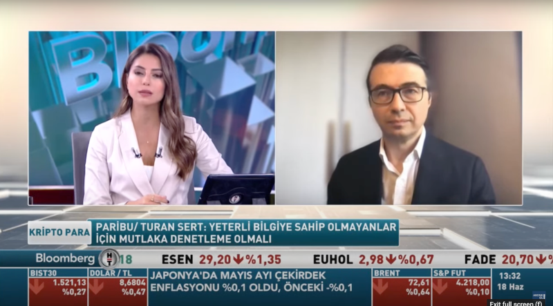

 BloombergHT 'Kripto Para' programında, [Güzem Yılmaz Ertem](https://twitter.com/guzemyilmaz)'in konuğu olarak kriptopara alanında beklenen düzenlemeleri konuştuk.
&nbsp;Türkiye'de kriptoparalar, Türkiye'de yaşananlar ve yatırımcının kendini koruması için neler yapması gerektiğini konuştuk. İngilizce yayınlanan programın linki aşağıda: 
&nbsp;

<table><tr><td style="width:50%">

</td>
<td style="width:50%">
<iframe loading="lazy" title="Kripto para düzenlemesinde son gelişmeler - Kripto Para  | 18.06.2021" width="224" height="126" src="https://www.youtube-nocookie.com/embed/7Qjh5HATOtY" frameborder="0" allowfullscreen></iframe></td></tr>
<tr><td style="width:50%; vertical-align:top">

Yayından bir görüntü 

</td>
<td style="width:50%; vertical-align:top">

Bu da yayının YouTube linki

</td></tr> 
</table>
