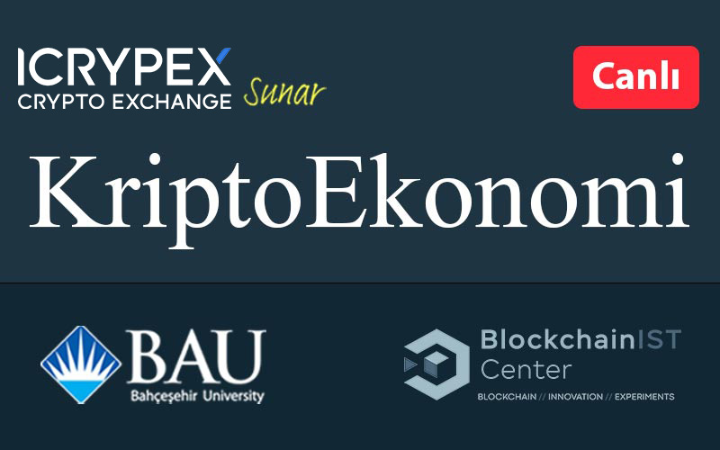
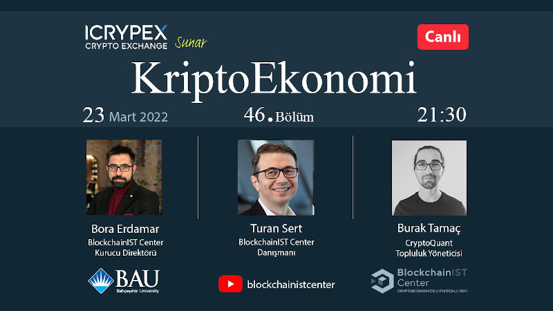

 Danışmanı olmaktan mutluluk duyduğum BlockchainIST merkezinin hazırladığı 'Kriptoekonomi' programına ikinci kez konuk oldum. Merkezin Direktörü sevgili [Bora Erdamar](https://twitter.com/berdamar) ve yakın zamanda tanıştığım sevgili [Burak Tamaç](https://twitter.com/burak_tamac) ile birlikte ilk olarak ikinci kitabım olan 'Sorularla DeFi', sonrasında ise FED Başkanı Powell'in son açıklamaları, Rusya'nın Ukrayna'yı işgalinin kriptoya etkisi ve daha pekçok güncel konuyu tartıştık. Popüler olmak yerine bilgi vermeyi edinen programdan şahsen çok zevk aldığımı belirtmem gerek. Kendilerine davetleri için teşekkür ederim. 

&nbsp;

<table><tr><td style="width:50%">

</td>
<td style="width:50%">
<iframe loading="lazy" title="KriptoEkonomi 46 | Sorularla Merkeziyetsiz Finans | Turan Sert" width="224" height="126" src="https://www.youtube-nocookie.com/embed/9Gxk3pcZolo" frameborder="0" allowfullscreen></iframe></td></tr>
<tr><td style="width:50%; vertical-align:top, font:italic">

Programın duyurusu...  

</td>
<td style="width:50%; vertical-align:top">

Bu da yayının YouTube linki.

</td></tr> 
</table>
