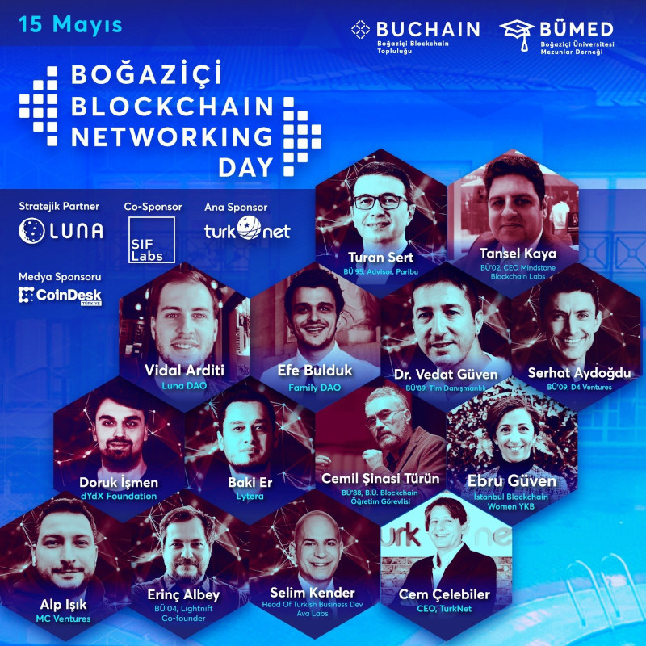
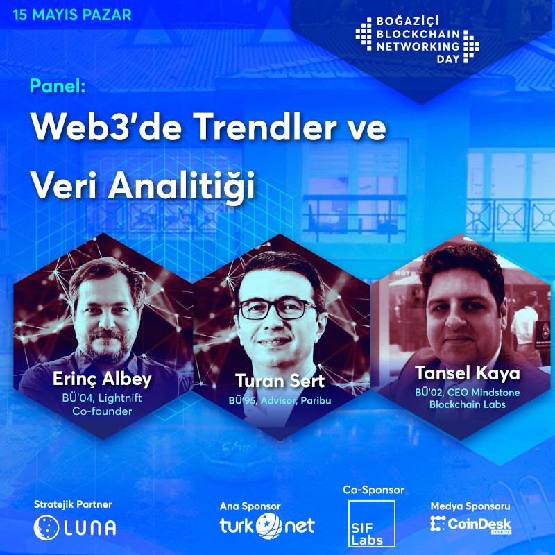
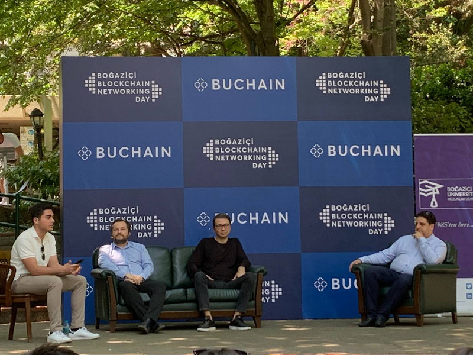
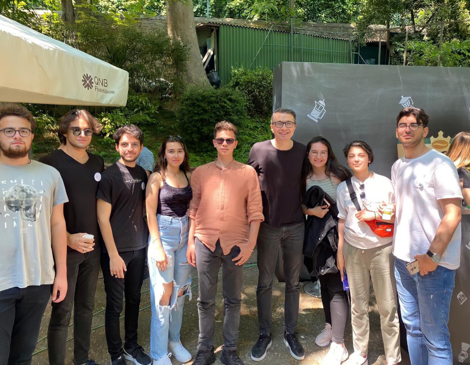
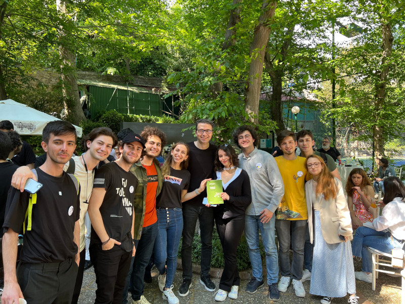
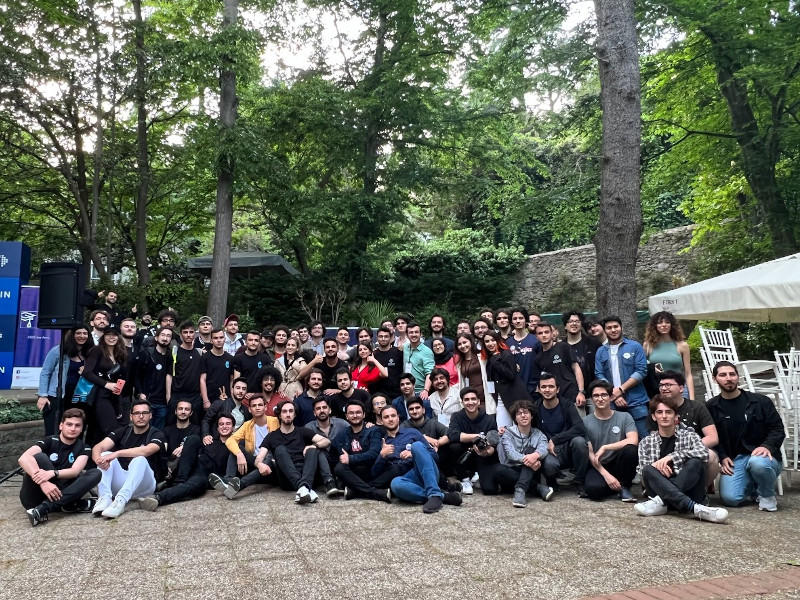

 [Boğaziçi Üniversitesi Blockchain Topluluğu](https://twitter.com/bogazicichain) tarafından düzenlenen '[Boğaziçi Blockchain Networking Day](https://web.archive.org/web/20220504191218/https://blockchainnetworkingday.com/)'de [Erinç Albey](https://twitter.com/erincalbey) ve [Tansel Kaya](https://twitter.com/TanselKayaTR) ile birlikte 'Web3'de Trendler ve Veri Analitiği' paneline konuk olduk. Oldukça keyifli geçen panel sonrası, öğrenci toplulukları ile bir arada olmak ayrı bir zevkti. Davetleri için kendilerine teşekkür ederim. Bu arada teşekkürlerden bir tanesi de, özellikle şehir dışından gelen öğrenci topluluklarının ulaşım masraflarını üstelenerek kendilerini destekleyen Luna DAO ekibi ve Vidal Arditi'ye. Ekosistemi geliştirmek için verdikleri çabalar umarım başka oluşumlara da ilham verir. 

&nbsp;

<table><tr>
<td style="width:50%">
</td>
</td>
<td style="width:50%"><iframe loading="lazy" title="Boğaziçi Blockchain Networking Day 15 Mayıs 2022" width="224" height="126" src="https://www.youtube-nocookie.com/embed/YjtnBNw7u-4?t=1583" frameborder="0" allowfullscreen></iframe>
</tr>
<tr><td style="width:50%; vertical-align:top">

Panelin posteri

</td>
<td style="width:50%; vertical-align:top">

Bu da yayın linki. 26:23'de başlıyor

</td>
</tr>
</table>

&nbsp;

<table>
<tr>
<td style>

</td>
<td style>
</td>
</tr>
<tr>
<td style>

</td>
<td style>
</td>
</tr>
</table>

