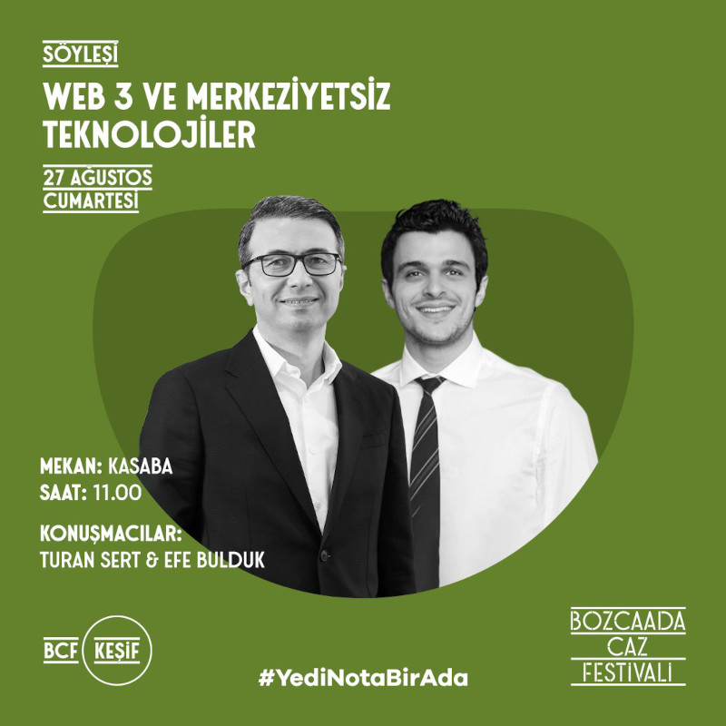
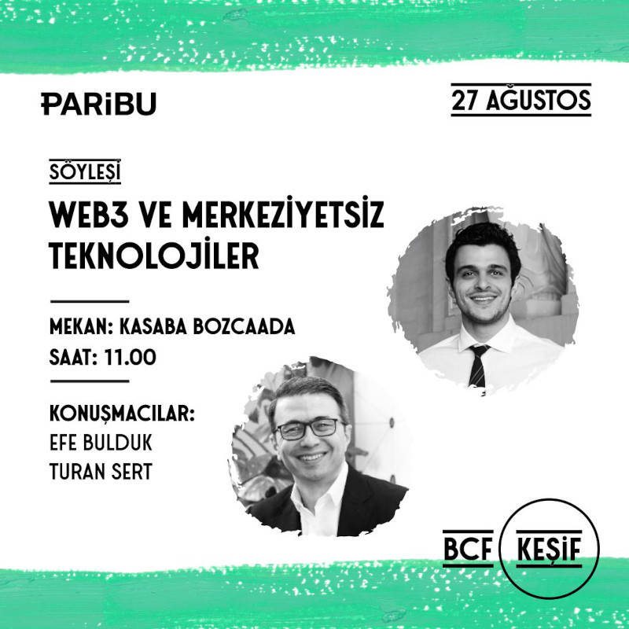

 Her yıl Ağustos ayında Bozcaada'da düzenlenen [Bozcaada Caz Festivali](https://bozcaadacazfestivali.com/) sanat dünyasından pek çok ismi bir araya getiren çok hoş bir etkinlik. Bu yıl, festivalin ana sponsorlarından Paribu'nun düzenlediği söyleşide sevgili [Efe Bulduk](https://twitter.com/TheBullduck) ile 'Web3 ve merkeziyetsiz teknolojiler' konusunu ele aldık. Bozcaada içindeki Kasaba isimli şirin mekanda Cumartesi sabahı erken saatte olmasına rağmen bizi dinlemeye gelen kalabalık bir kitle olması açıkçası beni hem şaşırttı hem de mutlu etti.   

&nbsp;

<table>
<tr>
<td style="width:50%">

</td>
<td style="width:50%"><iframe loading="lazy" title="KEŞİF söyleşisi: Web 3.0 ve Merkeziyetsiz Teknolojiler (Bozcaada Caz Festivali)" width="224" height="126" src="https://www.youtube-nocookie.com/embed/9Q4t_WqTWxA" frameborder="0" allowfullscreen></iframe>
</td>
</tr>
<tr>
<td style="width:50%; vertical-align:top">

Etkinlik ile ilgili bir başka poster

</td>
<td style="width:50%; vertical-align:top">

Söyleşinin video kaydı

</td>
</tr>
</table>
