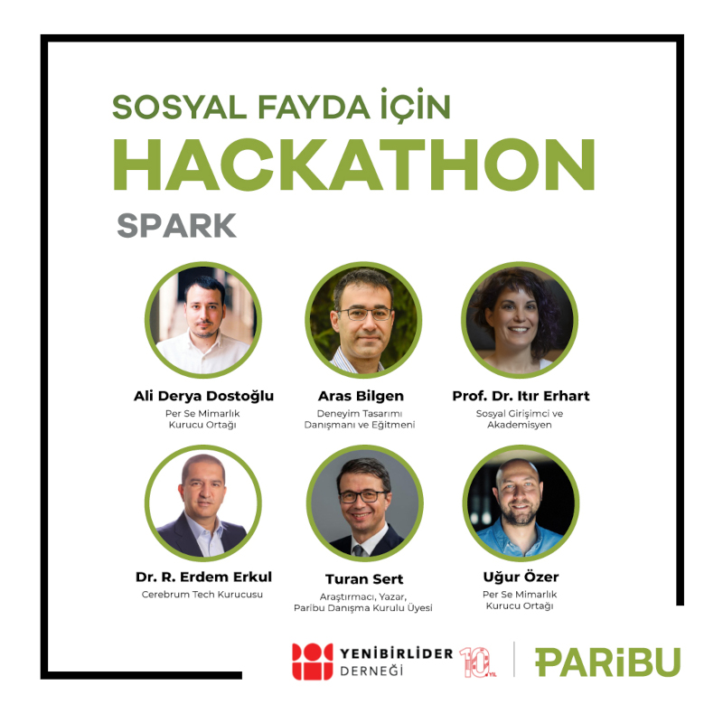
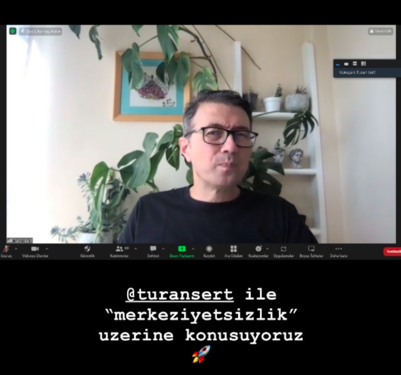

 [Yeni Bir Lider Derneği](https://yenibirlider.org/) tarafından düzenlenen '[Sosyal Fayda İçin Hackathon](https://yenibirlider.org/sf-hackathon/) etkinliğinde 60'a yakın katılımcı ile Web3 ve merkeziyetsiz sistemleri sosyal fayda perspektifinden konuştuk. Web3 sistemleri özellikle blokzincir altyapısı nedeniyle bağışların takibi gibi alanlarda oluşan sızıntıları önlemede kullanılabilir. Yine de blokzincir sistemlerinin daha çok dijital dünyada etkili olabileceği unutulmamalı. 

Daha sonrasında yapılan yarışmada da jüri üyesi oldum. Hackhaton'da biribirinden ilginç 19 projenin sunumlarını dinledik. Katılan ekiplere teşekkür ederim. 

&nbsp;

<table>
<tr>
<td style="width:50%">

</td>
</tr>
<tr>
<td style="width:50%; vertical-align:top">

Sunum ekran görüntüsü. Kayıt yayınlanmadı. 

</td>
</tr>
</table>

&nbsp;
