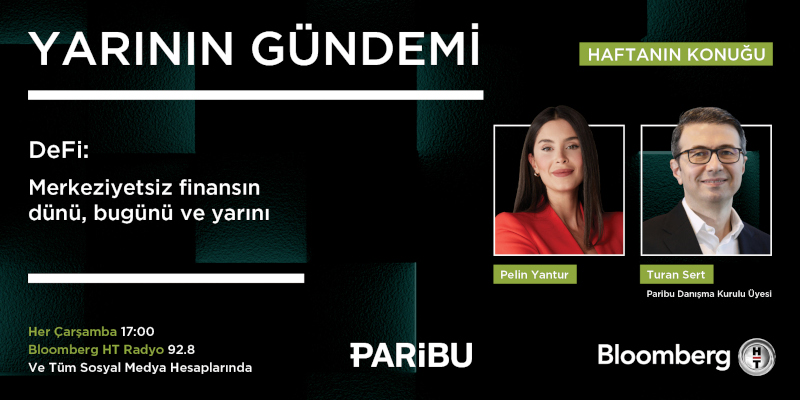
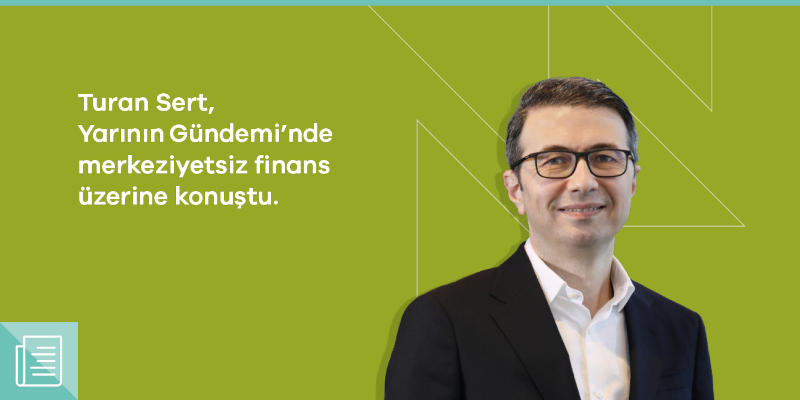

 BloombergHT Radyo'da yayınlanan 'Yarının Gündemi' programında, [Pelin Yantur](https://twitter.com/pelinyantur)'un konuğu olarak 2022 yılının merkeziyetsiz finans için nasıl geçtiğini, merkeziyetsiz finansın önümüzdeki 1, 5 ve 10 yılda hayatımıza nasıl etki edeceğini, geleneksel finans ile merkeziyetsiz finans arasında nasıl bir bağ olduğunu konuştuk. Program aynı zamanda YouTube üzerinden canlı olarak yayınlandı. 

&nbsp;

<table><tr><td style="width:50%">

</td>
<td style="width:50%">
<iframe loading="lazy" title="Yarının Gündemi - DeFi: Merkeziyetsiz Finansın Dünü, Bugünü ve Yarını | Turan Sert" width="224" height="126" src="https://www.youtube-nocookie.com/embed/9iFEkgIPATs" frameborder="0" allowfullscreen></iframe></td></tr>
<tr><td style="width:50%; vertical-align:top">

Program sonrası duyuru...  

</td>
<td style="width:50%; vertical-align:top">

Bu da yayının YouTube linki.

</td></tr> 
</table>
