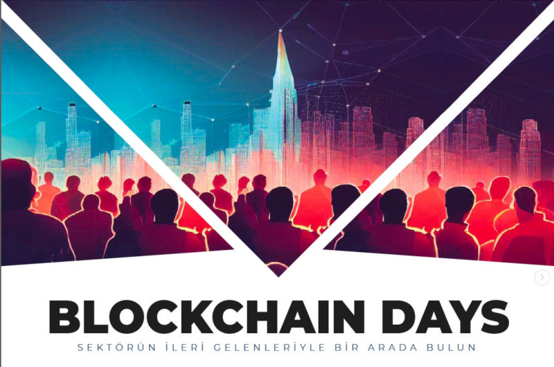
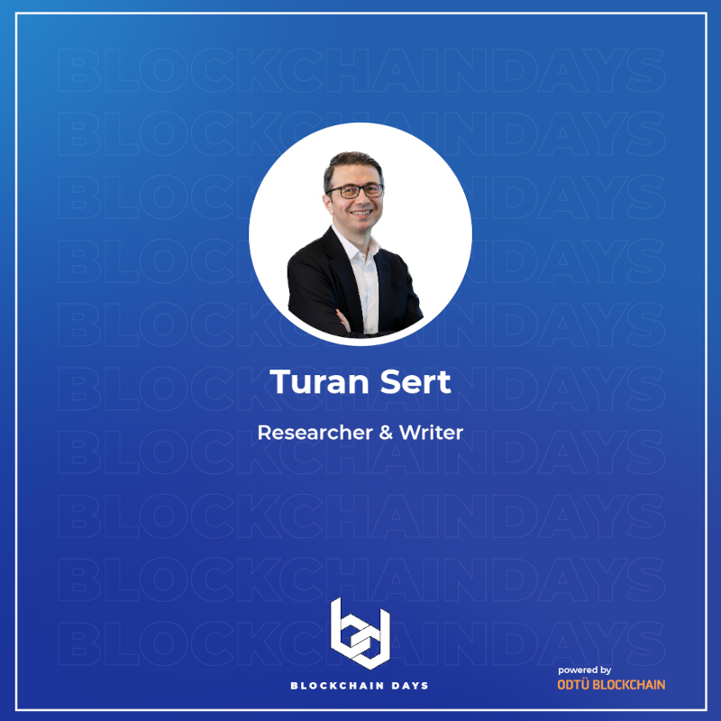
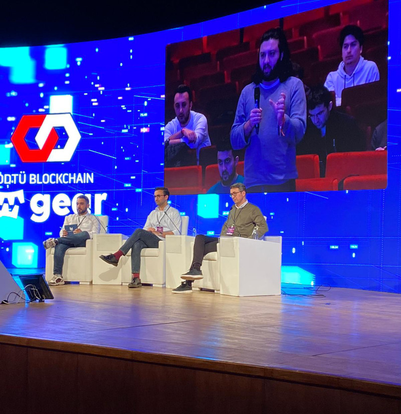

 [ODTÜ Blockchain](https://twitter.com/odtublockchain) tarafından 23-24 Aralık tarihlerinde düzenlenen '[Blockchain Days](https://www.blockchaindays.org/)'in ilk gününde "The Future of Financial Technologies - Finansal Teknolojilerin Geleceği" konulu bir panele Akbank'ta blockchain konulu insiyatiflerin liderlerinden sevgili [Selim Yüksel](https://twitter.com/selimyksl) ile birlikte konuk olduk. Organizasyonu düzenleyen ODTÜ Blockchain ve ilk gece beni ağırlayan sevgili Lytera ekibine teşekkürlerimi sunarım.. 

&nbsp;

<table><tr>
<td style="width:50%">

</td>
<td style="width:50%">

</td></tr>
<tr><td style="width:50%; vertical-align:top">

Panelin posteri

</td>
<td style="width:50%; vertical-align:top">

Panelden bir kare

</td>
</tr>
</table>

&nbsp;
