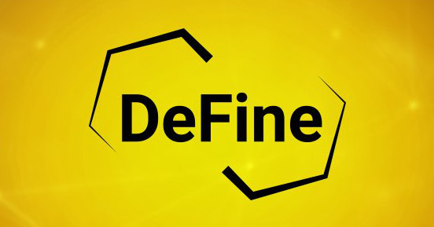 [CoinTelegraph Türkiye](https://web.archive.org/web/20200929072400/https://tr.cointelegraph.com/) YouTube [kanalında](https://www.youtube.com/channel/UCA5gkdX4wbUVwCBombVkdZQ) yayınlanan ve sevgili [Doruk İşmen](https://twitter.com/dorukismen) ile bendeniz tarafından sunulan DeFine programında, her onbeş günde bir DeFi, NFT, DAO kısacası Web3 dünyasında yaşanan güncel konuları konuşuyoruz. 

Tüm bölümleri yeniden eskiye aşağıda bulabilirsiniz. 

&nbsp;

<table>
<tr>
<td>

Tanıtım posteri

</td>
<td>

YouTube linki

</td>
<td>

Konular

</td>
</tr>

<tr>
<td style="width:33%">
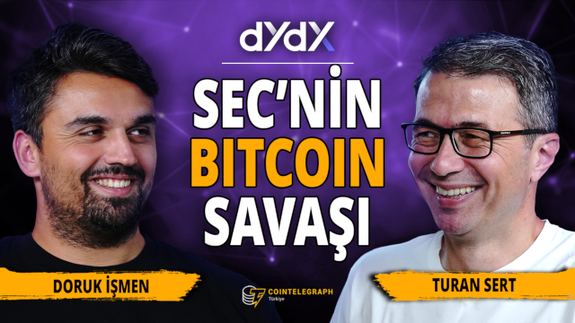
</td>
<td style="width:33%"><iframe loading="lazy" title="SEC'in Bitcoin ile Savaşı, Kripto Etkinlikleri, Uniswap ve Tornado Cash'in Dertleri | DeFine" width="224" height="126" src="https://www.youtube-nocookie.com/embed/qrGBloJ6bvw" frameborder="0" allowfullscreen></iframe>
</td>
 <td style="width:33%; vertical-align:top">

<b>Bölüm 17: </b> SEC'in kripto paralarla olan savaşı, 2023 yılında Istanbul'da gerçekleştirilecek kripto etkinlikleri ve Uniswap & Tornado Cash'ın regülasyon ile imtihanı 

</td>
    </tr>
<tr>
<td style="width:33%">
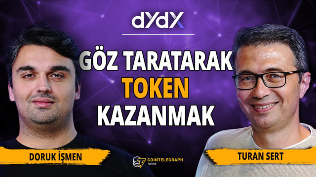
</td>
<td style="width:33%"><iframe loading="lazy" title="PayPal'dan stabilpara adımı, Layer 2 projeleri ve Telegram botları | DeFine" width="224" height="126" src="https://www.youtube-nocookie.com/embed/gU0hurwRVxk" frameborder="0" allowfullscreen></iframe>
</td>
 <td style="width:33%; vertical-align:top">

<b>Bölüm 16: </b>  Worldcoin, PayPal'ın stablecoini PYUSD, Layer 2 projeleri ve Telegram botları 

</td>
    </tr>
<tr>
<td style="width:33%">
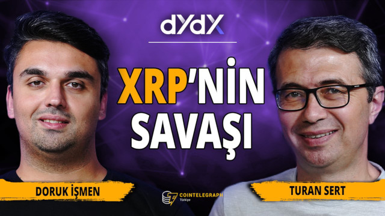
</td>
<td style="width:33%"><iframe loading="lazy" title="XRP Davasının Çözüme Kavuşan ve Kavuşmayan Kısımları, Polygon'un Yeni Tokenı | DeFine" width="224" height="126" src="https://www.youtube-nocookie.com/embed/1Y5GXMf17ps" frameborder="0" allowfullscreen></iframe>
</td>
 <td style="width:33%; vertical-align:top">

<b>Bölüm 15: </b> XRP davasının çözüme kavuşan ve kavuşmayan kısımları ve Polygon'un yeni tokeni POL 

</td>
    </tr>
<tr>
<td style="width:33%">
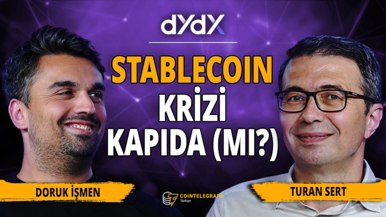
</td>
<td style="width:33%"><iframe loading="lazy" title="SEC'in Bitcoin Spot ETF'leriyle İmtihanı, dYdX'in Yeni Versiyonu ve Olası Stablecoin Krizi | DeFine" width="224" height="126" src="https://www.youtube-nocookie.com/embed/z-yl6OLwo1o" frameborder="0" allowfullscreen></iframe>
</td>
 <td style="width:33%; vertical-align:top">

<b>Bölüm 14: </b> BlackRock ETF başvurusu dYdX'in merkeziyetsizliğe yolculuğu ve merkezi stabil paraların sorunları 

</td>
    </tr>
<tr>
<td style="width:33%">
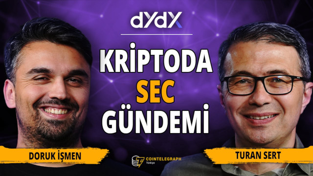
</td>
<td style="width:33%"><iframe loading="lazy" title="SEC'in yaptırımları, Uniswap'in yeni versiyonu ve DAO'ların geleceği | DeFine" width="224" height="126" src="https://www.youtube-nocookie.com/embed/dUuA1kQBVcw" frameborder="0" allowfullscreen></iframe>
</td>
 <td style="width:33%; vertical-align:top">

<b>Bölüm 13: </b> SEC'in yaptırımları, Uniswap'in yeni versiyonu ve DAO'ların geleceği 

</td>
    </tr>
<tr>
<td style="width:33%">
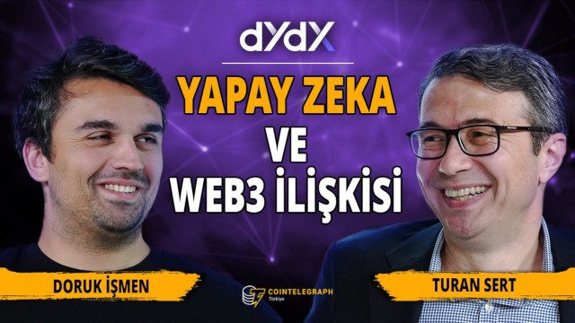
</td>
<td style="width:33%"><iframe loading="lazy" title="Yapay Zekanın Web3 ile Etkileşimi, DeFi Projelerinin Geleceği | DeFine" width="224" height="126" src="https://www.youtube-nocookie.com/embed/A_SsB81Foug" frameborder="0" allowfullscreen></iframe>
</td>
 <td style="width:33%; vertical-align:top">

<b>Bölüm 12: </b> Yapay zekanın web3 ile etkileşimi, DeFi tokenlarını ve projelerini gelecekte bekleyenler 

</td>
    </tr>
 <tr>
<td style="width:33%">
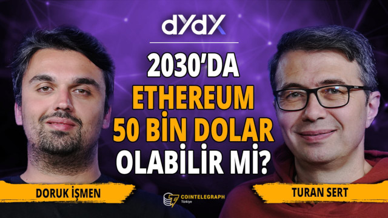
</td>
<td style="width:33%"><iframe loading="lazy" title="Ethereum 2030'da 50 Bin Dolar Olacak İddiası, Ledger'ın Yeni Özelliği | DeFine" width="224" height="126" src="https://www.youtube-nocookie.com/embed/TL60UKDysqA" frameborder="0" allowfullscreen></iframe>
</td>
 <td style="width:33%; vertical-align:top">

<b>Bölüm 11: </b> Ethereum'un 2030'da 50 bin dolar olacağı iddiası, donanım cüzdanı Ledger'ın yeni özelliği 

</td>
</tr>
       <tr>
<td style="width:33%">
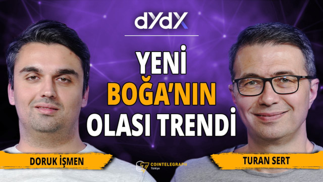
</td>
<td style="width:33%"><iframe loading="lazy" title="Kurumsal Taraftaki Gelişmeler ve Ethereum'da Son Durum | DeFine" width="224" height="126" src="https://www.youtube-nocookie.com/embed/6Hchp4qd2og" frameborder="0" allowfullscreen></iframe>
</td>
 <td style="width:33%; vertical-align:top">

<b>Bölüm 10: </b> Yeni boğanın olası trendi, kurumsal taraftaki gelişmeler ve Ethereum'daki son durum

</td>
</tr>
        <tr>
<td style="width:33%">
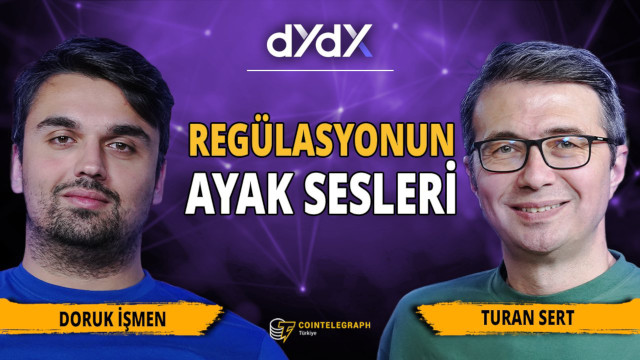
</td>
<td style="width:33%"><iframe loading="lazy" title="Avrupa'dan Gelen Regülasyon ve Yeni Nesil Memecoinler | DeFine" width="224" height="126" src="https://www.youtube-nocookie.com/embed/UHEtFwUSwXQ" frameborder="0" allowfullscreen></iframe>
</td>
 <td style="width:33%; vertical-align:top">

<b>Bölüm 9:</b> Ethereum Devconnect İstanbul etkinliği, Gary Gensler'in açıklamaları, piyasaya yeni çıkan memecoinler 

</td>
</tr>
    <tr>
<td style="width:33%">
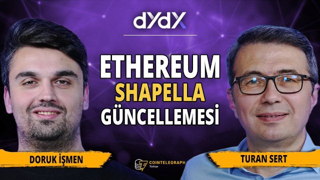
</td>
<td style="width:33%"><iframe loading="lazy" title="Ethereum Shapella Yükseltmesi | CFTC ve Binance Davasının Perde Arkası | DeFine" width="224" height="126" src="https://www.youtube-nocookie.com/embed/rzltdHUfJvc" frameborder="0" allowfullscreen></iframe>
</td>
 <td style="width:33%; vertical-align:top">

<b>Bölüm 8:</b> Ethereum Shapella yükseltmesi, CFTC'nin Binance davası

</td>
</tr>
        <tr>
<td style="width:33%">
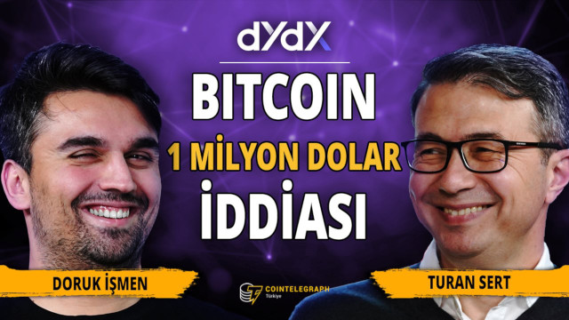
</td>
<td style="width:33%"><iframe loading="lazy" title="Bitcoin için Milyon Dolarlık İddia, Arbitrum Airdrop’u ve Gelecek Airdrop Fırsatları | DeFine" width="224" height="126" src="https://www.youtube-nocookie.com/embed/zdnVETPW-QM" frameborder="0" allowfullscreen></iframe>
</td>
 <td style="width:33%; vertical-align:top">

<b>Bölüm 7:</b> Bitcoin 1 milyon dolar iddiası, SEC-Coinbase olayı, Arbitrum airdrop ve sıradakiler

</td>
</tr>
  <tr>
<td style="width:33%">
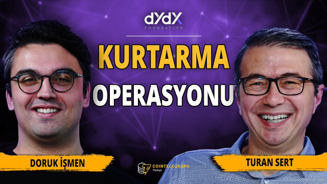
</td>
<td style="width:33%"><iframe loading="lazy" title="Fed’in Bankaları Kurtarma Operasyonu | DeFine" width="224" height="126" src="https://www.youtube-nocookie.com/embed/5Cbrq_-fT9I" frameborder="0" allowfullscreen></iframe>
</td>
 <td style="width:33%; vertical-align:top">

<b>Bölüm 6:</b> Fed'in Bankaları Kurtama Operasyonu

</td>
</tr>
    <tr>
<td style="width:33%">
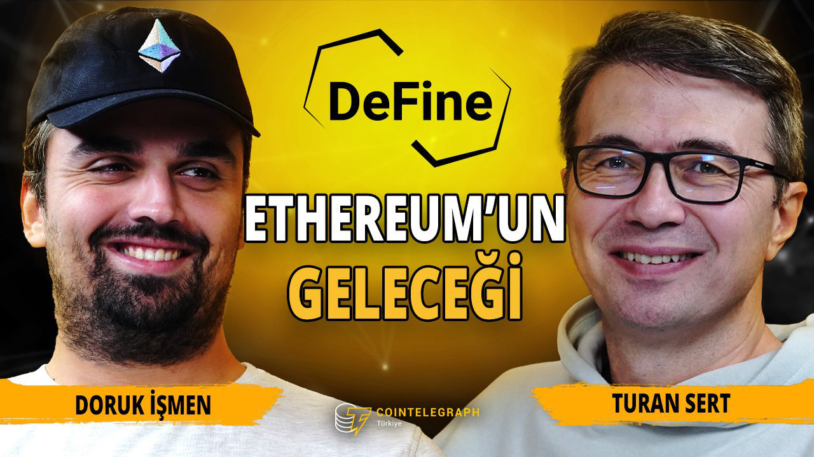
</td>
<td style="width:33%"><iframe loading="lazy" title="Ethereum'un Yeni Yol Haritası ve Polygon'un Kurumsal İş Birlikleri | DeFine" width="224" height="126" src="https://www.youtube-nocookie.com/embed/lBwkqvwjx7A" frameborder="0" allowfullscreen></iframe>
</td>
 <td style="width:33%; vertical-align:top">

<b>Bölüm 5:</b> Ethereum'un Yeni Yol Haritası ve Polygon'un Kurumsal İş Birlikleri

</td>
</tr>
  <tr>
<td style="width:33%">
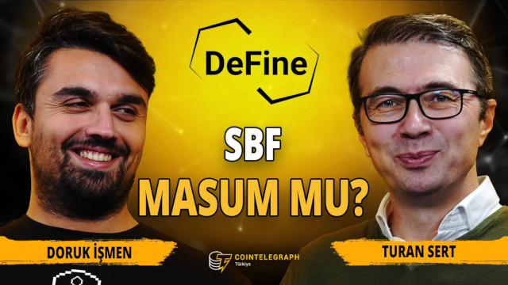
</td>
<td style="width:33%"><iframe loading="lazy" title="FTX Olayı Sadece Kripto Sektörünün Problemi Değil! | FTX’de Son Durum | DeFine" width="224" height="126" src="https://www.youtube-nocookie.com/embed/NBh229psBZs" frameborder="0" allowfullscreen></iframe>
</td>
 <td style="width:33%; vertical-align:top">

<b>Bölüm 4:</b> FTX Olayı Sadece Kripto Sektörünün Problemi Değil! | FTX’de Son Durum

</td>
</tr>
 <tr>
<td style="width:33%">
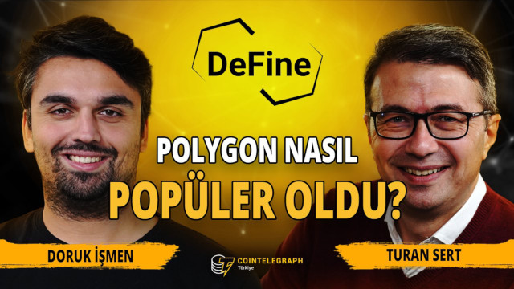
</td>
<td style="width:33%"><iframe loading="lazy" title="Ethereum’un Önündeki Yol Haritası Ne? | Ethereum'un Geleceği | DeFine" width="224" height="126" src="https://www.youtube-nocookie.com/embed/v_eudrimSTk" frameborder="0" allowfullscreen></iframe>
</td>
 <td style="width:33%; vertical-align:top">

<b>Bölüm 3:</b> Ethereum'un Geleceği ve Polygon zkEVM

</td>
</tr>
 
<tr>
<td style="width:33%">
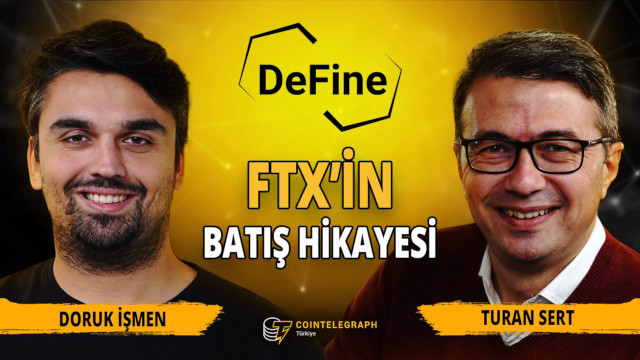
</td>
<td style="width:33%"><iframe loading="lazy" title="FTX Borsası Battı! | Bundan Sonra Ne Olacak? | DeFine" width="224" height="126" src="https://www.youtube-nocookie.com/embed/Ra4x4IF5UAA" frameborder="0" allowfullscreen></iframe>
</td>
 <td style="width:33%; vertical-align:top">

<b>Bölüm 2:</b> FTC Borsası Nasıl Battı?

</td>
</tr>

<tr>
<td style="width:33%">
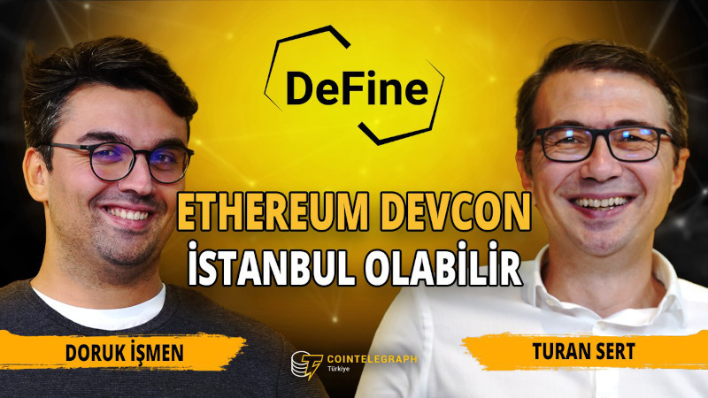
</td>
<td style="width:33%"><iframe loading="lazy" title="Ethereum'un Amacı Dünyayı Değiştirmek | Hackerların Aptos Yoklaması | DeFine" width="224" height="126" src="https://www.youtube-nocookie.com/embed/8dO2D3hKNE0" frameborder="0" allowfullscreen></iframe>
</td>
 <td style="width:33%; vertical-align:top">

<b>Bölüm 1:</b>  Devcon Bogota izlenimler, Devcon Istanbul, Ethereum'un üzerindeki son gelişmeler, BNB ve MangoDAO hack olayları

</td>
</tr>
</table>

&nbsp;
