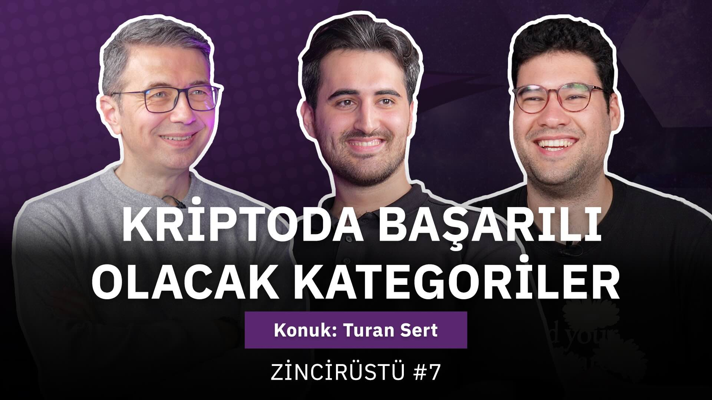

 Zincirüstü programında Selim Çetiner [@selim_jpeg](https://twitter.com/selim_jpeg) ve Yiğit Oğuz [@alamaluu](https://twitter.com/alamaluu) 'nun konuğu oldum. Keyifli bir sohbet oldu.
&nbsp;
<table><tr><td style="width:50%">

</td>
<td style="width:50%">
<iframe loading="lazy" title="Kriptoda Başarılı Olacak Kategoriler | Zincirüstü #7" width="224" height="126" src="https://www.youtube-nocookie.com/embed/hwoJBrOe_FM" frameborder="0" allowfullscreen></iframe></td></tr>
<tr><td style="width:50%; vertical-align:top">

Zincirüstü #7...

</td>
<td style="width:50%; vertical-align:top">

YouTube kaydı.

</td></tr>
</table>
