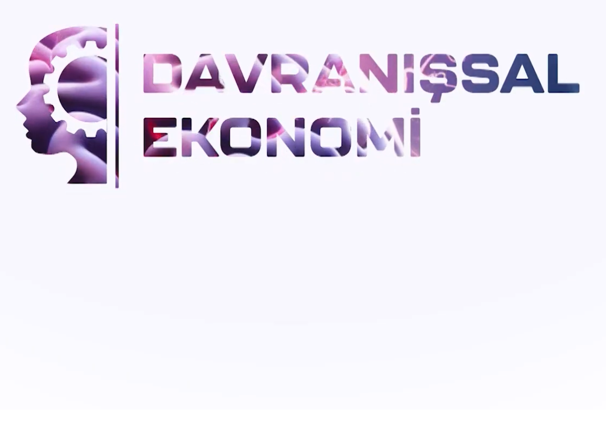
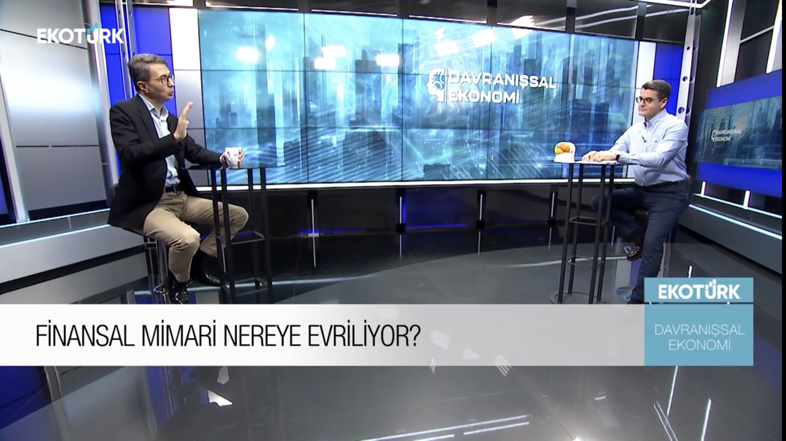

 Ekotürk TV'de yayınlanan "Davranışsal Ekonomi" programında sevgili [Mert Aydıner](https://twitter.com/MertAydiner) ile çok keyifli bir sohbet yaptık. Finansal mimarinin nereye evrileceğini, davranışsal ekonominin bu dönüşümdeki rolünü konuştuk.
&nbsp;
<table><tr><td style="width:50%">

</td>
<td style="width:50%">
<iframe loading="lazy" title="Merkeziyetsiz Finans ve Güç Dağılımı | Davranışsal Ekonomi | Turan Sert | Mert Aydıner" width="224" height="126" src="https://www.youtube-nocookie.com/embed/eVmT3hJPt78" frameborder="0" allowfullscreen></iframe></td></tr>
<tr><td style="width:50%; vertical-align:top">

Yayından bir görüntü...

</td>
<td style="width:50%; vertical-align:top">

Bu da yayının YouTube linki.

</td></tr>
</table>
