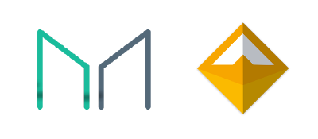

## Maker DAO nedir? {#maker-dao-nedir}

DeFi — Decentralized Finance (Dağıtık Finans) hareketinin öncülerinden olan [MakerDAO](https://makerdao.com/)[^1], Blockchain ile tamamen kendi kendine çalışan yeni bir borçlandırma mekanizması sunuyor. Gelin detaylarına birlikte bakalım.

<figure markdown="1">

<figcaption markdown="span">Maker ve Dai ([Kaynak](https://makerdao.com/en/)[^2])</figcaption>
</figure>

MakerDAO kişilerin ellerinde duran kripto paraları teminat verip bu teminat karşılığı sistemin parası olan Dai’yi yaratmalarına olanak veren dağıtık bir sistem. Ethereum üzerinde kurulu Akıllı Kontratlar kullanılıyor bunu yapmak için.

Dai nedir peki? Dai bir ABD Dolarına eşit olan bir sabit para. Sabit paraların ne olduklarına daha sonraki [bölümlerde](/Sorularla_Blockchain/bolum-6/diger-kripto-paralar-neler/#sabitparalar-dalgali-denizler-icinde-sakin-sular-sunar-mi-bize) değineceğiz. (Dai kelime anlamı olarak Çince’de [borç para vermek](https://www.reddit.com/r/MakerDAO/comments/5q98b1/%E8%B2%B8_dai/)[^3] anlamı taşıyor bu arada)

Nasıl çalışıyor?

Elinizdeki kripto parayı (şu an için yalnız Ethereum parası ETH geçerli) teminat olarak gösteriyorsunuz, buradaki deyişiyle ETH’lerinizi sistem içine kilitliyorsunuz. Gönderdiğiniz her 150 birim para için 100 birime kadar Dai yaratabiliyorsunuz. Sonrasında bu Dai’yi istediğiniz noktadaki borsada bire bire yakın bir değerden ABD Doları’na çeviriyor ve kullanıyorsunuz. Bu para için bir maliyet ödüyorsunuz, sonrasında ise dilediğiniz noktada tekrar Dai satın alarak yok ediyor ve ETH’nize geri kavuşuyorsunuz.

Neden insanlar kullanıyor?

Diyelim ani olarak paraya ihtiyacınız var, mevcut paranızı da ETH’ye yatırdınız. ETH’nin yükseleceğini düşünüyorsunuz ya da başka herhangi bir nedenle ETH’lerinizden ayrılmak istemiyorsunuz. Bu sistemi kullanarak hem nakit ihtiyacınızı karşılayabilir hem de ETH’nin getireceği kardan yararlanabilirsiniz.

Kredi maliyeti ne?

Bir ara inanılmaz ucuz idi, ancak 2019 yılının ortalarına doğru artmaya başladı. Başlangıçta yıllık %0,5 bir faiz maliyeti olan sistem önce %2,5 seviyelerine çıktı, sonraları ise %14’lere kadar yükseldi (buna stabilize ücreti deniyor ve bu ücreti ayrı bir para ile ödüyorsunuz ama şu aşamada çok da gerekli değil bunu bilmek — en altta notta teknik detayı var).

Ya ETH çok düşer de teminatımın altına inerse?

Buna dikkat etmek gerekiyor işte. Zira ETH’nin değeri düşerse ekstra ETH yüklemeniz yapmanız lazım. Ya da baştan ihtiyacınız olan nakitten daha fazla ETH koymakta fayda var. Aksi takdirde sistem ETH’nizi “bozuyor” ve %13 gibi bir ceza sonrası kalan paranızdan borcunuzu düşüp size geri veriyor.

Şu anda sistemde kilitli tutulan teminat rakamının kullanılan krediye oranının yaklaşık %200 olduğunu görüyoruz. Yani insanlar gerekli minimum limit olan %150’nin üzerine bir %50’lik bir ekstra teminat koymuşlar kullandıkları krediler için.

Kim borç veriyor bu sisteme?

Aslında kimse kimseye borç vermiyor. Siz elinizdeki ETH’yi teminat gibi kullanıp Dai yaratıyorsunuz. Buradaki soru şu olabilir? Dai’yi satıp ABD Doları aldınız. Kime satıyorsunuz Dai’yi? Genel olarak sabit para kullanmak isteyen insanlara (ya da daha önce kredi almış ve şu anda borcunu kapatmak için Dai almak isteyenlere). Neden sabit para kullanmak ister insanlar konusunu daha detaylı olarak [şu bölümde](/Sorularla_Blockchain/bolum-6/diger-kripto-paralar-neler/#sabitparalar-dalgali-denizler-icinde-sakin-sular-sunar-mi-bize) bulabilirsiniz.

Dai parası nasıl sabit kalıyor peki?

Dai, bir ABD dolarına sabitlenmiş. Ama alım satım yapıldığı borsada baktığınızda fiyatı aşağı ya da yukarı gidebiliyor. MakerDAO yaratıcıları fiyatın iniş ve çıkış olduğu durumda tekrar 1 ABD dolarına gelmesinin otomatik olacağını düşünüyorlar. Şöyle ki:

Diyelim, Dai fiyatında bir düşüş oldu. Böyle bir durumda geçmişte Dai yaratıp borç almış olanlar, aldıkları borcu yine Dai ile ödeyecekleri için kredilerini ucuza kapatma fırsatı bulabilecekler ve Dai satın alacaklar.

Aynı şekilde Dai fiyatında bir artış olduğunda (1 ABD dolarından daha yüksek bir fiyata geldiğinde) insanlar ellerindeki ETH’leri sisteme gönderip 1 ABD doları karşılığı olacak şekilde Dai yaratacak ve bu Dai’yi piyasada 1 ABD Doları’nın üzerinde bozdurma şansı yakalayacaklar. Bu da piyasada 1 Dai’nin 1 ABD Doları’na yaklaşmasını sağlayacak.

Bunun yanında Dai fiyatında ekstrem bir düşüş olduğu durumlar için de acil durum senaryoları hazırlanmış ama şu aşamada çok teknik kaldığı için ilgilenenleri [Tanıtım Yazısı](https://makerdao.com/en/whitepaper/)[^4]’nı (White Paper) okumaya davet ederek konuyu kapatıyoruz.

Peki başarılı olmuş mu MakerDAO?

MakerDAO tamamen otomatik bir sistem. Arada herhangi bir aracı yok. Karmaşık anlaşmalar yok — kâğıt imza vs yok. Sistem tamamen kodlanmış makineler aracılığıyla işliyor. Teminatınızı koyuyorsunuz, paranızı alıyorsunuz. Teminatınız %150’nin altına düşerse de ETH’niz bozduruluyor ve kredi borcunuzun üzerindeki teminatınız hesabınıza yatıyor. Bu nedenle kredi vermenin getirdiği kâğıt ve bürokrasi masrafından kurtulma sistemin en önemli avantajlarından biri.

Şu ana kadar iyi gittiklerini söylemek mümkün. Zira halihazırda iki milyon ETH’e yakın miktar MakerDAO sistemi üzerinden borçlandırılmış (CDP — Collateralized Debt Positions). ETH’nin şu aralar 120 ABD Doları civarında olduğu düşünülürse yaklaşık 240 Milyon ABD doları bir rakama denk geliyor bu. Ethereum’un kullanım olarak en işlevsel platformlarından biri MakerDAO.

Sistem şu ana kadar sıkıntı yaşamadan ilerledi. ETH sene içinde çok ciddi değer kaybetti ama buna rağmen Dai’de ciddi bir sıkıntı olmadı. Bu ileride de olmayacak anlamına gelmiyor tabii. O da bunun riski. ETH’nin aniden %33 değer kaybetmesi durumunda 150 birimlik teminatlar 100 birime düşebilir ve sistem bu ETH’leri satana kadar borç miktarının altına bile inebilir. Şu an için MakerDAO sistemi daha çok küçük — ama çok daha büyümesi durumunda tüm ETH değerini bile etkileyecek hale gelebilir olası ani düşüşler.

MakerDAO her derde deva mı?

Tabii ki hayır. Ancak, ‘bir ürünü ne kadar basit ve istisnaları dışarıda bırakarak şekillendirirseniz o kadar otomatik (insan eli değmeden) yürütebilirsiniz’ tezine güzel bir örnek. Şu anki rakamlar cesaret verici olsa da ileride gerçekten finans piyasalarını sarsıcı bir devrim haline dönüşür mü? Bunu şimdiden tahmin etmek oldukça zor. Neden?

Öncelikle, kriz anlarında test edilmiş bir ürün değil. Test edebilmenin tek yolu da ancak bir kriz yaşamaktan geçiyor — tabii ki stres test benzeri çalışmalar var ama hiçbiri kriz anında ne olacağını tam gösteremiyor. Yukarıda da yazdığımız gibi ETH 2019 yılında değer kaybetti ve MakerDAO’ya hiçbir sıkıntı yaratmadı bu durum. Peki ya ani düşüşler?

En büyük konulardan biri de teminat miktarı. Oldukça yüksek. Ama başta da yazdığımız gibi kredi sisteminin en masraflı ve karmaşık yönlerinden biri kredi derecelendirme ve geri ödememe oranları. Basitlik en başta bu iki özelliği budamaktan geliyor. Tabii ki bunun bir karşı maliyeti olacak, o da yüksek teminat oranları.

MakerDAO için sonraki adımlar neler?

MakerDAO özelinde baktığımızda sonraki adımlarda, sistemin organik olarak büyümesi var. Halihazırda tüm ETH miktarının %2’si MakerDAO sistemine kilitlenmiş durumda — bu da onu Ethereum sisteminin en büyük oyuncularından biri yapıyor. Ancak MakerDAO sadece ETH ile işler diye bir kural yok. Başlangıç noktaları bu ancak diğer altyapı protokolleri ile de çalışabilmek onları daha geniş kitlelere yayacak.

Bunun yanında sistemin daha geniş kitlelere yayılması için aslında farklı yatırımcıların ihtiyaçlarına hitap edecek çözümler üst seviye olarak ortaya çıkabilir (bir nevi Bitcoin üzerine ödemeleri hızlandırmak için kurulan Lightning Network gibi). Örneğin kredi derecelendirmesi gibi daha karmaşık çözümler. Ve bu çözümler merkezi yapılar da olabilir — zira karmaşık çözümler için merkezi yapılar daha efektif olabiliyor. Dolayısıyla altta merkezi olmayan ve bunun getirdiği kolaylıklardan yararlanan ama üstte daha karmaşık isteklere hitap eden merkezi yapılar (DeFi -Decentralized Finance- üzeri CeFi -Centralized Finance-) ilginç açılımlar getirebilir. Tanner Hoban’ın konu ile ilgili [makalesi](https://medium.com/@tehoban/defi-constructing-the-foundation-of-a-new-microeconomy-cb7f21f1c6dd)[^5] bu anlamda çok daha detaylı bilgi veriyor ilgi duyanlara.

Sonuç

MakerDAO kısa sürede kat ettiği aşama ile büyük bir potansiyel gösteriyor. Büyümesi sürerken yol üzerinde ufak tefek kazalar geçirmesi de olası — ancak ilk yıllarını kazasız bir şekilde atlattılar. Merkezi bir aracıya ihtiyaç duymadan finans dünyasının farklı bir alanında gösterdikleri başarı onları uzun vadede dikkatle izlenmesi gereken girişimlerden biri yapıyor.

[^1]: [https://makerdao.com/](https://makerdao.com/)

[^2]: [https://makerdao.com/en/](https://makerdao.com/en/)

[^3]: [https://www.reddit.com/r/MakerDAO/comments/5q98b1/%E8%B2%B8\_dai/](https://www.reddit.com/r/MakerDAO/comments/5q98b1/%E8%B2%B8_dai/)

[^4]: [https://makerdao.com/en/whitepaper/](https://makerdao.com/en/whitepaper/)

[^5]: [https://medium.com/@tehoban/defi-constructing-the-foundation-of-a-new-microeconomy-cb7f21f1c6dd](https://medium.com/@tehoban/defi-constructing-the-foundation-of-a-new-microeconomy-cb7f21f1c6dd)
