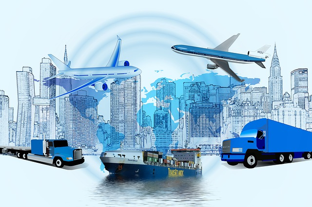
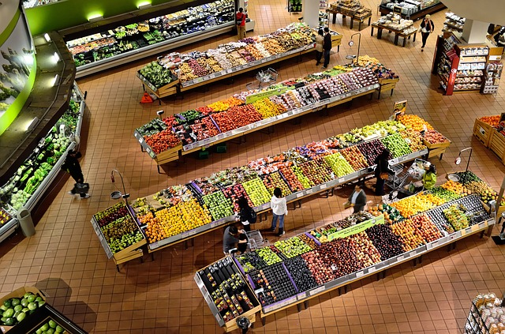

*Değişik sektörlerde Blockchain bazlı teknolojilerin açabileceği vizyon bakmaya devam edeceğiz. Ama şimdi tüm sektörlere dokunan tedarik zincirlerinde Blockchain bazlı olarak nitelendirdiğimiz dağıtık merkezli teknolojiler neler getirebilir kısaca ona bir bakalım…*

## Tedarik zinciri ne demek, Blockchain ne işe yarar burada? {#tedarik-zinciri-ne-demek-blockchain-ne-ise-yarar-burada}

Tedarik zinciri derken bu bölümün kapsamında bahsettiğimiz şu: bir şirketin müşterilerine sunacağı ürün ya da hizmeti oluşturabilmesi için gerekli alt ürünlerin ilk üreticiden itibaren izlediği zincir.

<figure markdown="1">

<figcaption markdown="span">Image by [Gerd Altmann](https://pixabay.com/users/geralt-9301/)[^1] from [Pixabay](https://pixabay.com/images/id-3125136/) [^2]</figcaption>
</figure>

Blockchain’in hayatımıza getirdiği en önemli yeniliğin ‘güvene olan ihtiyacı en aza indirmek’ olduğunu daha önce pek çok kez dile getirdik. Verdiğimiz örneklerde güvene duyulan ihtiyacı karşılayan ancak maliyeti yüksek aracılar için güzel günlerin sona ermekte olduğunu yazdık. İlk üreticiden (ki bu hammadde de olabilir) son kullanıcıya kadar pek çok aracının olduğu tedarik zincirleri de aslında buna çok açık bir örnek. Ama bunun yanında aracı olmasa bile aslında bir alıcı ile satıcı arasındaki güvene duyulan ihtiyaç yüksek. Nasıl? Bakalım:

Bir ürün üretmek için tedarikçinizden size bir mal göndermesini istiyorsunuz. Peki tedarikçi ürünü gönderdi mi? Gerçekten iddia ettiği miktarda mı gönderdi? Ürün şu an nerede? Düzgün, işe yarar durumda mı? Bana ne zaman ulaşacak?

Bütün bu sorulara net bir cevap verilememesinin yarattığı belirsizlikler, sizde

- Elinizde olduğundan fazla stok tutmak (ürün ya gelmezse?), ya da
- Kendi ürettiğiniz ürünün müşterinize zamanında ulaşmaması

gibi iki temel risk oluşturuyor. Hele bir de bu belirsizliklerin stok ömrü uzun olmayan sebze, meyve gibi ürünlerde olduğunu düşünün. Maliyetleriniz hepten artacak.

<figure markdown="1">

<figcaption markdown="span">Image by [ElasticComputeFarm](https://pixabay.com/users/ElasticComputeFarm-1865639/?utm_source=link-attribution&utm_medium=referral&utm_campaign=image&utm_content=949913)[^3] from [Pixabay](https://pixabay.com/images/id-3125136/)[^4]</figcaption>
</figure>

İyi de bunun için Blockchain’e ihtiyaç var mı? Hep söylediğimiz gibi Blockchain her derde deva olacak diye düşünmek doğru değil. Burada söz konusu olan sadece siz ve tedarikçiniz olsa haklısınız. İki taraf arasında olduğunda bir şekilde tedarikçinize dayatacağınız kurallar ile daha şeffaf bir süreç sürdürebilirsiniz. Ancak maalesef ikiniz dışında pek çok taraf var bu işlemin içinde. Taşıyıcı firma, gümrük işleri, sigorta, ithalatçı, ihracatçı… Bunların her birinin süreç içinde bir yeri ve sorumluluğu var. Alelade bir dokümanın bu firmalar arasında döndüğünü düşünün. Avrupa’dan Doğu Afrika’ya giden bir soğutucu için 30’un üzerinde kişi ve kurumdan onay ve 200’ün üzerinde bilgi alışverişi yapıldığını [biliyor muydunuz](https://www.reuters.com/article/us-maersk-blockchain-ibm/maersk-ibm-to-launch-blockchain-based-platform-for-global-trade-idUSKBN1F51DE)[^5]? Neden gerek var bu kadar iletişime? Çünkü taraflar birbirine (maalesef) güvenemiyor ve oluşan hatalar ya da sahtekarlıklar düşünüldüğünde pek de haksız sayılmazlar.

Peki bütün bu işlemlerin tüm taraflara şeffaf ve geriye dönük değiştirilemez şekilde yapıldığını ve ilgili taraflar ile paylaşıldığını düşünün bir de. Bürokrasinin ve hataların azalmasından sağlanan emek ve zaman tasarrufu hatırı sayılır olacak. Bir de buna düzensiz planlamanın getirdiği ekstra stresi ve aksamalarda oluşan müşterinize ürün ya da hizmeti zamanında verememenin getirdiği prestij kaybı ve potansiyel cezaları ekleyin. Bu iki kazanç bile yeter konuya dikkat kesilmek için.

Hemen belirtelim IBM ve Maersk bu alanda sektöre hitap edecek bir platform oluşturmak için bir [ortaklık kurdular](https://www.reuters.com/article/us-maersk-blockchain-ibm/maersk-ibm-to-launch-blockchain-based-platform-for-global-trade-idUSKBN1F51DE)[^6] ancak sektörün diğer büyükleri bu iki firma tekelindeki girişime şu anda [soğuk bakıyorlar](https://shippingwatch.com/carriers/Container/article10602520.ece)[^7].

Şeffaflık yalnızca alıcı olarak sizi ilgilendirmiyor. Yapılan işlemlerin doğruluğu ve ürünlerin uygunluğu sizin dışınızdaki dış denetçiler (özel denetim şirketleri ya da hükümetlerin yetkili mercileri) için de önemli. İşlemlerin Blockchain üzerinden şeffaf ve değiştirilemez şekilde tutuluyor olması, dış denetçiler için de büyük kolaylık. Onlar için bu daha az masraf ile çok daha geniş bir alanda işlerin doğru yürüdüğüne emin olmak anlamına geliyor.

Özellikle bozulabilir ürünlerde tedarik zincirini en başından beri takip edebilmenin bir faydası da şu: Özellikle Batı ülkelerinde bir toptancıdan gelen herhangi bir üründe bozukluk olduğunda, müşteriye sunulan bozuk ürünlerin itibara getirdiği hasardan dolayı büyük marketler bu konuda çok katılar — hiçbir risk almak istemiyorlar, sonucunda ürünün tamamı çöpe gidiyor. Halbuki ürünün ilk üreticiden itibaren takibi ve kontrolü yapılabildiğinde bozuk ürünün geldiği alanı nokta atışı belirlemek ve çok daha az ürünü yok ederek israfı engellemek mümkün.

Örneğin, geçtiğimiz yıl Kasım-Aralık aylarında ABD ve Kanada’da patlayan E.coli bakterisine bağlı hastalıklardan 60 kişinin hastanelik olup 2 kişinin ölmesinin ardından, bakterinin kaynağını belirlemek için yapılan araştırmalar hem uzun sürdü hem de çelişkili sonuçlar verdi. Kanadalı yetkililer kaynağın marul olduğunu belirtirken, ABD’li yetkililer nedeni ‘yeşil yapraklı sebzeler’ olarak açıkladı[^8]. Bu olay sonrası ABD’de marul satışları bir önceki yıla göre [%45 oranında düştü](https://www.dallasnews.com/business/retail/2018/06/21/could-blockchain-food-chains-answer-romaine-lettuce-e-coli-outbreaks)[^9]. Aylar sonra ürünün merkezinin Arizona’daki Yuma bölgesi olduğu belirlendi ama ekonomik olarak hasar çoktan gerçekleşti. Böyle bir kriz anında olaya neden olan ürünün tam menşei bölgesi hatta üretim alanı hızlıca belirlense tüketicide böyle bir panik havası yaşanmayacak ve bütün ürün satışlarına yansıyan bir düşüş olmayacaktı.

Bu olay sonrası Walmart, Güney Amerika’da küçük çiftliklerden ithal ettiği dilimlenmiş mangoların geldiği çiftliği mevcut sistemlerinin ne kadar zamanda saptayabildiği ile ilgili bir [deneme yaptı](https://www.dallasnews.com/business/retail/2018/06/21/could-blockchain-food-chains-answer-romaine-lettuce-e-coli-outbreaks)[^10] ve sonuç: 6 gün, 18 saat, 26 dakika. Eğer Blockchain bazlı bir sistem kurulu olsa bu süre saniyeler ile ölçülecekti.

İşin daha magazinsel tarafına gelirsek bir de son tüketicilerin ellerindeki ürünün hangi aşamalardan geçtiğini görebilmelerine imkân tanıması da avantajlardan biri.

Gayet tabii bu son iki örneği Blockchain olmadan da yapabilirsiniz (marketin kendi dahili kontrol mekanizmaları ile) ancak Blockchain girilen bilginin değiştirilemez olması, bağımsız denetçilerin de ürünün kalitesi ve verinin doğruluğunu rahatça kontrol edebilmeleri nedeniyle marketlerin tüketicilerine daha güvenilir bir ürün sunmasını sağlıyor.

## Madem Blockchain bu kadar avantajlı, neden kullanılmıyor hemen? {#madem-bu-kadar-avantajli-neden-kullanilmiyor-hemen}

<figure markdown="1">

<figcaption markdown="span">Image by [Gerd Altmann](https://pixabay.com/users/geralt-930187)[^11] from [Pixabay](https://pixabay.com/images/id-3348987/)[^12]</figcaption>
</figure>

Peki madem bu kadar ciddi getiriler var, neden hemen adapte etmiyor bunu oyuncular? Komik gelecek ama şu an tedarik zincirlerinde Blockchain kullanılmasının önündeki en büyük engel, aslında Blockchain’in minimize etmeye çalıştığı ana konu ile aynı: güven. Blockchain’i kullanacak ve gerekli olan bilgileri girecek olan yukarıda bahsettiğimiz onlarca taraf, kendilerinin ve diğer tarafların doğru bilgiyi gireceklerine şüphe ile bakıyorlar. Bunun yanında, kendine ait özel bir datayı başka tarafların görmesinden dolayı duyulan çekince de var. Ama bu bir süreç. Örnek çalışmalar arttıkça, kurumlar yeni teknolojiye aşina oldukça burada da adaptasyon artacak. Kanuni altyapı düzenlemeleri de önemli tabii. Sadece bir-iki büyük müşterinin dayatması ile belli tarafları Blockchain’e sokabilirsiniz ama tüm taraflar için hükümetlerin gerekli hukuki düzenlemeleri yapması sürecin hızlanmasını ve adaptasyonun artmasını sağlayacak.

Sonuç

Diğer pek çok alanda olduğu gibi burada da yeni teknolojilerin kullanılması konusunda henüz emekleme aşamasındayız. Geniş kesimler tarafından bu teknolojilerin adaptasyonu zaman alacak. Şu anda altyapılar kuruluyor, mevcut oyuncular harıl harıl üzerine kurulacak sistemler oluşturmaya çalışıyorlar. Sektörlerdeki kuşkucu (skeptik) oyuncuları ikna etmeye çalışıyorlar. Zaman alacak. Belki bir on yıl istenen vizyon gerçekleşmeyecek. O zamana kadar aldığımız ürünlerde satıcı kurum ya da kişiye güvenmeye devam…

[^1]: [https://pixabay.com/users/geralt-9301/](https://pixabay.com/users/geralt-9301/)

[^2]: [https://pixabay.com/images/id-3125136/](https://pixabay.com/images/id-3125136/)

[^3]: [https://pixabay.com/users/elasticcomputefarm-1865639/](https://pixabay.com/users/elasticcomputefarm-1865639/)

[^4]: [https://pixabay.com/images/id-3125136/](https://pixabay.com/images/id-3125136/)

[^5]: [https://www.reuters.com/article/us-maersk-blockchain-ibm/maersk-ibm-to-launch-blockchain-based-platform-for-global-trade-idUSKBN1F51DE](https://www.reuters.com/article/us-maersk-blockchain-ibm/maersk-ibm-to-launch-blockchain-based-platform-for-global-trade-idUSKBN1F51DE)

[^6]: [https://www.reuters.com/article/us-maersk-blockchain-ibm/maersk-ibm-to-launch-blockchain-based-platform-for-global-trade-idUSKBN1F51DE](https://www.reuters.com/article/us-maersk-blockchain-ibm/maersk-ibm-to-launch-blockchain-based-platform-for-global-trade-idUSKBN1F51DE)

[^7]: [https://shippingwatch.com/carriers/Container/article10602520.ece](https://shippingwatch.com/carriers/Container/article10602520.ece)

[^8]: https://newfoodeconomy.org/blockchain-food-traceability-walmart-ibm/

[^9]: [https://www.dallasnews.com/business/retail/2018/06/21/could-blockchain-food-chains-answer-romaine-lettuce-e-coli-outbreaks](https://www.dallasnews.com/business/retail/2018/06/21/could-blockchain-food-chains-answer-romaine-lettuce-e-coli-outbreaks)

[^10]: [https://www.dallasnews.com/business/retail/2018/06/21/could-blockchain-food-chains-answer-romaine-lettuce-e-coli-outbreaks](https://www.dallasnews.com/business/retail/2018/06/21/could-blockchain-food-chains-answer-romaine-lettuce-e-coli-outbreaks)

[^11]: [https://pixabay.com/users/geralt-930187](https://pixabay.com/users/geralt-930187)

[^12]: [https://pixabay.com/images/id-3348987/](https://pixabay.com/images/id-3348987/)
