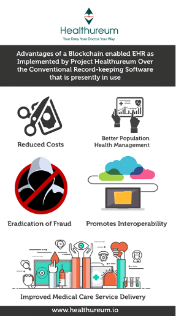

*Hasta hayatını kurtarabilecek bilginin hızlı paylaşımı ya da maliyet yaratan bürokrasinin azaltılması gibi konularda Blockchain bazlı girişimler sağlık sektörünün oyuncuları olan hasta, hastane, sigorta ve ilaç şirketlerine yeni açılımlar getirebilir.*

## Sağlık sektörünün sorunları ve sıkıntıları nerede? {#saglik-sektorunun-sorunlari-ve-sikintilari-nerede}

2015 yılı Haziran ayında “thedarkoverlord” isimli bir hacker yaklaşık [10 milyon Amerikalı’ya ait medikal veriyi](https://www.zdnet.com/article/hacker-advertising-huge-health-insurance-database/)[^1] 1 milyon ABD Dolarına yakın bir rakamdan satışa çıkardı. Hacker bu gizli medikal bilgileri dört ayrı şirketin ana bilgisayarlarından almıştı. İşte size merkezi sistemlerin en büyük dezavantajlarından biri: Verilerin bir arada tutulduğu merkezi yapılar her zaman güvenlik açığı potansiyeli taşır.

Öte yandan sağlık kurumlarının kendi özel veritabanlarını tutmaları ve hastaya ait bilgilerin kurumlar arasında paylaşımı ciddi bir sıkıntı. Sistemlerin birbiri ile konuşmaması bir yana bir şekilde iletişim sağlansa bile yaşanan gecikmeler dakikaların bile çok önemli olduğu kimi durumlarda daha ciddi sorunlara hatta ölümlere kadar giden kayıplara yol açabiliyor. Bilgi eğer hastanın kontrolünde olsa acil müdahale gerektiren kritik durumlarda hasta (ya da yakınları) o an ulaşabildikleri ilk sağlık kurumunda yetkili kişilere bu bilgilere erişime izin verebilir ve hastaya gerekli müdahaleler zamanında yapılabilir.

Hemen akla şu soru gelebilir: “Sağlık kurumları kendi aralarında anlaşsa ve bu sistemleri kursa ya? Ya da hükümetler onları zorlasa. Blockchain’e gerçekten gerek var mı?” Buna üç farklı açıdan bakarak cevap vermek mümkün:

1. Öncelikle bu tip farklı sağlık kurumlarının birbirleri ile konuşmalarını sağlamak için gerekli sistem entegrasyonu ya da iletişimi oldukça zor, karmaşık ve zaman alıcı. Üstelik çok maliyetli. Halbuki bütün hastanelerin bağlanacakları ortak bir platform olsa ve hasta kayıtlarına bu platform aracılığı ile ulaşılsa sağlık kurumları ciddi bir yatırıma girmeden sistemin nimetlerinden faydalanabilirler.
2. Tabii gecikmiş müdahalelerin hastada yol açacağı fiziki tahribat ve sonrasında bu tahribatların tedavisi için yapılacak masrafların büyüklüğü göz önüne alındığında, ortak bir platformun sigorta şirketleri için de ciddi bir tasarruf sağlayacağını öngörmek zor değil.
3. Bir de yukarıda en başta bahsettiğimiz bilginin değişik kurumlara açık olması durumunda yanlış ellere geçmesi ve güvenliğinin sağlanamaması konusu var.

## Blockchain nasıl çözümler sunabilir? {#blockchain-nasil-cozumler-sunabilir}

Özellikle sağlık alanına hitap eden kişisel bilgilerin korunması, saklanması ve güvenli şekilde paylaşılması konusunda pek çok yeni girişim var. Sadece bununla da sınırlı değil elbette girişimler, özellikle ilaç kullanımı ile ilgili tüm zinciri ilgilendiren konularda çalışanlar da var. İsterseniz sözü daha fazla uzatmadan bu girişimlerden birer cümle ile bahsedelim.

[Healthureum](https://www.healthureum.io/)[^2], Ethereum Blockchain’i kullanarak sizin medikal kayıtlarınız üzerinde tam bir sahipliğiniz olmasını sağlıyor. Yani kayıtlarınız Blockchain üzerinde şifreli olarak saklanıyor. Sizin izin verdiğiniz kuruluşlar sizin izin verdiğiniz ölçüde Healthureum platformu üzerinden bu kayıtlara ulaşabiliyorlar.

<figure markdown="1">

<figcaption markdown="span">Healthureum sistemi nasıl çalışıyor? (Kaynak: [Healthureum](https://healthureum.wordpress.com/2018/01/24/advantages-of-a-blockchain-enabled-ehr-as-implemented-by-project-healthureum-over-the-conventional-record-keeping-software-that-is-presently-in-use-2/)[^3])</figcaption>
</figure>

[Tierion](https://tierion.com/)[^4] da benzer şekilde hasta verilerinin sağlıklı bir şekilde kayıt edilmesi ve kayıtlarının tutarlılığı (değiştirilemezliği) konusunda çalışıyor ve Philips Blockchain Labs[^5] ile iş birliği içinde. Keza MIT altındaki Media Lab merkezinden çıkma girişimlerden [MedRec](http://medrec.io/)[^6] de hastaların verilerini kendi kontrolleri altında izin verdikleri kurumlarla kolayca paylaşabilmesine yoğunlaşmış. Bir başka girişim [Factom](https://www.factom.com/)[^7] ise Blockchain altyapısını kullanarak küresel ama özellikle sağlık hizmetlerine erişimin zor olduğu bölgelerde yaşayanların sağlık datalarının dağıtık bir yapıda (Blockchain üzerinde) tutulması ve biyometrik doğrulama ile erişimi konusunda uzmanlaşmış ve 2016 yılında Bill & Melinda Gates Foundation’dan [yatırım almış](https://www.gatesfoundation.org/How-We-Work/Quick-Links/Grants-Database/Grants/2016/11/OPP1159449)[^8].

[ScalaMed](https://www.scalamed.com/)[^9] ilaçlar ve reçeteler üzerinde yapılan sahteciliği önlemek amacıyla ilaç üreticileri, dağıtıcılar, hastaneler ve eczane zincirlerini bir araya getiren ve ilaçların kayıt, teyit ve transferinin güvenli, kaçağa yol açmayacak şekilde yapılmasını sağlayacak Blockchain altyapılı bir sistem üzerinde çalışıyor. Bu alanda çalışan diğer bir girişim olan [MediLedger](https://www.mediledger.com/)[^10] ise Genentech ve Pfizer’i içine alan bir pilot çalışma ile benzer şekilde ilaçların üreticiden hastaya ulaşımındaki kaçakları önlemek için Blockchain bazlı çözümlere kafa yoruyor.

Sonuç

Önceki bölümlerimizde de belirttiğimiz gibi, Blockchain tabanlı sistemler henüz emekleme aşamasında. Sağlık alanındaki girişimlerde odak daha çok kişisel bilgilerin korunmasına yoğunlaşmış durumda ve geçmişte yaşanan olaylardan dolayı bu gayet anlaşılır. Ancak hasta hayatını kurtarabilecek bilginin hızlı paylaşımı ve maliyetleri artıran bürokrasinin azaltılması gibi konularda da Blockchain bazlı girişimler sektöre yeni açılımlar getirebilir.

Özellikle sağlık alanında veri paylaşımında herhangi bir standart henüz oturmuş değil ve yukarıdaki örneklerde de gördüğünüz gibi bu alanda dominant oyuncu olmaya aday çok sayıda girişim var. Sağlık, ilaç ve sigorta sektörleri teknolojik yenilikleri yakından takip etseler de organizasyonel değişiklik getirebilecek değişim ve yeniliklerde genelde tutucu davranırlar. Dolayısıyla, özellikle tüm kurumların kullanabileceği ortak bir platforma geçiş konusuna da son derece ihtiyatlı yaklaşacaklarını hatta zorlansalar bile ayak direyeceklerini görmek sürpriz olmaz. Bakalım, Blockchain sağlık alanındaki yaşanan kimi dertlere bir şekilde deva olabilecek mi?

[^1]: [https://www.zdnet.com/article/hacker-advertising-huge-health-insurance-database/](https://www.zdnet.com/article/hacker-advertising-huge-health-insurance-database/)

[^2]: [https://www.healthureum.io/](https://www.healthureum.io/)

[^3]: [https://healthureum.wordpress.com/2018/01/24/advantages-of-a-blockchain-enabled-ehr-as-implemented-by-project-healthureum-over-the-conventional-record-keeping-software-that-is-presently-in-use-2/](https://healthureum.wordpress.com/2018/01/24/advantages-of-a-blockchain-enabled-ehr-as-implemented-by-project-healthureum-over-the-conventional-record-keeping-software-that-is-presently-in-use-2/)

[^4]: [https://tierion.com/](https://tierion.com/)

[^5]: http://www.2.forms.healthcare.philips.com/blockchainlabs

[^6]: [http://medrec.io/](http://medrec.io/)

[^7]: [https://www.factom.com/](https://www.factom.com/)

[^8]: [https://www.gatesfoundation.org/How-We-Work/Quick-Links/Grants-Database/Grants/2016/11/OPP1159449](https://www.gatesfoundation.org/How-We-Work/Quick-Links/Grants-Database/Grants/2016/11/OPP1159449)

[^9]: [https://www.scalamed.com/](https://www.scalamed.com/)

[^10]: [https://www.mediledger.com/](https://www.mediledger.com/)
