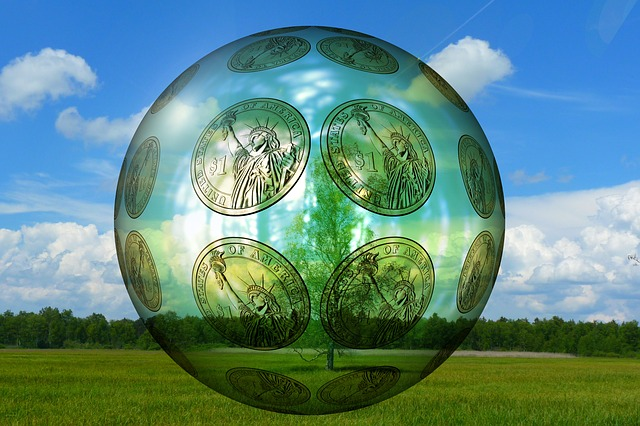
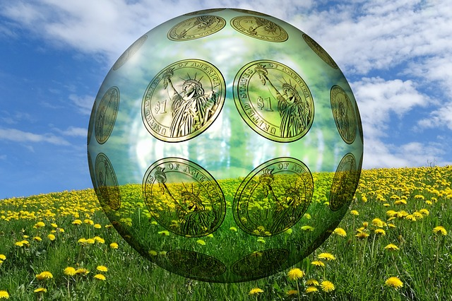

*Çevre Blockchain temelli fikirleri hayata geçirmede en mantıklı alanlardan biri. Neden?*

## Blockchain çevre için neden önemli? {#blockchain-cevre-icin-neden-onemli}

İçinde yaşadığımız dünyayı ciddi şekilde kirlettiğimiz ve kaynakları geri döndürülemez biçimde yok ettiğimizin artık belgeli hale gelmesi, hükümetlerin sorunu çözmeye yönelik ortak çabalarına 1990’lardan beri giderek artan bir hız kazandırdı. Bu çabaların sonuçlarını ise yeni yeni görmeye de başlıyoruz.

<figure markdown="1">

<figcaption markdown="span">Image by [Gerd Altmann](https://pixabay.com/users/geralt-9301)[^1] from [Pixabay](https://pixabay.com/images/id-886797/)[^2]</figcaption>
</figure>

Örneğin 90’lı yıllarda artan CFC (kloroflorokarbon) gazı nedeniyle yaklaşık %10 seviyesinde incelen ozon tabakası bu gazın kullanımına yönelik alınan tedbirler sonucu 2000 senesinden itibaren her on yılda %3 oranında kalınlık artışı göstermeye [başladı](https://news.un.org/en/story/2018/11/1024842)[^3]. Harika haber. Yeterli mi? Hayır. Bu daha bir başlangıç ve üstelik şu anda Çin dahil kimi ülkelerin hala ürettikleri kimi kimyasallar ile ozon tabakası için bir tehdit olduğu [iddia ediliyor](https://www.bbc.com/news/newsbeat-46107843)[^4].

Çevre sorunlarının hükümetler tarafından koordine edilerek ele alınması doğru bir yöntem. Ancak sistemin karışıklığı, oyuncuların farklı çıkar ilişkileri, çevre konusunda yapılan yatırımların yüksek maliyetinden dolayı daha alınması gereken çok yol var. Zira, herhangi bir konuda öncelikle hükümetler anlaşmalı, sonrasında bu anlaşmalara uygun gerekli denetim ve ölçüm/bildirim mekanizmaları kurulmalı, en sonunda da özel sektör ve kamu oyuncuları bu kurallara uygun davranıp aksiyonlarının sonuçlarını ölçmeli ve ilgili otoritelere bildirmeli. Oldukça yavaş işleyen bir mekanizma bu. Bu yavaşlık önümüzdeki nesillere miras olarak tamir edilemez hasarlara uğramış bir gezegen bırakmamıza yol açabilir.

90’ların başından beri yapılan müzakereler sonucu pek çok alanda hükümetler arası anlaşmalar yapıldı ve ülkelerin önüne özellikle çevre kirliliğini azaltma yolunda ödül/ceza sistemleri ve hedefler konuldu. Ölçümlemeler de uzun süredir yapılıyor. Bu ölçümler sonucu özellikle sera gazında önlenen hasarlar ile ilgili ödül kazanan firmalar bu ödüllerini çevreye zarar veren firmalara satarak çevre ile dost yatırımlarını daha kârlı hale getiriyor. Yani yavaş yavaş çark dönmeye başladı.

Ancak henüz daha yolun başındayız. Sistemin doğru işlemesi için daha yapılacak daha birçok iyileştirme var. Ve burada Blockchain bazlı teknolojiler bize yardımcı olabilir. Konuyu sadece mevcut sistemin iyileşmesi olarak düşünmemek lazım. Sıfırdan yepyeni sistemler de kurulabilir. Bu alanda alınabilecek o kadar o kadar aksiyon var ki. Örneğin World Economic Forum çevre alanında uygulanabilecek 65 farklı fikir/girişim içeren bir [rapor bile hazırladı](https://www.weforum.org/reports/building-block-chain-for-a-better-planet)[^5]. (raporun [pdf versiyonu da mevcut](http://www3.weforum.org/docs/WEF_Building-Blockchains.pdf)[^6]). Bölümün kalanında bu raporun içeriğine bakacağız.

<figure markdown="1">

<figcaption markdown="span">Image by [Gerd Altmann](https://pixabay.com/users/geralt-9301/)[^7] from [Pixabay](https://pixabay.com/images/id-886796/)[^8]</figcaption>
</figure>

## Blockchain nerede işe yarayabilir? {#blockchain-nerede-ise-yarayabilir}

PwC ve Stanford Woods Institute ile birlikte hazırlanan bu [rapor](https://www.weforum.org/reports/building-block-chain-for-a-better-planet)[^9], özellikle iklim değişikliği, doğal çeşitliliğin kaybı ve su arzının kısıtlılığı gibi çevresel problemlerde Blockchain nasıl uygulanabilir konusuna odaklanıyor. Doğru kurgulandığında Blockchain teknolojisinin daha temiz, kaynakları daha doğru kullanan merkeziyetsiz çözümler sunup bu sayede doğal sermayeyi açığa çıkarma ve toplumları güçlendirme potansiyeli olduğundan bahsediliyor.

Bu arada bu sütunlarda daha önce dile getirilen iki konuya burada da dikkat çekiliyor. Birincisi yeni teknolojilerin, mevcut geleneksel ekonomik sistemleri değiştirirken (hatta ters-yüz ederken) yaratılan değeri sadece sermayedarlara değil tüm paydaşlara dağıtma gücü. İkincisi ise bu tip büyük değişimlerin kendiliğinden bir anda olmayacağı. Değişimin gerçekleşebilmesi için teknoloji sağlayıcılardan politika üreten kurumlara kadar farklı her bir paydaşın birlikte çalışma kabiliyeti kazanması gerek. Sadece teknolojik olarak bir platformun uygulanması yeterli değil, sistemlerin de değişmesi gerek bu değişimin kalıcı olması için.

## Çevresel sorunlar neler? {#cevresel-sorunlar-neler}

Dünyada şu anda çevresel olarak sıkıntı yaratan konuları sıralarsak:

- İklim değişikliği: Şu anda sera gazı 3 milyon yılın en yüksek seviyesinde. 2100 yılında sadece Avrupa’da yılda 150.000 kişinin aşırı sıcaktan ölmesi bekleniyor.
- Doğal çeşitliliğin azalması: Mevcut canlı türlerinin beşte biri yok olma tehlikesinde ve yüzyılın sonunda bu oran %50 seviyelerine çıkacak. Amazonlardaki ağaç kesimi 2050 yılında bölgedeki yağış oranını %8 oranında azaltacak ve tüm dünya ekolojik olarak bu durumdan etkilenecek.
- Sağlıklı okyanuslar: Gerek plastik atıklar gerekse okyanusların sera gazını soğurması (absorbe etmesi) sebebiyle okyanuslarda asit oranı ve sıcaklık artışı hem balık sayı ve çeşidini hem de deniz altı zenginliklerini ciddi şekilde azaltacak.
- Temiz suya erişim: Yılda %1 oranında artan temiz su ihtiyacı şu anda 1,9 milyar insan için bir eksiklik ve 2050 yılında bu rakamın 3 milyara çıkması bekleniyor.
- Temiz hava: İnsanların %91’i Dünya Sağlık Örgütü’nün belirlediği değerden daha kötü hava koşullarına sahip bölgelerde yaşıyor. Yılda 7 milyon insan hava kirliliğinden dolayı yaşamını yitiriyor.
- Doğal felaketler: 2017 yılında 710 felaket yaşandı. Bu 1980 yılının tam üç katı. Toplam 330 Milyar ABD Doları hasar meydana geldi ve 23 milyon insan bu felaketler sonucu yer değiştirdi.

## Blockchain çevre için hangi alanlarda faydalı olur? {#blockchain-cevre-icin-hangi-alanlarda-faydali-olur}

İşte Blockchain bazlı sistemler bu alanlarda ciddi iyileştirmeler sağlayabilir. Neden Blockchain? Çünkü çok fazla oyuncu var. Bu oyuncular arasında tam olmasa da bir güvensizlik var (ve yaşanan pek çok felaketin ihmal ve daha korkuncu gizlemeden dolayı olduğu biliniyor). Denetim/ölçüm mekanizmaları henüz yeterli değil ve kurulması zaman alacak. Blockchain bazlı yenilikler piyasa oyuncuların maliyetlerini azaltabilir, yatırımların tamamlanma süresini kısaltabilir ve koruyucu kurumlara denetimde kolaylıklar sağlayabilir. Özellikle Blockchain teknolojilerinin zaman damgası özelliği ve akıllı kontratların işletileceği mekanizmalar verimli çalışan bir sistem kurulmasına yardımcı olabilir.

<figure markdown="1">

<figcaption markdown="span">Image by [Alexander Antropov](https://pixabay.com/users/AlexAntropov86-2691829/)[^10] from [Pixabay](https://pixabay.com/images/id-3096675/)[^11]</figcaption>
</figure>

## Mevcut durumu iyileştirmeye yönelik Blockchain bazlı girişimler var mı? {#mevcut-durumu-iyilestirmeye-yonelik-girisimler-var-mi}

Rapor mevcut durumu iyileştirmek amacı güden blockchain bazlı girişimleri şu şekilde grupluyor:

- Daha temiz ve verimli, merkezi olmayan sistemlere geçişi sağlayanlar
- Kaynak ya da ruhsatların kişiden-kişiye (Peer-to-peer — P2P) ticareti
- Tedarik zinciri yönetimi ve şeffaflık
- Çevresel sonuçları değerlendirecek finansal modellemeler
- Doğal sermayenin ve finansal olmayan değerlerin ortaya çıkarılması

Bu girişimler daha çok süreci iyileştirmeye yarayacak getirileri nispeten marjinal fikirler. Bunların üzerinde fazla durmadan vizyon açan başka fikirler de var. Dilerseniz hemen onlara bakalım.

## Peki ya ezber bozan Blockchain girişimleri? {#peki-ya-ezber-bozan-girisimler}

Mevcut sistemleri iyileştirmek dışında ezber bozan girişimler de var. Ne demek bu? Mevcut iş yapış biçimlerini değiştirecek, reform yapacak girişimler. Bunu yaparken de bir yandan endüstriyel alandaki son yıllarda yaşanan yenilikleri de içine alacak biraz da onlar sayesinde vizyonlarına ulaşacak fikirler (Ancak hemen hatırlatalım, bu fikirlerin pek çoğu daha test aşamasında — henüz yaygın adapte edilecek kadar olgun değiller)

Şeffaf tedarik zinciri:

Pek çok kurum çevresel olarak hükümetlere ve topluma karşı taahhütlerde bulunuyor. Ancak şirketler ne kadar samimi olsalar da bu taahhütlerin ne şekilde yerine getirildiği ile ilgili bir açıklık yok — özellikle tedarik zincirlerinde. Kaynaktan son kullanıcıya değiştirilemez ve şeffaf şekilde tutulan Blockchain verisi şirketlere hem riski algılamak ve kendi iç sistemlerini yönetmek hem de dış dünyaya aldıkları bu aksiyonları gösterebilmek açısından yardımcı olabilir. Şirketlere faydasının yanında son tüketici, sivil toplum kuruluşu ve hükümet gibi dış paydaşlara da bu eforu görme, takip ve takdir etme imkânı verebilir.

Merkezi olmayan ve sürdürülebilir kaynak yönetimi:

Mevcut merkezi elektrik-su-doğalgaz hizmet sağlayıcıların arz-talep dengesini sağlayamama, dağıtımda kaçakları önleyememe, tekil arıza noktası olma gibi sorunları var. Evlere yerleştirilecek akıllı alıcı (sensör) gibi endüstriyel yenilikleri kullanacak platformlar son kullanıcıların bu alanda yeni kapılar açıyor. Nasıl? Kullanım bilgisi ve alışkanlıklar konusunda onları daha bilgili ve donanımlı hale getiriyor ve merkezi olmayan yapıları kullanma konusunda ellerini güçlendiriyor. Hangi alanlarda? Kişiden kişiye ticaretten tutun, dinamik fiyatlama yapmaya, arz-talep dengesi içinde kendilerine en optimal hizmet sağlayıcıyı bulmaya kadar. Şu an için çok ütopik gelmekle birlikte bu konuda Brooklyn MicroGrid Project[^12] isimli bir projenin New York’ta başlatıldığını hatırlatalım.

Sürdürülebilir finans için kaynak sağlama:

Birleşmiş Milletlerin belirlemiş olduğu [Sürdürülebilir Gelişim Hedefleri](https://www.un.org/sustainabledevelopment/sustainable-development-goals/)[^13]’nin gerçekleştirilebilmesi için gerekli kaynaklar anlamında yıllık 5–7 Trilyon ABD Doları yatırım açığı var ve bunun 2,5 Trilyon ABD Dolarlık kısmı gelişmekte olan ülkelerde. Bu boşa harcanan bir para da değil bu arada. Bu alanda yapılacak yatırımlardan ciddi bir geri dönüş sağlanabilir — yani oldukça kârlı yatırımlar ve bu alana yatırım yapmak isteyenler de var. Ancak veri eksikliğinden tutun, finansal karmaşıklığa pek çok sorun nedeniyle yatırımcılar ile ihtiyaç sahipleri bir türlü bir araya gelemiyor. Geldiği durumda başarı hikayeleri de ortaya çıkmıyor değil:

Sun Exchange isimli Afrika bazlı bir proje, evlere ücretsiz güneş enerjisi modülleri takma karşılığında ev sahiplerinin elektrik faturası yerine tasarruf ettikleri paranın bir kısmını kira olarak ödemesi şeklinde bir model geliştirmiş. Kira olarak ödenen rakam, kullanım bazlı olarak sensörler aracılığıyla bu firmaya gönderiliyor. Eğer evde oturanlar kirayı ödemez ise yine sensörler aracılığıyla hizmet kesiliyor. Hatta bu sistemi Afrika dışında Filipinler’de kurma gibi bir girişimleri de olmuş ancak yabancı para cinsinden para tahsil ve transfer etmede sıkıntı yaşıyorlar. Bu sorunu çözebilmek için Filipinler’de kripto para kullanımının yaygınlaşmasını beklemek zorundalar:)

Döngüsel ekonomileri teşvik:

Geri dönüştürülebilecek pek çok ürün yeterli teşvik mekanizmaları olmadığı için çöp haline geliyor. 2050 yılında okyanuslarda balıktan çok plastik atık olacağı tahmin ediliyor. Bu konuda örneğin plastik atıkları geri dönüşüme sokanlara kripto para veren birkaç girişim mevcut. Bu kripto paraları sonrasında yiyecek, su gibi ihtiyaçlar için kullanabiliyorsunuz. Ne kadar başarılı olur tartışılır. Ama daha ilginç projeler de var: Ormanların yok edilmesine karşı, GainForest isimli girişim çiftçilere ilginç bir finansal teşvik sağlıyor. Ormanlara yerleştirilen uydu sistemleri ile ağaç kesimleri takip edilebiliyor. Ağaçların bulunduğu alanında herhangi bir değişim olmaması durumunda akıllı kontratlar devreye giriyor ve çiftçilerin hesabına belli miktar para yatıyor.

Karbon emisyon pazarlarını değiştirmek:

Karbon emisyon ticaretinin başladığı ilk günlerden bu yana işlemlerin görünür ve izlenebilir olmaması, değişik ülkelerde uygulanan farklı standartlar ve kanunlar ile çifte harcama (double counting) gibi konular bu ticaretin verimliliği konusunda hep şüphe uyandırdı. Bu sorunları gidermeye yönelik IBM ile Energy Blockchain Labs’in ortaklaşa gerçekleştirdiği “Çin’de Karbon Kredi Yönetim Programı” başarılı olursa tüm dünyaya yayılmayı planlıyor[^14].

Yeni nesil sürdürülebilirlik izleme ve raporlama sistemleri:

Tedarik zincirine benzer şekilde tüm dünyada önde gelen kurumların sürdürülebilirlik bazında iş modellerini revize etmekle ilgili ciddi taahhütleri var ancak sarf edilen eforu tam layıkıyla gösterebilecekleri mekanizmalar az. Blockchain bazlı sistemler şirketlere kendilerini daha iyi ifade etme imkânı verirken, son kullanıcılara da bu şirketlerin performansını değerlendirme ve tüketim tercihlerini daha doğru yapabilme imkânı veriyor.

## Bu çözümlerin önündeki engeller neler? {#bu-cozumlerin-onundeki-engeller-neler}

Yukarıda fikirlerin çoğu henüz ham, daha olgunlaşmamış. Gerçekleşmelerinin önünde engeller de var. Nedir bu engeller?

Öncelikle, bahsettiğimiz değişiklerin birçoğu tüketici alışkanlıklarında bir değişim gerektiriyor. Ekonomik menfaatler bu tip değişimleri hızlandırsa da kimi projeler pratik olmayabilir ve bu nedenle de yaygınlaşmayabilir.

Bunun yanında, bu sistemlerin destek olacak endüstriyel değişimler yeterince hızlı gelişmeyebilir ya da yenilikler Blockchain sistemleri ile uyumlu olmayabilir.

[Tedarik zincirleri için Blockchain](/Sorularla_Blockchain/bolum-2/tedarik-zinciri/) bölümümüzde belirttiğimiz gibi, çok partinin taraf olduğu sistemlerde oyunculardan bir kısmı hassas bilgileri diğerleri ile paylaşmak istemeyebilir.

Bunun dışında her ülkede kanunların farklı olması özellikle uluslararası nitelikteki projelerde adaptasyon ve canlılığa ket vuracak sıkıntılar doğurabilir.

Teknolojik olarak ise pek çok alanda değişik oyuncular tarafından geliştirilecek farklı Blockchain sistemlerinin birbirleri ile iletişiminin sıkıntı yaratabilir ancak yukarıdaki kültürel ya da kanuni sorunlara göre teknolojik sıkıntıların çok daha kolay şekilde aşılabileceğini düşünüyorum.

Sonuç

Evet, gördüğünüz gibi, kendi içinde bulunduğumuz ülkemiz ve küçük dünyamızı aşıp uluslararası alana baktığımızda, sınır ötesi işlemlerde Blockchain bazlı sistemlerin aracıları ortadan kaldıran yapısının hemen hemen her alanda gerek çevresel kazanç olarak gerekse finansal anlamda sağlayacağı faydalar olduğu çok açık. Ulusal yapılar ve politik çıkarlar Blockchain ile ortaya çıkabilecek bu faydaları deneyimlememize ne kadar izin verecek bunu hep birlikte yaşayarak göreceğiz.

[^1]: [https://pixabay.com/users/geralt-9301](https://pixabay.com/users/geralt-9301)

[^2]: [https://pixabay.com/images/id-886797/](https://pixabay.com/images/id-886797/)

[^3]: [https://news.un.org/en/story/2018/11/1024842](https://news.un.org/en/story/2018/11/1024842)

[^4]: [https://www.bbc.com/news/newsbeat-46107843](https://www.bbc.com/news/newsbeat-46107843)

[^5]: [https://www.weforum.org/reports/building-block-chain-for-a-better-planet](https://www.weforum.org/reports/building-block-chain-for-a-better-planet)

[^6]: [http://www3.weforum.org/docs/WEF\_Building-Blockchains.pdf](http://www3.weforum.org/docs/WEF_Building-Blockchains.pdf)

[^7]: [https://pixabay.com/users/geralt-9301/](https://pixabay.com/users/geralt-9301/)

[^8]: [https://pixabay.com/images/id-886796/](https://pixabay.com/images/id-886796/)

[^9]: [https://www.weforum.org/reports/building-block-chain-for-a-better-planet](https://www.weforum.org/reports/building-block-chain-for-a-better-planet)

[^10]: [https://pixabay.com/users/AlexAntropov86-2691829/](https://pixabay.com/users/AlexAntropov86-2691829/)

[^11]: [https://pixabay.com/images/id-3096675/](https://pixabay.com/images/id-3096675/)

[^12]: https://www.brooklyn.energy/

[^13]: [https://www.un.org/sustainabledevelopment/sustainable-development-goals/](https://www.un.org/sustainabledevelopment/sustainable-development-goals/)

[^14]: https://www.ibm.com/case-studies/energy-blockchain-labs-inc
