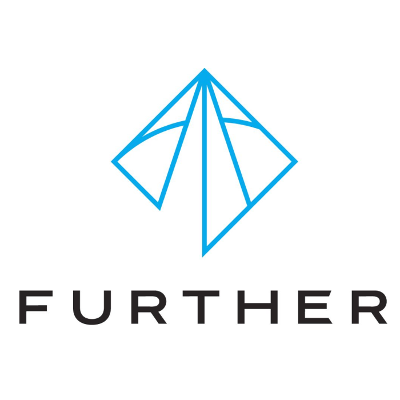
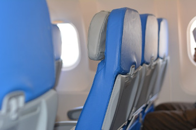

*Blockchain bize daha rahat, esnek ve ekonomik seyahatler sağlayabilir. Nasıl mı?*

<figure markdown="1">

<figcaption markdown="span">Image by [TheAndrasBarta](https://pixabay.com/users/TheAndrasBarta-2004841/)[^1] from [Pixabay](https://pixabay.com/images/id-1264062/)[^2]</figcaption>
</figure>

Dünyada en dağınık sektörlerden biri seyahat sektörü. Son kullanıcı olarak bizler bu dağınık yapının çok az bir kısmını görüyoruz. Bizim için acente ya da web üzerinden bir bilet almaktan ibaret gibi. Ama perde arkasında pek çok hizmet sağlayıcı bize bu hizmeti vermek için bir araya geliyor. Bileti ayarlayan acente, uçuşu sağlayan havayolu, bağlantı uçuşu varsa diğer uçuşu sağlayan havayolu. Bu işin sadece uçuş kısmı — bir de buna ekstra hizmetler (otel, kiralık araba vb.) eklerseniz iyice karmaşıklaşıyor.

Bunun ötesinde belki İstanbul’dan ya da Londra’dan New York’a uçmak nispeten zahmetsiz. Ama gelin bir de İstanbul’dan Tayland’daki Chang Rai’ye gitmeye kalkın. Mevcut ana havayollarının dışında nispeten az bilinen ve lokal uçuşlar yapan havayollarına binmeye kalkın.

## Seyahat sisteminin sorunları neler? {#seyahat-sisteminin-sorunlari-neler}

Acenteler, havayolları, oteller her biri kendine özgü sistemler kullanan silolar. Başlangıçta kağıdın olduğu bir dünya üzerine kurulan bu sistemler, zamanla teknoloji gelişip de herşey elektronik olunca afallayıp kalıyorlar. Bu sistemlerden çıkan bilgiler standart değil, çoğu zaman da eksik ya da yanlış bilgi veriyor. Paylaşılan bilgi doğru olduğunda ve sistemler mutabık kaldığında yolcular için her şey yolunda gidiyor ama istisnalar (iptaller, gecikmeler) olduğunda sorunlar zincirleme şekilde tüm sistemi etkiliyor (müşteriler tarafından yapılan itirazların oranının %5'i bulduğu havayolu şirketleri bile var). Malum, konu seyahat olduğunda bu tip sorunlar da eksik olmadığı için, tüm sektör aslında istisnalardan oluşan sorun yumağını çözmek için ciddi zaman, emek ve para harcıyor.

Sistemlerin birbirinden bağımsız olması nedeniyle oyuncular arasındaki ilişkiler de karmaşık. Bir havayolu bir uçağı uçuşa açtığında sistemlerinde bir ürün yaratıyor. Acentelere bu ürünü satmak için imkân verdiğinde aslında bir nevi acentelere bir tür kredi açmış oluyor. İşte bu kredi nedeniyle acenteler, üye olan havayolları için havayolları birliği olan IATA’ya, üye olmayanlar havayollarının her birine ayrı ayrı kapora ödemesinde bulunmak zorundalar. Ayrıca acenteler ile havayolları arasındaki bu bilet satışının ödemesi için günlerce süren uzun ve yüksek komisyonların ödendiği bir hesaplaşma süreci var. Şöyle söyleyelim: sadece IATA hesaplaşma sistemi yılda 400 milyar ABD Doları işlem yapıyor ve sırf bu işlemler için bankalara 7,7 milyar ABD Doları [komisyon ödeniyor](http://airlines.iata.org/blog/2017/09/blockchain-can-rebalance-the-value-chain-to-benefit-airlines-and-passengers)[^3].

## Blockchain bu sorunları çözmek için neler getirebilir? {#blockchain-bu-sorunlari-cozmek-icin-neler-getirebilir}

Yukarıda yazdığımız sorunların temel nedeni eski birbirinden bağımsız sistemlerin yarattığı veri eksikliği/yanlışlığı ve sistemlerin birbiri ile konuşmaması. Eğer tüm servis sağlayıcılar bir araya gelip bir standart oluşturulabilir ve herkes sistemlerini buna göre güncelleyebilse bunca sorunu çözmek mümkün olabilir. Ama başka öncelikler (gelir artırma gibi), sistem güncellemenin yüksek maliyeti, tüm kurumları bir araya getirecek bir ortak/merkezi irade olmayışı gibi nedenlerle bu çok mümkün görünmüyor.

Blockchain için her zaman söylediğimiz, belli bir merkezi otoritenin varlık nedeni olan güven ihtiyacını minimuma indirebilmesi. Burada da Blockchain herhangi bir partinin güdümünde olmayan ve tüm partilerin güvenle bağlanabilecekleri bağımsız bir platform olarak taraflar arasındaki bilgi paylaşımı ve para ödemelerini rahatlıkla gerçekleştirebilir.

## Sorun çözme yanında yeni fırsatlar da yaratılabilir mi? Örnek: Further Network {#sorun-cozme-yaninda-yeni-firsatlar-da-yaratilabilir-mi-ornek-further-network}

2016 yılında Türkiye’de kurulan [Further Network](https://further.network/)[^4] Blockchain’in olanaklarını kullanarak yukarıda yazdığımız sorunlara çözüm üretmeyi, özellikle yüksek işlem maliyetlerini minimuma indirmeyi hedefliyor. Ancak vizyonları bununla sınırlı değil.

<figure markdown="1">

<figcaption markdown="span">Kaynak: [Further Network](https://further.network/)[^5]</figcaption>
</figure>

Son kullanıcılar için büyük kolaylıklar getirmeyi planlıyorlar. Bunlardan biri uçuş biletini basit bir kâğıt parçasından daha akıllı hale sokmak. Daha önce bahsettiğimiz Akıllı Kontrat haline getirmek. Ne demek bu? Normalde aldığınız bilet size ait bilgiler, uçuşunuzun detayı ve kaç para ödediğinizi yazar. Buna daha başka detaylar eklemek istemez misiniz? Örneğin vejetaryen menü istediğiniz, seyahatte size özel TV programlarının (mesela sadece romantik komedileri) sunulmasını, koltuk arası genişliğinin belli bir cm’den fazla olmasını? Bu ve benzeri bilgileri kendi dijital kimliğinizde paylaşabilir ve dilediğiniz partiye dilediğiniz kadar bilgiyi verebilirsiniz (havayoluna başka, otele başka).

<figure markdown="1">

<figcaption markdown="span">Geniş koltuk aralığı için ekstra ücret öder misiniz? (Image by [Stela Di](https://pixabay.com/users/StelaDi-563699/)[^6] from [Pixabay](https://pixabay.com/images/id-519002/)[^7])</figcaption>
</figure>

Bir başka kolaylık da uçuşları daha değiştirilebilir hale getirmek. Birkaç uçuştan oluşan bir biletini uçuşlarından birini otomatik değiştirmek, uçuşu (ya da bir ayağını) bir başkasına devredebilmek gibi.

Otellere de bakalım: Seyahat acenteleri bir şehirdeki konaklama olanaklarını (otel hatta evleri bile) akıllı bilet haline getirebilirler. Siz de herhangi bir şehirdeki bir fuara gitmeden önce dijital kimliğinizden istediğiniz bilgileri paylaşarak istediğiniz konaklamayı alabilirsiniz. Bunu ödemek için de istediğiniz para cinsini ya da kripto parayı kullanabilirsiniz.

Ödeme demişken, son kullanıcı olarak ödediğimiz bu parayı, Akıllı Kontratımız havayolu, seyahat acentesi ve diğer servis verenler arasında otomatik olarak bölüştürecek, arka plandaki pek çok pürüz yok olacak.

Further Network, yukarıdaki sistemin çalışabilmesi için bir de kendi Token’ı olan Aton’u çıkarıyor. Daha önceki “Değişen Dünyada Girişimcilik” bölümümüzde Token Dünyası’nın nasıl çalıştığından bahsetmiştik. Further Network de sadece bir şirket değil bir ekosistem yaratıyor ve hisse senedi çıkarmak yerine Aton’u çıkararak gerek kendisini fonluyor gerekse de sistemin çalışması için gerekli enerjiyi sağlıyor. Örneğin Blockchain içindeki oyuncuların yeni işlem (örneğin Akıllı Bilet) yaratmak için Aton’a ihtiyacı olacak. Ya da sistem içindeki tüm işlemleri Aton üzerinde tutarak, sistem kullanıcılarına dünyadaki mevcut paralardaki kur değişimlerinden bağımsız bir bakiye ölçme aracı sunacak. Bunun yanında taraflar arasında ödeme için Aton kullanılması durumunda eskiden günlerce süren klasik paralar ile ödeme işlemlerinin anında yapılması sağlanacak. Böyle bir sistemin benimsenmesi durumunda, işlemler anlık olacağı için eskiden olduğu gibi acentelerin IATA ya da havayollarından işlem yapması için gerekli olan yüksek kapora ödemlerine de gerek kalmayacak.

## Başka ne tip girişimler var? {#baska-ne-tip-girisimler-var}

Ülkemizden çıkan en prestijli yeni nesil sistemlerden olan Further Network bu alanda rakipsiz değil. İsviçre/Çekya merkezli havayolu taşımacılığını benzer şekilde sarsmayı planlayan [Winding Tree](https://windingtree.com/)[^8], keza benzer şekilde çalışan Finlandiya merkezli [ETH Travel](https://ethtravel.io/)[^9], Çin merkezli otel rezervasyonları üzerine uzmanlaşmış [Tripio](http://trip.io/)[^10] bu alanda pay almak için çabalayan yüzlerce yeni nesil girişimlerden sadece birkaçı. Sistemin mevcut oyuncuları da elleri kolları bağlı oturmuyor tabii — örneğin IATA mevcut süreçlerini basitleştirmek için [pek çok proje](http://www.iata.org/whatwedo/stb/Pages/index.aspx)[^11] deniyor ama bu hantallık ile ne kadar yol alacakları gerçekten meçhul.

Sonuç

Karmaşık ve eskimiş sistemler nedeniyle şu an yalpalamakta olan seyahat sektöründe önümüzdeki on yıl içinde büyük değişimler olması kaçınılmaz. Bu değişimler biz son kullanıcılara daha fazla konfor getirecek. Klişe olacak ama hizmet verenler ise bu değişime ayak uydurdukça sağ kalacaklar — Uyduramayanlar ise hak ettikleri değeri görüp iş hayatının tarihinde kalacaklar. Ülkemizden çıkan ve global bir oyuncu olmayı hedefleyen Further Network ise yeni nesil teknolojileri kullanarak doğacak fırsatlardan pay almak için oldukça avantajlı bir konumda — dileriz doğru ortaklıklar ile bu alanın önde gelen oyuncularından biri olurlar

Dipnot: Uçuş işleminin parçaları\*

Seyahat sisteminin oyuncuları 40 yıl tasarlanmış sistemler ile günümüzün hızlı dünyasına ayak uydurmaya çalışıyorlar. Bu ne yazık ki çok mümkün değil. Sistem değiştirmek hem pahalı hem de 7/24 devam ettiği için riskli. Elektronik bilete geçmek bile 15 yılı buldu.

Bir uçuş ve konaklama işlemini üç parçaya ayırmak mümkün:

- Uçuş (ya da konaklama) verisinin ve rezervasyonların sisteme ve son kullanıcıya iletilmesi. Bunu uçuşlar için Sabre, Amadeus, konaklama için Hotelspro ve HotelBeds sağlıyor
- Sistem kullanıcıları arasında bir uçak bileti satın alınması işleminin gerçekleştirilmesi. Burada her servis sağlayıcı kendi sistemini kullanıyor
- Partiler arasında satın alma sonucu ödenen paranın paylaştırılması. Burada da aynı şekilde herkes kendi yağıyla kavruluyor

Yukarıdaki üç parçadan ilki için sistem ile kullanıcı arasındaki bilgiyi IATA (International Air Transport Association) sağlıyor. Ancak mevcut havayolu taşımacılığında senede 3,7 milyar yolcu taşınırken bunun yalnızca %65'i IATA üzerinden geçiyor. Kalanı ise IATA üyesi olmayan 460 havayolu ile taşınıyor ve aralarında standart bir bilgi paylaşımı yok.

\*Further Network’un yayınladığı [white paper](https://further.network/whitepaper/whitepaper-latest-en.pdf)[^12]’dan alındı

[^1]: [https://pixabay.com/users/TheAndrasBarta-2004841/](https://pixabay.com/users/TheAndrasBarta-2004841/)

[^2]: [https://pixabay.com/images/id-1264062/](https://pixabay.com/images/id-1264062/)

[^3]: [http://airlines.iata.org/blog/2017/09/blockchain-can-rebalance-the-value-chain-to-benefit-airlines-and-passengers](http://airlines.iata.org/blog/2017/09/blockchain-can-rebalance-the-value-chain-to-benefit-airlines-and-passengers)

[^4]: [https://further.network/](https://further.network/)

[^5]: [https://further.network/](https://further.network/)

[^6]: [https://pixabay.com/users/StelaDi-563699/](https://pixabay.com/users/StelaDi-563699/)

[^7]: [https://pixabay.com/images/id-519002/](https://pixabay.com/images/id-519002/)

[^8]: [https://windingtree.com/](https://windingtree.com/)

[^9]: [https://ethtravel.io/](https://ethtravel.io/)

[^10]: [http://trip.io/](http://trip.io/)

[^11]: [http://www.iata.org/whatwedo/stb/Pages/index.aspx](http://www.iata.org/whatwedo/stb/Pages/index.aspx)

[^12]: [https://further.network/whitepaper/whitepaper-latest-en.pdf](https://further.network/whitepaper/whitepaper-latest-en.pdf)
