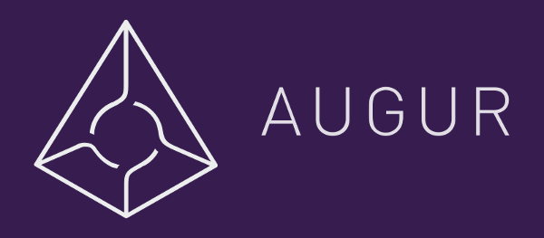
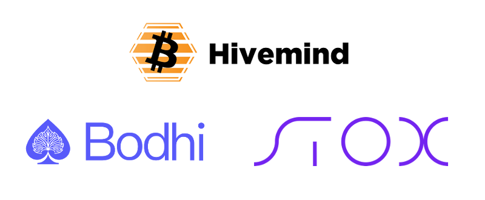

*Blockchain ile geleceği tahmin etmek mi? Yok, o kadar değil ama burada bile Blockchain belli alanlarda çığır açabilir.*

## Tahmin piyasaları (Prediction Markets) ne demek? {#tahmin-piyasalari-prediction-markets-ne-demek}

Geleceği tahmin etmek derken aslında kastettiğimiz “tahmin piyasası” (prediction market). Ne demek bu? Tahmin piyasaları esasında, insanlara gelecek ile ilgili tahminlerin hisselerinin satıldığı piyasalar. Normal bir hisse senedi piyasasından farklı değil, sadece alıp sattığınız bir şirketin hissesinden ziyade bir olayın olma ya da olmama ihtimali üzerine çalışıyor.

Bu tip borsalar şu anda normal olarak var. Özellikle vadeli işlem borsaları bu iş için kurulmuş durumda. Blockchain ile bu tip borsalar merkezi bir yapıdan, adem-i merkezi yani herhangi bir merkezi olmayan dağıtık bir yapıya kavuşacaklar. Bunun ne gibi avantajları var?

<figure markdown="1">

<figcaption markdown="span">Image by [Gerd Altmann](https://pixabay.com/users/geralt-9301/)[^1] from [Pixabay](https://pixabay.com/images/id-2446896/)[^2]</figcaption>
</figure>

## Akıllı kontratların tahmin piyasalarına etkisi olur mu? {#akilli-kontratlarin-tahmin-piyasalarina-etkisi-olur-mu}

Blockchain’in ana temellerinden birinin Akıllı Kontratlar olduğuna şu bölümde değiniyoruz. Özetlemek gerekirse, Akıllı Kontratlar içeriği itibariyle aslında akıllı olmayan gayet basit kontratlar. Ancak Akıllı Kontratları güçlü yapan, hiçbir dış etken etkisinde kalmaması ve eğer gerekli koşullar oluştu ise o kontratın gerektirdiği her türlü sonucu “tak” diye yapması idi.

Bu ne sağlıyor? Bu insanlar için öncelikle “akıl sağlığı” (peace of mind) sağlıyor. Ne demek bu? Şu demek, bir anlaşma yaptığınızda “acaba karşı taraf sözünü yerine getirmezse” diye geceleri uykunuzun kaçmasına gerek yok. İyi yapılmış bir Akıllı Kontrat size otomatik olarak hakkınız olanı verecek.

Peki nasıl çalışacak sistem? Şöyle: Herhangi ama herhangi bir konuda gelecek ile ilgili bir tahmininiz var. Örneğin, İstanbul Şişli’de oturuyorsunuz ve yeni yılın ilk günü saat 12:00 ile 16:00 arasında kar yağacağına eminsiniz. Etrafınızdaki insanlara sordunuz, çoğunun bu konuda bir fikri yok; hatta böyle bir iddiada bulunduğunuz için size deli gözüyle bile bakabilirler. Halbuki, o gün İstanbul’da ya da Türkiye’de ya da dünyanın herhangi bir yerinde sizin gibi başka bir ‘deli’ İstanbul’da havanın aynı saatler içinde günlük güneşlik olacağını düşünüyor ve iddia ediyor olabilir! Birincisi böyle bir düşünen bir insanı normal yollardan çevrenizde bulmanız çok zor. O nedenle internet üzerinden ortak bir platform olması mantıklı. Ama daha önemlisi varsayalım çevrenizde böyle bir insan buldunuz ve iddiaya girdiniz, peki o insanın sözüne nasıl güveneceksiniz? Ya cayarsa? Hadi diyelim, oturdunuz noterden bir sözleşme imzaladınız, ya yine ödemez ise? Gidip mahkemeye mi vereceksiniz? Uğraş dur, üç kuruş para alacağım diye tonla masrafa gir. Üstelik eminim hâkim ve savcılar da böyle gereksiz konularda onları uğraştırdığınız için size çok da sevgiyle bakmayacaklardır.

Blockchain üzerindeki bir platformdan aynı işlemi gerçekleştirdiğinizde, öncelikle bu tip tahminlerde bulunan pek çok kişi ile aynı ortamda olduğunuz için tahmininizin tersini düşünen birini bulmanız çok daha kolay. Daha da önemlisi böyle bir kişi bulup anlaşma yaptığınız anda artık rahatsınız. Zira, öncelikle bu tahmininiz Blockchain üzerinde kayıt altına alınıyor ve daha önce de pek çok kez [yazdığımız](/Sorularla_Blockchain/bolum-1/nedir-bu-blockchain/) gibi Blockchain üzerindeki kayıtlar hiçbir şekilde hiç kimse tarafından geriye dönük olarak değiştirilemiyor. İkincisi de, Akıllı Kontrat sayesinde yaptığınız tahminin sonucunu aldığınız anda sistem iddiayı kazanan kişiye gerekli ödüllendirmeyi otomatik olarak yapıyor.

Burada kritik konulardan biri, aranızdaki iddianın ne şekilde sonuçlandığına kimin karar vereceği. Bunun için piyasanın güvendiği bir ortak hakem belirleyebilirsiniz (örneğin maç sonuçları için espn.com, hava tahminleri için accuweather.com, belli ekonomik göstergeler için wsj.com gibi), ya da bu iş için özel olarak eğitim almış (bu platformlar için çalışan) aracıları kullanabilirsiniz.

## Bireysel tahmin mi konu yoksa daha geniş bakabilir miyiz konuya? {#bireysel-tahmin-mi-konu-yoksa-daha-genis-bakabilir-miyiz-konuya}

Tahmin piyasalarını sadece kişilerin istedikleri tahminleri yapacakları bir enstrüman gibi görmemek lazım. Aslında burada önemli konulardan biri de bu tip piyasalar sayesinde gelecek ile ilgili toplumun ne düşündüğü konusunda iyi kötü tahmin yapabilme, yani toplumun nabzını tutabilme imkânı. Bir nevi araştırma ya da anket şirketlerinin yaptığı tahminlerin çok ötesinde insanların ne düşündüğünü ve ne tahmin ettiğini bu piyasalar sayesinde kestirebilirsiniz. Örneğin, bir sonraki seçimlerde Almanya’da Merkel’in iktidarda kalma ihtimali konusundaki tahmini oranlarından (olacağına inananlar bu ihtimali satın alabilir, inanmayanlar da satabilir) ya da bu ihtimal için biçilen değerin zaman içinde artmasından ya da azalmasından kamuoyunun ne düşündüğünü bulabilirler.

## Zaten hazırda çözümler var, neden merkezi olmayan tahmin piyasalarına ihtiyaç duyuluyor? {#zaten-hazirda-cozumler-var-neden-buna-ihtiyac-duyuluyor}

Normalde tahmin oyunları için kullanabileceğiniz merkezi yapılar var ve gayet de güzel işliyor. Pek çok vadeli işlem borsası var finansal alanda. Ya da spor karşılaşmaları için örneğin ülkemizde Spor-Toto teşkilatının sunduğu [iddaa](https://www.iddaa.com/)[^3] sayesinde pek çok spor karşılaşması için bahis yapmak mümkün. Tabii böyle yapıların belli kısıtları var: mesela sadece iddaa’nın size sunduğu karşılaşmalara tahminde bulunabiliyorsunuz, üstelik oranları da iddaa belirliyor. Dolayısıyla, sadece iddaa’nın belirlediği alanda onun topuyla oynayabiliyorsunuz — pek çok kişi için makul olsa da daha özgür hareket etmek isteyecek bir kesim için çok da tatminkar bir oyun değil bu. “Topumu alıp aşağı mahallede istediğim kurallarla oynarım” demek isteyebilir kimileri.

Bunun yanında merkezi platformların her zaman belli bir otorite tarafından kanuni yaptırımlara tabi olması kimi insanlarda “acaba burada yaptığım bir tahminin sonucunda kazanırsam kanuni bir nedenle hakkımı almama ihtimalim olur mu?” şeklinde bir kuşkuya neden olabiliyor. Merkezi olmayan bir platformda kanuni otoriteler nasıl bir denetim yapacaklar, ya da ne kadar denetim yapılabilir, bunu kestirebilmek için henüz çok erken. Toptan yasaklama genelde çözüm olmuyor. Ne ile karşı karşıya olduğunuzu iyi düşünmek lazım, aksi takdirde bu platformlardaki aktiviteyi illegal yollara düşürmek, kanun koyucu için de ciddi bir vergi kaybı anlamına gelebilir. En doğrusu bu platformlarda belli tahminlerin yapılmasının önüne geçmek olabilir (örneğin kötü bir olayın, bir isyan, suikast ve benzerinin olması gibi).

Bunun yanında bir de merkezi olmayan platformların komisyon miktarı açısından merkezi platformlara göre çok daha avantajlı olduğunu belirtmek lazım. Zira merkezi platformlar tahmin için belirledikleri oranların içine hatırı sayılır miktarda kendi komisyonlarını koyuyor. Merkezi olmayan platformlar ise aslında bir borsa gibi o tahminin alıcısı ile satıcısı arasında aracı oldukları için her iki taraf için de kazanma durumunda alacakları ödül miktarı artıyor.

## Tahmin piyasası oyuncuları kimler? {#tahmin-piyasasi-oyunculari-kimler}

Tahmin piyasasının içindeki en büyük oyuncu şu an itibari ile [Augur](http://www.augur.net/)[^4]. Daha önce de bahsettiğimiz [Ethereum](https://ethereum.org/)[^5] platformunu kullanarak Reputation (REP) adını verdikleri bir token çıkaran Augur bu alanın öncülerinden biri. Augur’un şu an itibariyle yaklaşık 350 milyon ABD Doları değeri var.

<figure markdown="1">

<figcaption markdown="span">Kaynak: [Augur](http://www.augur.net/)[^6]</figcaption>
</figure>

Bu alanda ikinci büyük [Gnosis](https://gnosis.pm/)[^7] de benzer şekilde Ethereum üzerine kurulmuş, şu anda yaklaşık 56 milyon ABD Doları değere sahip bir platform. Gnosis de GNO adını verdiği bir token ile kripto para borsalarında işlem görüyor.

<figure markdown="1">

<figcaption markdown="span">Kaynak: [Gnosis](https://gnosis.pm/)[^8]</figcaption>
</figure>

Bir diğer bu alanda çalışmayı planlayan platform [Hivemind](http://bitcoinhivemind.com/)[^9] ise Bitcoin üzerine kurulu ancak şu anda henüz Ar-Ge aşamasında.

Bunun yanında Çin piyasasında ön plana çıkan ve Qtum Blockchain platformunu kullanan Bodhi[^10] ve Ethereum platformunu kullanan [Stox](https://www.stox.com/)[^11] da tahmin piyasaları pazarından pay kapmaya çalışan diğer oyuncular olacak gelecekte.

<figure markdown="1">

<figcaption markdown="span">Kaynak: [Hivemind](http://bitcoinhivemind.com/)[^12], Bodhi[^13] ve [Stox](https://www.stox.com/)[^14]</figcaption>
</figure>

Sonuç

Kişisel olarak gelecek ile ilgili istediğiniz konuda (bir karşı taraf bulabilmek şartıyla) sınırsız şekilde tahmin yapabilme imkânı büyük bir güç. Bunun yanında kişilerin bireysel düşüncelerini toplayarak toplumun (ya da bir kesiminin) kolektif düşüncesini görebilmek/anlayabilmek de belirli olayların nasıl gelişeceğini önceden anlayabilmek için oldukça önemli bir gösterge. Bu alanı şans oyunları gibi dar bir kapsamdan çıkararak çok daha bilimsel tabanlı bir şekilde değerlendirmek gelecek için pek çok konuya daha iyi bakabilme imkânı verecek. Bu alandaki büyük potansiyeli görmek için kâhin olmaya gerek yok:)

[^1]: [https://pixabay.com/users/geralt-9301/](https://pixabay.com/users/geralt-9301/)

[^2]: [https://pixabay.com/images/id-2446896/](https://pixabay.com/images/id-2446896/)

[^3]: [https://www.iddaa.com/](https://www.iddaa.com/)

[^4]: [http://www.augur.net/](http://www.augur.net/)

[^5]: [https://ethereum.org/](https://ethereum.org/)

[^6]: [http://www.augur.net/](http://www.augur.net/)

[^7]: [https://gnosis.pm/](https://gnosis.pm/)

[^8]: [https://gnosis.pm/](https://gnosis.pm/)

[^9]: [http://bitcoinhivemind.com/](http://bitcoinhivemind.com/)

[^10]: https://www.bodhi.network/

[^11]: [https://www.stox.com/](https://www.stox.com/)

[^12]: [http://bitcoinhivemind.com/](http://bitcoinhivemind.com/)

[^13]: https://www.bodhi.network/

[^14]: [https://www.stox.com/](https://www.stox.com/)
