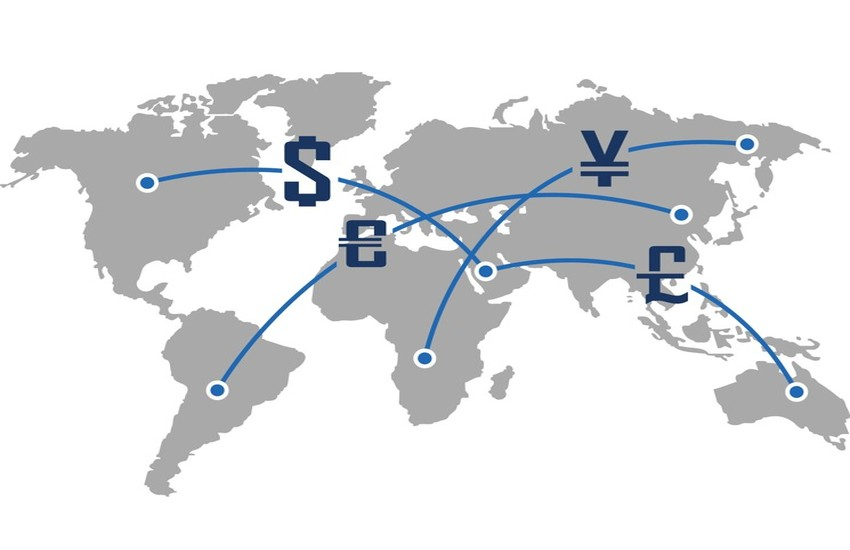
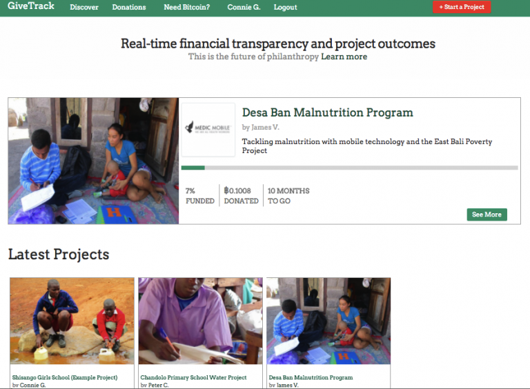

*Bu bölümde, finansın soğuk ve rakam dolu dünyasından biraz uzaklaşarak, Blockchain’in dünyayı daha güzelleştirecek filantropi ve insani yardım işleri için nasıl kullanıldığına bakalım dilerseniz.*

Blockchain ile ilgili şimdiye kadar yazdıklarımızı tek bir cümle ile özetlemek gerekirse, eski dünyada aracılar tarafından yürütülen her işlem ve bu işlemlerin olmazsa olmazı “güven” ihtiyacı, şifreleme teknolojisi sayesinde aracılardan makinelere geçiyor.

Bu dalga en çok da aracıları (ve güvene) en çok ihtiyaç duyulan finans kesiminin aktörlerini etkileyecek. Ama konu sadece finans sektörü ile sınırlı değil. Aracıların olduğu her sektörü ilgilendiriyor.

Birleşmiş Milletler Dünya Gıda Programı (WFP) geçtiğimiz yıl Mayıs ayında Ürdün’de yeni bir program başlatır. Azrak Göçmen Kampı’nda bulunan mültecilere o bölgede bulunan bir marketten alışveriş yapmaları için kuponlar dağıtır. WFP, bu kuponları halihazırda kullandığı biyometrik tanımlama teknolojisinin içine Blockchain’i entegre eder, dolayısıyla mülteciler süpermarkette [retina okuyucuya bakarak](https://www.wfp.org/news/news-release/wfp-introduces-innovative-iris-scan-technology-provide-food-assistance-syrian-refu?_ga=2.69982032.171380775.1522352727-1632756231.1522352727)[^1] bu kuponları kullanırlar. Bu sayede, mültecilerin bütün işlemleri sorunsuz bir şekilde Blockchain üzerinde tutularak, hem bürokrasi ve kâğıt masrafından hem de bankalara verilen komisyonlardan tasarruf sağlanır. Proje o kadar başarılı olur ki, WFP projeyi tüm Ürdün’e yayarak, [ayda 100.000 ABD Doları tasarruf sağlamayı planlamakta](https://www.wired.com/story/refugees-but-on-the-blockchain/)[^2]…

Blockchain konusundaki iyimserler, mültecilerin işlemlerinin kayıt altına alınması sayesinde insanların bir kredi geçmişi oluşturulabileceğini ve yeni yerleştikleri ülkelerde finans sistemine girişlerinde kolaylık sağlanabileceğini düşünüyorlar.

Benzer şekilde dünyada gelişmekte olan ülkelere yapılan yardımların [%30’u heba oluyor](https://www.cgdev.org/blog/how-much-aid-really-lost-corruption)[^3], ihtiyaç sahiplerine ulaşamıyor. Neden? Aracılara ödenen paralar ve yolsuzluk. İrlanda Kızılhaç’ı bu nedenle Lübnan’da mültecilere gönderdiği kuponları Blockchain teknolojisi ile takip ederek böyle [hangi ürünlerde kullanıldığını anlık olarak görme imkânına sahip olur](https://medium.com/@DemandASME/as-they-say-follow-the-money-462f00ac16bd)[^4]. Bu, onlar için de bir aydınlanma olur, zira normalde nakdi olmayan yardımlar genelde gıda maddeleri ile sınırlı olurken, burada ailelerin genelde temizlik malzemesi satın aldığını fark ederler. Ayrıca kurum, bu sistem sayesinde bağışçılarına yaptıkları bağışların hangi alanlarda kullanıldığını da takip etme olanağı verir. Verdiğiniz yardımın insanların hayatına dokunduğunu görmekten alacağınız manevi tatmini artırmanın yanında, sonra yapacağınız bağışlar için de ciddi bir motivasyon olacağını söylemek doğru olur sanırım.

Benzer konuda, Birleşmiş Milletler Kalkınma Programı (UNDP) ülkelerinden uzakta bulunan diasporaların anavatanlarındaki soydaşlarına gönderecekleri paralar için Blockchain altyapısını nasıl kullanır ve yaklaşık %7’lere varan maliyetleri nasıl düşürebiliriz sorularına cevap bulmaya[^5] çalışıyorlar. Projenin doğuş nedenlerinden biri gönderilen paraların soydaşlar tarafından ağırlıklı alkole harcanmasının diasporanın canını sıkmış olması.

<figure markdown="1">

<figcaption markdown="span">Sırbistan üzerinden para yardımı şeması. (Kaynak: Altfinlab[^6])</figcaption>
</figure>

2013 yılında ABD’de kurulan [BitGive](https://www.bitgivefoundation.org/)[^7] kâr amacı gütmeyen ilk Bitcoin bazlı yardım kuruluşu. Bağış kampanyaları düzenleyen bu kuruluş, aynı zamanda ihtiyacı olanlara ulaşması için toplanan paraların izlediği tüm yolu Blockchain üzerinden takip ediyor. Böylece bu bilgiler kesinlikle değiştirilemiyor ve anlık olarak gözlemlenebiliyor. Kurum bağışçılardan Bitcoin toplayarak, Nepal’deki depremde kırsal bölgeler ile merkezler arasında irtibatın kurulumuna yardımcı olacak mobil telefon alınmasından[^8], Kenya’daki bir kız okuluna [kuyu açılmasına](https://thewaterproject.org/community/projects/kenya/a-new-well-in-kenya-4333)[^9]; [Filipinler’den](https://www.savethechildren.org/us/what-we-do/emergency-response/historical-emergencies/typhoon-haiyan)[^10], Brezilya ve Meksika’ya, küçük ama insanların hayatlarına dokunan projeler için kampanyalar düzenliyor.

<figure markdown="1">

<figcaption markdown="span">BitGive GiveTrack sistemi (Kaynak: [BitGive Foundation](https://www.bitgivefoundation.org/)[^11])</figcaption>
</figure>

Bunlar somut, gerçekleşen örnekler ve bu örneklerin benzerleri artarak kullanılmaya devam edecek. Blockchain her derde deva olmayacak ama yine de başarılı birkaç proje bile dünyayı daha güzel ve yaşanır hale getirecek kuşkusuz.

[^1]: [https://www.wfp.org/news/news-release/wfp-introduces-innovative-iris-scan-technology-provide-food-assistance-syrian-refu?\_ga=2.69982032.171380775.1522352727-1632756231.1522352727](https://www.wfp.org/news/news-release/wfp-introduces-innovative-iris-scan-technology-provide-food-assistance-syrian-refu?_ga=2.69982032.171380775.1522352727-1632756231.1522352727)

[^2]: [https://www.wired.com/story/refugees-but-on-the-blockchain/](https://www.wired.com/story/refugees-but-on-the-blockchain/)

[^3]: [https://www.cgdev.org/blog/how-much-aid-really-lost-corruption](https://www.cgdev.org/blog/how-much-aid-really-lost-corruption)

[^4]: [https://medium.com/@DemandASME/as-they-say-follow-the-money-462f00ac16bd](https://medium.com/@DemandASME/as-they-say-follow-the-money-462f00ac16bd)

[^5]: http://altfinlab.org/blog/serbia-sending-remittances-from-serbian-diaspora-to-the-city-of-nis-beneficiaries

[^6]: http://altfinlab.org/blog/serbia-sending-remittances-from-serbian-diaspora-to-the-city-of-nis-beneficiaries

[^7]: [https://www.bitgivefoundation.org/](https://www.bitgivefoundation.org/)

[^8]: http://www.bitgivefoundation.org/medic-mobile-campaign/

[^9]: [https://thewaterproject.org/community/projects/kenya/a-new-well-in-kenya-4333](https://thewaterproject.org/community/projects/kenya/a-new-well-in-kenya-4333)

[^10]: [https://www.savethechildren.org/us/what-we-do/emergency-response/historical-emergencies/typhoon-haiyan](https://www.savethechildren.org/us/what-we-do/emergency-response/historical-emergencies/typhoon-haiyan)

[^11]: [https://www.bitgivefoundation.org/](https://www.bitgivefoundation.org/)
