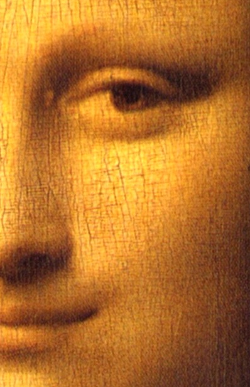
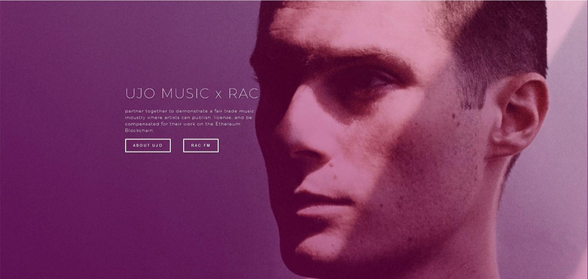

*Mona Lisa’nın bir parçasına sahip olmak ister misiniz? Yakın zamanda mümkün olacak gibi görünüyor.*

Bir konuyu tekrar vurgulamakta yarar var: Blockchain çok yeni bir teknoloji — dolayısıyla kullanım alanlarına baktığımızda gördüğümüz örnekler genellikle çok yeni ve deneysel. Bu teknolojinin pratik hayatta etkilerinin daha iyi hissedilmesi için bu örneklerin hem çoğalması hem de olgunlaşması gerekiyor. Bu kitaptaki amaç, ilgisi olan okuyuculara bu teknolojinin nasıl kullanılacağı konusundaki vizyona dair fikir vermek.

Bu bölümde ise Blockchain’in sanat dünyasının yaratıcı ve tüketicilerine neler sunabileceğine birkaç kullanım örneği üzerinden bakacağız.

## Sanat sanat için mi… yoksa kimin için? {#sanat-sanat-icin-mi-yoksa-kimin-icin}

Bir resim gördünüz ve çok beğendiniz. Sahip olmak ister misiniz? Tabii. Ama fiyatına baktınız — eyvah! Değil aylarca, yıllarca çalışsam almam mümkün değil. Tüh bak kaçırdık! Halbuki şimdi alabilsem, biliyorum ki beş yıl sonra bunu belki de üç-beş katına satabilirim.

Size bu resmin tamamına değil ama bir parçasına sahip olabilirsiniz desem? Üstelik, bu sahip olduğunuz parçayı yatırım olarak tutup sonra istediğiniz zaman satabileceğinizi? İlginizi çekti değil mi? İyi ama nasıl olacak bu?

<figure markdown="1">

<figcaption markdown="span">Mona Lisa’nın bir parçasına sahip olmak ister misiniz? (Image by [WikiImages](https://pixabay.com/users/WikiImages-1897/)[^1] from [Pixabay](https://pixabay.com/images/id-74050/)[^2])</figcaption>
</figure>

Hayal gibi ama bir gün bu da olacak. Şu an Blockchain teknolojisini kullanan “start-up”lar size bu imkânı verecek platformlar için çalışıyor. Örneğin [Artrium](http://artrium.co/)[^3] “Art-sharing” denen bir konsepte sahip. Nasıl çalışıyor sistem? Üç ana adım var: Satın alınacak resim önce eksperler tarafından dikkatlice kontrol ediliyor ve orijinalliği teyit ediliyor. Satın alım sonrası Blockchain üzerinden küçük parçalara bölünüyor ve bu parçalar onlarca müşteriye satılıyor. Daha sonra kendi içinde mini bir borsa ile parçalar yatırımcılar arasında el değiştirebiliyor. Blockchain burada gerek sanat eserinin tümünün gerekse ona ait bölünmüş her bir parçanın tek tek aidiyetini ve alınıp satıldığında yeni sahipliğini hem takip hem de kayıt ediyor.

Yukarıda verdiğimiz örnek, sanat yatırımlarına Blockchain’in getireceği bir yenilik. Peki sanatçılar tarafında durum nasıl? Blockchain’in sanatçılara faydası var mı? Görünüşe göre evet. Yukarıdaki örnekte olduğu gibi sanatçıların yarattığı eserlerin (özellikle dijital sanat eserlerinin) kopyalanması/çalınmasına karşı güzel önlemler var: Örneğin, sanatçı tarafından Blockchain üzerinde yarattığı parçanın hem sahipliğinin hem de yaratılan kopya sayısının kaydının yapılması gibi (hatırlarsanız Blockchain üzerinde yapılan bir kaydın değiştirilmesi mümkün değil). Sahiplik ve kopya sayısına yönelik ilginç bir örnek ile devam edelim.

## Kripto Kediler... peki var mı başka acayiplikler? {#kripto-kediler-peki-var-mi-baska-acayiplikler}

Dijital sahipliğin ve Blockchain teknolojisinin bir araya geldiği son nokta “Dijital Koleksiyonculuk” olarak da adlandırılan ve dijital bir oyun olan [CryptoKitties](https://www.cryptokitties.co/)[^4].

<figure markdown="1">

<figcaption markdown="span">Ünlü CryptoKitty’lerden Twitch (Kaynak: [CryptoKitties](https://www.cryptokitties.co/marketplace)[^5])</figcaption>
</figure>

Nedir bu diye soracak olursanız: CryptoKitties [sitesindeki](https://www.cryptokitties.co/) kedileri inceliyor ve beğendiğinizi satın alıyorsunuz. Aldığınız kedinin pek çok değişik özelliği var almadan önce inceleyebileceğiniz (göz, tüy rengi türü vb.) ancak bilmeniz gereken bir detay: bu kediden sadece bir tane var, başka eşi yok (bir insan gibi her bir kedinin DNA’sı farklı ve Blockchain üzerinde tutularak bu DNA’nın güvenliği sağlanıyor). Sonra bu kediyi bir başka kedi ile “çiftleştirerek” yepyeni bir kedicik yaratabiliyor ve bu kediciği satabiliyorsunuz. Bu kedilerin ilk jenerasyonu sınırlı sayıda yaratıldığı için çok talep görüyor. Çiftleştirme yapılan kediler eğer pahalı bir cinse aitse ise yavrusu da cins ve pahalı olabiliyor ama bir garantisi yok — aynı her ünlünün çocuğunun annesi ya da babası kadar ilgi çekici olmadığı örnekler gibi.

“Hadi canım olur mu öyle şey, çok saçma” demeyin. Geçtiğimiz Kasım ayında faaliyete geçen siteye, daha ilk ayında 180.000 kişi kayıt oldu ve 20 Milyon ABD dolarından [fazla para harcadı](https://www.nytimes.com/2017/12/28/style/cryptokitties-want-a-blockchain-snuggle.html)[^6]. Ondan fazla kedicik 100.000 ABD Doları’ndan yüksek fiyata satıldı. Sitenin sahibi şirket Mart ayı başında Andreessen Horowitz (Twitter ve AirBnB’nin ilk yatırımcılarından) ve Union Square Ventures (Zynga, Twitter ve Foursquare’in ilk yatırımcılarından) gibi dünyanın en saygın özel sermaye şirketlerinden 12 Milyon ABD doları yatırım aldı. İnsanlar sırf bu kediciklerden satın alabilmek için kripto para dünyası ile tanışıp Ether satın aldılar. Kripto paraların sanal dünyada en yaygın kullanım gördüğü alanlardan biri oldu CryptoKitties.

Nasıl? Neden? Psikolojik bir yanı olduğu kesin. Sahip olma isteği. Özellikle eşsiz (her bir kedinin ayrı bir DNA’sı var eşi benzeri yok) ve sınırlı sayıda (özellikle ilk yaratılanlardan başka yaratılamayacak olması) olan bir nesneye sahip olma isteği. Üzerine bunu yatırım gibi kullanabilme ve potansiyel para kazanma imkânını koyun. Alın size talep. Bu saydığımız özelliklerin temeli de bir kere işlendi mi değiştirilemeyecek olan Blockchain teknolojisinin insanlarda yarattığı güven.

## CD bitti, yaşasın Spotify... Ya da? {#cd-bitti-yasasin-spotify-ya-da}

2017 yılının Temmuz ayında RAC adıyla dans müziği üreten André Anjos, son albümü EGO’yu bilinen dijital kanallar yanında kendi web sitesinden Ether kripto parası karşılığında da dinleyicilere [sundu](http://musically.com/2017/08/04/ujo-music-blockchain-uphill-battle-existing-companies/)[^7]. Bunu yaparken de Ujo Platformu[^8]’nu kullandı.

<figure markdown="1">

<figcaption markdown="span">RAC & UJO Music (Kaynak: Ujo Music[^9])</figcaption>
</figure>

Biliyorsunuz, müzik dünyası CD’lerden, “streaming” servislerine hızlı bir geçiş yaptı — arada pek çok plakçı/CD satan büyük mağazalar zayi oldu. Artık kimse bir yere gidip CD almıyor, Apple Music ya da Spotify üzerinden istediğimiz müziği istediğimiz kadar dinliyoruz. Kullanıcı için büyük rahatlık. Peki sanatçılar için? Onlar biraz sıkıntılı bu durumdan dolayı. Zira, dinlendikçe para kazanıyorlar ancak bu streaming firmaları tek bir dağıtıcı olarak %30’lara varan ciddi komisyonlar alıyorlar oluşan gelirden. Adeta kartel olmuşlar! Sanatçıların çok söz hakkı yok.

Buna karşı çıkan ve bağımsız sanatçıları koruyan platformlar yok mu? Var tabii. Örneğin [Bandcamp](https://bandcamp.com/)[^10], müzisyenlerin direkt olarak dinleyiciler ile bir araya gelmesini sağlıyor. Binlerce müzisyen ve 3.000’den fazla bağımsız müzik şirketini bir araya getiren Bandcamp, 2007 yılından bu yana 287 Milyon ABD Doları bir tutarı müzisyenlere ödemiş. Karşılığında ne almış? %15–20 tutarında bir komisyon. Yukarıda Apple Music’in aldığı oranlara bakınca ciddi bir düşüş oldu bile. Harika. Ama yeterli mi?

Peki o zaman ilk bahsettiğimiz Ujo Music’e dönelim. Ne farkı var? Büyük bir yenilik mi? Tam olarak sayılmaz. Ama iki tane ilerleme saymak mümkün.

Birincisi bahsettiğimiz komisyonlar ciddi olarak düşüyor. İkincisi ise lisans ve dağıtım sistemi içinde yenilikler var. Ujo “global, açık, merkezi olmayan, kimseye ait değil ama aynı anda herkesin sahip olduğu” bir lisans sistemine dayanıyor. Oldukça süslü sözler, peki tam olarak ne demek? Kısacası, sanatçıların a) ürünlerine tamamen sahip oldukları b) ürünlerinin dağıtım politikasını istedikleri biçimde belirledikleri bir sistem. Bu iki noktayı biraz daha açarsak:

- Bir müzisyen olarak, müziğimi platform bazlı olarak bağlamak yerine platform bağımsız olarak istediğim yere taşıyabileceğim — ne de olsa sahipliği bende, nasıl kullanacağımı da ben belirlerim.
- Özellikle ticari alanda şarkılarımı kullanmak isteyen start-up ya da uygulamaların bu eserleri sanatçı olarak ancak benim belirlediğim lisans hakkı ve dağıtım politikaları çerçevesinde kullanabildikleri bir sistem. Parçayı direkt kullanmanın yanında örneğin bir YouTube fenomeninin müziğimi remix yaparak kendine ait YouTube videosunda kullanma koşullarına da ben karar vereceğim. Eğer müziğim tek bir platforma bağlı olursa bunu yapabilmek uzun zahmetli bir iş. Hem müzisyen olarak benim için hem de müziğimi kullanmak isteyenler için… Bunun yerine, her tür platformda geçen otomatikleştirilmiş bir lisans sistemi olsa aradaki bürokrasi de azalacak.

Tabii bu konuda şüpheci davranıp müzik alanında yukarıdaki gelişmelerin reklam amaçlı olduğunu, UjoMusic’in “[doğru soruları sorduğunu ama henüz cevapları bulamadığını](http://www.hypebot.com/hypebot/2017/11/ujo-attempts-music-on-the-blockchain-a-second-time-with-ego-by-rac.html)[^11]” düşünenler de var.

Sonuç

Başlangıçta da belirttiğimiz gibi Blockchain yeni bir teknoloji. Bu teknolojinin her derde deva olacağını düşünmek yanlış. Ancak bir taraftan da biraz daha çerçevenin dışında düşünmekte fayda var. Sanat alanında gördüğümüz hem dijital sahiplik hem aracıların azalması (dolayısıyla komisyon ve bürokrasinin minimuma indirilmesi), ağırlıklı olarak sanatçılara ama bunun yanında sanata ulaşmak isteyen (ticari ya da kişisel olarak) kitlelere fayda sağlayacak pek çok yeniliğe gebe. Henüz Blockchain’in temellerinin atıldığı şu günlerde son kullanıcı olarak bu teknolojilere erişim için bir süre daha beklememiz gerekecek. Ama işin potansiyeli ve gerçekleştiğindeki faydalarına baktığımızda heyecanlı ve sonunda değecek bir bekleyiş olacağı kesin gibi. Beklerken eğlenmek isterseniz bir kedicik de siz sahiplenebilirsiniz!:)

[^1]: [https://pixabay.com/users/WikiImages-1897/](https://pixabay.com/users/WikiImages-1897/)

[^2]: [https://pixabay.com/images/id-74050/](https://pixabay.com/images/id-74050/)

[^3]: [http://artrium.co/](http://artrium.co/)

[^4]: [https://www.cryptokitties.co/](https://www.cryptokitties.co/)

[^5]: [https://www.cryptokitties.co/marketplace](https://www.cryptokitties.co/marketplace)

[^6]: [https://www.nytimes.com/2017/12/28/style/cryptokitties-want-a-blockchain-snuggle.html](https://www.nytimes.com/2017/12/28/style/cryptokitties-want-a-blockchain-snuggle.html)

[^7]: [http://musically.com/2017/08/04/ujo-music-blockchain-uphill-battle-existing-companies/](http://musically.com/2017/08/04/ujo-music-blockchain-uphill-battle-existing-companies/)

[^8]: https://ujomusic.com/

[^9]: https://www.ujomusic.com/portal/musicgroup/18

[^10]: [https://bandcamp.com/](https://bandcamp.com/)

[^11]: [http://www.hypebot.com/hypebot/2017/11/ujo-attempts-music-on-the-blockchain-a-second-time-with-ego-by-rac.html](http://www.hypebot.com/hypebot/2017/11/ujo-attempts-music-on-the-blockchain-a-second-time-with-ego-by-rac.html)
