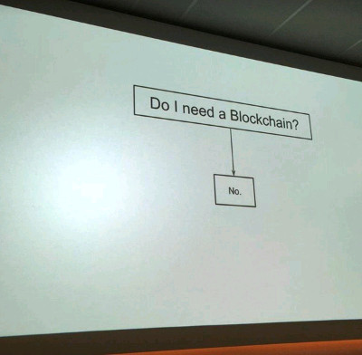

*Elbette değil. Önce bir faydalarına tekrar göz atalım ve değişik türlerini gözden geçirelim sonra da neden bu alandaki girişimlerin çoğu başarısız olacak ona bakalım. Bir sonraki bölümde ise hangi alanlarda başarı şansı daha yüksek ona değineceğiz.*

Geçtiğimiz bölümde değişik sektörlerden verdiğimiz örneklere bakıp Blockchain dünyanın tüm dertlerine deva olacakmış gibi bir izlenim çıkmaması için madalyonun diğer tarafına da bir göz atmakta fayda var. Gerçekten Blockchain tüm sorunlarımızı çözebilecek mi?

<figure></figure>

## Blockchain’in faydalarını özetleyelim mi? {#blockchainin-faydalarini-ozetleyelim-mi}

Değişik sektörlerde Blockchain ile ilgili uygulamalara baktığımızda genel olarak ağırlık kazanan birkaç ortak tema görmek mümkün. Bunları madde madde bir araya getirirsek:

- Merkezi otoritede yaşanan herhangi bir sıkıntının tüm sistemi etkilemesini (ya da durdurmasını) önlemek
- Aracıları ortadan kaldırarak yüksek komisyonları minimize etmek
- Bürokrasinin getirdiği zaman ve emek kaybını minimuma indirmek
- Geriye yönelik olarak doğru, tutarlı, değiştirilemez kayıt bilgisi oluşturmak
- Bireyler için dijital alanda tüm haklarını ellerinde tuttukları dijital kimlikler oluşturmak

## Blockchain bir tane mi? Elle tutulur mu? {#blockchain-bir-tane-mi-elle-tutulur-mu}

Güzel bir soru. Blockchain bir konsept. Bunun farklı farklı uygulamaları var. Her Blockchain de bir değil. Blockchain aslına bakarsanız, birbiri ile uzaktan bağlı makinelerin, belli işlemleri ortak bir mutabakat yoluyla değiştirilemez biçimde tuttukları bir sistem. (Basit olsun diye sistem diyoruz, başka yerlerde protokol diye görürseniz şaşırmayın, aynı anlamda kullanılıyor). Ama bunun da farklı türleri var. Genel hatları ile ikiye ayrılıyorlar: Genel ve Özel Blockchain’ler (Public ve Private). Önce nedir bunlar, farkları neler ona bir bakalım:

## Genel (Açık) ve Özel (Kapalı) Blockchain: Farkları ne? {#genel-acik-ve-ozel-kapali-blockchain-farklari-ne}

Genel Blockchain’ler, her tür makinenin izin almadan istediği gibi bağlandığı ve bir parçası olabildiği sistemler. Örneğin, şimdiye kadar konuştuğumuz Bitcoin, Ethereum gibi Blockchain sistemleri bu şekilde. Yani, yarın bir bilgisayar alıp, bir yazılım yükleyip siz de sisteme bağlanabilir ve yapılan işlemleri görüp işlem yapabilirsiniz.

Özel Blockchain ise adından da anlaşıldığı gibi, bir otorite tarafından içeri girişiniz ve içeride işlem yapışınız izne bağlı olan sistemler.

Her iki tür ile ilgili herkesin ayrı bir fikri ve düşüncesi var. Bitcoin taraftarlarına sorarsanız, Özel Blockchain’leri sistemden bile saymazlar — kendilerince haklılar. Zira Bitcoin’in derdi, “merkezi bir otoritenin getirdiği güven ihtiyacını” minimuma indirmek, hatta yok etmek. Halbuki, Özel Blockchain’lerde bu felsefeye taban tabana zıt olacak şekilde, sizin sisteme girişinize ve hareket etmenize izin veren ve gerekirse bu izni yok eden bir otorite var!.

Ama bir taraftan da özellikle kripto para dışındaki girişimlerde her zaman topluma açık sistemler kurmak girişim için en verimli yol olmayabilir. Öncelikle, açıklık demek, gizliliğin olmaması demek. Bahsetmiştik, örneğin Bitcoin’de yapılan işlemleri kimin yaptığı şifreli olarak gizlenmiş durumda ancak bütün işlemler rakamlar ve işlemi yapan partilere ait adresler şeffaf bir şekilde herkes tarafından tutuluyor. Bu kadar açıklık, özellikle ticari iş yapan kurumlar için sakınca yaratabiliyor.

Bunun yanında izne bağlı olmayan açık sistemler, bilginin kayıt edilmesi sırasında kimi partilere fayda sağlayabilecek ancak sisteme yük getirecek ve bilgi kirliliğine yol açabilecek işlemlerin (örneğin spam bildirimler) oluşmasına yapıları gereği engel olamıyorlar.

## Genel ve özel Blockchain’lerden birkaç örnek verelim mi? {#birkac-ornek-verelim-mi}

Elbette. Genel (ya da açık) Blockchain’lere örnekler çok. Hepimizin duyduğu Bitcoin ve Ethereum en bilinen Blockchain örnekleri. Tüm yazılımları halka açık, bütün makinelerin istedikleri gibi bağlanıp parçası olup, istedikleri gibi çıktıkları açık platformlar.

Özel Blockchain’ler ise genelde ticari kurumlar tarafından kuruluyor ve o nedenle ismen çok da bilinmiyorlar. Örneğin IBM’in liderlik ettiği (her ne kadar IBM’in sadece katılımcısı olduğu ve liderliğini Linux Foundation’ın yaptığı söylense de) [Hyperledger Fabric](https://www.ibm.com/blockchain/hyperledger)[^1]. Ya da finansal alanda pek çok finansal kuruluşun üzerine gelişim yaptırdığı Corda Blockchain’i yaratan [r3](https://www.r3.com/)[^2]

## Peki girişimciler Blockchain konusunda ne kadar tecrübeli? {#peki-girisimciler-bu-konuda-ne-kadar-tecrubeli}

Hemen hemen her sektörde Blockchain bazlı sistemleri kullanarak sektörü kökünden sarsmak isteyen pek çok yeni girişim var. Ancak, bu girişimlerin birçoğu maalesef hüsranla sonuçlanacak. Neden? Birkaç nedeni var, onları da sıralayalım:

- Henüz Blockchain teknolojisinin altyapısı tam olgunlaşmadı, özellikle genel (public) Blockchain’lerin altyapılarının gelişimi oldukça yavaş bir şekilde ilerliyor. 2000’li yılların başında patlayan Startup balonunda da benzeri olmuştu. O zaman pek çok fikir vizyon olarak iyi ama zamanın çok ötesinde olduğu için başarılı olamadı (şimdi o fikirlerin bir kısmı yeniden hayata geçiriliyor).
- Sırf piyasada bu alana büyük ilgi var diye iş yapmaya çalışan kişiler var — ki bunların bir kısmı PR yapmaya çalışan ve altı boş girişimler. Örnek mi? Sierra Leone’de seçimleri Blockchain üzerinden yaptığını [iddia eden](https://techcrunch.com/2018/03/14/sierra-leone-just-ran-the-first-blockchain-based-election/)[^3] Agora ve bunu şiddetle [reddeden](https://techcrunch.com/2018/03/19/sierra-leone-government-denies-the-role-of-blockchain-in-its-recent-election/)[^4] hükümet.
- “Her ağacın meyvesi olmaz” derler. Her sektörün farklı farklı dinamikleri var. Dolayısıyla Blockchain de her alanda faydalı olacak diye düşünmek doğru değil. Bu nedenle Blockchain’e ihtiyaç duyulmayan, böyle bir potansiyelin bulunmadığı sektörlere giren girişimcilerin de hüsrana uğraması kaçınılmaz.

[^1]: [https://www.ibm.com/blockchain/hyperledger](https://www.ibm.com/blockchain/hyperledger)

[^2]: [https://www.r3.com/](https://www.r3.com/)

[^3]: [https://techcrunch.com/2018/03/14/sierra-leone-just-ran-the-first-blockchain-based-election/](https://techcrunch.com/2018/03/14/sierra-leone-just-ran-the-first-blockchain-based-election/)

[^4]: [https://techcrunch.com/2018/03/19/sierra-leone-government-denies-the-role-of-blockchain-in-its-recent-election/](https://techcrunch.com/2018/03/19/sierra-leone-government-denies-the-role-of-blockchain-in-its-recent-election/)
