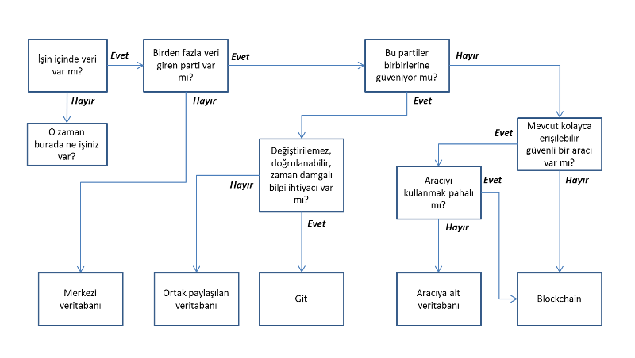

*Blockchain her sektöre uygun değil. Neden? Mevcut sistemlere göre pek çok sıkıntısı var çünkü. Fayda sağlayacağı sektörler de var ama, avantajlarının dezavantajlara üstün geldiği. Nelermiş bunlar bir bakalım.*

Geçtiğimiz [bölümde](/Sorularla_Blockchain/bolum-2/her-derde-deva/), Blockchain’in iki türü olan Özel ve Genel Blockchain kavramından bahsetmiş ve neden bu Blockchain bazlı çoğu projenin geleceğinin parlak olmayacağını göz atmıştık. Şimdi de neden Blockchain bazlı teknolojiler çalışması zor yapılar, başarılı olması için gerekli kriterler neler onlara bakalım dilerseniz.

## Her güzelin bir kusuru olur, peki Blockchain’in kusurları ne(ler)? {#her-guzelin-bir-kusuru-olur-peki-blockchainin-kusurlari-ne-ler}

Bilmemiz gereken en önemli nokta, Blockchain’in aslında çok büyük bir database (veritabanı) olduğu. Bu ne demek? Herhangi bir şekilde sisteme giren bir bilginin, tek bir merkezde tutulması yerine binlerce makinede aynı şekilde tutulması demek. Yeni bir bilgi geldiğinde de yine aynı şekilde bilginin binlerce makineye dağılarak o eski bilginin üzerine eklenmesi demek. Bu sistemin aslında pek çok dezavantajı var. Kısaca bakalım:

- Bilginin binlerce makineye dağılması ve orada tutulması demek öncelikle oldukça yavaş ve hantal bir yapınız var anlamına geliyor. Verilen geliyor, tüm makinelere dağılıyor, makineler bunu kaydediyor, sonra belli aralıklar ile bunların tutarlı olup olmadığını kontrol ediyor. Zaman isteyen bir süreç.
- Aynı zamanda enerji bakımından maliyetli. Merkezi bir sistemde olsa tek bir makine için harcayacağınız elektrik masrafını düşünün, bir de binlerce makinenin aynı bilgiyi tutmasından dolayı gerekecek enerjiyi…
- Bir yandan da oldukça geniş bir bilgi depolama alanına ihtiyacınız var. Bilginin toplam alanını bir makinede tuttuğunuzda gerekli olan depolama alanını düşünün, bir de aynı bilginin binlerce makinada tutulduğunda gerekli olan alanı…
- Binlerce makinayı içeren bir sistemi düşündüğünüzde sistemin yavaş gelişeceğini de kabul etmeniz lazım. Öncelikle sistemi kurarken çok ince elemeli ve sık dokumalısınız. Merkezi bir veritabanı kurarken gerekli olan önlemleri zaten almanız lazım. Ama üzerine bir de binlerce makinenin bağlanacağı bir merkezi olmayan sistemin getireceği sıkıntılara da göğüs gerecek bir sistem olmalı bu.
- Keza, sistemi işletirken sonrasında yaptığınız yenilikler de sistem üzerindeki binlerce makina tarafından kabul edilmeli ve içselleştirilmeli. Sistem doğası gereği adem-i merkezi bir yapı olduğu için hiçbir makineye zorla bir dayatmada bulunamazsınız. Gönüllü olmalı bu iş. Dolayısıyla, yapacağınız her tür değişiklik geriye dönük olarak eski versiyonlarda da kullanılabilmeli. Bu da her yaptığınız değişikliğin tüm sistem tarafından toplu kabulünü oldukça yavaşlatan bir durum.
- Her bir Blockchain sistemi okyanus üzerinde yüzen birer ada gibi. Farklı teknoloji ve altyapılar kullanıyorlar. Birbirleri ile bir iletişimleri yok. Bir Blockchain üzerinde yapılan bir işlemin bir başka Blockchain üzerinde hükmü yok. Bir Blokchain’e dahil kullanıcı ya da madencilerin ellerindeki kripto paraları başka bir Blockchain’de kullanmaları (eğer bir kripto para borsasına gidip al-sat yapmıyorlar ise) mümkün değil.

İşte bu nedenle Blockchain ancak gerekli olduğunda başvurulması gereken bir alan. O nedenle Blockchain üzerine yatırım yapmadan önce iyi düşünmekte fayda var, yoksa…

<figure markdown="1">

<figcaption markdown="span">Photo by [Jp Valery](https://unsplash.com/@jpvalery)[^1] on [Unsplash](https://unsplash.com/photos/mwNkPv3d_EI)[^2]</figcaption>
</figure>

## Neden ve ne zaman Blockchain’e ihtiyaç duyulur? {#neden-ve-ne-zaman-blockchaine-ihtiyac-duyulur}

Hakikaten bir ihtiyaç olmalı Blockchain’e. Geçen bölümden hatırlarsak, neydi bu ihtiyaçlar?

Merkezi otoriteye ya da aracıya güvensizlik

Bilgileri tutacak bir merkezi otoriteye karşı güven bunalımı. Merkezi bir otorite, Nick Szabo’nun da dediği bir “güvenlik açığıdır”. Konu gerçekten böyle bir güvenlik açığının olması. Merkezi otoritede yaşanan sıkıntı biz kullanıcıları ne kadar etkiler? Yukarıda saydığımız merkezi olmayan sistemin ağır ve hantal yapısı ile uğraşmaya değer mi? Bunları tartmak lazım.

Bu nedenle belki de Blockchain’in şu ana kadar en başarılı olduğu alan para konusu oldu. Zira, daha önce de bahsettiğimiz gibi ABD’de 2008 yılında yaşanan kriz sonrası, daha önceki yıllarda halkın üzerinden korkunç karlar elde eden ve bu korkunç karlarını daha da büyütmek amacıyla gittikçe daha çok risk alan bankalar, sonrasında “aman kriz daha da büyümesin” açıklaması ile kurtarıldı. Bu kurtarmada Amerikan vatandaşlarının “vergilerinden gelen para” kullanıldı. Üstelik bu kriz nedeniyle enflasyon yaşandı. Üstelik hükümet halka sormadan milyarlarca dolar karşılıksız para bastı. Bunu da “likidite” diyerek halka yutturmaya çalıştı (yeri gelmişken eğer seyretmediyseniz “[Too Big To Fail](https://www.imdb.com/title/tt1742683/)[^3]” filmini hararetle tavsiye ederim). Dolayısıyla, bireyler açısından merkezi otoritenin yetkinlikleri ya da yaptıklarının her zaman kendi çıkarlarına olmadığını düşünmelerine sebep olan bu güven bunalımı üzerine Bitcoin’in ortaya çıkması çok da tesadüfi değil.

Aracının maliyeti

Bireyler arasındaki işlemlere aracılık ederek bundan komisyon alan her türlü aracı, bu işi kâr için yaptığı noktada işlemin tarafı olan partiler tarafından aracılık için ödenen ücretler yüksek görülecek. Böyle düşünenlerin haklı olduğu alanlar da yok değil. Örneğin, Uber’in sadece bir software olması ve araçlar ile insanlar arasında optimizasyon yapmasına rağmen ödenen ücretin %30'lara varan bir kısmını cebine indiriyor olması tepki çekiyor. Keza, bankacılık sistemine dahil olmayan insanların bir ülkeden diğerine para gönderirken onlar hatta yüzlerce dolar komisyon vermeleri de öyle. İşte dağınık sistemler, ortadaki güven sağladığını iddia ederek (ya da sağlayarak) yüksek miktarda masraf “çakan” aracılara karşı faydalı hatta gerekli.

Aracının hantal yapısı

Evet, dağıtık yapılar hantal olabilirler. Ama gerçekten özellikle geçmişten gelen gerek eski teknoloji gerekse çeşitli bürokratik çıkarlar nedeniyle mevcut sistemi kontrol eden ve yönetenlerin yarattığı bürokratik yapı yanında bu bahsettiğimiz yavaşlığın esamesi okunmaz. Örnek mi? Maersk’e göre, bir soğutucunun Avrupa’dan Afrika’ya ulaşımında 30'dan fazla kişi ya da organizasyon sürece dahil oluyor ve bu aktörlerin birbirleriyle 200'den fazla kez iletişim halinde olmaları gerekiyor. Neden? Bürokrasi, değişik ülkelerdeki kurumların birbirine güvenmemesi, politik ajandalar vb.

Aracılardan bağımsızlık isteği

Merkezi sistemlerin, kişileri bağlamak, elinde tutmak, kişinin üzerinden izinli ya da izinsiz fayda sağlamaya çalışmaları da bireylerde bu tip otoritelerden uzak kalmaya çalışmak, bağımsız olmak dürtüsünü artırdı. Daha önce bahsettiğimiz, Facebook’un bilgilerimizi bizden habersiz (ya da uzun uzun okumadığımız ve evet tuşuna basıp geçtiğimiz kullanım sözleşmeleri aracılığıyla) kurumlara satması gibi. İnsanlar artık, özellikle dijital dünyada kendilerine ait bilgileri kendi kimlikleri gibi ellerinde tutmayı, istedikleri bilgiyi istedikleri yere vermeyi ve istedikleri noktada da o bilgiyi verdikleri kurumdan geri almayı istiyorlar. Merkezi yapılarda ya bu olanak yok, ya da varsa da gerçekten söz verdiklerini yapacaklarına dair bir garanti yok. Dağıtık yapılar bu anlamda bireylere özgürlük getiriyor. Tabii bir de dağıtık yapıların herhangi bir merkezleri olmamasının getirdiği, kanuni olarak hangi otoritenin altında oldukları konusundaki belirsizlik de kimi bu tip otoriter yapıların altında olmak istemeyen kişileri bu yapılara doğru çeken bir başka etken.

## Peki neden bu kadar şişiriliyor Blockchain balonu? {#peki-neden-bu-kadar-sisiriliyor-blockchain-balonu}

Dediğimiz gibi hemen hemen her sektörde gerek yeni girişimler gerekse sistemin içindeki mevcut oyuncular için Blockchain sektörü derinden sarsacak bir olguymuş gibi parlatılıyor. Neden?

Öncelikle bilgi eksikliği diyebiliriz. Daha önce de [bahsettiğimiz](/Sorularla_Blockchain/bolum-1/nedir-bu-blockchain/) gibi, Blockchain anlaması ve algılaması oldukça zor bir kavram. Özünde “merkezi olmayan bir veritabanı” olsa da şifreleme, bağımsız makineler, aracıya olan güveni ortadan kaldırma gibi terimler alışık olmadığımız, büyürken bize öğretilen doğrulara kimi zaman taban tabana zıt kavramlar. Hem anlamakta zorluk çekiyoruz hem de “startup patlamasında” yaşadığımız gibi uzak kalmak ya da etkilenmek istemiyoruz. Büyük kurumların da insanlardan oluştuğunu unutmamamız gerek. Dolayısıyla kurumlar da bu rüzgârdan etkileniyorlar.

Bunun yanında Blockchain’i kullanmaktan çok aslında dışarıda kalmamaya çalışıyor kimi kurumlar. Bir nevi test ortamında deniyorlar kullanışlı olup olmadığını. Havuz kenarına gelip suyun nasıl olduğunu ayağınızın ucuyla dokumak gibi düşünebilirsiniz bunu. Ancak kullandıkları Blockchain teknolojilerin hizmetini verenler bunu piyasada ballandıra ballandıra anlatarak küçük bir olayı bambaşka boyutlarda sunuyorlar. Örnek olarak, şahsen, Ripple Network içinde yer aldığını açıklayan onlarca prestijli bankanın sadece ne olduğunu anlayabilmek için bu ortamda olduklarını düşünüyorum.

İkincisi, özellikle Bilgi Sistemleri çok önce kurulmuş ve doğası gereği yenilenmeye açık olmayan sektörlerde yeni sistem kurmanın imkânsızlığı ya da yüksek maliyeti, Blockchain sistemlerine olan ilgiyi artıyor. Örnek mi? Geçen bölümlerde bahsettiğimiz [havacılık sektörü](/Sorularla_Blockchain/bolum-2/seyahat/). Havacılık için böyle bir ihtiyaç var gibi görünüyor ancak başka pek çok sektörde danışman firmalar tarafından da böyle bir ihtiyaç var havası yaratılıyor maalesef.

Bir başka neden de, kurumların kendilerini teknoloji lideri olarak göstermek için Blockchain’den bahsetmeleri. Bir nevi “biz çok akıllıyız, bu teknolojileri anlıyoruz, kullanmaya başlıyoruz” diyerek ‘hava atmaları’…

Peki Blockchain sorunlara karşı panzehir geliştirebiliyor mu?

İki bölüm önce Blockchain ile ilgili problemlerden bahsettik: Hantal olması, çok enerji harcaması, geniş bilgi depolama ihtiyacı, güvenlik açıkları olma ihtimali gibi… Peki Blockchain üzerine çalışanlar bu sorunlara bakıp “kader işte yapacak bir şey yok” mu diyorlar? Elbette hayır. Hızlıca bir bakalım arı kovanı gibi çalışan geliştiricilerin yaptıklarına:

- Hantal yapı: Blockchain içinde eğer hantal yapıyı hızlandırmak istiyorsanız, özel Blockchain yapıları kurmak en efektif yöntem. Sisteme giriş çıkışların denetlendiği ya da izne tabi olduğu, yapılan geliştirmelerin makineler tarafından kısmen “zorunlu” tutulduğu yapılar. Halka açık Blockchain yapıları, özel kurulmuş benzerlerini güvenlik ve şeffaflık anlamında zayıf bulduklarını da belirtmek lazım. Ancak her iş ya da her konuda illa tamamıyla şeffaf bir yapı kurmak o kadar da zorunlu değil. Tamam eğer konu bir kripto para ise yani bir değer atfedecek iseniz o zaman güvenlik ve şeffaflıktan bıktıracak kadar hassas olabilirsiniz ama diğer kimi sektörlerde belki o kadar uç noktalara gitmeyecek ama çok daha pratik ve esnek çözümler ile ilerleyebilirsiniz.
- Enerji harcama: Özellikle Bitcoin Blockchain mimarisini kullanan yapılar için kullanılan sistemin çok enerji harcadığı ile ilgili eleştiriler konusunda Bitcoin geliştiricilerinin bir hamle yapmasını beklemek hayal. Zira onlar bu enerji harcamanın sistemin kendi güvenliğini korumak (dış ataklara karşı) için elzem olduğunu düşünüyorlar. Ancak diğer başka Blockchain yapıları gerek Proof-of-Stake gerekse başka tür çalışma kuralları kurarak enerji sorununu çoktan hallettiler bile. Bu konuda detayları [şu bölümde](/Sorularla_Blockchain/bolum-3/uzlasma-mekanizmalari-neler/) bulabilirsiniz.
- Geniş depolama ihtiyacı: Yine özellikle Bitcoin özelinde en çok yapılan eleştirilerden biri işlemlerin tamamının şeffaf bir şekilde sistemde ve her makinede tutulması nedeniyle çok ciddi bir depolama ihtiyacının olması. Yine Bitcoin’de değil ama alternatif yapılarda bunun da çözümü bulunmuş durumda. Örneğin bütün işlemlerin detaylarını tutmak yerine sadece ana başlıklarını tutmak, bilgilerin sıkıştırmak için gelişmiş öğütme mekanizmalarından yararlanmak bunların birkaçı. Bunun yanında gerekli depolama ihtiyacını her bir makinede tutmak yerine şifreleme sistemleri kullanarak bir bilgiyi birkaç makineye paylaştırmak da benzer çözümlerden biri.
- Uyumluluk ve sürdürülebilirlik: Birbirinden farklı yapıdaki Blockchain sistemlerinin birbirleri ile konuşabilmeleri için yapılan pek çok çalışma var. Bundan birkaç yıl önce çalışmaya başlayan [Polkadot](https://polkadot.network/)[^4] ve 2018 yılı başlarında sansasyon yaratan [Cosmos](https://cosmos.network/)[^5] bu tip çalışmalardan sadece birkaçı. Belki hiçbir zaman tam bir entegrasyon olmasa da, yeni teknolojilerin birbirleri ile hiçbir iletişimi olmayan geçmişteki silo yapılara (Kaç kredi kartı taşıyorsunuz örneğin? Gerçekten gerek var mı bu kadar karta?) oranla çok daha ilişkili olacakları kesin…

## Blockchain hangi sektörlerde başarılı olur? Turnusol kağıdı var mı? {#blockchain-hangi-sektorlerde-basarili-olur-turnusol-kagidi-var-mi}

Buraya kadar yazdıklarımızın ötesinde daha net olarak içinde bulunduğunuz sektör için Blockchain gerekli mi sorusuna yanıt için aşağıdaki şemayı kullanabilirsiniz (Kaynak: Thomas Ferry — [To Blockchain or Not to Blockchain](https://medium.com/causys/to-blockchain-or-not-to-blockchain-aed05bf08150)[^6] adlı Medium makalesi)

<figure></figure>

Sonuç

Hep söylediğimizi bir kez daha tekrarlayalım: Blockchain yeni gelişmekte olan bir teknoloji. Güvene dayalı aracıların verimsizleştirdiği her alanda aracıları yıkacak güce ve potansiyele sahip. Şimdi, bu yıl ya da önümüzdeki yıl etkilerini henüz görmeyeceğiz. Ama nasıl internet hiç yokken hayatımıza girdi ve vazgeçilmezimiz oldu Blockchain bazlı teknolojiler de önümüzdeki beş-on yıl aralığında hayatımızı benzer şekilde değiştirecekler. Umuyoruz olumlu yönde olacak bu değişiklikler.

[^1]: [https://unsplash.com/@jpvalery](https://unsplash.com/@jpvalery)

[^2]: [https://unsplash.com/photos/mwNkPv3d\_EI](https://unsplash.com/photos/mwNkPv3d_EI)

[^3]: [https://www.imdb.com/title/tt1742683/](https://www.imdb.com/title/tt1742683/)

[^4]: [https://polkadot.network/](https://polkadot.network/)

[^5]: [https://cosmos.network/](https://cosmos.network/)

[^6]: [https://medium.com/causys/to-blockchain-or-not-to-blockchain-aed05bf08150](https://medium.com/causys/to-blockchain-or-not-to-blockchain-aed05bf08150)
