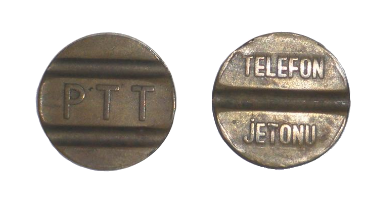
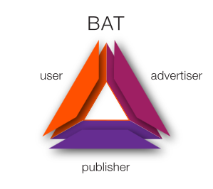

*Yeni dünyada, yaratılan katma değer sadece girişimciler ve yatırımcılar değil tüm kesimler tarafından paylaşılıyor. Bunu sağlayan da Token dediğimiz yeni tip varlıklar. Gelin nedir bir bakalım.*

Önceki [bölümlerde](/Sorularla_Blockchain/bolum-2/degisen-girisimcilik-ve-yatirimcilik/) bildiğimiz anlamda klasik girişimci- yatırımcı ilişkisinin yeni teknolojiler ile birlikte değişmeye başladığını belirtmiştik. Bu değişim ile birlikte girişim tarafından yaratılan katma değerin girişimci-yatırımcı tekelinden çıkıp tüm kesimlere (geliştiriciler, kaynak sağlayıcılar, kullanıcılar gibi) yayıldığını, bu sayede de daha demokratik, daha sağlam ve sürdürülebilir bir yapı (en azından teoride) oluşturulduğuna değinmiştik.

Bu bölümde ise bu katma değerin nasıl bu kesimler tarafından paylaşıldığına bakalım. Ama öncesinde bu sistemi çalıştıran ana öğe olan Token nedir onu bir anlayalım…

## Aranan kan bulundu mu? — ICO ve Token dünyası {#aranan-kan-bulundu-mu-ico-ve-token-dunyasi}

Yeni teknolojiler ile yaratılan katma değer artık daha eşit şekilde paylaşılıyor. Ama yine de bu katma değeri yaratmak için bir kaynağa ihtiyaç var. Eskiden bu kaynağı yatırımcılar girişimcilere ortak olarak verirdi. Şimdi, pastadan başka pay sahibi olmak isteyenler var. Bu yeni teknoloji ile kurulan yapıların da çalışmak için güce bir nevi yakıta ihtiyacı var. Aynı klasik sistemde şirketlerin hisse senedi adı altında pay satıp yatırımcılardan para almaları gibi. Tek fark, burada bir şirket yok, bir sistem ile kişilerden ve şirketten bağımsız bir yapı var; dolayısıyla neyin payını alacaksınız? İşte yeni terimimiz. “Token”. Bütün bu yeni sistemi çalıştırmak için gerekli güç bu Token’lardan geliyor.

<figure markdown="1">

<figcaption markdown="span">Eski günlerdeki (hatırlayana tabii) PTT jetonu. Kaynak: [Wikimedia](https://commons.wikimedia.org/wiki/File:Turkish_telephone_token.jpg)[^1]</figcaption>
</figure>

## Token’ın hisse senedinden farkı ne? {#tokenin-hisse-senedinden-farki-ne}

Klasik anlamda bellediğimiz tipik şirket yapısında, eğer bir şirkete yatırım yapmak isterseniz o şirketin hisselerini sahiplerinden satın alırsınız. Yok eğer şirket halka açık ise, o zaman hisselerinin işlem gördüğü açık pazarlardan o an için fiyatı ne olarak belirlenmiş ise onun üzerinden satın alabilirsiniz. Özel şirketlerin bu şekilde hisselerini açık piyasalarda işleme açmasına yani halka açılmasına Halka Arz işlemi (IPO — Initial Public Offering) denir.

Yeni tip Web 3.0 sistemlerinde ise klasik anlamda bir şirket bulunmadığı için (elbette girişimcilerin kendine ait bir şirketi olabilir ama bu şirket sadece sistemi kurmak ile meşgul, yoksa sistemin sahibi değil), sistemin ihtiyacı olan yakıt, yatırımcılar tarafından Token olarak sisteme konur, bu işleme de ICO (Initial Coin Offering) denir.

Token’ları bir nevi hisse senedi gibi düşünebilirsiniz ancak Token hisse senedinden çok daha kapsayıcı bir kavram. Çünkü sadece hisse senedinden çok daha fazla işlevi var.

Klasik anlamda hisse senedi aldığınızda elinizde iki farklı güç var. Birincisi, hisseniz oranında şirket yönetiminde söz sahibi olursunuz (en basit anlamda). İkincisi yatırım anlamında ya bu hisseler için şirketin her yıl temettü dağıtmasını beklersiniz, ya da şirketin geleceği hakkında spekülasyon yaparak, şirketin hissesini sermaye piyasalarında alır ya da satarsınız.

Token’da ise durum biraz farklı. Yönetiminde söz sahibi olabileceğiniz ya da size temettü verecek bir şirket yok. Token özünde bir ekosistemin parçası. Ama Token eğer kripto para borsalarında işlem görüyor ise alım-satım yaparak o Token’ın ve ilgili ekosistem ile ilgili spekülasyon yapabilirsiniz.

Token’lar baştan girişimci tarafından belirlenen bir sistem ile tüm paydaşlara dağıtılır. Bir kısmı fikrin sahibi ve sistemin çatışını kuran girişimci grubuna, bir kısmı geliştirme/test aşamasında yardımcı olan bağımsız geliştiricilere (eskiden gönüllü çalışan kişilere), bir kısmı verilecek hizmetin altyapısını sağlayacak olan bağımsız makinelere (aynı Bitcoin’deki madenciler gibi düşünün), bir kısmı da bu hizmeti kullandığı için şirkete para kazandıran (örneğin reklam geliri) kullanıcılara verilir. Her girişim için yukarıdaki paydaşlar, dağıtılacak miktar, dağıtım koşulları vb değişebilir, ancak sistem aşağı yukarı bu şekilde işler.

ICO ile işte bu Token’lar yatırımcılara satılır. Gelir, yukarıda bahsedilen model içinde paylaşılır, sistem büyümeye başladıkça önceden öngörülen miktarda Token’lar değişik paydaşlara bu şekilde dağıtılır. Yani, her bir paydaş katkısı ölçüsünden önceden belirlenmiş Token’a hak kazanır. ICO sonrası da bu Token’lar artık piyasalarda işlem görmeye ve sahipleri tarafından alınıp satılmaya başlarlar.

## Token sadece yatırım için mi kullanılır? {#token-sadece-yatirim-icin-mi-kullanilir}

Bununla da sınırlı değil Token ile yapabilecekleriniz. Token’lar aynı zamanda, ekosistemin farklı paydaşları tarafından yaratılıp harcanabilir. Örneğin, sistemin çalışması için de yardımcı olabilir ve Token kazanabilirsiniz. Hatırlarsanız, Bitcoin için demiştik ki, A kişisi B kişisine para transferi yaptığında makineler bu transferi yakalıyor, sisteme iletiyor, sistemde bunların kayıtları oluşturuluyor ve her 10 dakikada bir bu kayıtlar mühürleniyor. İşte bu para transferini yakalayan makineler her işlem başına ufak bir komisyon, her 10 dakikada bir kayıtları mühürleme işlemini yapmaya hak kazanan şanslı makine de büyük bir ödül (şu anda yaklaşık 12,5 Bitcoin) kazanıyor. İşte gördüğünüz gibi bulmacayı çözen makine Token (yani Bitcoin) kazandı. Makine sahipleri bu kazandıkları Bitcoin’leri herhangi bir kripto para borsasında satıp ABD Doları, Türk Lirası ne isterler ise onunla değiştirebilirler.

Sistemin çalışmasına yardımın başka çeşitleri de var. Örneğin [Brave](https://brave.com/)[^2] aynı Chrome, Internet Explorer gibi bir tarayıcı ve kullanıcılarına her kullanım için BAT adında bir Token ödüyor. Şöyle düşünün, web sitelerine girdiğinizde yukarı, aşağı, sağ, sol bu da yetmez gibi önünüze aniden çıkan (pop-up) reklamlar görüyorsunuz. Evet, bu siteler size içeriklerini parasız sunuyorlar ama karşılığında sizi reklama boğarak hatırı sayılır miktarda reklam geliri elde ediyorlar. İşte Brave o gelirin bir kısmını sizinle paylaşıyor. İsterseniz hiç reklamsız siteleri ziyaret edebiliyorsunuz, isterseniz tercihlerinize göre size uygun reklamlara maruz kalarak BAT Token kazanabiliyorsunuz. Rakamlar çok büyük değil, Token’in değeri ne olacak o da belli olmaz ama hiç yoktan iyidir.

<figure markdown="1">

<figcaption markdown="span">Brave Browser Token’i BAT (Kaynak: [Brave](https://brave.com/)[^3])</figcaption>
</figure>

Yukarıda bahsettiğimiz değişik paydaşlar bu ellerine geçen tokenı başka amaçlar için de kullanabilirler. Kazandığınız Token’ı sadece kripto para borsasında satmak yanında, bu ekosistemin yarattığı hizmetleri alır ve bu hizmetler karşılığı ödeme olarak kullanabilirsiniz. Örneğin, Dropbox benzeri bir depolama hizmeti veren Filecoin hizmetini kullandığınızda, dosyalarınızı şifreli biçimde dünyanın çeşitli yerlerindeki bilgisayarlarda güvenli bir şekilde saklayabilir ve bu hizmetin karşılığını Filecoin’in Token’ı ile ödeyebilirsiniz.

Bundan sonraki bölümde değişik değişik tokenlara yine en bildiğimiz örnek olan kripto paralardan başlayarak bakalım isterseniz.

[^1]: [https://commons.wikimedia.org/wiki/File:Turkish\_telephone\_token.jpg](https://commons.wikimedia.org/wiki/File:Turkish_telephone_token.jpg)

[^2]: [https://brave.com/](https://brave.com/)

[^3]: [https://brave.com/](https://brave.com/)
