## Baştan başlayalım: Şifreleme ne demek? Neden önemli? {#bastan-baslayalim-sifreleme-ne-demek-neden-onemli}

*Blockchain sistemlerinin güvenli bir şekilde çalışmasının en kritik noktası şifreleme. Peki bu ne anlama geliyor? Neden bu kadar önemli? Aşağıda.*

Şifreleme deyince aklımıza çok karışık anlaşılmaz konular geliyor değil mi? Normal. Aslında o kadar da zor değil ama anlayabilmek için biraz çaba sarf etmek gerek — her türlü konuda olduğu gibi. Peki neden önemli bu şifreleme? Çünkü şifreleme bize pek çok kişiye dağılan bilginin doğru ve tam olduğunu anlamamızı sağlıyor. Peki ama ne demek şimdi bu?

<figure markdown="1">

<figcaption markdown="span">Image by [priyanshu28](https://pixabay.com/users/priyanshu28-589101/)[^1] from [Pixabay](https://pixabay.com/images/id-1181480/)[^2]</figcaption>
</figure>

Efendim, daha önce de belirtmiştik. 90’larda internet hayatımıza girdi ve her tür dijital bilgi ve verinin yaygınlaşmasını ve bir taraftan diğerine kolayca iletilmesini sağladı. Bu harika bir olay, çünkü masrafsız bir şekilde bilgiyi kopyalayabiliyor ve dağıtabiliyorsunuz. Eğitim, araştırma ve gelişme için bulunmaz nimet. Ancak herhangi bir dijital varlığı internet üzerinden transfer etmeye kalktığınızda önümüze sorunlar çıkıyor. Zira olur olmaz kopyalanmaması lazım, gerçek sahibinin kim olduğu biliniyor olmalı, o sahip gerçekten bu varlığı birine devretmek istiyor mu onu bilmeli gibi gibi.

İsterseniz internet üzerinden transfer edilebilecek pek çok dijital varlıktan en aşina olduğumuz para üzerinden bir örnek verelim.

## Para, para, para — varlığı bir dert... ya yokluğu? {#para-para-para-varligi-bir-dert-ya-yoklugu}

Para ilk zamanlarda fiziki olarak önce madeni para ve kâğıt halinde bulunurken, 60’lı-70’li yıllarda bilgisayarlar ile iletişim başlayınca kurumlar arasında kullanılan elektronik paraya, 90’lardan sonra internet yaygınlaşıp kişiler arasında iletişimin artması ile birlikte de dijital paraya evrildi.

Ancak, paranın alışverişe layık olabilme niteliğini koruyabilmesi için hep bir merkezi otoriteye (merkez bankaları ya da bankalar) ihtiyaç duyuldu. İnsanların güven duyacağı birilerinin kontrol etmesi lazım parayı diye düşünüldü içgüdüsel olarak — normal. Öbür türlü dijital bir nesneyi sonsuz olarak üretebilirsiniz, gerçekten size mi ait nereden bileceksiniz, yabancıların sözlerine nasıl güveneceksiniz? Ya bir kişi birden fazla kopyalama yapar, sahip olduğu parayı hem size hem başkasına gönderirse? O nedenle, bankalar ve merkezi otoriteler vardı ki bu sorunlara karşı güvence altına alsın.

İşte tam bu sırada 90’ların sonunda Satoshi Nakamoto dediğimiz kişi(ler) para transferi teknolojisini şifreleme ile birleştirdi ve tek bir otoriteye bağlı kalmaksızın, o otoritenin sağladığı güvenin yerini makinelerin aldığı bir yapı oluşturarak adeta bir devrim yarattı. Bu devrim ile işlemlerin arasında yer alan güven abidesi banka gibi kurumlara olan ihtiyaç neredeyse sıfıra indi — çünkü artık her makine kendi başına bir banka!

Nasıl olur da makineler koskoca bankanın yerini alır derseniz şöyle: Banka kişilere ait banka hesaplarını ve yapılan işlemleri tutarak bir kişinin kendine ait bir varlığı birden fazla kişiye göndermesine engel oluyor. Bunu yaparken doğru ve güvenilir davrandığına emin olmamız için gerek iç organizasyon yapısı gerekse dışarıdan merkezi otorite tarafından dayatılan kontrol ve cezalarına tabii. Blockchain (örneğin Bitcoin sistemi) ise bir kişinin elindeki parayı iki kere harcamasını bütün hesapları ve bütün işlemleri halka açık olarak yaparak önlüyor. İşlemler ve bakiyeler halka açık ama isminiz gibi özel detaylarınız gizli. Dolayısıyla, bir kişiden diğerine Bitcoin gönderildiğinde herkes gönderenin bakiyesinden o paranın düştüğünü alıcının bakiyesinin de o para kadar arttığını görüyor. Yani bankacılık sisteminde ben bankanın yanlış yapmayacağına emin olmak için kendi iç kontrolleri ya da denetleyici kurumlara güvenmek durumunda iken, Blockchain’de her şey açık olduğu için “gözlerime” güvenmem yeterli.

Tekrar edelim: Para örneğini hep konuşulduğu için verdik. Konu sadece para ile sınırlı değil. Bu her tür dijital varlık olabilir: Örneğin noterlerde saklanan bilgi, bir dijital sanat eseri gibi; bana ait olan, başkasının üzerinde hak iddia edemeyeceği, dijital olarak saklanabilen, istediğimde başka birine dijital olarak kısa sürede transfer edebileceğim her tür varlık ya da nesne.

## Çok karışık değil mi bu şifreleme? {#cok-karisik-degil-mi-bu-sifreleme}

Yukarıda bahsettiğimiz hem tüm hesap bakiyeleri ve transferler açık olacak hem de hesap sahiplerine ait özel bilgiler gizli kalacak nasıl oluyor dediğimizde bu şifreleme sayesinde.

Şifreleme Blockchain’in temelini oluşturuyor, çünkü Blockchain dağınık bir sistemde çalışıyor, yani bilgi binlerce farklı, birbiri ile ilintili ama birbirini tanımayan makine üzerinde bulunuyor. Dağınık sistemlerin kontrolü olmadığı için bilginin düzgün ve değiştirilmemiş olması son derece önemli — bunu sağlayan da şifreleme sistemi. Yani şifreleme sayesinde herhangi bir bilgi Blockchain üzerindeki her nokta üzerinde hem aynı şekilde tutarlı hem de gizli olarak tutulabiliyor.

Şifreleme teknik ve karmaşık görünse de onu daha iyi anlamak bize günlük hayatımızda Blockchain teknolojisini nasıl daha verimli olarak kullanırız konusunda farklı ipuçları verebilir. Eğer genel yapı olarak ne olduğunu anladıysak, biraz daha teknik olarak nedir şifreleme ona da şimdi bakalım…

## Şifreleme ve öğütme  ne kadar önemli? {#sifreleme-ve-ogutme-ne-kadar-onemli}

Dijital dünyada bir varlığı bir kişiden diğerine transfer ederken iki önemli konu var dikkat etmemiz gereken:

1. Birincisi, öncelikle varlığın transferi güvenli bir şekilde yapılmalı. Buradan kastedilen bu dijital varlık değiştirilmeden bir taraftan öbürüne geçmeli ve geçtikten sonra bu işlem bir daha değiştirilemez olmalı. Yani herkeste aynı bilgiler olmalı. Herkeste aynı bilgi olursa kimse “eyvah kandırılıyor muyum?” kaygısı yaşamaz, gece evinde rahat uyur. Bu öğütme (hashing) sayesinde başarılıyor.
2. İkincisi, bana ait bir varlığı bir başkasına devredeceksem öncelikle bu varlığın bana ait olduğu ve bu varlığı kendim devretmek istediğim, yani bu işlemi başlatan kişinin gerçekten ben olduğum (orijinal/otantik olduğunun) teyit edilmeli. Ama bunu yaparken bir taraftan da bana ait özel bilgilerin gizliliği kalması da sağlanmalı. İşte bu da şifreleme (encryption/decryption) sayesinde başarılıyor.

Önce bir öğütelim mi?

Kapalı bir kutu (belki de bir kâğıt öğütücü) düşünün. Bir taraftan anlamlı bir sözcük veriyorsunuz, diğer taraftan rakam ve sayılardan oluşan anlamsız rastgele bir sayı/harf dizisi veriyor. İşte buna öğütme deniyor.

Bir örnek yapalım dilerseniz:

<figure><a href="/assets/books/sorularla-blockchain/301-2.png">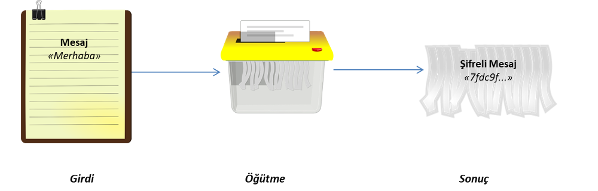</a><figcaption>Öğütme Mekanizması</figcaption></figure>

Siz de [deneyebilirsiniz](http://www.xorbin.com/tools/sha256-hash-calculator)[^3] — aynı sonucu bulacaksınız (bu sonuca teknik olarak hash deniyor).

İşte işin özü bu. Değişik öğütme mekanizmalarından en popüler olan SHA-256 böyle çalışıyor. Girin herhangi bir SHA-256 şifreleme sitesine “Merhaba” yazın, yukarıdaki sonucun aynısını verecek size: 64 karakterli bir dizi.

* * *

Peki buraya uzunca bir paragraf koymak istesek ne olur? Mesela,

<figure><a href="/assets/books/sorularla-blockchain/301-3.png">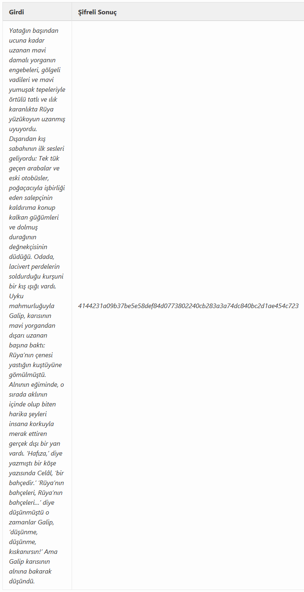</a></figure>

Ta tam! Bambaşka bir dizi ama yine 64 karakterli. Buraya isterseniz girdi olarak koca bir ansiklopedi koyun, sonuç yine 64 karakterli bir dizi olacak.

* * *

Şimdi ilk örneğimize geri dönelim: Merhaba kelimesinin sonuna bir “!” işareti ekleyelim, bakalım ne olacak?

<figure><a href="/assets/books/sorularla-blockchain/301-4.png">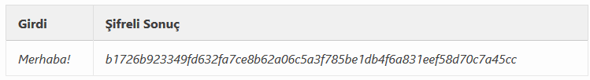</a></figure>

Yukarıdaki “Merhaba” da çıkan sonuç ile karşılaştırın bakalım. Tamamıyla değişti!. Bir harf ekledik ama ilk kelimeden tamamen farklı bir sonuç çıktı ortaya. Ama dikkat edin 64 karakterli yine.

* * *

Çok güzel de bu kadar girizgahı neden yaptın derseniz? Buraya kadar anlattıklarımızı biraz daha açalım. Aynı girdiler hep aynı sonucu veriyor. Ama girdi içinde bir harf bile değiştirin, çıkan sonuç bambaşka oluyor. Bu ne işe yarıyor? Bu girilen bilginin orijinal ya da otantik (değiştirilmemiş) olup olmadığını anlamamıza yarıyor. Eğer elinizde bir bilgi (girdi) ve bu bilgi sonucu ortaya çıkan şifreli bir sonuç da varsa, bu girdi hakikaten bu sonucu mu veriyor test edebiliyorsunuz. Girin ilk bilgiyi (girdiyi) şifrelemeye aynı sonucu bulacaksınız.

Bu arada şunu da belirtmekte fayda var. Bu şifreleme mekanizmalarının özelliği şu: sonucu biliyor olmanız girdiyi de bildiğiniz anlamına gelmiyor. Yani, girdiyi biliyorsanız sonucu bulabiliyorsunuz ama sonuçtan geriye bilgiye gidemiyorsunuz. Yani, öğütücüden geçmiş kâğıtlara bakarak kâğıtta ne yazıyordu okuyamıyorsunuz. Ancak kağıdın orijinali varsa elinizde onu öğütücüden geçirip önceki öğütülmüş kâğıt demetinin aynısını elde edebiliyorsunuz.

Bilginin tutarlı olduğunu bilmek ne işimize yarıyor? Yukarıda yazdığımız gibi bilgiyi dağıtıp tek bir noktada tutmadığınızda, bilginin dağınık olarak herkeste aynı şekilde durması, bilginin doğruluğu ve kişilerin bu bilgiye olan güvenini sağlayan en önemli etken. Öbür türlü kırk kişide kırk farklı bilgi olursa ona dedikodu denir, kimse de beş kuruş değer vermez.

Harika. Ama yarın öbür gün ben bu mesajı değiştirsem “Yok, yahu ben öyle dememiştim, böyle demiştim” desem? Kusura bakmayın mümkün değil, çünkü mesajınız alındı, güzel bir şekilde öğütüldü ve tüm sistemdeki makineler üzerinde aynı şekilde tutulmaya başladı.

Peki çok güzel. Ama ya bu mesajı ben değil de bir başkası yazdıysa? Onu da şifreleme hallediyor. Şimdi de şifrelemeye bakalım:

Şifrelemeli mi, şifrelememeli mi? Şimdi de şifreleyelim…

Şifreleme bir nevi kilitleme demek. Diyelim bir mesajınız var. Şifreleme derken, bir anahtar ve kilit düşünün, bu anahtar sizin mesajınızı alıyor ve kilidin içine koyup kilitliyor.

<figure><a href="/assets/books/sorularla-blockchain/301-5.png">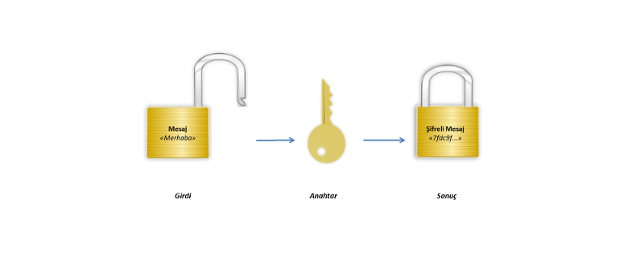</a><figcaption>Basit (simetrik) Şifreleme</figcaption></figure>

Dolayısıyla sizin yazdığınız bu mesajı sadece anahtarı verdiğiniz kişiler görebiliyor. Buraya kadar güzel. Bu anahtarı bir kişiye verirsem bir sorun yok. Bir taraf mesaj yazar, anahtar ile kilitler, diğeri anahtarın kopyası ile açar mesajı okur, sonra yeni bir mesaj yazar ve anahtarı ile şifreler ve bu böyle sürüp gider. Ancak işin pratiğe geldiğimizde soru(n)lar ortaya çıkmaya başlıyor.

Ya karşı taraf bu anahtarı başka birine daha verirse? O zaman ne olacak? O anahtarı verdiği üçüncü kişi bir mesaj yazarsa? Karşı tarafın bu mesajı yazdığını nereden bileceğim? Anahtarın kopyalanabildiği durumlarda sıkıntı var, mesajı kimin yazdığını anlamak zor.

İşte bu “mesajı kim yazdı, kimler okudu sorununu çözmek için” 1976 yılında yeni bir şifreleme yöntemi ortaya atılmış. “Özel Anahtar” ve “Genel Anahtar” kavramları çıkmış.

“Özel Anahtar” ve “Genel Anahtar”

Yine yukarıdaki anahtar-kilit örneğinden devam edelim. Demiştik ki iki ana problem var. Birincisi benim yazdığım mesajın içeriğini anahtarı olan (ya da anahtarı alan) herkesin görüyor olması, ikincisi de herkesin bu mesajı benim yazdığımdan (kilidi benim kilitlediğimden) emin olması.

Önce ikinciden başlayalım. Şöyle demiş bir akıllı bilim adamı. “Şu kilidin özelliğini bir parça değiştireyim — öyle bir hale getireyim ki, iki tane farklı ama birbiri ile uyumlu anahtarı olsun. Öyle uyumlu olsunlar ki, herhangi biri ile anahtarı kilitlediğimde diğeri açabilsin. Bu anahtarlardan birini çoğaltıp tüm arkadaşlarıma vereyim. Ama diğer uyumlu anahtar sadece bende olsun” İlginç bir mantık. Neye yarıyor peki? İki farklı şekilde kullanabiliriz bu anahtarları.

Birincisi birileri bana bir mesaj göndermek isterse ise mesajı yazıp kilide koyar ve kilitler. Kilidi açan diğer anahtar bende olduğu için, sadece ben açarak bu mesajı okuyabilirim. Böylece bana yazılı mesajın sadece benim tarafımdan okunması garantilenmiş olur.

İkincisi, eğer ben bir mesaj yazıp sadece kendimde bulunan anahtar ile bu kilidi kilitler isem, isteyen herkes benim dağıttığım diğer anahtar ile kilidi açabilir ve içindeki mesajı benden geldiğini bildiği mesajı okur. Böylece, hepimiz yazılan bir mesajın hakikaten benden geldiğine emin oluruz.

İşte bu iki anahtardan bana ait olana “Özel Anahtar”, herkese verdiğime de “Genel Anahtar” deniyor.

<figure><a href="/assets/books/sorularla-blockchain/301-6.png">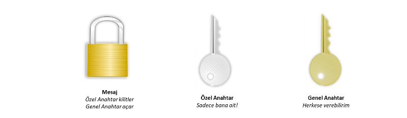</a><figcaption>Özel ve Genel Anahtarlar</figcaption></figure>

Yukarıda bahsettiğimiz gibi Özel Anahtar ve Genel Anahtarı farklı ama birbirlerine uyumlu iki anahtar gibi düşünebiliriz. Aradaki tek fark, Özel Anahtarın sadece benim bildiğim (hiç kimse ile paylaşmadığım) bir anahtar olması. Genel Anahtar ise yine bana ait, ama herkes ile paylaştığım tüm dünyanın görebileceği bir anahtar.

İlişkileri ise şu: Benim Özel Anahtarım ile kapadığım kapıyı (şifrelediğim mesajı) Genel Anahtarı bilen herkes açabiliyor (şifreyi açıp mesajı görebiliyor). Ya da benim Genel Anahtarıma sahip birinin kapadığı kapıyı (bana gönderdiği şifreli mesajı) sadece benim açabiliyor olmam (şifreyi açıp mesajı okumam).

<figure><a href="/assets/books/sorularla-blockchain/301-7.png">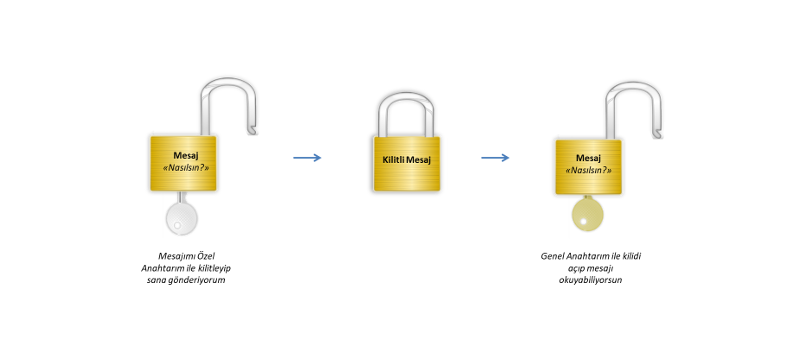</a><figcaption>Şifreleme Mekanizması</figcaption></figure>

İşte yukarıdaki ilk sorunu çözdük. Mesajın benden geldiğini herkes gördü. İyi de yazının içeriğini tüm dünya görmüş oldu, ben içeriği bilinsin istemiyordum, şimdi ne olacak? İşte burada ilk bölümde anlattığımız öğütme mekanizması ortaya giriyor ve sizin yazınızı okunamaz bir hale getiriyor.

Para ya da başka dijital varlığın Blockchain ile aktarılmasında da işte yukarıdaki sistem kullanılıyor.

- Özel Anahtar ile bana ait olan bir varlığı bir başkasına gönderiyorum, paranın benim bakiyemde olduğu ve bu gönderdiğim paranın miktarını herkes görüyor (Ki kanıtlama işlemine Dijital — ya da Sayısal- İmza deniyor).
- Ama aynı zamanda gönderdiğim kişinin Genel Anahtar’ını da ekliyorum ki, hem diğer insanlar o kişinin Genel Anahtarını kullanarak parayı gerçekten ona gönderdiğimi görebilisinler, hem de o kişi sonra bu anahtara uyumlu kendi Özel Anahtarı’ını kullanarak bu parayı sahiplenebilsin ve başkalarına gönderebilirsin.
- Öğütme sayesinde ise bu bakiyenin bana ait olduğunu gizleyebiliyorum.

Para ya da başka dijital varlığın Blockchain ile aktarılmasında da işte yukarıdaki sistem kullanılıyor.

\- Özel Anahtar ile bana ait olan bir varlığı bir başkasına gönderiyorum, paranın benim bakiyemde olduğu ve bu gönderdiğim paranın miktarını herkes görüyor. (ki kanıtlama işlemine Dijital (ya da Sayısal) İmza deniyor).

• Ama aynı zamanda gönderdiğim kişinin Genel Anahtar’ını da ekliyorum ki, hem diğer insanlar o kişinin Genel Anahtarını kullanarak parayı gerçekten ona gönderdiğimi görebilisinler, hem de o kişi sonra bu anahtara uyumlu kendi Özel Anahtarı’ını kullanarak bu parayı sahiplenebilsin ve başkalarına gönderebilirsin.

• Öğütme sayesinde ise bu bakiyenin bana ait olduğunu gizleyebiliyorum.

## Peki Blockchain şifrelemesi nasıl çalışıyor? {#peki-blockchain-sifrelemesi-nasil-calisiyor}

İşte dijital dünyada devrim yaratan şifreleme mekanizması bu şekilde çalışıyor. Bu mekanizma sayesinde dijital varlıkların (örneğin paranın) herhangi bir aracıya ihtiyaç doğmaksızın güvenli bir şekilde bir taraftan öbürüne taşınması sağlanıyor. Dijital olarak bana ait olan her tür varlığı bu şekilde bir başkasına transfer edebilirim bu teknoloji ile. Blockchain teknolojileri önceki [bölümde](/Sorularla_Blockchain/bolum-3/sifreleme/) değindiğimiz iki kavramı (öğütme ve şifreleme) kullanarak kendi sistemlerini otomatik güvenli hale getiriyorlar (ya da tek bir kişiye duyulan güven ihtiyacını sıfıra indiriyorlar).

Şifrele ki senden geldiğini anlasınlar

Önce şifreleme kısmına bakalım. Efendim, biliyorsunuz Blockchain sistemi bir dijital varlığın bir kimseden diğerine geçmesini sağlıyor. Burada da bu dijital varlıklardan en bilineni olan dijital para Bitcoin ile konuyu örneklendirelim:

Varsayalım benim bir dijital varlığım, örneğin 1 Bitcoin’im var. Öncelikle, demiştik ki, bütün Blockchain işlemleri aynı şekilde tüm makineler tarafından tutuluyor. Dolayısıyla sistemdeki bütün makineler bu 1 Bitcoin’in bende olduğunu biliyor (o paraya nasıl sahip olduğum ise aşağıda anlatacağımız işlem sonucu daha netlik kazanacak).

Şimdi ben bu parayı Ayşe’ye göndereceğim. Sistem üzerindeki makinelere diyorum ki “Ey ahali, ben 1 Bitcoin’imi Ayşe’ye gönderiyorum”. Sistemde “ben” diye bahsettiğim bana ait bir adres. Ayşe de aynı şekilde bir adres. Dolayısı ile diyorum ki, “Ben, bu adresin sahibi kişi şu adrese bu kadar parayı gönderiyorum”. Sistem üzerinden görülenler: bana ait hesap numarası, karşı tarafa ait hesap numarası ve ne kadar para gönderildiği.

Merak ediyorsanız nasıl bir şeydir bu diye, işte bir örnek aşağıda: Bunu da kaydedip internet üzerinde [yayınlıyorlar](https://blockchain.info/block/0000000000000000001c2fa26ad4d4850fe94e688cfccf812c4fbe6d245761eb)[^4]

<figure><a href="/assets/books/sorularla-blockchain/301-8.png">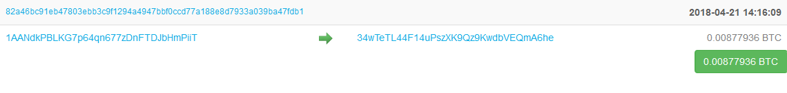</a><figcaption>Bitcoin İşlem Örneği (Kaynak: <a href="https://blockchain.info/block/0000000000000000001c2fa26ad4d4850fe94e688cfccf812c4fbe6d245761eb">Blockchain.Info</a>)</figcaption></figure>

Yukarıdaki işlemi yazarken aslında iki küçük ekleme yapıyorum işleme. Birincisi, işlemi sisteme kendi Özel Anahtarım ile kaydediyorum. Böylece herkes bana ait olduğunu anlıyor bu paranın. İkincisi de, Ayşe’nin Genel Anahtarını da kaydediyorum. Böylece paranın Ayşe’ye gittiğini de anlıyor herkes. Ve bu parayı sadece Ayşe kullanabilir, çünkü bu Genel Anahtara karşılık gelen Özel Anahtar sadece Ayşe’de var.

Eğer Ayşe bu parayı bir gün Mehmet’e göndermek isterse, benzer şekilde kendi Özel Anahtarı’nı kullandığında sistem bakacak “Hah tamam bu para zamanından Ayşe’nin Genel Anahtarı kullanılarak gönderilmişti, yani Ayşe’nin malı, şimdi Ayşe Özel Anahtarını kullanarak bu malın kendi sahipliğini ve Mehmet’in Genel Anahtarını kullanarak bu sahipliği Mehmet’e geçirdiğini söylüyor, o zaman yapalım bu transferi” diyecek.

Şimdiye kadar (2009 yılındaki başlangıcından beri) Bitcoin üzerinde yapılmış bütün transferler kayıtlı ve yukarıdaki gibi görülebiliyor. Yani aslında işlemlerin hepsi şeffaf — hem de en başından beri. Yani Ayşe’ye gönderdiğim parayı da ben birinden aldım. Bu kişi de bir başkasından. Bu şekilde 2009 yılına kadar gidebilirsiniz. Peki ya en başında ne olmuştu? Bu kadar Bitcoin nasıl çıktı ortaya? Şimdi ona da bakalım:

Öğüt ki, sonsuza kadar kaydedilsin

Hatırlar mısınız, önceki bir bölümde şunu söylemiştik: “Blockchain sisteminde yükü çeken makinelerin bu yaptıkları işlemleri kayıt etme, daha sonra da teyit etme işlemi sonucu aldıkları ödüle (ya da lotaryaya) Bitcoin deniyor. Neden lotarya deniyor? Zira, bu on dakikada bir yapılan teyit işlemi aslında çok zor bir bulmaca. Bir nevi Sudoku oyunu gibi düşünün”

Şimdi dilerseniz bu bulmaca konusunu biraz daha açalım. Ortada tabii ki bir bulmaca yok ama bir öğütme işlemi var. Aynı yukarıda olduğu gibi “girdi” ve “çıktı” kısmı olan bir SHA şifrelemesi.

Girdinin (input) iki parçası var

- Belli bir süre içinde gerçekleşen tüm işlemlerin bir dökümü
- Bir de bir sayı

Çıktı (Output) ise yukarıdaki gibi 64 karakterli bir şifre.

Sistem söyle çalışıyor.

1. Her 10 dakikada bir Bitcoin ile yapılan bütün işlemler bir araya toplanıyor ve makinelere gönderiliyor

<figure><a href="/assets/books/sorularla-blockchain/301-9.png">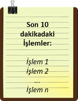</a></figure>

1. Sonra sistem bütün makinelere şunu söylüyor: “Ey makineler, işlemlerin toplam [dökümü](https://blockchain.info/block/0000000000000000001c2fa26ad4d4850fe94e688cfccf812c4fbe6d245761eb)[^5] elinize geçti, şimdi bu işlem dökümünü alın yanına öyle bir sayı ekleyin ki, öğütmeye koyduğunuzda çıkan çıktı (output) beş tane sıfır ile başlasın”
2. Makineler bu çıktıyı alıyor ve sırayla rakamları denemeye başlıyorlar. Önce 1 ekliyor, çıkan sonuca bakıyor,

<figure><a href="/assets/books/sorularla-blockchain/301-10.png">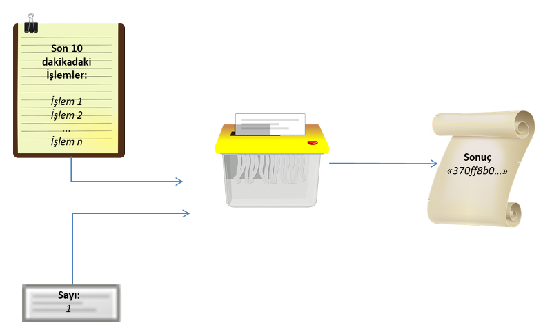</a></figure>

yok olmadı, “370ff8b0…” ile başlayan bir output verdi. Sonra 2 ekliyor, yine bakıyor:

<figure><a href="/assets/books/sorularla-blockchain/301-11.png">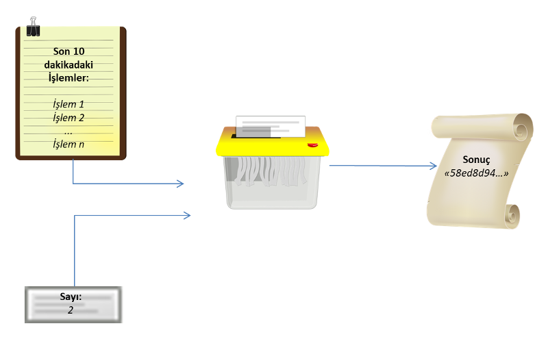</a></figure>

bu sefer “58ed8d94…” diye başlayan bir sayı verdi… Yine olmadı… Böyle böyle sırayla tüm sayılar deneniyor. Ta ki bir sayı (diyelim “25264”) bize “00000…” ile başlayan bir sonuç verene kadar!

<figure><a href="/assets/books/sorularla-blockchain/301-12.png">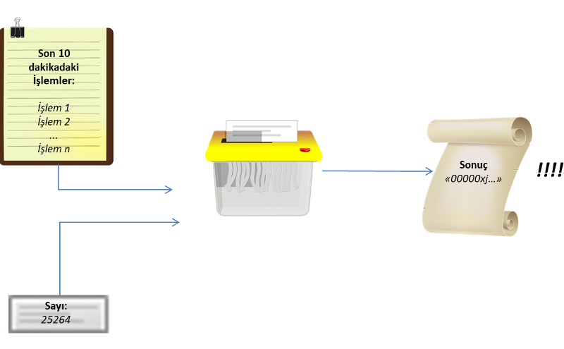</a></figure>

1. “00000…” ile başlayan sonucu ilk bulan makine “Buldum!” diyerek bu sonuca ulaştıran sayıyı (“25264”) diğer makinelere haber veriyor.
2. Sonucu gören makineler, işlem dökümünü 25264 sayısı ile birlikte şifreye sokuyorlar, bakıyorlar hakikaten çıkan sonuç “00000…” ile başlıyor, “Tamam” diyorlar, “Sonuç doğru” ve bir sonraki 10 dakika için yapılan işlemlere geçiyorlar.
3. “25264” rakamını bulan makine işte bu ödülü (şu anda 12,5 Bitcoin yani 100.000 ABD Doları civari bir rakam) kazanıyor!

İşte bu kadar. Yukarıda anlatılanları görsel olarak izlemek isterseniz, aşağıdaki İngilizce videoyu hararetle tavsiye ederim. Aklınıza yatmayan her konu basit bir şekilde özetlenmiş.

<figure markdown="1">
<a href="/assets/books/sorularla-blockchain/301-13.png">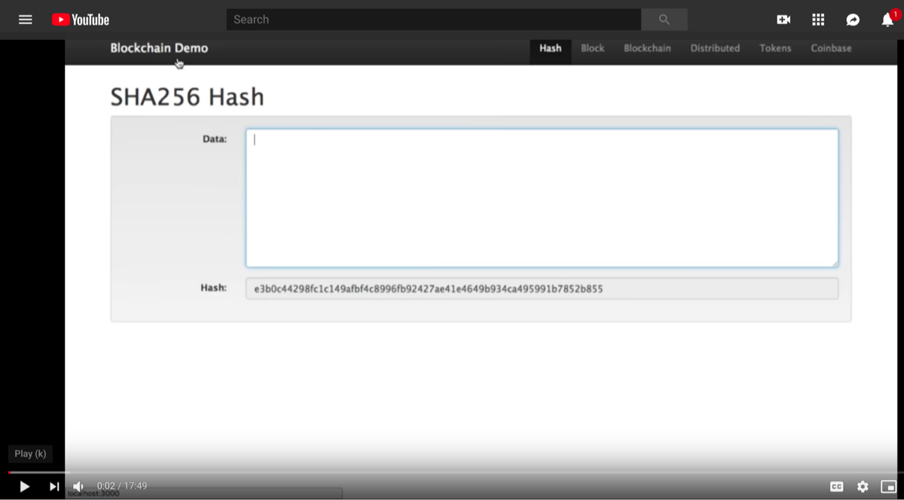</a>
<figcaption markdown="span">“Blockchain nasıl çalışır?— görsel demo” (İngilizce) Kaynak: [Anders Brownworth - YouTube](https://www.youtube.com/watch?v=_160oMzblY8)[^6]</figcaption>
</figure>

Yukarıdaki süreç her 10 dakikada bir tekrar ediyor ve her 10 dakikada bir 12,5 Bitcoin yaratılarak, sonucu bulan makineye veriliyor yani sisteme sokuluyor (buna İngilizce “mining” deniyor). İşte yukarıda bahsettiğimiz birbirimize transfer edilen Bitcoin’ler bu şekilde yaratılıyor. Şu ana kadar (Nisan 2017 itibariyle) 17 Milyon Bitcoin yaratıldı. Önümüzdeki 100 yıl boyunca yaklaşık 4 Milyon Bitcoin daha girecek sisteme ve orada 21 Milyonda duracak piyasadaki miktar.

Nasıl oldu da 9 yılda 17 Milyon yaratılırken bundan sonraki 100 yılda 4 Milyona düşecek derseniz, Bitcoin yaratıcıları para enflasyona yenik düşmesin diye her dört yılda bir verilen ödülü yarıya düşürüyorlar. İlk dört yıl 10 dakikada bir 50 Bitcoin verilirken, sonra bu 25’e düştü, şu an 12,5’da, 2021’de 6,25’e inecek.

Peki bu madenciler bu ödül ile yaşıyorlar, ödül miktarı düşerse madencilik yapmayı bırakmazlar mı diye akla bir soru gelebilir. Olabilir tabii ama bu yeni para yaratımı ile ilgili bir konu. Madenciler bir de aynı zamanda, yapılan transferler üzerinden bir komisyon almaya devam ediyorlar. Eğer Bitcoin kişiler arası para transferinde sık kullanılmaya devam ederse ya da değeri şimdiki gibi yüksek olursa bir sorun olmaz. Çok düşerse o zaman bir kısım madenci sahneden çekilir, kalanlara pastadan daha büyük bir dilim düşer ve onlar çalışmaya devam ederler.

Bu kadar mı?

Evet, aslında işin özü bu kadar basit. Genel Anahtar aracılığı ile zamanında bana gönderilmiş olan bir varlığı, Özel Anahtarımı kullanarak şifreleyip bir başkasına gönderiyorum. Sistem de bu işlemleri 10 dakikada bir toplayıp öğütüp bir paket haline getiriyor. Şifrelemeyi kullanarak bana ait olduğunu kanıtladığım bir dijital varlığı öğütücü sayesinde bir başkasına kati olarak transfer ediyorum — bunun için de hiç kimsenin onay vermesine ihtiyaç duymuyorum.

Para örneğinden yola çıktık ama tekrar edelim. Dijital olarak bana ait olan her tür varlık ve bilgiyi bu şekilde bir başkasına transfer edebilirim bu teknoloji ile. Seçenekler ve ihtimaller sınırsız — gerisi hayal gücünüze kalmış…

[^1]: [https://pixabay.com/users/priyanshu28-589101/](https://pixabay.com/users/priyanshu28-589101/)

[^2]: [https://pixabay.com/images/id-1181480/](https://pixabay.com/images/id-1181480/)

[^3]: [http://www.xorbin.com/tools/sha256-hash-calculator](http://www.xorbin.com/tools/sha256-hash-calculator)

[^4]: [https://blockchain.info/block/0000000000000000001c2fa26ad4d4850fe94e688cfccf812c4fbe6d245761eb](https://blockchain.info/block/0000000000000000001c2fa26ad4d4850fe94e688cfccf812c4fbe6d245761eb)

[^5]: [https://blockchain.info/block/0000000000000000001c2fa26ad4d4850fe94e688cfccf812c4fbe6d245761eb](https://blockchain.info/block/0000000000000000001c2fa26ad4d4850fe94e688cfccf812c4fbe6d245761eb)

[^6]: [https://www.youtube.com/watch?v=\_160oMzblY8](https://www.youtube.com/watch?v=_160oMzblY8)
