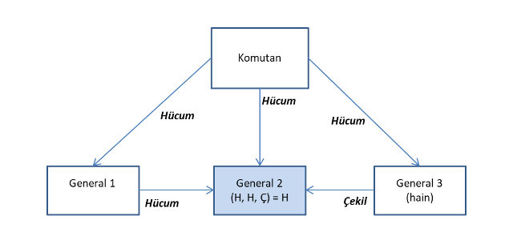
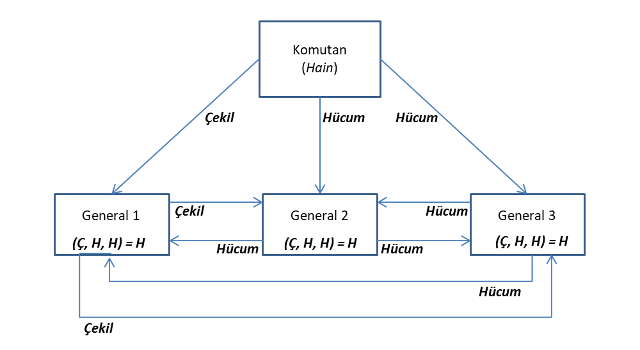

*Blockchain bazlı sistemlerde binlerce makine ortak bir yerden direktif almadan beraberce hareket ediyor. Nasıl? Anlamak için önce işin temelini anlamak lazım:*

<figure markdown="1">

<figcaption markdown="span">Kaynak: Image by [Russellbande](https://pixabay.com/users/russellbande-717096/)[^1] from [Pixabay](https://pixabay.com/images/id-1282722/)[^2]</figcaption>
</figure>

Blockchain bazlı şifreli sistemlerin birbirine bağlı ancak birbirinden bağımsız binlerce makineden oluştuğundan daha önceki bölümlerimizde bahsetmiştik. Peki bu makineler merkezi bir otorite olmadan nasıl hep birlikte aynı anda aynı kararı veriyorlar? Aralarında hiç sorun çıkmıyor mu? Eğer çıkıyorsa bu sorunları nasıl çözüp tekrar aynı yolda ilerliyorlar? Birileri sistemi manipüle etmek isterse ne olacak? Olamaz mı? Olur tabii ki… Sistemin mimarları buna karşı nasıl önlemler almış ona bir göz atalım şimdi. Konuya başlamadan önce Blockchain sistemini kısaca hatırlatmakta yarar var.

Demiştik ki, Blockchain yapılan bir işlemin binlerce makinede kaydının tutulması ve belli aralıklar ile (örneğin Bitcoin’de on dakikada bir) bütün makinelerin ellerindeki kayıtların toplanıp tabiri caiz ise bir balya haline getirilmesi şeklinde çalışan bir sistem idi. Bir araya getirilen bu bilgilerin her makinede aynı şekilde bulunması gerekiyor ki, üzerine yeni bir balya işlem gelebilsin. Dolayısı ile altta kalan balyadaki bilgiler hem tutarlı olsun hem sonradan değiştirilemesin (balya bağlandıktan sonra binlerce makineye dönüp işlem değişikliği yapamazsınız, imkânsıza yakın bu).

Peki ama yukarıda bahsettiğimiz bu on dakikada bir her makinede gerçekleşen işlemler nasıl aynı şekilde bulunuyor? Ya birileri ortama nifak tohumu ekmeye kalkar ve sahte işlem girmeye kalkarsa? Nasıl sağlanacak bu mutabakat? Öncelikle ‘mutabakat’ derken ne kastediyoruz ona bir bakalım:

## Bizans generallerinin problemi ne? {#bizans-generallerinin-problemi-ne}

Efendim, ilginçtir, birbirinden bağımsız sistemlerin (bunlara dağıtık sistemler de deniyor) arasındaki ilişkiler ve çıkan anlaşmazlıklar literatüre “Bizans Generalleri Problemi” olarak girmiş.

İlk olarak Prof. Dr. Eralp Akkoyunlu ve ekibi tarafından 1975 yılında yazılan [“Some constraints in and trade-offs in the design of network communications (İletişim ağlarının dizaynı sırasında yapılan -karşılaşılan- bazı kısıtlama ve feragatler)](http://hydra.infosys.tuwien.ac.at/teaching/courses/AdvancedDistributedSystems/download/1975_Akkoyunlu,%20Ekanadham,%20Huber_Some%20constraints%20and%20tradeoffs%20in%20the%20design%20of%20network%20communications.pdf)[^3][”](http://hydra.infosys.tuwien.ac.at/teaching/courses/AdvancedDistributedSystems/download/1975_Akkoyunlu,%20Ekanadham,%20Huber_Some%20constraints%20and%20tradeoffs%20in%20the%20design%20of%20network%20communications.pdf) isimli bir araştırmada bu sorun ortaya atılmış. (New York Üniversitesi Bilgisayar Bölümü’nde kürsü başkanı olan ve 1987 yılında kendi elleri ile yaptığı on iki metrelik teknesi ile bir dünya seyahati gerçekleştiren [Prof. Dr. Akkoyunlu](https://tr.wikipedia.org/wiki/Eralp_Akkoyunlu)[^4]’yu da bu vesile ile saygıyla analım).

Sonrasında da 1982 yılında [Bizans Generalleri Problemi](https://www.microsoft.com/en-us/research/publication/byzantine-generals-problem/)[^5] adıyla geliştirilmiş. Peki nedir bu problem, kısaca anlatalım.

<figure markdown="1">

<figcaption markdown="span">Kaynak: Image by [EliasSch](https://pixabay.com/users/eliassch-3372715/)[^6] from [Pixabay](https://pixabay.com/images/id-2962730/)[^7]</figcaption>
</figure>

Vakti zamanında Bizans Ordusu bir şehri kuşatır. Ancak şehrin etrafında vadiler ve dağlar olduğu için ordu parça parça birlikler halinde kuşatmıştır şehri. Birlikler birbirinden uzakta oldukları için aralarındaki haberleşmeyi ulaklar sağlamaktadır. Ancak ordunun asker sayısı oldukça sınırlı, savunmadaki şehir halkı da oldukça dişlidir. Ayrıca birliklerin başındaki generaller içinde (komutan da bunlara dahil) hainlerin bulunma ihtimali vardır. Kale ancak ordu dört bir yandan topluca birlikte hareket ederse alınabilecektir. Aksi takdirde, birliklerin bir kısmı hücum eder diğerleri hücuma katılmazsa saldıranların telef olacağı kuşatma, Bizans ordusunun hezimetiyle sona erecektir.

Komutan ve birliklerin başındaki generallerin birbiri ile anlaşması ve “saat 10:00’da hücum” ya da “geri çekil” emrini ortak bir şekilde gerçekleştirmeleri nasıl sağlanabilir? Yani birbirine güvenmeyen (içlerinde hain ya da hatalı sinyaller verebilecek) parçaların ortak hareket etmesi nasıl sağlanır? Nasıl bir “Mutabakat Mekanizması” olmalı ki aralarında beraberce hareket edebilirler? İşte Bizans Generalleri Problemi bu.

Bu problemi çözmek için oluşturulan sistemin adı ise Bizans Hata Tolerans Sistemi. Bütün hava ulaşım araçlarının motorlarında ve nükleer santrallerde kullanılıyor. Bu sistem, belli bir alana dağılmış ve birbirlerine sinyaller gönderen değişik parçaların gelen çelişkili sinyaller karşısında nasıl doğru hareket etmeleri gerektiğini belirliyor.

Sistem aşağıdaki kurallara bağlı olarak çalışıyor:

1. Oyuncuların en az 2/3’ü doğru çalışıyor olmalı (yalan söylemez);
2. Her bir parça kendisine gelen mesajlar içinde çoğunluğun gönderdiği mesajı uygular;
3. Sistem oyuncuların çoğunluğunun ilerlediği şekilde ilerler. (Burada önemli olan “doğru” bir sonuç çıkması değil “tutarlı bir” sonuç çıkması, ortada bir kararsızlık kalmaması)

Örneğimizden devam edelim:

Öncelikle şu basit duruma bakalım: Bir komutan ve üç general var. Ve bu generallerden biri hain (ya da hatalı bilgi veriyor). Bu durumda komutanın hücum emri vermesi durumunda nasıl bir sonuç çıkıyor aşağıda görelim:

<figure><figcaption>İkinci General gözünden gelen mesajlar: Ne yapmalı generalimiz?</figcaption></figure>

İki numaralı generalin perspektifinden bakalım: Kendisine üç mesaj geliyor. Bunlardan ikisi “hücum”, biri “çekil” şeklinde. Bu durumda general, “hücum” emrini uygular, çünkü kendisine gelen hücum emirleri daha fazla. Bir numaralı general de aynı şekilde hareket eder. Üç numaralı hain general “çekil” emri gereği dursa bile sonuçta iki general (yani çoğunluk) “hücum” emrini verdiği için sistem hücum eder.

Peki ya kumandan hainse? Ve generallere farklı mesajlar yolluyor ise? Bu durumda olaylar şu şekilde gelişir:

<figure><figcaption>Komutan hain ise, generaller ne yaparlar?</figcaption></figure>

Komutan bir emir veriyor, bu emir tüm generallere dağıtılıyor. Generaller de bu emri birbirileri ile paylaşıyorlar. Bu durumda her bir generale iki “hücum” ve bir “çekil” mesajı gelecek. Bu durumda da generaller “hücum” emrini uygulayacaklar.

Konunun teknik açıklaması oldukça uzun ve matematiksel olarak incelemek isterseniz [şu harika makaleye](https://marknelson.us/posts/2007/07/23/byzantine.html)[^8] göz atabilirsiniz.

Özetle, Blockchain bazlı sistemler genel olarak yukarıda bahsedilen Bizans Hata Tolerans sistemine bağlı “Mutabakat Mekanizması” kullanarak kendi aralarında uzlaşma sağlıyorlar. Tabii yukarıdaki sistemin Blockchain’e uygulanması sırasında pek çok farklı işlem (örneğin Proof-of-Work) söz konusu.

## Blockchain nasıl uzlaşır? {#blockchain-nasil-uzlasir}

*Blockchain üzerindeki bağımsız ama birbiri ile konuşan parçaların emir aldıkları bir merkez yok. Peki nasıl oluyor da ortak hareket edebiliyorlar? Geçen bölümde temeline bakmıştık, şimdi Blockchain özelinde nasıl oluyor ona bakalım…*

Önceki [bölümü](/Sorularla_Blockchain/bolum-3/kendi-basina-hareket/) kısaca özetlersek: Bizans Hata Tolerans diye adlandırılan bir sistemi kullanan oyuncular, kendilerine gelen mesajların içinde çoğunluğun söylediği mesajı uygulayarak ilerliyorlar, böylece ortada kararsızlık söz konusu olmuyor.

Geçtiğimiz [bölümün](/Sorularla_Blockchain/bolum-3/kendi-basina-hareket/#blockchain-uzerinde-uzlasma-nasil-oluyor) başlangıcında akla takılabilecek birkaç soru sormuştuk:

- Peki bu makineler merkezi bir otorite olmadan nasıl hep birlikte aynı anda aynı kararı veriyorlar? Aralarında hiç sorun çıkmıyor mu? Eğer çıkıyorsa bu sorunları nasıl çözüp tekrar aynı yolda ilerliyorlar? Birileri sistemi manipüle etmek isterse ne olacak? Olamaz mı? Olur tabii ki…

<figure markdown="1">

<figcaption markdown="span">Birlikte hareket etmek derken...? Image by [analogicus](https://pixabay.com/users/analogicus-8164369/)[^9] from [Pixabay](https://pixabay.com/images/id-3769402/)[^10]</figcaption>
</figure>

Bu sorulardan yalnızca ilkine cevap verdik geçtiğimiz bölümde. Şimdi diğer soruların cevaplarını anlamak için bu sistem Blockchain’e nasıl uyarlanmış ona bakalım:

## Blockchain nasıl çözüm bulmuş bu sorulara? {#blockchain-nasil-cozum-bulmus-bu-sorulara}

Bitcoin’in de içinde bulunduğu Blockchain bazlı sistemlerde de aynı şekilde, makinelerin doğru mesajı verdiğini, arada bir hainin yanlış bilgiyi etrafa verip vermediğini nasıl anlayabiliriz?

## Kısa hatırlatma: Blockchain nasıl çalışıyordu? {#kisa-hatirlatma-blockchain-nasil-calisiyordu}

Efendim bunu anlayabilmek için öncelikle [Bitcoin şifrelemesi](/Sorularla_Blockchain/bolum-3/sifreleme/) ile ilgili bölümü hatırlamakta fayda var.

Kısaca tekrar etmek gerekirse: Bitcoin ile yapılmış işlemleri sistemdeki bütün makineler bir araya toplayıp kendi defterlerine yazıyorlar. Sonra da bu işlemleri toplayıp balya haline getiriyorlar (yani madencilik “mining” yapıyorlar)

Peki nasıl bir işlem yapıyordu bu makineler? Hatırlarsanız bahsetmiştik daha önce: Yaptıkları aslında önce üç bilgiyi bir araya getirmek;

1. en son yapılmış balyanın sonucunu al,
2. sonra son on dakikada yapılmış bütün işlemleri ekle
3. bir de eğer sonucu kazanırsan kendine bir ödül olacak (hani şu 50 Bitcoin ile başlayan ve şimdilerde 12,5 Bitcoin’e düşmüş olan), o ödülü de yaratılmış gibi ekle.

Sonra bu üç bilgiyi kullanarak sistemin sorduğu bulmacayı çözmeye çalışmak. Bu yaklaşık on dakika süren bir çalışma (Nasıl bir bulmaca bu derseniz detaylarını bu kısmın başında bahsettiğimiz [bölümümüzde](/Sorularla_Blockchain/bolum-3/sifreleme/) bulabilirsiniz).

Binlerce makine soruyu çözmeye çalışır ve bunun için de ciddi bir enerji harcar. Çözen makine anında bulmaca sonucunu tüm sisteme yayar. Bilgiyi alan diğer makineler de yukarıdaki üç bilgiyi bir araya getirip sonucu kontrol ederler (bulmacayı çözmek zor ama çözülmüş sonucu kontrol etmek çok basit).

Kontrolün sonunda sonucun doğruluğuna emin oldukları anda sistemdeki bütün makineler bu kazananın sonucunu alıp, yeni balyaya başlar ve yukarıdaki işlemleri tekrar edip yeni bulmacayı çözmeye girişirler. Çoğunluğun üzerinde çalıştığı balya en uzun balya olarak takip edilen zincir olur.

## Blockchain üzerinde uzlaşma nasıl oluyor? {#blockchain-uzerinde-uzlasma-nasil-oluyor}

İşte bu makinelerin Mutabakat Mekanizması. Bizans Hata Toleransı’nın Blockchain’e uyarlanmış hali. Blockchain yukarıdaki Mutabakat Mekanizması’nı kullanarak, en son yapılan balya sonucunu kimin belirleyeceği (yani bir sonraki akında generalin kim olacağı) konusunda mutabakat sağlıyor. İşte buna Bitcoin özelinde Proof-of-Work deniyor.

<figure markdown="1">

<figcaption markdown="span">“Anlaştık dostum…” Image by [rawpixel](https://pixabay.com/users/rawpixel-4283981/)[^11] from [Pixabay](https://pixabay.com/images/id-3520015/)[^12]</figcaption>
</figure>

## Peki bu uzlaşma sistemi çok maliyetli değil mi? {#peki-bu-sistem-cok-maliyetli-degil-mi}

Biliyorsunuz Blockchain üzerindeki en bilinen iki sistem Bitcoin ve Ethereum halka açık. Bu şu demek: İsteyen her makine sisteme katılabilir. Ancak sisteme katılabilmek için enerji harcaman lazım. Eğer harcadığın enerji sonrası doğru işlem yaparsan çıkan sonuçtan ödül kazanmaya hakkın var.

Eğer bu makineler herhangi bir şekilde yukarıdaki gibi enerji harcayacakları bir çalışma içine girmeden ilerleme imkânına sahip olsalardı, o zaman kötü niyetli bir grup, sisteme olabildiğince makine sokup, manipüle edebilirdi. Halbuki belli bir maliyet olması ve sistemde çok fazla katılımcı olması nedeniyle bu çok maliyetli bir manipülasyon.

O nedenle “[Bitcoin çok enerji harcadı, Bitcoin Sırbistan kadar enerji harcıyor, boşa israf](https://www.cnnturk.com/ekonomi/kripto-para/bitcoin-islemleri-159-ulkeden-fazla-enerji-tuketiyor)[^13]” gibi sözler doğru, ancak işin doğasında var bu. Bitcoin sisteminin yaptığı bu kadar enerji harcayarak kendisini dış tehditlere karşı korunaklı hale getirmek. Bunu boşa bir harcama değil bir güvenlik harcaması gibi düşünün. Kurulduğu 2009 yılından bu yana bir kez bile teklemeyen ve her tür dış tehdidi bertaraf etmiş olmanın bedeli…

## Uzlaşmada başka ne olabilir? {#baska-ne-olabilir}

Peki ya istisnalar olamaz mı? Olabilir. Bakalım ne olabilir ve çözümü var mı?

- Örneğin, bir bulmacayı aynı anda iki makine çözerse ne olur? Bilgisayarlardan bahsettiğimiz için bu durum söz konusu değil. Milisaniye de olsa bir makine diğerinden önce çözer…
- İyi de bir makine diğerinden 1 milisaniye sonra çözse bulmacayı ve her iki makine de sisteme kendi sonuçlarını verseler? Sistemdeki oyunculardan bir kısmı bir makinenin sonucunu diğerleri ise diğerinin sonucunu önce aldılar (bu olabilir, sonuçta kablolar aracılığıyla dünyanın dört bir ucuna yayılan mesajlardan bahsediyoruz). Dikkat edin, sonuçlar farklı çıkacak çünkü yukarıda yazdığımız üçüncü maddedeki ödülü her iki makine de kendisi için yazdı ve o bilgiyi bulmacaya soktu. Bu durumda sistem ve makineler, en uzun balya (zincir) mantığı ile çalışıyor. İki farklı dal türüyor ve makineler ya birini ya ötekini seçiyor. Nihayetinde makineler bu dallardan birine doğru evrilmeye başlıyorlar ve o dal ana zincir haline geliyor, diğer daldaki makineler de o dalı bırakıp çoğunluğun olduğu bu dala geliyorlar (bulundukları dalı “öksüz” — orphan- bırakıyorlar)
- Peki ya bir makine araya sahte bir işlem sokarsa, ona göre bulmacayı çözerse ve bunu dağıtmaya başlarsa? O zaman, yukarıdaki ikinci maddede yazdığı gibi, diğer makineler sahte işlemi aldıkları anda o işlem kendilerinde olmadığı için bu makinenin yazdığı sonucu kabul etmezler. Bu dediğimiz senaryonun tek istisnası, eğer bir gün bir grup tüm işlem gücünün %51’ini ele geçirir ve içeri bir sahte işlem sokup ondan sonra bu işlemi sistemdeki makinelerin çoğunluğuna doğrulatır ise olabilir. Bu da çok ama çok büyük bir elektrik gücü harcaması demektir ve imkânsız olmasa da çok ama çok güç bir durum.

Sonuç

“Nasıl oluyor da, kendilerine direktif veren bir yönetici olmadan birlikte hareket ediyor” dediğimiz binlerce makine, dışarıdan bakınca bilinmez ve karmaşık gelen ama içine girince matematiksel olarak planlanmış yukarıdaki sistemleri kullanarak Bitcoin örneğinde neredeyse on yıldır tıkır tıkır çalışıyorlar. Şu ana kadar bir sorun olmadı, olursa da teknoloji üzerine çalışanlar bir çözüm yolu bulurlar diye düşünmeden edemiyor insan…

[^1]: [https://pixabay.com/users/russellbande-717096/](https://pixabay.com/users/russellbande-717096/)

[^2]: [https://pixabay.com/images/id-1282722/](https://pixabay.com/images/id-1282722/)

[^3]: [http://hydra.infosys.tuwien.ac.at/teaching/courses/AdvancedDistributedSystems/download/1975\_Akkoyunlu,%20Ekanadham,%20Huber\_Some%20constraints%20and%20tradeoffs%20in%20the%20design%20of%20network%20communications.pdf](http://hydra.infosys.tuwien.ac.at/teaching/courses/AdvancedDistributedSystems/download/1975_Akkoyunlu,%20Ekanadham,%20Huber_Some%20constraints%20and%20tradeoffs%20in%20the%20design%20of%20network%20communications.pdf)

[^4]: [https://tr.wikipedia.org/wiki/Eralp\_Akkoyunlu](https://tr.wikipedia.org/wiki/Eralp_Akkoyunlu)

[^5]: [https://www.microsoft.com/en-us/research/publication/byzantine-generals-problem/](https://www.microsoft.com/en-us/research/publication/byzantine-generals-problem/)

[^6]: [https://pixabay.com/users/eliassch-3372715/](https://pixabay.com/users/eliassch-3372715/)

[^7]: [https://pixabay.com/images/id-2962730/](https://pixabay.com/images/id-2962730/)

[^8]: [https://marknelson.us/posts/2007/07/23/byzantine.html](https://marknelson.us/posts/2007/07/23/byzantine.html)

[^9]: [https://pixabay.com/users/analogicus-8164369/](https://pixabay.com/users/analogicus-8164369/)

[^10]: [https://pixabay.com/images/id-3769402/](https://pixabay.com/images/id-3769402/)

[^11]: [https://pixabay.com/users/rawpixel-4283981/](https://pixabay.com/users/rawpixel-4283981/)

[^12]: [https://pixabay.com/images/id-3520015/](https://pixabay.com/images/id-3520015/)

[^13]: [https://www.cnnturk.com/ekonomi/kripto-para/bitcoin-islemleri-159-ulkeden-fazla-enerji-tuketiyor](https://www.cnnturk.com/ekonomi/kripto-para/bitcoin-islemleri-159-ulkeden-fazla-enerji-tuketiyor)
