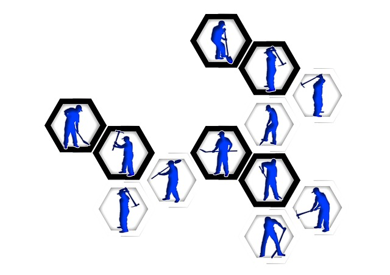

*10 yılını kutlamakta olduğumuz Bitcoin aslında daha önce ortaya çıkmış pek çok teknolojik gelişmenin üzerine kurulmuş. Devrim niteliğindeki yeniliği ise Proof-of-Work aslında. Nedir bu, gelin detaylıca bakalım.*

Geçtiğimiz [bölümde](/Sorularla_Blockchain/bolum-3/kendi-basina-hareket/) Blockchain sisteminde aktif rol oynayan birbirinden bağımsız oyuncuların nasıl olup da birlikte hareket ettiklerinin üzerinden geçmiştik. Önce işin sistematiği (mantığı) nasıl çalışıyor sorusunu geçmişte ortaya çıkmış birbirine güvenmeyen Bizans Generalleri’nin düşmana karşı nasıl ortak hareket ettiğine bakmış, sonra da bu problemin Blockchain özelinde nasıl çözüldüğüne göz atmıştık.

2018 yılının Ekim ayında 10. yılını kutladığımız Bitcoin’in yaratıcısı Satoshi Nakamoto’yu bir kez daha analım ve yaptığı devrim niteliğindeki yeniliğe bir kez daha dikkat çekelim.

## Satoshi Nakamoto’nun asıl başarısı ne idi? {#satoshi-nakamotonun-asil-basarisi-ne-idi}

Bilmemiz gereken kritik nokta şu: Meşhur Satoshi Nakamoto aslında üç parçayı bir araya getirdi. Bu parçalardan ikisi zaten ortada idi. Satoshi, üçüncü kritik parçayı geliştirdi ve bu üç parçanın birbirleri ile sağlam ve durdurulamaz şekilde çalışmasını sağladı. Neydi bu üç parça?

Birinci parça internet idi. Internet sayesinde birbirinde uzakta ve bağımsız makineler birbirleri ile bağlantı kurabildiler.

İkincisi ise şifreleme. Bu dağınık dünyadaki farklı parçaların birbiri ile güvenli iletişimi için şifreleme (Kriptografi) olmazsa olmaz koşuldu.

Bu ilk iki parça yaklaşık 20–30 yıllık bir süreç içinde yavaş yavaş geliştirildi. Eksik olan bu birbirinden uzakta makinelerin ortada bir aracı olmadan nasıl birlikte çalışacağı ve bu şekilde çalışabilmek için nasıl motive edilecekleri (ve nasıl ortak karara varacaklarını) idi.

Satoshi, Bitcoin adını verdiği dijital para fikriyle, kurduğu sistemin altyapısını işletecek oyuncuların bir arada çalışmasını sağlayan bir teşvik sistemi kurdu. İşte bu daha önce yapılmamış olan bulmacadaki eksik son parça idi. İşte Bitcoin bu sorunu çözdü ve aracıya olan ihtiyacı kaldırdı. Bu sayede Satoshi, herhangi bir otoritenin uhdesinde olmadan kendi kendine çalışan, dış tehditlere karşı kendini koruyan ve on yıldır sarsılmadan ayakta duran bir dijital para yarattı. Buna Nakamoto Konsensüsü deniyor.

Bu üçüncü parçayı biraz daha açalım. Nedir ona bakalım, başka ne tip alternatifleri var onlara da bir sonraki bölümde değinelim.

## Bitcoin’in meşhur ettiği Proof-of-Work ne, nasıl çalışır? {#bitcoinin-meshur-ettigi-proof-of-work-ne-nasil-calisir}

<figure markdown="1">

<figcaption markdown="span">Image by [Gerd Altmann](https://pixabay.com/users/geralt-9301/)[^1] from [Pixabay](https://pixabay.com/images/id-442924/)[^2]</figcaption>
</figure>

Nasıl bir uzlaşma mekanizması bu Nakamoto Konsensüsü? Bu bahsettiğimiz parçaların, o an için oluşan Blockchain zincirlerinden en uzununa doğru evrilmesi ve o zincir üzerinde mutabakat sağlanması. Bunun otomatik olması ve bir aracıya ihtiyaç duyulmaması.

Buradaki kritik nokta, makinelerin sistemin içindeyken birlikte nasıl uyumlu bir şekilde çalışacağı ve ötesinde dış tehditlere karşı kendilerini nasıl koruyacakları. Aynı zamanda makinelerin sisteme nasıl gireceğini ve sistemde iken neler yapması gerektiği. İşte bunları belirleyen kuralların en önemlisi Proof-of-Work.

Tabii PoW sistemini anlatırken, bunun aslında çok enerji harcayan bir süreç olduğundan bahsetmiştik. Olaylara maalesef yüzeysel olarak bakan medya, bunu “Bitcoin 159 ülkeden fazla enerji harcıyor” ya da “İzlanda finans bakanı Bitcoin’in ülkede yerleşim bölgelerindekinden fazla tüketimi olduğu konusunda uyarıda bulundu” gibi başlıklar ile veriyor. Hakikaten nedir derseniz, detay [yazılar](https://www.ofnumbers.com/2018/08/26/how-much-electricity-is-consumed-by-bitcoin-bitcoin-cash-ethereum-litecoin-and-monero/#footnote_0_5656)[^3] var. Örneğin: Bitcoin elektrik harcaması olarak dünyada 37. sıradaki Avusturya’dan daha fazla.

Bitcoin’in sadık kullanıcıları böyle bir enerji harcamanın uzlaşma mekanizmasının işlemesi için değil ama bu işleyen mekanizmanın dışarıdan sistemi bozmak isteyecek bir tehdide karşı kendini savunma mekanizması olduğunu belirtiyorlar. Zira, uzlaşma mekanizmasının kilit noktası sistem üzerindeki parçaların %51'inin ortak bir kabul üzerinden ilerlemesi şeklinde. Nedir bu kabul? Son 10 dakikada gerçekleşen işlemlerin herkeste aynı şekilde tutulması, tutarlı ve aynı olması.

Eğer sistemin %51'ini ele geçirmek sadece etrafa makine kurmak ve sisteme bağlanmak ile olsaydı (hatırlarsanız kimseye sormadan Blockchain sistemine bağlanıp siz de bir oyuncu olabilirsiniz), o zaman elinin altında (ya da kullanabileceği) büyük bir makine kapasitesi olan biri sistemi ele geçirebilirdi. Halbuki, Bitcoin’in oyunculara sorduğu bilmeceyi çözmek için ciddi bir enerji harcamak gerekiyor. Sistemi ele geçirmek isteyen “dış tehdit” için oldukça maliyetli bir durum bu.

Bitcoin dışında aslında Bitcoin’in küçük kardeşleri diğer alternatif kripto paraların birçoğu da PoW mekanizması kullanıyor. Ethereum (ki değiştirmeyi planlıyor), Litecoin, Monero gibi bütün büyük Bitcoin alternatifleri de PoW’e dayanıyor.

## PoW’un en önemli rakibi olan Proof-of-Stake (PoS) nasıl çalışır? {#powun-en-onemli-rakibi-olan-proof-of-stake-pos-nasil-calisir}

Peki bu kadar enerji harcamaya gerek var mı? Başka yöntemlerle de makinelerin ortak hareket etmesi sağlanamaz mı? Bu konuda kafa yoranlar var tabii. Onların da geliştirdiği alternatifler var. Gelin dilerseniz bunlara kısaca göz atalım.

Proof-of-Stake, Bitcoin’in Proof-of-Work mekanizmasına en ciddi rakip.

Farkını anlatmak için PoW’nun ne yaptığını tekrar hatırlatalım. Siz eğer Bitcoin’i bozmak gibi bir çabaya girerseniz, tüm Bitcoin’in %51’ini ele geçirecek kadar yatırım ve enerji harcamadıkça yaptığınız çaba sonuçsuz kalır ve yaptığınız tüm masraf boşa gider. Zira sistemin oyuncuları, sizin istediğinizi değil çoğunluğun yolunda giderler, siz de yaptığınız masraf ile geride kalırsınız.

O zaman şöyle bir soru soruyor diğerleri: “İyi çok güzel, bu tip mekanizma kurarak dış tehditleri önlüyorsunuz ama öte yandan iyi niyetli mevcut oyuncular da aynı şekilde bulmaca çözmek zorundalar ((Bitcoin kazanmak için gerekli çünkü). Bu nedenle ortaya çok büyük bir enerji harcaması çıkıyor. Sistemi manipüle edecek birine çok maliyet getirecek ama düzgün çalışan uyumlu oyunculara masraf çıkarmayacak dolayısıyla ‘büyük israflara’ neden olmayacak bir çözüm bulunamaz mı?”

PoS işte bunun cevabını şu şekilde veriyor. Yapılan işlemlerin teyidi için bir bulmaca çözüp enerji harcamayalım, onun yerine doğru olduğunu düşündüğümüz işlemlerin doğru olduğunu teyit için elimizdeki tüm parasal değeri rehin olarak verelim. Elimizi taşın altına koyalım yani. Sistem de bu rehin edenler içinde birine piyango ile yeni blok yaratma ayrıcalığı versin. Ne kadar çok varlık rehin edersek, o kadar çok piyango biletimizin olsun. Sonundaki ödülü kazanmadaki şansımız da o kadar artsın. Öte yanda eğer sistemi bozmaya çalışan bir dış tehdit isek, (ve eğer çoğunluğa sahip değilsek) yaptığımız manipülasyon nihai olarak sonuçsuz kalacak ve ceza olarak sistem bizim tüm varlığımızı sıfırlayacak — sıkı bir caydırıcı. Bitcoin’in en büyük dezavantajı olarak öne çıkan yüksek enerji sarfiyatı sorununu çözen bir alternatif.

Bu konuda tartışmalar halen devam etmekte. Proofof-Stake’i kullanacak olan Ethereum geliştiricileri konu üzerinde çalışmaya devam ediyorlar. Bunun dışında Cardano, OmiseGo, QTUM, Ardor PoS kullanıyorlar. Bir de PoS ile PoW’yi karışık şekilde kullananlar var (Decred, Dash, Stratis, HShare, Pivx gibi)

## Başka ne tip alternatifleri var? {#baska-ne-tip-alternatifleri-var}

Blockchain gibi değişik bazlı parçaların birbiri ile nasıl çalışacaklarına ilişkin çalışmalar sadece PoW ve PoS ile sınırlı değil tabii. Teknoloji alanında bir sorun olduğunda onlarca çözüm ortaya çıkar. Neler onlar derseniz, sadece isimlerini ve kimlerin kullandığını belirtelim:

- Proof-of-Authority(Parity) - Ripple, Hyperledger
- Delegated-Proof-of-Stake (DPos) — BitShares, Steemit (sahipleri aynı bu ikisinin), EOS
- DeligatedByzantineFaultTolerance (DBFT) — NEO
- ProofofActivity (PoA) — Digital Note, Vechain
- ProofofCapacity (PoC) — Burstcoin
- ProofofBurn (PoB) — Slimcoin
- ProofofRun (PoR) — Runcoin
- ProofofAssignment — IOTW
- ve diğerleri: DirectedAcyclicGraphs (DAG), ProofofImportance (POI), Proof-of-Elapsed-Time (POET), Leased-Proof-of-Stake (LPos), PracticalByzantineFaultTolerance (PBFT), SimplifiedByzantineFaultTolerance (SBFT)

Bunları bilmek gerçekten önemli mi? Eğer geliştirici değilseniz çok da önemi yok aslında. PoW’un etkili bir sistem olduğu biliniyor. 10 yıldır da sağlam bir şekilde kullanılıyor. Bu alternatifler ağırlıklı olarak PoW’un enerji harcaması konusundaki sıkıntılara çözüm olsun diye çıktı. Bunun yanında farklı farklı mekanizmalar PoW’a kıyasla daha hızlı, madencilerin birden fazla Blockchain’e hizmet verebilme imkanı sağlama ya da PoW’a göre daha dağıtık bir yapıya sahip olma gibi değişik alanlarda uzmanlaşmış durumdalar. Ama bundan on yıl sonra herhalde bu konuda yeterince geliştirme yapılır ve bu konu bir nüans olarak tarihteki yerini alır.

Sonuç

Yeni teknolojiler ile ilgili hep söylediğimizi tekrar edelim. Bu tip teknolojilerin olgunlaşması zaman alıyor ama güzel tarafı, herhangi bir sistemde bir eksiklik görüldüğünde (ya da hissedildiğinde) hemen birileri onun üzerinde çalışmaya başlıyorlar. Sadece eksiklik demeyelim aynı zamanda “daha verimli, daha kolay” bir çözüm arayışı sürekli olarak mevcut. Bu da aslında bu sistemlerin gücü. Zira sürekli bir ilerleme ve gelişme var. Kırk yıldır kullanılan eski sistemlere göre ne kadar büyük bir rahatlık düşünsenize.

[^1]: [https://pixabay.com/users/geralt-9301/](https://pixabay.com/users/geralt-9301/)

[^2]: [https://pixabay.com/images/id-442924/](https://pixabay.com/images/id-442924/)

[^3]: [https://www.ofnumbers.com/2018/08/26/how-much-electricity-is-consumed-by-bitcoin-bitcoin-cash-ethereum-litecoin-and-monero/#footnote\_0\_5656](https://www.ofnumbers.com/2018/08/26/how-much-electricity-is-consumed-by-bitcoin-bitcoin-cash-ethereum-litecoin-and-monero/#footnote_0_5656)
