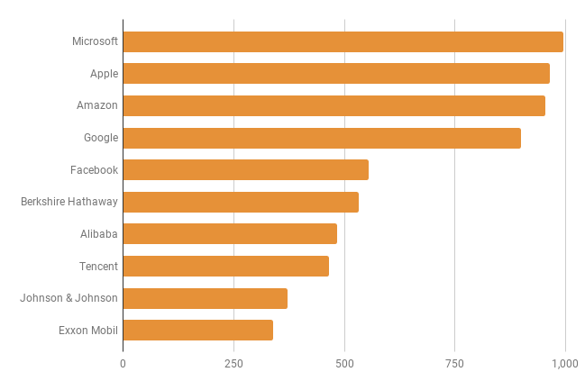

Yurtdışında (özellikle ABD'de) çok rastlarız: İnsanlar gelecek için belli öngörülerde bulunurlar ve sonrasında da bu tahminlerinin gerçekleşip gerçekleşmediğine bakarlar. Hatalarını da göğüslerini gere gere söylerler.

Bizde ise çok görülmez bu; en uzman kişiler bile genellikle hata yapmaktan korktukları için geleceğe yönelik tahmin yapmaktan çekinirler (çoktan seçmeli eğitim sisteminin getirdiği sıkıntılar bunlar aslında - yorumdan çok bilme/ezberlemenin ön planda olduğu ve hata yapıldığında binlerce sıra geriye düşüldüğü bir sistemin çocukları olarak hepimiz böyleyiz)

Hadi gelin Blockchain ile ilgili (muhtemelen bir kısmı yanlış çıkacak) birkaç öngörüde bulunalım.

## Blockchain'in geleceği nasıl görünüyor? {#blockchainin-gelecegi-nasil-gorunuyor}

Basit olanlardan başlayalım: Web 3.0'ın bize yeni bir dünya getireceği artık bir tahmin bile değil, şimdiden görmeye başladığımız bir durum.

Web 3.0 nedir derseniz, ilk [bölümümüze](/Sorularla_Blockchain/bolum-1/nedir-bu-blockchain/) göz atabilirsiniz, ama bir cümle ile özetlersek: Dijital hayatta ekonomik, sosyal, kültürel her tür ikili ya da çoklu ilişkide aracılara olan ihtiyacı ortadan kaldıran ve gücü yeniden kullanıcılara veren teknolojiler.

Peki bu teknolojilerin aracılar ile derdi ne?

Aracılar genelde merkezi yapılar. Kullanıcılar ile ilişkilerde güç dengesi hep bu merkezi yapıların tarafında. Bu dengeye karşı çıkan kullanıcı tarafındaki yeni teknolojiler ise adem-i merkeziyetsiz yani gücü kullanıcı da dahil dış oyuncular ile paylaşıyorlar.

Aracılar kullanıcılarının bilgilerini korumada yetersiz kaldıkları ya da parasal faydayı daha ön planda tuttukları için kullanıcı tepkisi çekiyorlar; yeni teknolojiler kullanıcı mahremiyetine daha önem veriyor.

Aracılar merkezi yapılar olarak zamanla genişliyor ve hantal yapılar haline geliyorlar. Bu da maliyetlerini artırıyor. Bir taraftan da bu yapıların hemen hemen tümü halka açık olduğu için her üç ayda bir borsaya kâr bildirmek, üstelik her seferinde bu kârı ciddi miktarda artırmak zorundalar. Dolayısıyla verdikleri hizmet için kullanıcılardan daha çok para isterken yeni teknolojiler daha ucuz ya da ücretsiz.

<figure><figcaption>Web 2.0 bize pek çok yeni şirket ve iş modeli getirdi. 20 yıl önce ortada olmayan şirketler bugün dünyanın en büyüğü oldular. Bakın listeye, piyasa değeri en yüksek on şirketin yedisi teknoloji şirketi ve bunların beşi Web 2.0 sonrası doğdular (Apple biraz daha eski ama esasında onun büyümesi de Web 2.0 sayesinde)</figcaption></figure>

*Dünyanın en büyük 10 şirketi - Mayıs 2019 (Milyar ABD Doları)*

Yeni girişimlerin uğraş alanı ne olacak?

Bu alanda çalışan binlerce girişim var. Hangisi başarılı olacak şu noktada bilmeye ihtimal yok tabii. Peki bu şirketler ne ile uğraşıyor olacaklar?

Öncelikle güven ihtiyacını minimuma indirmekle meşgul olacaklar. Neden? Son kullanıcının güven ihtiyacını karşılayarak ondan komisyon tırtıklayan her türlü aracıyı yukarıda saydığımız araçlar ile alt edebilmek için.

Bunu yapabilmek için, önlerinde aşmaları gereken uzun ve zahmetli bir yol var. Çünkü karşılarındaki aracıların maddi imkanları çok geniş. Bu gücü kullanarak en iyi yazılımcıları tutup en gelişmiş programları yazdırabilirler. Üstelik bunların bir çoğu müşterilerini çok iyi dinliyorlar, onların taleplerine hızlı cevap veriyorlar.

İşte bu nedenle yeni girişimlerin ucuz oldukları kadar pratik de olmaları gerekiyor. Merkezi olmayan bir yapı oluşturmak başlı başına karmaşık bir işlem. Girişimler şimdiye kadar bu altyapıyı geliştirmek için çaba sarfettiler. Ancak çıkan ürünler ya da hizmetler son kullanıcı açısından oldukça karmaşık; anlaması ve kullanması zor. Bundan sonrasında hem fonksiyon hem de kullanıcı arayüzü anlamında kullanıcı rahatlığına dönük çaba göstermeleri gerekiyor yeni teknoloji girişimlerinin.

Ya "bedava" hizmet veren merkezi aracılar?

Aslında bu mevcut devlerin birçoğu müşteriden para da istemiyor hizmetlerini sunmak için. Bedava her şey! Gerçekten öyle mi? Değil tabii. Evet belki para istenmiyor ama bu çağın artık çok daha önemli geçerli akçesi haline gelen bilgi (hem de kişisel mahrem bilgiler) karşılığında veriliyor bu hizmetler.

İşte son kullanıcılar bu alanda haklarını ve sahibi oldukları bilgileri paylaşmak konusunda ne kadar farkındalık geliştirecekler bunu hep birlikte göreceğiz. Çıkan skandallar hiç kuşkusuz farkındalığı artırıyor ama ne kadar büyük bir kitlenin umurunda bu durum onu bilmiyoruz.

Dolayısıyla eğer girişimler ücretsiz devler ile yarışıyorlar ise, o zaman sadece ekonomik, kullanışlı ve bilginin korunduğu bir hizmet vermek başarı için yeterli olmayabilir. Bunun yanında biraz da gelişen olaylar sonucu son kullanıcıların davranışlarının değişmesi ve gelişmesi için duacı olmak zorundalar. Önümüzdeki dönemde mahremiyet en tartışılan konulardan biri olmaya devam edecek.

Kullanım kolaylığı ile kişisel bilginin paylaşımı savaşını bakalım kim kazanacak?

Hâlâ çoğu aracı bedel istiyor ama...

Yine de pek çok alanda aracılar hâlâ çok güçlü ve kullanıcılardan ciddi rakamlar talep ediyorlar. Aracının olacağı her alanda yeni girişimler mevcut oyunculara gittikçe daha artan bir şekilde rakip olacaklar.

## Peki kısa vadede neler bekleniyor? {#peki-kisa-vadede-neler-bekleniyor}

Öncelikle kısa vadeli olarak baktığımızda, Blockchain dünyasında önümüzdeki aylar ve birkaç yıl boyunca en çok tartışılacak konular şunlar görünüyor:

Yönetim şekli (governance):

Bir Blockchain'in mevcut ve gelecekteki işleyişi üzerindeki karar yetkisinin kimler tarafından hangi durumlarda kullanılacağı konusunda hâlâ çok net değil.

Her bir Blockchain farklı bir yönetim prensibi benimsiyor; açıkçası hangi yönetim biçiminin öne çıkacağına ileride yaşayacağımız olaylar ışık tutacak. Değişik durum ve gelişen olaylara oyuncuların vereceği tepkiler en kullanışlı yönetim modellerini ortaya çıkaracak.

bir modelden çok birden fazla kullanışlı model olacak - sektör, ihtiyaçlar, oyuncuların beklentileri, Blockchain sisteminin olgunluğu gibi pek çok etkeni göz önüne alan farklı durumlar uygun farklı modeller göreceğiz.

Finansman modellerinde değişim

2017 ve kısmen 2018'de yaşanan Token çıkarıp yatırımcılardan direkt para toplama modeli (ICO) 2019'a geldiğimizde artık eski hızında değil. Bunun yerine kripto para borsaları ile birebir anlaşarak bu borsaların müşterilerine direkt satış yöntemi yaygınlaşıyor. Merkezi olmamak ile övünen Blockchain ruhu ile çelişen bu yöntem daha ne kadar sürdürülebilir önümüzdeki aylarda göreceğiz.

Kripto alanında uzmanlaşmış fonlar aracılığı ile halka açılma öncesi finansman modeli de 20172018 öncesine göre evrim geçiriyor. O yıllarda (tıpkı internet balonunun patladığı 2000'ler öncesinde olduğu gibi) önüne gelen girişime neredeyse gördüğünde cebine para sokacakmış gibi kolayca para veren fonlar kalmadı artık. Bunun yerine, seçici davranan ama inandığı girişime çok büyük meblağlı çekler kesen fonlar var artık.

Bu fonlar sadece şirkete yatırımla da kalmıyorlar, bunun yanında ekosistemi geliştirici madencilik ya da yatırım yaptığı ekosisteme destek olacak daha küçük girişimlere yatırım gibi yan alanlara da kaymış durumdalar. Fonlar aktif yatırımcılık yapmaya devam edecekler.

Çeşitlenen özel Blockchain girişimleri

Geçtiğimiz yıl içinde özel/kapalı (private) Blockchain alanında yapılan denemelerde sınırlı başarı elde edildi. Tasarruf odaklı elde edilen kazanımlar yapılan zahmete henüz değmiyor. Bu da iş çevrelerinde Blockchain ile ilgili genel heyecanı biraz söndürmüş görünüyor.

Bir yandan da sessiz ama derinden devam eden pek çok proje var. IBM bu konuda desteklediği Hyperledger teknolojisi ile hem kendi iç yatırımına hem de ekosistemi geliştirici hamlelerine devam ediyor. Bunu yaparken de potansiyel olduğunu düşündükleri sektörlerde lider şirketler ile işbirliğinde tam gaz ilerliyorlar. Kısa vadede çok büyük bir başarı beklentisi yok, uzun vadeli olarak potansiyel ne kadar gerçek olacak onu da bekleyip göreceğiz.

İşbirliği / karşılıklı çalışılabilirlik (interoperability)

Önümüzdeki dönemin en önemli konularından biri Blockchain'lerin karşılıklı olarak birbirleri ile iletişimde olmaları olacak. Şu an her bir Blockchain kendi dünyası içinde doğuyor ve büyümeye çalışıyor. Bir noktaya kadar bu şekilde belli bir gelişim gösterebilirsiniz. Ancak daha fazla büyüme ve kullanıcı adaptasyonu için mutlaka daha geniş bir alanda oynamalı ve diğer Blockchain'ler ile bilgi alışverişi sağlamalısınız. İşte bu konuda interoperability denen karşılıklı işbirliğini artırıcı altyapı çalışmaları da tam gaz devam ediyor. Gelin dilerseniz bu son maddeye biraz daha detaylı bakalım:

## Blockchain’ler birbirleri ile konuşur mu? {#blockchainler-birbirleri-ile-konusur-mu}

Burada ve benzer pek çok yazıda Blockchain üzerine değişik girişimleri okuyoruz. Ancak dikkat ettiniz mi bilmiyorum, bu tip girişimlerin her biri genelde ayrı bir Blockchain kuruyorlar. Ve birbirleri ile pek bir bağlantıları yok. Zaten kullanıcıları çok sınırlı, hatta pek çoğunun sıfıra yakın. Yani bir okyanus üzerine kurulmuş ıssız adalar gibiler. Bu ne kadar sağlıklı?

<figure markdown="1">

<figcaption markdown="span">Photo by [Daria Shevtsova](https://unsplash.com/@daria_shevtsova)[^1] on [Unsplash](https://unsplash.com/photos/k_RYBedEvDw)[^2]</figcaption>
</figure>

Blockchain'leri bağlamak ne demek?

Peki bunları neden birleştirmek isteyelim, ya da istesinler? Belli başlı birkaç neden var. Bunlardan en önemlisi kullanıcı sayısını çoğaltmak tabii ki. Blockchain'lerin birbirleri ile bağlantıları olması, kullanıcılara pratik pek çok fayda getiriyor, bu da karşılığında kullanıcı adaptasyonunu artırıyor.[https://unsplash.com/@daria\_shevtsova?utm\_source=unsplash&utm\_medium=referral&utm\_content=creditCopyText](https://unsplash.com/@daria_shevtsova?utm_source=unsplash&utm_medium=referral&utm_content=creditCopyText)

Şu anda kullanılan başka alternatifler var mı?

Tam olarak bire bir olmasa da birçok girişim kendi Blockchain'ini kurmak yerine mevcut bir Blockchain altyapısını kullanıyor. Örneğin önceki bir [bölümde](/Sorularla_Blockchain/bolum-2/sanat/) bahsettiğimiz [CryptoKitties](https://www.cryptokitties.co/)[^3] yani Kripto Kedicikler aslında Ethereum üzerine kurulmuş bir oyun. Ethereum, değişik alanlarda kullanılabilecek (para dışında) bir altyapı oluşturduğu ve özellikle de Akıllı Kontratlar konusunda üstüne kurulan uygulamalara esneklik getirdiği için bu alanda en rağbet gören Blockchain.

Peki neden Ethereum üzerine dApps yazarsın, ne zaman kendi Blockchain'ini kurarsın?

Ethereum üzerine uygulama yazmanın hayatı kolaylaştırdığı kesin. Bir kere geniş bir ekosistemin içine giriyorsunuz. Yazılımcı bulmanız kolay, kullanıcılara ulaşmak kolay. Strateji derslerinde sık sık söz edilen Küme Etkisi (Cluster Effect) durumu var burada, bir nevi - bütün kuyumcuların bir çarşıda toplanması gibi...

Örneğin geçtiğimiz yazılardan birinde bahsettiğimiz DeFi hareketi, bu şekilde Ethereum üzerine kurulu finans alanında çalışan girişimlerin birbilerini kullanmasına dayanıyor. Biraz daha açalım. Bu alanın aslında birbirine rakip gibi görünen iki girişimi var: [Dharma](https://www.dharma.io/)[^4] ve [MakerDAO](https://makerdao.com/en/)[^5].

Her ikisi de kişilere kredi hizmeti sağlıyor. Dharma bu hizmeti verirken MakerDAO'nun yarattığı DAI parasını kullanıyor örneğin. Nasıl yapabiliyor bunu? Temelinde her iki uygulamanın da Ethereum üzerinde olması var. Bir kullanıcı Dharma protokolünde MakerDAO'nun parasını kullanıp ETH (Ethereum'un parası) borçlanabiliyor. Sonra da bu ETH ile gidip kendisine CryptoKitty alabiliyor.

Öte yandan Ethereum gibi bir Blockchain üzerine uygulama yazdığınızda normal olarak pek çok alanda özgürlüğünüzden feragat ediyorsunuz. Altyapınızın gelişiminde Ethereum'un hızına uyum sağlamak zorundasınız. Onun getirdiği yazılım dilleri içinde gelişim yapmalısınız. Onun güvenlik protokollerini kullanmak zorundasınız. Kendinize ait gelişimini ve işleyişini yönetebileceğiniz bir Blockchain olmuyor- Ethereum'a bağlısınız. Ve yine aynı şekilde iletişimde olup birlikte hareket edebileceğiniz girişimlerin de yine Ethereum altyapısını kullanması gerekiyor. Bir başka yapıyı (örneğin Tezos ya da Stellar) kullanan bir yapı ile iletişiminiz kapalı.

Başka bir yol yok mu?

Peki o zaman bir orta yol bulunamaz mı? Hem her türlü hakkına sahip olduğum bir Blockchain'im olsun, hem de diğer Blockchain'ler ile rahatça iletişimde olayım? İşte son birkaç yıldır perde arkasında çalışmasını sürdüren ve bu günlerde görücüye çıkan Interoperatibility konusuna geldi sıra.

Interoperability ne demek?

Interoperability Ethereum'un yaptığını bir parça daha genişleten bir kavram aslında. Nasıl Ethereum, kendi üzerine kurulan girişimler (dApps) arasında iletişim sağlıyor ancak başka silolara iletişim konusunda sıkıntı yaşatıyor ise, Interoperability sağlayan girişimler aslında bir nevi bunu da aşacak bir çözüm bulmaya çalışıyorlar. Yani, Ethereum üzerine kurulu bir girişimin, başka bir siloda kurulu (örneğin Tezos) başka bir girişim ile iletişimde olmasını sağlıyor. Ya da bir sistemi kullanan bir kullanıcının başka bir sisteme de angaje olabilmesine olanak veriyorlar.

Bireysel kullanıcılar için ne ifade ediyor bu?

En basit ifadesiyle kullanıcı rahatlığı. Projeler arasında bilgi paylaşımı olması, kullanıcıların kendilerine ait bilgilerinin (kullanıcının izin verdiği kadarının) değişik projelerde kullanılabilmesi anlamına geliyor. Bunu sadece bilginin paylaşılması anlamında değil aynı zamanda bir teyid fonksiyonu olarak da düşünün. 18 yaşından büyük olduğunuz, finansal olarak kabul edilebilir durumda olduğunuz gibi pek çok özelliğiniz ile ilgili detay bilgiyi ayrı ayrı projelere tekrar tekrar vermek yerine, bir projeden alacağınız “yeterlilik belgesini" içeriğindeki detayları paylaşmadan diğer projelerde kullanabilmek gibi.

Bunun yanında bir Blockchain içinde yarattığınız bir varlığın bir başka Blockchain içinde de değeri olması demek. Bir Blockchain için kullanılan bir parayı alıp kripto para borsasında satmak ve başka bir Blockchain üzerindeki parayı almak yerine sistemler arasında hızlıca geçiş yapmak anlamına geliyor bu. Bunu yaparken de daha önce de bahsettiğimiz [Akıllı Kontratlar](/Sorularla_Blockchain/bolum-6/ethereum-hikayesi/#akilli-kontrat-olur-mu-ethereum-ve-akilli-kontratlar) kullanılıyor.

Girişimler için ne ifade ediyor?

Girişimciler için temel avantajı bir ekosistemde olmanın getirdiği rahatlık. En önemlilerinden biri, bir Blockchain kurduğunuzda bu Blockchain'in güvenliğini uzlaşma mekanizmalarını da kullanarak bağımsız teyid ediciler ile sağlıyorsunuz (Bitcoin sistemindeki madenciler gibi) Bu teyid edici makinelerin sizin sisteminizde olması ve sisteminizin güvenliğini sağlamaları için onlara bir ödül vermeniz gerek. Ayrıca sizin gibi başka pek çok proje de bu makinelerin peşinde. Interoperability içinde yer alırsanız (örneğin Polkadot) makine bulmak için uğraşmıyor ve ortada bulunan bir havuzdan dilediğiniz gibi yararlanıyorsunuz (ücreti mukabilinde).

Tabii burada şuna da bakmak lazım. Kimi girişimciler için projenin güvenliği hayati önem taşırken, kimileri için o kadar da önemli olmayabiliyor. Normalde bir Bitcoin benzeri değer taşıma üzerine kurulu bir kripto paradan bahsediyor olsak, sistemin güvenliğinin tehlikeye girmesi o kripto paranın değerini sıfıra indirebilir. Dolayısıyla bu kripto paranın geliştiricileri güvenlik için her tür fedakarlığı yapabilir.

Bir de CryptoKitty'leri düşünün. Yani güvenlik iyi güzel de tek özelliği değer taşımak olan bir kripto para kadar değil. Ama baktığınızda CryptoKitty'ler de Ethereum ağı üzerinde bu bahsettiğimiz diğer kripto para da. Ethereum kendisini süper güvenli yapmak zorunda ve bundan dolayı ciddi bir maliyeti var. CryptoKitty sırf Ethereum ağında olduğu için aslında gereksiz yere fazladan bu masrafa katlanmak zorunda.

Halbuki Interoperability sağlayan bir ağ üzerinde olsa bu alanda güvenlik için gerektiği kadar kullanıp çok daha ekonomik bir şekilde sürecini yönetebilir.

Interoperability alanında çalışan ve ilerleme sağlamış iki tane girişim bulunmakta. [Polkadot](https://polkadot.network/)[^6] ve [Cosmos Network](https://cosmos.network/)[^7]. Önümüzdeki yıllarda her iki projeyi de sık sık duyacağız.

Sonuç

Blockchain alanı önümüzdeki yıllarda hem kapalı hem de açık Blockchain’lerde heyecan verici gelişmelere gebe. Girişimler mevcut Web 2.0 devlerini alt edebilecekler mi bunu merakla bekliyor olacağız. Ama kesin olan şu: Yarış artık olması gerektiği gibi son kullanıcıyı memnun etmeye döndü ve bu dönüşümden en kârlı biz son kullanıcılar çıkacağız.

[^1]: [https://unsplash.com/@daria\_shevtsova](https://unsplash.com/@daria_shevtsova)

[^2]: [https://unsplash.com/photos/k\_RYBedEvDw](https://unsplash.com/photos/k_RYBedEvDw)

[^3]: [https://www.cryptokitties.co/](https://www.cryptokitties.co/)

[^4]: [https://www.dharma.io/](https://www.dharma.io/)

[^5]: [https://makerdao.com/en/](https://makerdao.com/en/)

[^6]: [https://polkadot.network/](https://polkadot.network/)

[^7]: [https://cosmos.network/](https://cosmos.network/)
