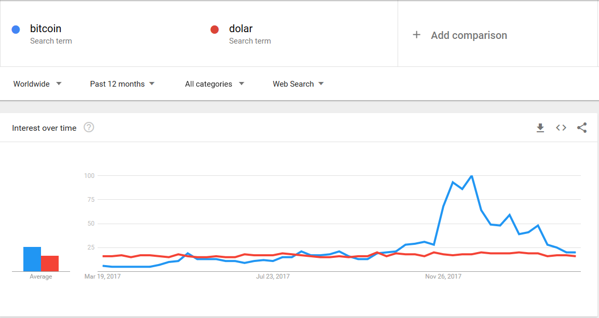
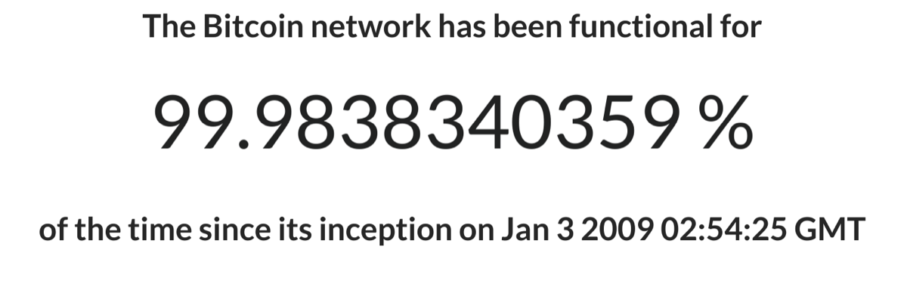
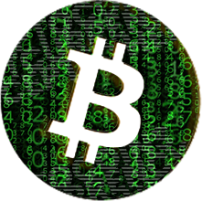

*Blockchain ile ilgili bir parça okuduysanız, Blockchain teknolojisi üzerine kurulan onlarca hatta yüzlerce kripto para olduğunu göreceksiniz. Ancak herkesin dilinde Bitcoin var.*

<figure markdown="1">

<figcaption markdown="span">Kaynak: [icons8](https://photos.icons8.com/photos/5a8bed328b658800019f1d52)[^1]</figcaption>
</figure>

Baksanıza geçtiğimiz yıl “enflasyon” kelimesinden daha fazla aranmış Google Türkiye’de. (Ama tabii herkes ne olduğunu bildiği için olabilir, örneğin “küresel ısınma” da hiç aranmamış, herkes tehlikenin farkında belli ki.)

<figure markdown="1">

<figcaption markdown="span">Kaynak: [Google Trends](https://trends.google.com.tr/trends/explore?geo=TR&q=bitcoin,blockchain,enflasyon,k%C3%BCresel%20%C4%B1s%C4%B1nma)[^2]:</figcaption>
</figure>

Aslında bu normal. Çünkü Bitcoin diğerlerinden farklı — bir nevi bu işin Altın Standardı, tabiri caiz ise ‘ağır abisi’. Neden? Anlatalım.

## Bitcoin’in kritik püf noktası ne? İpucu: “Uzlaşma Mekanizması” {#bitcoinin-kritik-puf-noktasi-ne-ipucu-uzlasma-mekanizmasi}

Geçmiş [bölümlerden](/Sorularla_Blockchain/bolum-1/dalganin-farkinda-miyiz/) de hatırlayacağınız gibi, kripto (şifreleme) teknolojisi 1970’lerden beri süregelen araştırmalar sayesinde hatırı sayılır bir olgunluğa erişmişti.

Sonrasında 2008 yılında Satoshi Nakamoto denen kişi(ler), bu kripto teknolojisini kullanarak dünyanın farklı yerlerinde bulunan (adem-i merkezi yapıdaki) makineleri kendi aralarında olabilecek “güven” sorununu en aza indirecek bir “uzlaşma (mutabakat) mekanizması” aracılığıyla birleştirdi. Bu da, merkezi yapıya olan ihtiyacı ortadan kaldıran bir devrim yarattı.

Bu mutabakat mekanizması dünyanın dört bir yanına dağılmış birbirini tanımayan makineler tarafından yapılıyordu. Neden? Çünkü, farklı yerlerde olan makineleri fiziksel olarak kontrol altına almak imkânsız.

Yine hatırlarsak, “uzlaşma mekanizması”, taraflar arasında yapılan işlemlerinin makineler tarafından onaylanması idi. Bu basitçe şöyle gerçekleşiyor: İki taraf arasında yapılan işlem, bir makine tarafından “kayda geçiriliyor” ve anında diğer makinelere haber gönderiliyor. Bu şekilde, yapılan bütün işlemler yaklaşık 10 dakikada bir toplanıp tek bir paket haline getiriliyor. Makineler bu paketin doğru olduğunda anlaşırsa, tekrar çalışmaya ve yeni, bir sonraki paketi oluşturmaya başlıyorlar.

Makineler arasında uyumsuzluk genelde olmuyor yani birbirleri ile anlaşıyorlar (istisnalar olabiliyor, sonraki bölümlerde bahsedeceğiz, şimdilik kafamızı karıştırmayalım). Olması durumunda ise çoğunluğun kabul ettiği sonuç ile ilerliyor sistem. Yani makinelerin %51’i ne isterse o oluyor.

Peki, dünyanın dört bir yanına dağılmış makineler neden bu sisteme bağlansınlar? Sonuçta makineler elektrik ile çalışıyor. Karşılığı olmadan gönüllü yapılan hareketler ancak insanlar tarafından, o da ya kişisel gönüllülük ya da ideolojik amaç uğruna yapılıyor.

Üstelik bir sorun daha var. Diyelim makineleri topladık ve bir ağ kurduk. Makineler bu ağa güçleri kadar katkı yapıyorlar. Ya birisi çok güçlü bir makine geliştirir, ya da binlerce makinelik bir ağ kurar ve bu sistemin %51’ini ele geçirirse?

Makinelere “mutabakat mekanizması”nı çalıştırmaları için bir ödül vermek lazım yoksa çalışmayı bırakırlar, bu da bir kişi ya da gücün sistemin %51’ini ele geçirmesine neden olabilir.

## Artık şu Bitcoin’e gelsek mi? {#artik-su-bitcoine-gelsek-mi}

İşte geldik Bitcoin’e! Efendim, Blockchain sisteminde yükü çeken makinelerin bu yaptıkları işlemleri kayıt etme, daha sonra da teyit etme işlemi sonucu aldıkları ödüle (ya da lotarya) Bitcoin deniyor.

Neden lotarya deniyor? Zira, bu on dakikada bir yapılan teyit işlemi aslında çok zor bir bulmaca. Bir nevi Sudoku oyunu gibi düşünün. Sistem bu soruyu soruyor, binlerce makine de bu bulmacayı çözmeye çalışıyor. Bulmacanın bir çözümü var — bir makine çözüyor ve sonucu diğerlerine bildiriyor. Yine aynı Sudoku’daki olduğu gibi çözmesi zor ancak başarıldığında çözümün doğru olduğu anında görünebiliyor. Yani diğer makineler çözümü görüyor, mutabık kalıyor ve yeni paket üzerinde çalışmaya başlıyor.

Şimdi diyeceksiniz neden bu kadar zor bir bulmaca var? Çünkü sistemi kuranlar, bu bulmacanın basitçe çözülmesini istemiyorlar. Makinelerin bunu çözerken ciddi bir elektrik harcaması yapmasını özellikle istiyorlar. Ki böylece, yukarıda bahsettiğimiz sistemin %51’ini ele geçirmek inanılmaz pahalı bir hale gelsin.

“Bitcoin çok enerji harcıyor“ söylemlerini de duymuşsunuzdur muhakkak. Doğru — çok enerji harcıyor. Ama sistemi dışarıdan gelecek tehlikelere karşı tutmak için ödenen bir bedel bu. Şu anki Bitcoin değeri on binlerce makinenin çalışmasında kullanılan enerji maliyetini karşılamaya yetiyor. Eğer bir gün Bitcoin fiyatları düşerse makineler de çalışmayı bırakabilir ve sistem bir noktada kendi dengesini bulur.

Ha bu arada “bu 10 dakikada bir mutabakat yapma iyi de teknoloji gelişiyor, makineler artık daha güçlü” diyebilirsiniz. Onun da çözümünü bulmuşlar: eğer bir bulmaca 10 dakikadan önce çözülürse, bir sonraki bulmaca zorlaşıyor!

## Bitcoin’in bir değeri var mı? {#bitcoinin-bir-degeri-var-mi}

“İyi tamam da, niye Bitcoin’e bir değer atfediliyor” diye bir soru aklınızı kurcalıyor ise, aslında yukarıda elektrik harcaması ile başladığımız değer atfı konusunu “para” terimi üzerinden biraz daha açmaya çalışalım.

Paranın iki ana özelliği var esasında. Bir değer saklama aracı olması, ikincisi değiş tokuşa aracılık etmesi.

Para ya da banknot eğer buna değer atfeden ya da bu kâğıt parçası karşılığı bir hizmet veren varsa bir anlam taşır. Yoksa üzerinde dolar yazan yeşil bir banknot kâğıt parçası olarak arkasında ABD hükümeti olmadıkça bir anlam ifade etmez. Peki ya altın? Alıyor ve satıyorsunuz, yani birileri bu madene bir değer atfediyor (çıkartılması maliyetli diyorsanız, evet doğru aynen Bitcoin’de olduğu gibi)

Bitcoin, para dediğimiz mefhumun bu iki ana özelliğini de taşıyor: Değer depolama ve değişim aracı olmak. Ancak özellikle son zamanlarda, Bitcoin’e talebin çok fazla olması, dolayısıyla çok değerlenmesi nedeniyle depolama özelliği ön plana çıktı. Zira insanlar fiyat yükseleceği beklentisi ile Bitcoin’i herhangi bir alım satım işlemi için kullanmayıp kenarda bekletiyorlar!

O nedenle şu anda Bitcoin’in en çok benzetilebileceği araç altın. Değişim için fazla kullanılmıyor, eskimiyor, daha çok değeri için tutuluyor. Tabii başka avantajları da var, hızlıca el değiştirebilmesi, coğrafi sınırlara bağlı olmaması gibi.

Tabii Bitcoin’in altın ve diğer resmi kâğıt paralardan önemli bir farkı var. O da Bitcoin yaratımı kısıtlı ve bir süre sonra da (tahmini 2140 yılında) bitecek. Dolayısıyla da enflasyonist değil deflasyonist bir sistem ile kurulmuş. Bu da Bitcoin’in değerinin zaman geçtikçe yükseleceği şeklinde bir düşünce yaratıyor. Doğru mu değil mi göreceğiz.

Bitcoin bu alanda ortaya çıkan ilk kripto para olduğu ve yıllarca bir kere bile üzerinde işlem yapılması sekteye uğramadığı (ya da engellenemediği) için dijitalleşen dünyada en çok kabul gören para birimi oldu. Bunun yanında arkasında merkezi bir yapı yok, hatta bir web sitesi bile yok ([www.bitcoin.com](http://www.bitcoin.com/) Bitcoin’e değil onun klonu Bitcoin Cash’e ait, karıştırmayın), bu da tek bir gücün eline geçmesini zorlaştırıyor.

<figure><figcaption>Kaynak: www.bitcoinuptime.com</figcaption></figure>

Bitcoin konusunda iyimser olanlar Bitcoin’in gelecekte dünyanın kullanacağı sınırları olmayan, tek bir hâkiminin olmadığı global bir para olacağını düşünüyor. Şimdiden yer kapma amacıyla Bitcoin’e hatırı sayılır bir değer biçiyorlar.

Bitcoin konusundaki karamsarlar ise, dünyanın şu anki hâkimi olan güçlü kuruluşların gelecekte de Bitcoin sistemini aynı şekilde kontrol edeceği görüşündeler. Sonucun ne olacağını hep birlikte göreceğiz.

## Bitcoin nasıl başlamış? {#bitcoin-nasil-baslamis}

<figure markdown="1">

<figcaption markdown="span">Image by [designwebjae](https://pixabay.com/users/designwebjae-1753371/)[^3] from [Pixabay](https://pixabay.com/illustrations/image-set-internet-vectors-3046593/)[^4]</figcaption>
</figure>

Kripto paraların en eskisi, en çok kullanılanı, bir nevi şahı. Diğer bütün paralardan ayrılan birkaç özelliği var. Öncelikle, kurulmak için herhangi bir yatırım almamış. 2008 yılında çıkan kriz sonrası koca koca bankaların batması ihtimali ve devletlerin bu bankaları kurtarmak için (finansal krizi önlemek adına) milyarlarca dolar para basmasına tepki olarak bir grup siberpunk tarafından geliştirilen fikrin meyvesi. Bu dev bankaların batma ihtimali onlarda “acaba paramız mevcut sistemde güvende mi?” sorusunu doğurdu. Devletlerin finansal krizi önleme adına milyarlarca dolar karşılıksız para basması ise onlarda “mevcut düzenin koruyucusu olan devletler ne kadar sorumlu davranıyorlar?” şeklinde düşünceler ile ilk sorulan sorunun etkisini daha da derinleştirdi. Sonunda da Satoshi Nakamoto tarafından yaratılan Bitcoin ortaya çıktı.

Ancak deneysel bir ürün olan Bitcoin’in Internet üzerinden kuralsız olarak her türlü ürünü satan Silk Road sitesinde kullanıma başlaması (kredi kartı ile ödemede tüm kimlik bilgileri ifşa edilirken Bitcoin’de bir tür gizlilik olması nedeniyle) Bitcoin’e ilgiyi patlattı. Ancak Bitcoin’in (ve Satoshi’nin istediği) istediği normal olarak bu tip bir kötü şöhret değildi. 2010 yılı sonunda ABD hükümeti geçmişte yaptığı gizli işleri ortaya çıkaran Wikileaks’e halk tarafından yapılan yardımları kredi kartı sistemleri üzerinden engellemeye başladı. Bunun üzerine Wikileaks’in Bitcoin ile bağış toplamaya başladığını açıklaması Bitcoin’e olan talebi iyice yükseltti.

Ancak Bitcoin kurucusu ve o zamana kadar anonim olan Satoshi yazdığı bir yazı ile Bitcoin’in deneysel bir ürün olduğunu henüz gerçek hayatta pratik kullanıma hazır olmadığını belirterek Wikileaks’den Bitcoin ile bağış uygulamasına son vermesini rica etti. Wikileaks’in bunu dinlememesi sonrası ise Satoshi sırra kadem bastı. Şu anda nerededir, kimdir bilen kimse yok. Pardon, bilen bir kişi vardı, o da Bitcoin üzerinden yapılan ilk para transferinden Satoshi’den $100 alan [Hal Finney](https://en.wikipedia.org/wiki/Hal_Finney_%28computer_scientist%29)[^5], o da 2014 yılında hayata veda etti.

<figure markdown="1">

<figcaption markdown="span">Satoshi’yi bildiğine emin olduğumuz tek kişi: Hal Finney (Kaynak [Wikipedia](https://en.wikipedia.org/wiki/File:Hal_Finney_%28computer_scientist%29.jpg)[^6])</figcaption>
</figure>

Sonrasında değişik iniş ve çıkışlar yaşayan, defalarca değeri fırlayan, defalarca değeri yarıya düşen, her yıl birkaç kere “artık öldü” denilen ama her seferinde daha da güçlü bir şekilde hayatını sürdüren, kurulduğundan beri bir dakika bile işlemleri sekteye uğramamış bir kripto para, Bitcoin hayatımıza girdi. (Bu arada “Bitcoin öldü” haberleri için istatistik bile tutuluyor, şu ana kadar 300’ü geçmiş, sırf bunu takip eden web siteleri var[^7])

[^1]: [https://photos.icons8.com/photos/5a8bed328b658800019f1d52](https://photos.icons8.com/photos/5a8bed328b658800019f1d52)

[^2]: [https://trends.google.com.tr/trends/explore?geo=TR&q=bitcoin,blockchain,enflasyon,k%C3%BCresel%20%C4%B1s%C4%B1nma](https://trends.google.com.tr/trends/explore?geo=TR&q=bitcoin,blockchain,enflasyon,k%C3%BCresel%20%C4%B1s%C4%B1nma)

[^3]: [https://pixabay.com/users/geralt-9301/](https://pixabay.com/users/geralt-9301/)

[^4]: [https://pixabay.com/images/id-442924/](https://pixabay.com/images/id-442924/)

[^5]: [https://en.wikipedia.org/wiki/Hal\_Finney\_(computer\_scientist)](https://en.wikipedia.org/wiki/Hal_Finney_%28computer_scientist%29)

[^6]: [https://en.wikipedia.org/wiki/File:Hal\_Finney\_(computer\_scientist).jpg](https://en.wikipedia.org/wiki/File:Hal_Finney_%28computer_scientist%29.jpg)

[^7]: https://99bitcoins.com/obituary-stats/
