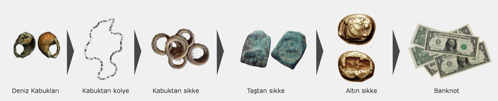
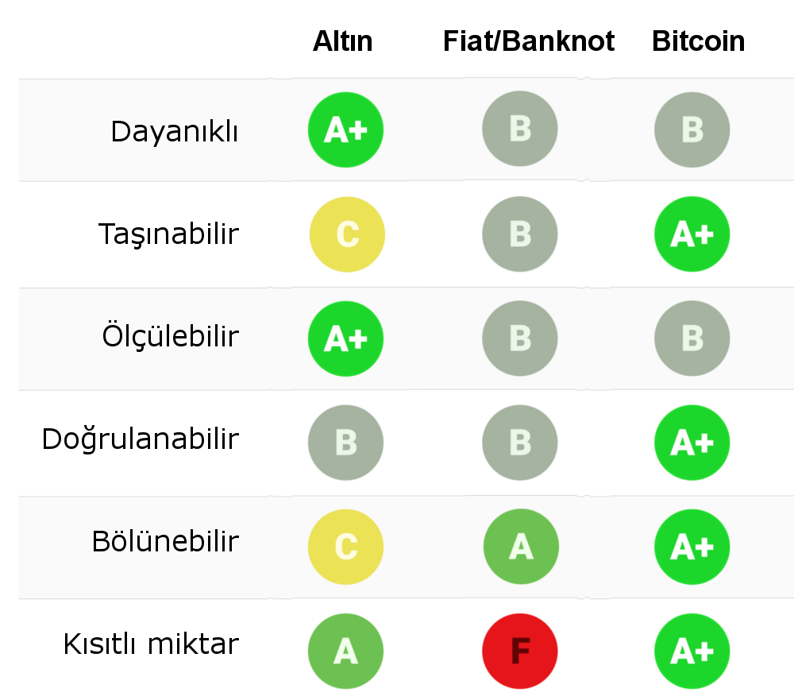

*“Nasıl para denir bu Bitcoin’e aklım almıyor” diyorsanız buyurun beraber bakalım:*

Önceki [bölümden](/Sorularla_Blockchain/bolum-5/bitcoin-ne-tam-olarak/) kısaca özetlersek, Blockchain yeni çıkan bir altyapı, dijital varlıkların transferine yarıyor ve büyük bir devrim yaratma potansiyeli var. Bitcoin de bu dijital varlıkların sadece biri. Kripto paraların içinde en bilinen ve en kullanılır olanı.

Şimdi burada akılları en çok karıştıran soru şu: “Bitcoin’in para olduğunu nasıl iddia edersin?” Öyle ya, gözle görülmez, elle tutulmaz, arkasında herhangi bir değer yok gibi görünüyor. Nasıl olur da para denir böyle bir “şeye”? Önceki bölümlerimizde basitçe değinmeye çalıştık ama sanki bir miktar daha açmaya ihtiyaç var. Paranın ilk çıkışından başlayalım dilerseniz.

## Paranın ortaya çıkışı nasıl olmuş? {#paranin-ortaya-cikisi-nasil-olmus}

İlkçağlarda insanlar alışveriş için değiş-tokuş (takas - barter) yöntemini kullanıyorlardı. Benim ineğimden aldığım bir kilo süt var, senin de bahçenden topladığın iki kilo domates. Ver domatesini al sütümü. Çok güzel ancak her gün domates yenmez ama evdeki çocuğun her gün süt içmesi lazım. Ben senden her gün domates alamam ki? Dolayısıyla takas yöntemi ikili basit alışverişlerde kullanılabilir ama büyük miktarlarda ve hayatın akışında kullanımı pratik değil.

Alışverişler için başlangıçta kullanılan değiş-tokuş yöntemi belli büyüklüklerde işe yaramamaya başlayınca insanoğlunun en içgüdüsel dürtülerinden biri yardıma koşmuş. Biriktirmek — özellikle güzel bulduğu ya da az olduğunu düşündüğü nesneleri… Örneğin deniz kabuklarını… Bu kabukları sadece biriktirmekle kalmamış insanlar, bunlardan kolyeler yapmaya başlamışlar. Sonrasında bu kolyeleri birbirlerine hediye etmişler. Birinde bu kolyeyi görüp çok beğenen komşusu ona sahip olabilmek için evinde bulunan yiyecekleri teklif etmiş. Sonra komşu da aldığı bu kolyeyi başka bir ihtiyacını karşılamak için başkasına teklif etmiş. Bu şekilde bir değer transferi aracı olmuş bu kabuklar ve kolyeler.

Yüzyıllar geçtikçe aracılık için kullanılan nesneler daha gelişmiş ve kullanışlı olanlardan seçilmeye başlanmış. Zamanla deniz kabuklarının yerini metaller, bakır ve metal paralar almış. Sonrasında ise altın ön plana çıkmış ve alışverişlerde kullanılan ana öğe olmuş. Ta ki devletler ortaya çıkıp önce altın karşılığı kâğıt para basıp, sonra ise karşılıksız istedikleri kadar para yaratana kadar… (Burada hemen şunu da belirtelim: Eğer hala Merkez Bankalarının altın karşılığı para bastığını düşünüyorsanız, maalesef o günler Vietnam Savaşı sırasında Nixon’un imzaladığı bir emir ile tarih oldu, artık bu basılan paraların rezerv bir karşılığı yok)…

<figure markdown="1">

<figcaption markdown="span">Kaynak: [Nakamoto Institute](https://nakamotoinstitute.org/shelling-out/)[^1]</figcaption>
</figure>

## Paranın olmazsa olmaz özellikleri neler?: Değer atfedilme ve aracılık etme {#paranin-olmazsa-olmaz-ozellikleri-neler-deger-atfedilme-ve-aracilik-etme}

Yukarıda bahsedilen tüm bu nesnelerdeki iki ana öğe paranın esasını oluşturuyor “değer atfedilmesi” ve alışverişlere “aracılık etmesi”. Bunlar paranın olmazsa olmazları.

## Her para bir değil. Neler değerini artırır paranın? {#her-para-bir-degil-neler-degerini-artirir-paranin}

Ancak tabii burada sorun şu: Hangi nesneleri bu iş için kullanacağım? Doğada her nesneden var. Bu nesnelerden bir ya da birkaçı ön plana çıkacak ama hangisi? Eğer ben diğerlerinden önce bu ön plana çıkacak nesneyi anlarsam, bunları toplarım, sonradan gelenler az bulunan ve talep gören bu nesneleri talep edince değeri yükselir. Ne gibi özellikler bu nesnenin değerini artırır?

1. Öncelikle ihtiyaçlarım bugün farklı yarın farklı. Yazın farklı kışın farklı. Dolayısıyla elimde tuttuğum bu nesneleri sadece yarın değil önümüzdeki aylarda da kullanabilmeliyim. Hatta benim çocuklarım var onlara iyi bir gelecek sağlamalıyım; eğer aracılık yapacak bu nesneleri çocuklarıma bırakabilsem benim için daha kıymetli olurlar. Dolayısıyla ne kadar dayanırsa o kadar iyi. İşte değerli bir paranın ilk özelliği “Dayanıklı” olması
2. Tabii evde duran nesneler güzel ama eğer ben bunları taşıyıp başka yere götürebilirsem yani “yükte hafif” olursa, bunu nesnenin daha takdir gördüğü yerlerde kullanabilirim. Bu da benim için değerini artırır. Ayrıca yanımda taşıyabilirsem, gönül rahatlığıyla seyahat edebilirim. Evde bırakıp “eve gece yarısı hırsız girerse” diye uykularım kaçmaz. İşte paranın değerini artıran ikinci özellik “Taşınabilir” olması.
3. Elimde tuttuğum nesnelerin şekilleri ve içerikleri benzer hatta aynı olmalı ki el değiştirirken aynı değerden kabul görsün. O nedenle, örneğin altın pırlantaya göre alışveriş yapmak için daha kullanışlı, zira herhangi bir parçası diğerine eşit, pırlanta gibi şekli, kesimi, netliği önemli değil. Kullanışlılık demek değer demek, bunun için nesnenin “Ölçülebilir” olması değerini ciddi olarak artıran bir özellik.
4. Bu nesnelerin bana güzel gelmesi ve benim için özel olması çok da önemli değil. Önemli olan bunun değerinin başkaları tarafından da takdir ediliyor olması. Bunun için en önemlisi, bakan bir kişinin bu nesnenin gerçekten konuştuğumuz nesne olduğunu hemen anlayabilmesi yani “Doğrulanabilir” olması.
5. Herhangi bir eşyanın satıcı ile alıcı tarafından üzerinde anlaşılan ortak bir değeri oluştuğunda, alışveriş için kullanacağım nesnenin bu değeri tamı tamına karşılayabiliyor olması lazım. Hayatta her zaman bu kadar şanslı olmayacağımız için, genellikle elimizdeki nesnenin tamamı değil sadece bir parçası bu eşyayı almak için yeterli olacak. Aksi halde elimizdeki nesneden fazla miktarda vereceğiz karşı tarafa, bir nevi nesnemizin değeri düşecek. İşte bu nedenle, nesnenin alt parçalara “Bölünebilir” olması, onun değerini artıran özelliklerden biri.
6. Gelelim paranın değerini artıran belki de en önemli ve ilk aklınıza gelen özelliğine. Eğer para olarak kullandığımız bu nesne tabiatta bolca bulunuyorsa o zaman ne olacak? Örneğin deniz kabuğunu alışverişi aracı olarak kullansak, herhalde balıkçılar zengin olurdu! Bu nedenle kullanılan nesne “Kısıtlı” olmalı ya da ünlü bir teorisyenin dediği gibi “[üretilmesi ya da taklit edilmesi çok maliyetli](http://nakamotoinstitute.org/shelling-out/)[^2]” olmalı ki değeri yüksek olsun. Bunu biraz daha açmakta fayda var:

- Bir maden ne kadar kısıtlı olursa ya da üretmesi zor olursa o kadar değerli olur. Neden? Çünkü taklit edilemez. Taklit edilmesi zor bir nesne, kolayca gerçek olduğu anlaşılacağı için alışverişlerde “güven” içinde kullanılabilir.
- Peki bu madde çıkarması zor ya da pahalı ise niye alışverişte kullanılsın? Haklısınız içgüdüsel olarak “bu masrafa değer mi?” diye düşünüyor olabilirsiniz. Ama şunu unutmayın
- Bir nesne, bir alışverişte kullanılır ve bir işe yararsa (değer transferine aracılık ederse) bir değeri olur.
- Bu nesne, ne kadar çok alışveriş işlemine tabii olursa (yani dolaşıma dahil olursa) değeri o kadar artar!
- Çok işleme tabii olması için ise insanların güvenini kazanması, yani kullanışlı olması ve taklit edilemez olması (yani değerinin bir sonraki alışverişte düşmemesi) gerekir.
- Yani bir nevi nesne ne kadar çok işleme tabi olursa çıkarılma masrafını karşılayıp değer yaratmaya başlar.
- İşte bu nedenle, herhangi bir paranın değeri matematiksel olarak hesaplanırken başka varlıklarda olduğu gibi gelecekte yaratacağı nakit akımlarının toplamına değil, ne kadar sık alışverişte kullanıldığına ve bu alışverişlerde ne değerden işlem gördüğüne bakılır.

## Peki Bitcoin para mı? {#peki-bitcoin-para-mi}

Şimdi de yukarıda saydığımız özellikleri Bitcoin, altın ve devlet tarafından çıkarılan banknot (ya da bu dünyadaki tanımı ile İtibari ya da Fiat) için karşılaştırmalı olarak değerlendirelim (Vijay Boyapati’nin “[Bullish Case for Bitcoin](https://medium.com/@vijayb_24615/the-bullish-case-for-bitcoin-6ecc8bdecc1)[^3]” makalesindeki değerlendirmesinin revize edilmiş hali):

<figure></figure>

Şimdi bu üç aracı nesneye karşılaştırmalı olarak bakalım, farklar ve benzerlikler iyice ortaya çıksın:

Dayanıklılık

- Bu konuda altın hakikaten bir “altın standart”. Bırakın yılları yüzyıllardır hiçbir eskimeye uğramadan nesillerden nesillere aktarılıyor. Notumuz: A+
- İtibari paralar kâğıt formunda eskidikleri durumda, arkalarındaki Merkez Bankaları bunları değiştiriyor. Orada bir sorun yok. Potansiyel sorun, bu paraların arkasındaki Merkez Bankaları bir gün olmazsa? Mesela 1913–1933 yılları arasında var olmuş olan eski Almanya diyebileceğimiz [Weimar Cumhuriyeti](https://tr.wikipedia.org/wiki/Weimar_Cumhuriyeti)[^4]. 1919 yılında 1 Mark olan bir ekmeğin 1923’de 100 milyar Mark olması ve sonrasında paranın değersiz ve kullanılamaz hale gelmesi gibi canlı bir örnek var önümüzde. Notumuz: B
- Bitcoin’e gelirsek, ilk başladığı 2009 yılından bu yana aynı şekilde devam ediyor. Yapılan her türlü dış atağa karşı şu ana kadar sağlam durdu. İleride ne olacak kimse bilemez ama benzer şekilde bu tür bir bilinmezlik belki çok güçlü birkaç para dışında her ülke parası için de geçerli. Notumuz: B

Taşınabilirlik

- Altın, bu üçlü içinde taşınması en zor olanı. Zira bir yerden diğerine taşımak hem maliyetli hem fiziki olarak zor. Bu nedenle daha çok rezervlerde tutuluyor ve sabit duruyor. Notumuz: C
- İtibari paralar, fiziki olarak çok taşınmasalar da, genelde dijital olarak taşınabiliyorlar. Yine de ülkeler arası sistem farklılıkları ya da politikalar nedeniyle uzun süre alabiliyor para transferi, kimi zaman da hiç mümkün olmayabiliyor. Notumuz: B
- Bitcoin bu alanda korkutucu derecede avantajlı. Milyonlarca dolara eşdeğer Bitcoin’i 10 dakika içinde dünyanın öbür ucundaki birine gönderebilmenizin ötesinde, özel kelimelerinizi bir parça kağıda yazarak tüm Bitcoin’inizi bir ülkeden diğerine rahatça cebinizde taşıyabilirsiniz. Notumuz: A+

Ölçülebilirlik/Eşitlik

- Bu alanda altın en önde giden. Altını alıp eritin, parçalara bölün, toplayın altın yine altın. Gramı ne ise kilosu da aynı. Notumuz: A+
- İtibari paralar da fena sayılmazlar. Gerçi yüksek rakamlı banknotlar bazen sıkıntı yaratabiliyor. Örneğin Hindistan hükümetinin kayıt dışını önlemek için 500 ve 1000 rupi banknotlarını azaltmasından sonra bu paralar piyasada iskonto görüyor. Notumuz: B
- Bitcoin de bu alanda itibari paralara benziyor, hatta daha dezavantajlı olabilir. Bitcoin özelliği gereği takip edilebilir. Dolayısıyla örneğin kara para ile ilgisi olan rakamların transferinde — özellikle büyük meblağlar söz konusu olduğunda-, Bitcoin çok da elverişli bir araç değil. Notumuz: B

Doğrulanabilirlik/Sahicilik

- Altın, sahiciliğini kanıtlamada genelde oldukça iyi ama kimi zaman altın kaplamalı sahte madenlerin altın diye yutturulması vakaları mevcut. Notumuz: B
- İtibari paralar ve banknotların da sahteleri ile insanların kandırıldığı örnekler maalesef hala mevcut. Notumuz: B
- Bitcoin o anlamda altın ve itibari paradan açık ara daha önde. Herkes sahip olduğu Bitcoin’i çok rahat bir şekilde kanıtlayabilir. Hatta, ortada dolaşan ve “Ben Satoshi Nakamoto’yum” diye dolaşan şahıslar eğer gerçekten o kişi ise, kanıtlamaları o kadar kolay ki! Yapılan ilk işlemi kendisinin yaptığını göstersin yeter :) Notumuz: A+

Bölünebilirlik

- Altını ufak parçalara bölsek, en ufağı 1 gram olsa yine de oldukça yüksek bir rakam. Ekmek almak için altın kullanamayız mesela. O nedenle özellikle mikro ödemeler için elverişli değil. Notumuz: C
- İtibari para bu anlamda gayet iyi. Kuruşlara kadar inebiliyorsunuz. Notumuz: A
- Bitcoin ise çok daha küçük parçalara inebildiği için itibari paralardan bir adım önde (gerçi çok ufak paraları transfer etmek komisyon rakamlarından dolayı çok mantıklı olmayabilir). Notumuz: A+

Kısıtlılık

- Altın, şu anda dünyada hatırı sayılır miktarda var ve yeni büyük bir arz beklenmiyor. Yine de teknolojideki değişimler kimi elde edilmesi zor rezervleri ekonomik hale getirip arzda artışa yol açabilir. Notumuz: A
- Maalesef itibari paralar bu alanda sınıfta kaldılar. Zira para musluğu Merkez Bankaları’nın elinde ve para arzı ciddi boyutlara ulaşabiliyor. Notumuz: F
- Bitcoin’in altın ve itibari paralara göre en ayırt edici özelliği bu. [Şu anda Bitcoin’in %80’i tedavülde](http://www.bitcoinblockhalf.com/)[^5]. Kalan %20 ise 2140 yılına kadar her dört yılda bir azalarak tedavüle girecek. Arz belli ve gittikçe azalacağı için deflasyonist bir trend yaşanacağı söyleniyor ama bu Bitcoin fiyatı ileride artacak diye kesin bir hüküm vermeye yeterli değil. Notumuz: A+

Evet — yukarıda saydığımız özelliklere bakınca Bitcoin’in para olduğu konusunda hiçbir kuşku yok. Ne kadar değerlidir, ona da yanıt aradık, yine de en iyisi bu kararı siz verin. Ama eğer topluma bakacak olursanız 22 Mart itibariyle 7.500 ABD Doları adet fiyatı ve 125 milyar ABD Doları toplam piyasa değeri ile Bitcoin dünya tarafından şimdilik değerli bir para olarak kabul edilmiş bile.

Sadede gel? (TL;DR - Too long, did not read)

Efendim, konuyu özetlersek:

- Bir nesneyi para diye adlandırmamız için insanlar arasındaki ticari ilişkilere aracılık etmesi ve insanlar tarafından ona bir değer atfedilmesi olmazsa olmaz koşullar
- Bunun yanında para ne kadar kullanışlı ise ve sirkülasyonu artar ise o kadar değerli oluyor
- Tarihte alışveriş ve değer korunumu için önce altın, sonrasında ise Merkez Bankalarının bastıkları banknotlar kullanılmış
- Bitcoin’i altın ve banknotlar ile karşılaştırdığımızda, dezavantajları olsa da genel olarak kullanışlılık açısından bu iki araçtan bir adım önde görünüyor

kripto paralar üzerine bir hayli vakit harcadık. Bundan sonra, Blockchain teknolojisinin bizi ya da kurumları nasıl etkileyeceğine diğer dijital varlıklara bakarak karar vermeye çalışacağız.

— -

Not: Daha detaylı bilgi için aşağıdaki yazılara da göz atmanızı tavsiye ederim:

- Vijay Boyapati’nin uzun ama oldukça açıklayıcı “[Bullish Case for Bitcoin](https://medium.com/@vijayb_24615/the-bullish-case-for-bitcoin-6ecc8bdecc1)[^6]” ve
- Nick Szabo’nun 2002 tarihli ağır ve karmaşık ama muhteşem “[Shelling Out: The Origins of Money](http://nakamotoinstitute.org/shelling-out/)[^7]”

[^1]: [https://nakamotoinstitute.org/shelling-out/](https://nakamotoinstitute.org/shelling-out/)

[^2]: [http://nakamotoinstitute.org/shelling-out/](http://nakamotoinstitute.org/shelling-out/)

[^3]: [https://medium.com/@vijayb\_24615/the-bullish-case-for-bitcoin-6ecc8bdecc1](https://medium.com/@vijayb_24615/the-bullish-case-for-bitcoin-6ecc8bdecc1)

[^4]: [https://tr.wikipedia.org/wiki/Weimar\_Cumhuriyeti](https://tr.wikipedia.org/wiki/Weimar_Cumhuriyeti)

[^5]: [http://www.bitcoinblockhalf.com/](http://www.bitcoinblockhalf.com/)

[^6]: [https://medium.com/@vijayb\_24615/the-bullish-case-for-bitcoin-6ecc8bdecc1](https://medium.com/@vijayb_24615/the-bullish-case-for-bitcoin-6ecc8bdecc1)

[^7]: [http://nakamotoinstitute.org/shelling-out/](http://nakamotoinstitute.org/shelling-out/)
