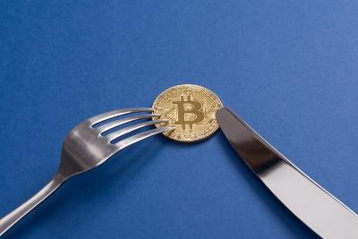
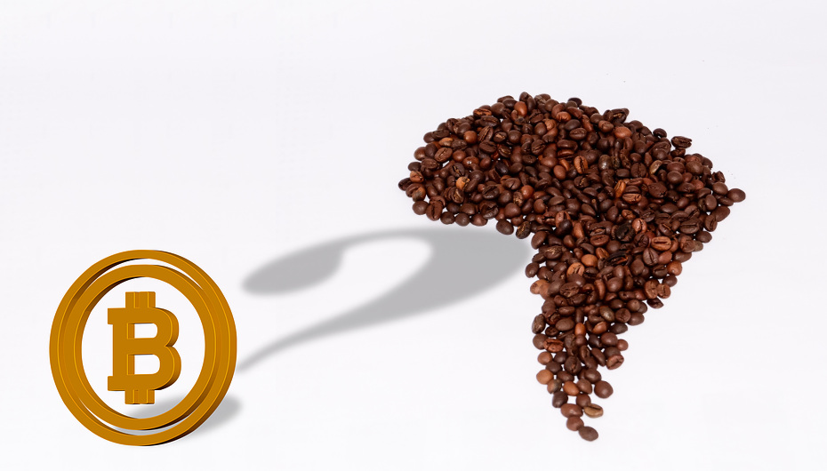

*Bitcoin’in şu anki spekülasyonları bir kenara bırakırsak ileride bir değeri olup olmayacağına geniş kitleler tarafından kullanılıp kullanılmayacağı karar verecek.*

Geçtiğimiz bölümde, Bitcoin’in ileride değerli olup olmayacağının iki ana belirleyicisi olacağını belirtmiştik: Birincisi hakikaten insanların işine yarayacak mı, ikincisi de geniş kesimler tarafından kullanılacak mı? Bu iki soruya ne kadar olumlu cevap verebiliyorsak Bitcoin’in değerinin de ileride o kadar artacağını düşünebiliriz.

<figure markdown="1">

<figcaption markdown="span">Kaynak: [icons8.com](https://photos.icons8.com/some-food-for-thought-about-bitcoin-5a7c0a678b6588000181ced6)[^1]</figcaption>
</figure>

## Bitcoin’in geleceği nasıl şekilleniyor? {#bitcoinin-gelecegi-nasil-sekilleniyor}

Her ne kadar teknoloji hızla gelişiyor olsa da Bitcoin için aynısını söylemek mümkün değil. Bitcoin yavaş gelişen bir sistem — bu kasıtlı olarak böyle aslında. Efendim, Bitcoin biliyorsunuz bir dijital para. İşin içine para girdiğinde konu ciddileşiyor. Bitcoin geliştiricileri de bu bilinç ile hareket ediyorlar.

Bu geliştiriciler temel bir prensip var: “Acele işe şeytan karışır”, yani ne kadar hızlı gider ve yeterince test ve deneme yapmazsanız hata çıkma ihtimali o kadar artar. O nedenle bu topluluk Bitcoin sistemini özellikle yavaş yavaş tabiri caizse sindire sindire geliştirme yolunu seçiyor.

İkinci bir prensipleri daha var bu topluluğun: “Bir ürüne ne kadar fonksiyon eklerseniz, o kadar güvenlik açığına davet [çıkarırsınız](https://twitter.com/NickSzabo4/status/956507150012026882)[^2]” Konu para olunca güvenlik açığının yaratacağı sorunlar daha da dramatik hale gelebiliyor. O nedenle geliştiricilerin Bitcoin’e para dışında yeni fonksiyonlar eklemeleri oldukça zor.

Peki ne olacak o zaman? Bitcoin bu haliyle kör topal devam mı edecek? Tabii ki hayır. Olacak olan ana hatları ile şu: Bitcoin ana (baz) katman olarak fonksiyonunu dijital para şeklinde sürdürecek. Bu ana katmanın üzerine inşa edilecek yeni katmanlar geniş kitlelerin ihtiyacı olan o yeni fonksiyonları sunacaklar.

## Kahvenizi Bitcoin ile ödemek mi? {#kahvenizi-bitcoin-ile-odemek-mi}

Bitcoin’in büyümesi ve geniş kitleler tarafından adapte edilmesinin önündeki en büyük engel kendi teknik kısıtları. Nedir onlar? Anlatalım:

<figure><figcaption>Bitcoin ile kıtalararası para gönderme yapabiliyorsunuz diyoruz. Bunun yaparken de maliyetleriniz oldukça düşük. Özellikle yurtdışında yaşayanlar için çok iyi haber. Ama bu göreceli olarak küçük bir kitle ve sınır ötesi para transferini ayda yılda bir yapıyorlar. Bitcoin’in geniş kitlelere yayılması için yeterli değil.</figcaption></figure>

*Image by [Gerd Altmann](https://pixabay.com/users/geralt-9301/)*[^3] *from [Pixabay](https://pixabay.com/images/id-3696891/)*[^4]*, Photo via [Good Free Photos](http://www.goodfreephotos.com/)*[^5]

Peki ya gündelik hayatta mikro ödemeler için Bitcoin kullanımı? İşte orada Bitcoin’in kendi iç kısıtlamalarına takılıyoruz. Bitcoin’in saniyede yapabileceği işlem sayısı 7 ile kısıtlanmış. Ethereum için bu sayı 20 işlem. Paypal’in saniyede 450, Visa’nın ise 56.000 işlem yapma kapasitesi olduğunu [söylersek](https://altcointoday.com/bitcoin-ethereum-vs-visa-paypal-transactions-per-second/) Bitcoin’in neden mikro ödemeler için kullanılamayacağını anlayabiliriz sanırım.

## Mikro ödemeleri Bitcoin üzerinden yapmaya kalkarsak sistem patlar mı? {#mikro-odemeleri-bitcoin-uzerinden-yapmaya-kalkarsak-sistem-patlar-mi}

İşlem sayısı kısıtlamanın getirdiği ana sorun işlem hızı. Normalde Bitcoin transferi yaptığınızda işlem madenciler tarafından alınıyor ve o anki en son bloğun içine işleniyor. Peki ya bloğun hacminden daha fazla işlem yapıldı ise? O zaman işlem bir sonraki bloğa atılıyor. Her bir blok 10 dakikada bir toplanıp bağlandığı için böyle bir durumda işleminizin gerçekleşmesi 10 dakika sonraya kalıyor. Peki neye göre işleminizin o bloğa ya da sonraki bloğa gireceğine karar veriyor madenciler? O yaptığınız işlem için verdiğiniz (ya da vermek istediğiniz) komisyona göre. İşlem ücretiniz ne kadar yüksek ise o kadar erken işleminiz gerçekleşiyor. Mikro ödemeler zaten kendileri ufak rakamlar oldukları için işlem ücretleri de çok düşük olmak zorunda, bu nedenle de geç gerçekleşme ihtimalleri yüksek.

## Bitcoin’i nasıl hızlandırırız? {#bitcoini-nasil-hizlandiririz}

Aslında bir mikro ödemenin gerçekleşmesi için tüm Bitcoin sisteminin kullanılmasına o kadar da gerek yok. Çünkü biliyorsunuz Bitcoin ile bir işlem yapıldığında binlerce makineye bu işlem yazılıyor. Bir kafeye girip satın aldığınız bir kahvenin işlemi neden binlerce makinede yazılsın ki? Bu işlemler bir bir işlenmek yerine bir araya toplansa?

İşte bu felsefeden yola çıkan geliştiriciler Bitcoin üzerinde mikro işlem yapabilmek için ikinci bir katman yarattılar. Buna da Lightning Network adını verdiler. Bir sonraki bölümümüzde bu Lightning Network nedir biraz daha yakından bakalım.

[^1]: [https://photos.icons8.com/some-food-for-thought-about-bitcoin-5a7c0a678b6588000181ced6](https://photos.icons8.com/some-food-for-thought-about-bitcoin-5a7c0a678b6588000181ced6)

[^2]: [https://twitter.com/NickSzabo4/status/956507150012026882](https://twitter.com/NickSzabo4/status/956507150012026882)

[^3]: [https://pixabay.com/users/geralt-9301](https://pixabay.com/users/geralt-9301)

[^4]: [https://pixabay.com/images/id-3696891/](https://pixabay.com/images/id-3696891/)

[^5]: [http://www.goodfreephotos.com/](http://www.goodfreephotos.com/)
