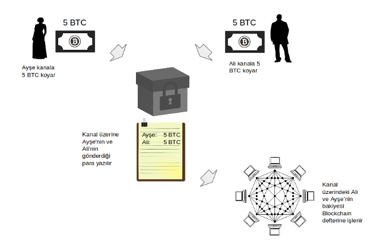
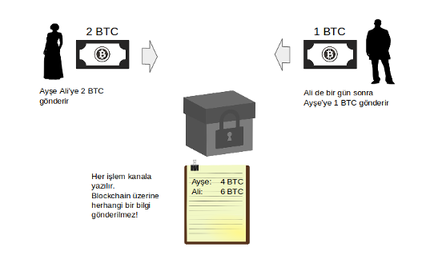
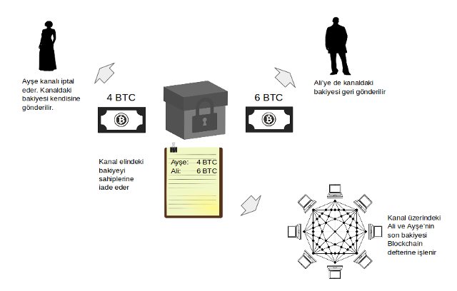
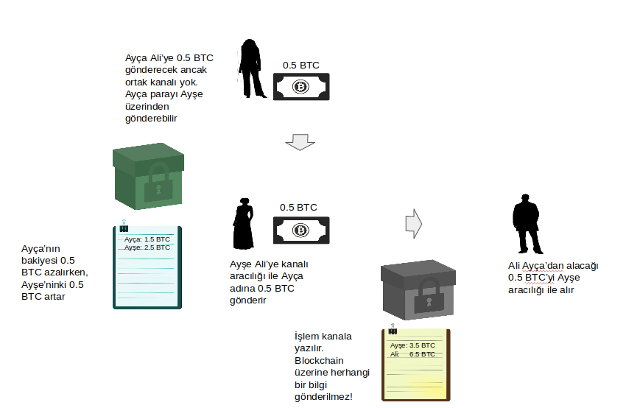

*Bitcoin bir gün hayatımızın bir parçası haline gelecekse öncelikle kendi sıkıntılarını aşmalı. Bu konuda çalışan çok. Bunlardan biri de Lightning Network.*

Geçtiğimiz [bölümde](/Sorularla_Blockchain/bolum-5/bitcoin-genis-kitlelere-nasil/), Bitcoin’in geniş kitlelerce kullanımının önündeki en büyük engelin teknik olarak kısıtlı kapasitesi olduğundan bahsetmiştik. Özetle tekrarlarsak; yapılan her işlem Blockchain üzerine yazılıyor, bunu yapan madenciler ve işlem binlerce makineye yazıldığı ve 10 dakikada bir balya haline getirilip onaylandığı için saniyede maksimum 7 işlem gerçekleşebiliyor.

<figure markdown="1">

<figcaption markdown="span">Image by [janeb](https://pixabay.com/users/janeb13-725943/)[^1] from [Pixabay](https://pixabay.com/images/id-1161353/)[^2]</figcaption>
</figure>

Ama eğer biz her işlemi Blockchain üzerine yazmak yerine bunları toplayıp bir araya getirsek ve o şekilde yazsak, yani Blockchain’in zinciri üzerine değil zincir dışı işlem yapsak o zaman bu teknik kısıtlardan kurtulabiliriz. Peki ama, biri bana bir Bitcoin yollarsa benim bu Bitcoin’e sahip olduğumu kanıtlamamın tek yolu bu paranın Bitcoin Blockchain’ine işlenmiş olması değil miydi? Nasıl emin olacağım Bitcoin’in benim olduğuma eğer Blockchain zincirini kullanmaz isek? İşte Lightning Network dediğimiz sistem hem zincir dışı hızlı binlerce işlem yapabilen hem de bu binlerce işlemin sadece sonuçlarının Blockchain’e yazıldığı (yani herkesin hak ettiği Bitcoin’i günün sonunda kendi cüzdanında görebildiği) bir yol öneriyor.

## Nedir bu Lightning Network? {#nedir-bu-lightning-network}

Önceki [bölümde](/Sorularla_Blockchain/bolum-5/bitcoin-genis-kitlelere-nasil/) da belirttiğimiz gibi Lightning Network esasında Bitcoin üzerine kurulmuş ikinci bir katman.

Lightning’in ana prensibi Bitcoin üzerindeki işlemlerin zincir üzerinden (yani bloklara yazılması yerine) zincir dışına çıkarılması.

Özündeki prensip ise şu:

- İşlemleri yapmak için ayrı kanallar kuralım.
- Bu kanallar baştan Bitcoin sistemine para yatırsınlar, bir nevi depozito koysunlar.
- Sonrasında bu koydukları parayı geçmemek kaydıyla Bitcoin Blockchain’i dışında kişiler arası para transferi yapılmasına aracılık etmeye yetkili olsunlar (ve aracılık ettikleri bu işlemlerden cüzi bir işlem ücreti alsınlar).
- Birinden alsınlar öbürüne versinler, ama yaptıkları işlemlerin sonundaki net bakiye başta koydukları depozitoyu hiçbir şekilde geçmesin.
- Böylece madencileri kullanmadan işlemlere aracılık etsinler, dolayısıyla masrafları çok daha az olsun ve bunun sonucunda da sistemi kullanan kullanıcılardan komisyon olarak alacakları çok cüzi rakamlar bile kendilerini kurtarsın.

## Nasıl çalışıyor peki bu Lightning Network? {#nasil-calisiyor-peki-bu-lightning-network}

Basit bir örnek ile başlayalım sonra detaylandıralım:

- Ali ve Ayşe ticaret ile uğraşıyor ve birbirlerine sık sık para gönderiyorlar. Bu ikili öncelikle beraberce bir kanal (burada basit olsun diye kilitli bir sandık diyelim) yaratıyorlar. Bu sandığa her ikisi de bir miktar Bitcoin koyuyorlar (örneğin her biri 5 BTC). İlk para koyduklarında bu işlem Bitcoin Blockchain üzerine işleniyor.

<figure></figure>

- Diyelim bir gün Ali Ayşe’ye 1 BTC gönderiyor, ertesi gün de Ayşe Ali’ye 2 BTC. Bu iki işlemi de Bitcoin ağına binlerce makineye göndermek yerine kendi aralarındaki bu sandık üzerinden gerçekleştiriyorlar. İki gün sonunda Ali’nin sandıktaki hakkı 6 BTC, Ayşe’ninki ise 4 BTC oldu. Sandık orada, iki taraf da kendi bakiyelerini görebiliyor. Ama Bitcoin Blockchain’e herhangi bir bildirimde bulunmuyorlar.

<figure></figure>

- Eğer iki günün sonunda Ali ya da Ayşe’den biri parayı kendi hesabına çekmek isterse sandığı iptal ediyor. Bu durumda her iki tarafın bakiyesi kendi hesaplarına geri aktarılıyor. Bu örnekte Ali 6 BTC Ayşe ise 4 BTC alıyor.

<figure></figure>

Özetle iki kişi sandık adını verdiğimiz bir kanal yarattılar. Sandıktaki para da bu kanalın Bitcoin üzerindeki depozitosu, yani bu kanalı kullanacakların güvencesi.

İki kişi üzerinden anlatınca basit görünüyor ama böyle ikili ticaret eden kaç kişi var ki? Peki denkleme bir kişi daha ekleyelim: Örneğin Ayça.

Ayça’nın da Ayşe ile ortak bir sandığı olsun ancak Ali ile daha önce hiçbir para ilişkisi olmasın. Ayça Ali’ye para gönderebilir mi (örneğin 0,5 BTC)? Gayet tabii. Ayça Ali’ye parayı Ayşe aracılığı ile gönderebilir. Ayça’nın Ayşe ile ortak sandığından 0,5 BTC’sini Ayşe’nin yaparsınız, Ayşe’nin Ali ile olan sandığındaki 0,5 BTC’sini de Ali’nin.

<figure></figure>

Şimdi bu tip sandıklardan (kanallardan) binlerce kişi ve kurumun açtığını düşünün: Bir kahve zincirisiniz. Ali ile Ayşe içtikleri kahve için size ödeme yaptılar. Siz de bu ödemeleri alıp size kahve çekirdeği satın almada kullandınız. Size çekirdeği satan firma dijital reklamlarının dizaynını yapan Ayça’ya bu para ile ödeme yaptı. Ayça da Ali’den aldığı internet hosting hizmeti için kendisine bir miktar para yolladı. İşte tüm sistemi Lightning Network üzerinden döndürebilirsiniz. Binlerce işlemin Bitcoin üzerinden Blockchain bloklarına yazılmadan güvenli bir şekilde gerçekleştirildiği ikinci bir katman yaratmış olursunuz.

Sonuç?

Bitcoin sanal dünyadaki şifreli paralar içinde en kullanılanı. Ancak şu anda hala kısıtlı bir kitle tarafından kullanılıyor. Eğer hakikaten bir değer elde edecek ise faydalarının geniş kitlelere yayılması gerekiyor. Bitcoin geliştiricileri hızlı davranıp Bitcoin’i ‘bozma’ riski almamak için geniş kitlelerin ihtiyacı olan değişiklikleri çabucak yapmayacaklar. Bu yenilikleri Lightning Network gibi ikinci katmanlar yapacak. Başarılı olup olmayacaklarını zaman gösterecek ancak şimdiden söyleyebileceğimiz doğru yolda oldukları.

[^1]: [https://pixabay.com/users/geralt-9301](https://pixabay.com/users/geralt-9301)

[^2]: [https://pixabay.com/images/id-1161353/](https://pixabay.com/images/id-1161353/)
