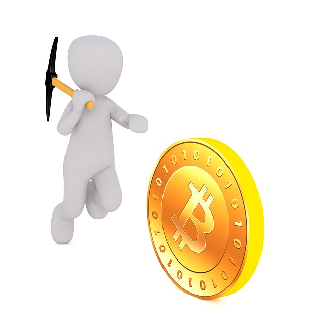

*Yeni nesil teknolojilerin gelişmesi için her kesim çaba gösteriyor. Bunlardan biri de bu alana yatırım yapmış kurumsal yatırımcılar. Özellikle girişim sermayeleri iş yapış biçimlerini değiştiriyorlar. Gelin bir göz atalım neler yaptıklarına:*

Yeni teknolojilerin geniş kesimlerce adapte edilebilmesi için pek çok girişim var. Bunlardan [Lightning](/Sorularla_Blockchain/bolum-5/lightning-network/), [Liquid](/Sorularla_Blockchain/bolum-5/liquid-network/) ve [Bakkt](/Sorularla_Blockchain/bolum-5/bakkt/)’a geçmiş bölümlerde değinmiştik. Şimdi bu trendlerden gelecekte daha da önem kazanacak olan bir tanesine, kurumsal yatırımcıların kafa yorduğu Generalized Mining (ya da Mining 2.0) kavramına bakalım birlikte.

## Yatırımcılık değişiyor, neden? {#yatirimcilik-degisiyor-neden}

Hatırlarsanız geçmiş bir [bölümde](/Sorularla_Blockchain/bolum-2/degisen-girisimcilik-ve-yatirimcilik/) yeni teknolojiler ile değişen girişimcilik ve yatırımcılık tanımlarından bahsetmiştik.

Kısaca özetlersek, değişen teknolojiler ile birlikte bir şirketin yarattığı katma değer artık sadece şirket kurucuları ve yatırımcıları tarafından değil diğer başka aktörler tarafından da paylaşılıyor.

Bunun temel nedeni ise ‘artık yeni teknolojiler ile bir şirket değil bir ekosistem (bir ağ) yaratılıyor’. Ve yeni teknolojilerin geçmişe göre devrim niteliği taşıyan ana özelliği, yarattıkları ekosistemdeki tüm oyuncuların oyuna devam etmesini sağlamak için kurdukları teşvik mekanizmaları.

Peki kim bu diğer oyuncular? Madenciler ve son kullanıcılar.

Neden? Öncelikle bir Blockchain sisteminin, birbirinden bağımsız makineler tarafından işletilmesini istiyorsanız bu makinelere harcadıkları efor ve enerjinin karşılığını vermelisiniz, aksi halde neden uğraşsınlar?

Keza benzer şekilde sistemin kullanıcıları da artık harcadıkları vakit karşılığı sadece sistemin sunduğu kolaylıklardan faydalanmak ile yetinmiyorlar. Onlar da ortaya çıkan pastadan pay istiyorlar, ki sistemi kullanmaya devam etsinler ve büyümesine yardımcı olsunlar.

Sonuçta eskiden girişimlere erken yatırım yapan kurumlar (VC’ler — girişim sermayeleri) koydukları para ve aldıkları riskin karşılığı olarak ciddi bir oranda şirket hissesi alarak ortaya çıkan değerin büyük bir kısmını uhdelerine alıyorlar idi. Şimdi ise yeni teknolojiler ile pastadan pay alanlar çoğaldığı için girişim sermayeleri de iş yapma biçimlerini değiştirmek durumunda kalıyorlar.

## Konu ICO’lar mı? Hayır {#konu-icolar-mi-hayir}

Yukarıda bahsettiğimiz [bölümde](/Sorularla_Blockchain/bolum-2/degisen-girisimcilik-ve-yatirimcilik/) girişimler için girişim sermayelerine alternatif olarak ortaya çıkan ICO piyasalarından bahsetmiştik. 2018 yılı içinde girişimlere ciddi miktarda finansman sağlayan ICO piyasaları yılın sonuna doğru tabiri caizse kurudu.

Bunun pek çok nedeni var: en önemlisi, girişim adı altında ortaya çıkanların çoğunun aslında bu yaratılan heyecanı kullanan hayal tacirleri ya da dolandırıcılar oldukları ortaya çıkması.

Ama benzer durum internet girişimlerinin ilk çıktığı 90’larda da yaşanmıştı, o zaman da çok para battı ancak girişimler yatırım almaya devam ettiler. İlk yaşanan balon söndükten sonra özellikle gerçekten değer yaratan girişimlere uzun vadeli yatırım yapanlar çok ciddi getiriler elde ettiler. Dolayısıyla şu an ICO pazarı tıkanmış olabilir ancak yeni mekanizmalar ile ileride tekrar canlanması çok muhtemel.

Yine de ICO pazarının kuruması klasik anlamdaki risk sermayelerinin artık eskisi gibi at koşturabileceği anlamına gelmiyor. Çünkü oyun değişti. Ne gibi? Bahsedelim.

<figure markdown="1">

<figcaption markdown="span">Image by [GraphicMama-team](https://pixabay.com/users/GraphicMama-team-2641041/)[^1] from [Pixabay](https://pixabay.com/images/id-1456473/)[^2]</figcaption>
</figure>

## Girişim Sermayesi’nin faydası ne? {#girisim-sermayesinin-faydasi-ne}

Bir risk sermayesi şirketi girişime sadece para vermez. Bunun dışında pazar bilgisi ile girişimin yönünü etkiler. Ya da organizasyonel tecrübesi ile şirketin büyümesi sırasında kontrolü kaybetmemesi için ne tip insan kaynağı ya da organizasyon yapısına gitmesi gerektiği konusunda girişimciye yardımcı olur.

Ancak yeni teknolojiler ile girişim sermayesi artık sadece girişim ile değil aynı zamanda ekosistemle de ortak oluyor. İşte bu nedenle eskiden şirketi etkilemek ve yönlendirmek için kullandığı çabayı artık ekosistem için de göstermeli.

## Girişim Sermayesi başka neler yapabilir? Madencilik 2.0’a hoş geldiniz! {#girisim-sermayesi-baska-neler-yapabilir-madencilik-2-0a-hos-geldiniz}

Peki neler yapabilir Girişim Sermayeleri bu alanda? Örneğin madencilik işine girebilirler! Şaşırtıcı değil mi?

Peki yapabilirler mi? Neden yapamasınlar? Eğer açık (public) bir Blockchain sisteminden bahsediyorsak, isteyen herkes madenci olabilir. Girişim Sermayesi şirketi de bu sistem içinde kendisi madencilik yapabilir ya da spesifik girişiminin yarattığı ekosistemde madencilik yapan bir şirkete yatırım yapabilir.

## Girişim Sermayesi neden madencilik yapsın? {#girisim-sermayesi-neden-madencilik-yapsin}

Girişim sermayeleri neden böyle bir işe kalkışsınlar? Birkaç nedeni var:

Öncelikle, hatırlayalım; madenciler sistem içindeki işlemleri gerçekleştiren ve aynı zamanda çeşitli protokoller ile (PoW gibi) sistemin güvenliğini sağlayan aktörler. Girişim sermayesi açısından eğer uzun vadede bir getiri hedefleniyor ise bu değeri yaratacak olan ekosistemin kesintisiz bir şekilde yaşaması ve dış tehditlerden korunması hayati öneme sahip.

Bir yandan da madenciler ekosistemin gidişatı konusunda sınırlı da olsa söz hakkına sahipler. (genellikle uzlaşma sonucunda tamamlanan blokların içinde yarattıkları tokenlar sayesinde) Birçok ekosistemin nasıl yönetileceğine o sistemin yarattığı token’ları ellerinde tutanlar karar veriyor. Ne kadar token o kadar söz hakkı.

Benzer şekilde, özellikle bu sistemlerin açık kaynaklı olması nedeniyle çok sık rastlanmasa da kimi durumlarda sistemler klonlanarak (hard fork) farklı adlar altında strateji değiştirebiliyor ya da farklı bir grubun kontrolü altına girebiliyorlar. Bu tip hard fork durumlarında ekosistem içindeki her bir aktörün bu iki gruptan hangisinin içinde yer alacağına karar vermesi gerekiyor. Böyle bir durum ortaya çıktığında oyuncular genelde çoğunluğa uyarlar, bu işin doğası böyle.

Girişim sermayesi de madenciler arasında kendine pay alarak yukarıdaki iki durumda çoğunluğu etkileme ve stratejiyi belirleme konusunda kendisine bir avantaj yaratıyor.

Ama daha da önemlisi, madenciler yaptıkları çalışmaların karşılığını maddi olarak token şeklinde alıyorlar. Girişim Sermayesi de benzer şekilde madencilik yaparak token kazanabiliyor. Kimi durumlarda yaptığı yatırımdan elde ettiği getirinin çok daha fazlasını bu tip madencilik faaliyetinden alabiliyorlar, özellikle token değerinin yükseldiği zamanlarda.

## Girişim Sermayeleri artık teknik açıdan da gelişmek zorunda mı yoksa? {#girisim-sermayeleri-artik-teknik-acidan-da-gelismek-zorunda-mi-yoksa}

Kurumsal yatırımcılar, yeni teknolojiler karşılığında klasik anlamda iş yapış biçimlerini ciddi şekilde değiştirmenin yanında ağır bir teknik bilgi birikimine de ihtiyaç duyuyor.

<figure markdown="1">

<figcaption markdown="span">Image by [3dman\_eu](https://pixabay.com/users/3dman_eu-1553824/)[^3] from [Pixabay](https://pixabay.com/images/id-2883885/)[^4]</figcaption>
</figure>

Örneğin yukarıda bahsettiğimiz madencilik işi öyle basitçe anlaşılacak gibi değil. Daha doğrusu işi layığı ile yapmak istediğinizde ciddi bir teknik donanıma ihtiyacınız var. Kullanacağınız makineler için yüklü bir yatırım yapacaksınız, sonra enerji harcayacaksınız? Sonra yatırımı nereye yapacaksınız, maliyetler nerede düşük?

Ayrıca her Blockchain kendi özelinde farklılık gösteriyor, madencilik olarak da öyle. Gerekli altyapı farklı, enerji ihtiyaçları farklı.

Bunların hepsini iyi anlamak ve hesaplamak gerekiyor. Bu nedenle bu alana yatırım yapan ve akıllı davranan Girişim Sermayeleri ekiplerini artık teknik donanıma sahip (kimi yazılım kökenli) üyeler ile güçlendiriyorlar.

Sonuç

Siz bakmayın öyle “ICO piyasaları kurudu, kripto paraların geleceği yok” gibi söylentilere. Hep söylediğimiz gibi yeni teknolojilerin sunduğu vizyonların birçoğu ulaşılabilir. Ancak bu vizyonlara ulaşmak için gerekli altyapılar henüz yok ve bu alanda çalışmalar tüm hızıyla sürüyor.

Aslında kripto paraların fiyatlarının düşmesi konuya uzun vadeli yaklaşanlar için rahatlatıcı bile oldu. Zira sürekli yükselen fiyatlar, değer yaratmaktan ziyade spekülasyon yapan yatırımcıların piyasayı doldurmasına, yazılımcıların da akıllarının sürekli yükselen fiyatlarda olmasına neden oluyordu. Artık bu spekülatörler piyasadan çekildi (gerçi fiyatlar bir yükselmeye başlasın, ilk onlar geri gelecekler).

Pek çok kurumsal yatırımcı ve girişim sermayesi konuya uzun vadeli bakmaya devam ediyor. Bu yatırımcılar bahsedilen vizyonların gerçekleşmesi için gereken altyapı ve yazılım çalışmaları devam ederken sistemin devamını sağlamak için madencilik dahil her yolu deniyor. Tavsiyem siz de onlar gibi konuya uzun vadeli değer yaratma perspektifinden bakmaya çalışın… ve Çetin Altan’ın dediği gibi “Enseyi karartmayın”…

[^1]: [https://pixabay.com/users/GraphicMama-team-2641041/](https://pixabay.com/users/GraphicMama-team-2641041/)

[^2]: [https://pixabay.com/images/id-1456473/](https://pixabay.com/images/id-1456473/)

[^3]: [https://pixabay.com/users/3dman\_eu-1553824/](https://pixabay.com/users/3dman_eu-1553824/)

[^4]: [https://pixabay.com/images/id-2883885/](https://pixabay.com/images/id-2883885/)
