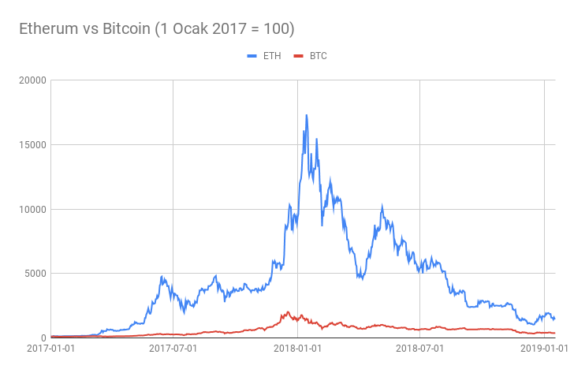
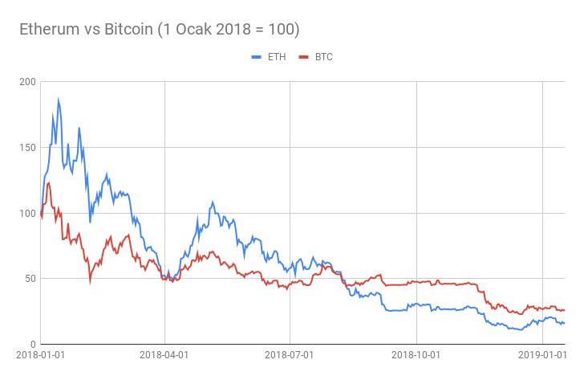
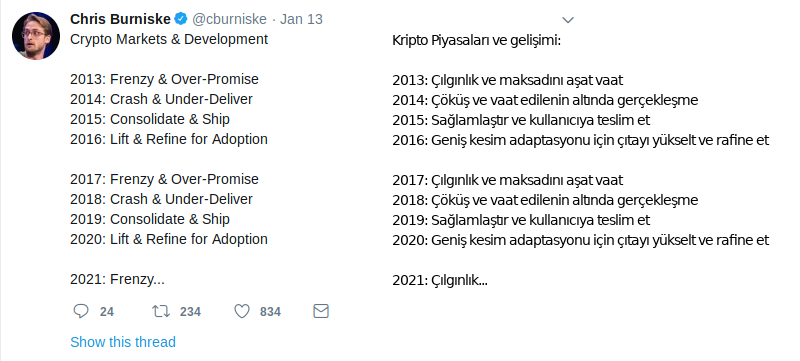

*Bitcoin dışında en bilinen kripto para Ethereum’un parası olan Ether. Yaratıcısı da 18 yaşında bir genç. Ancak bu genç Ethereum’u kripto para olsun diye yaratmamış. Çok daha iddialı hayalleri var.*

“Birbirine bağlı binlerce makine” diyoruz uzun zamandır. Bu makineler bağımsız bir şekilde çalışarak, güvenli tek bir yere bağlı olmayan sistemler içinde kırılıp bükülmeyen, geriye doğru değiştirilemeyen sistemler yaratıyorlar. Bu da güvenin en çok ihtiyaç duyulduğu alan olan para ve onun dijital transferi anlamında dünyada kabul görmüş.

Bu birbirine bağlı binlerce makinenin böyle geniş ortak bir defter ile kayıt tutma dışında başka güçleri de var tabii. İşte bu güçleri kullanmak için yola çıkan sistemin adı Ethereum. Çok kabaca ifade edersek bu binlerce makinenin bağlı olduğu dünyanın en büyük bilgisayarı olma iddiasında Ethereum. Detaylarına bakacağız ama ilginç bir hikayesi var Ethereum’un, kısaca bahsetmekte fayda var.

Vitalik Buterin: 18 yaşında bir dahi mi?

Bitcoin’in ortaya çıkışından birkaç yıl sonra, 2011 yılında Rusya’dan Kanada’ya göç etmiş bir ailenin babası, 17 yaşındaki oğluna Satoshi’nin işlerinden ve Bitcoin’den bahseder. Babasının bahsettiklerinden büyülenen Vitalik Buterin adındaki bu genç kendini bir anda bu dünyanın içinde bulur. Önce arkadaşları ile Bitcoin Magazine diye bir dergi kurarlar. Teknoloji, yazarlık ve matematik konusundaki yetenekleri ile oldukça etkili olur. Zaten rivayete göre üç basamaklı rakamları aklından normal bir insanın iki katı hızda çarpma yeteneğine sahip bu genç, henüz 18 yaşında Uluslararası Enformasyon Olimpiyatları’nda Bronz madalya kazanarak yeteneklerini global platformda da gösterir.

<figure markdown="1">

<figcaption markdown="span">Vitalik Buterin (Kaynak: [Ethereum Foundation](https://www.ethereum.org/foundation)[^1])</figcaption>
</figure>

Buterin, öncelikle Bitcoin üzerinde gelişmeler yaparak, Bitcoin transferi dışında daha başka pek çok fonksiyonu (para dışı varlıkları gönderme, dijital kontrat yaratma gibi) bu sisteme geçirmek için uğraşır. Ancak bu konuda oldukça zorlanır. Zira Bitcoin özelliği itibariyle tek işi (o da para gönderme) iyi yapmak üzere kurgulanır. Geliştiricilerinin aklındaki tek konu “Bitcoin’i nasıl dış tehlikeler karşı daha güvenilir yaparız?” sorusuna cevap bulmaktır, yenilikler öncelikleri arasında değildir (hala da öyle, en gurur duydukları konu bu: Bitcoin 2009’dan beri bir kez bile tökezlemedi ve “hack” edilemedi diye göğüslerini gere gere ortada dolaşıyorlar). Buterin’in kafasında ise paranın bir yerden öbürüne geçtiği işlemleri tutan hesap makinesi benzeri bir fonksiyondan çok, daha pek çok işlemi yapabilecek bir dünya bilgisayarı vizyonu vardır.

Ethereum nasıl ortaya çıkmış?

2013 yılında Buterin 15 yazılımcı arkadaşı ile birlikte Ethereum’u tanıtır. Ama henüz ortada sadece bir konsept tasarım vardır — para kazanılacak ya da yatırım alabilecek bir ürün için henüz erkendir. Tam o sırada Peter Thiel (bilenler bilir; PayPal’in kurucularından, Facebook’a ilk para yatıran kişidir kendisi) onlara 100.000 ABD Doları burs verir. Derler ki bu bursu almak ABD’nin en iyi üniversitelerine girmekten bile zordur. Tabii sadece bu da değil, aynı zamanda Buterin, 2014 yılı içinde Etherum ile Dünya Teknoloji Ödülü’nü de alır. O yıl, Enerji dalında Elon Musk, Medya alanında meşhur Walter Isaacson, Teknoloji alanında ise Buterin ile birlikte bu ödüle layık görülen diğer kişiler olurlar.

Ödüller karın doyurmuyor, var mı yatırım yapacak?

Peter Thiel’in bursu ekibin daha olgun bir ürün oluşturma anlamında yol almasına yardımcı olsa da yeterli olmaz. 2014 Eylül ayında ilginç bir yöntem ile para toplarlar. Derler ki, “ilk iki hafta 2.000 Ether = 1 Bitcoin olacak şekilde para topluyoruz, sonrasında bu rakam yavaş yavaş düşecek en son alanlar 1.337 Ether = 1 Bitcoin şeklinde alacaklar”. Daha önce denenmemiş bir yöntem, zira bildiğimiz Dolar ya da Euro para toplamıyorlar, Bitcoin topluyorlar! O zamanlar Bitcoin çok az biliniyor. Herhangi bir regülasyona da tabii değil. Ama zaten ortada satılan bir şirket de yok — neye tabii yapacaksınız ki? Karmaşık bir süreç ama nispeten rahat. İsviçre’de bir vakıf kurarak bu vakıf üzerinden satış yaparlar ve o zamanın parası ile 18,5 Milyon ABD Doları toplarlar. Bu bir ether için ortalama 0,31 ABD doları demek. Etherin şu anki fiyatının yaklaşık 500 ABD doları olduğunu söylersek, o zaman yatırım yapanların şu anki karlarını hesaplamak da size kalsın (ya da boş verin biz söyleyelim, koydukları paranın yaklaşık 1.600 katını kazanmış durumdalar).

Yukarıda bahsedilen toplanan paranın tamamının geliştiricilere verilecek ödüller ve maaşlar ile, Ethereum Vakfı’nın destekleyeceği Ethereum ve Kripo dünyası ile ilgili projeler için harcanacağını belirtelim. Bu şekilde satılan etherin yanında, bu miktarın onda biri kadar bir rakam da kurucular için ayrılmış. Yani, daha önceki bölümlerimizde bahsettiğimiz, şirket kurucularının şirketin büyük kısmına sahip olmalarının yerini, bu yeni modelde, para toplamak için satılan etherin ufak bir kısmına baştan sahip olmak almış. Bu da bir yenilik.

İşte bu şekilde etkili bir başlangıç hikayesine imza atar Ethereum. Peki ama ne işe yarar Ethereum? Ona da bir sonraki yazımızda bakalım artık.

## Ethereum’un çıkış ve inişi bir döngünün mü parçası? {#ethereumun-cikis-ve-inisi-bir-dongunun-mu-parcasi}

*Girişimlerine para toplayan girişimciler son iki yıldır ağırlıkla Ethereum altyapısını kullandılar. Bu da Ethereum’un parası ETH’yi çılgın seviyelere çıkardı. Ancak sonrası hüsran. Neden böyle oldu?…*

Özellikle ICO piyasalarının ve piyasaya çıkan binlerce kripto paranın performansının kötü gitmesi bu alanda konuşan, fikir üretenlerin morallerini bozdu. Kötü gitmesi derken kastettiğimiz şu: 2017 yılında başlayıp 2018 yılında doruk noktasına ulaşan kripto para balonunda (hype da denebilir), balonu oluşturanların büyük kısmı kısa vadeli yatırımcılar oldu. Bu tip yatırımcılar genelde çok detaylı araştırma yapmadan, etraflarında duydukları ya da Twitter benzeri yerlerde gördükleri “gaz” hesaplardan etkilendiler.

Neden bahsediyoruz? Kim bunlar?

Netflix’de izleyebileceğiniz Peaky Blinders dizisinde güzel bir hikaye var. 1920'lerin başında geçen dizinin [Cillian Murphy](https://www.imdb.com/name/nm0614165)[^2]’nin canlandırdığı baş kahramanı bahis işi yapan [Thomas Shelby](https://www.imdb.com/title/tt2442560/characters/nm0614165)[^3] yarışa sokacağı bir atı bir Çinliye götürerek herkesin ortasında hayvana büyü yaptırır. Aslında Shelby hayvanın zaten iyi olduğu için yarışı kazanacağını biliyordur. Hayvan yarışı kazanır ve insanlar “büyü” yüzünden kazandığını söyler. Olay kulaktan kulağa büyü yavaş yavaş tüm Birmingham’a yayılır. At ikinci yarışında da kazanır bir hafta sonra. Sonra bir daha. Ta ki insanlar ellerinde ne var ne yok satıp bir sonraki yarışta yine aynı ata yatırana kadar… At o hafta kaybeder. İnsanlar tüm varlıklarını yitirirler. Thomas Shelby ise parayı koyacak yer bulamaz.

<figure markdown="1">

<figcaption markdown="span">Thomas Shelby’nin duvar resmi. Kaynak ([Elliot Brown - Flickr](https://www.flickr.com/photos/ell-r-brown/)[^4][)](https://www.flickr.com/photos/ell-r-brown/)</figcaption>
</figure>

Maalesef ülkemiz de dahil tüm dünyada 2018 yılının başında büyük bir çoğunluk 1920'lerde Birmingham halkının başına gelen bu olayın benzerini yaşadı. Arkadaşının para kazandığını görenler, hesapsız kitapsız anlamadan para yatırdılar bilmedikleri paralara. Oysa aslında para toplayanların ciddi bir kısmı ponzi scheme benzeri programlar ile insanlardan para toplayan ama ne yapmak istedikleri çok da anlaşılmayan projeler idi. Bu projeleri şimdilik bir kenara bırakalım.

Her projeye de Ponzi denmez ama değil mi?

Performans olarak kötü gitmesine rağmen aslında belli bir vizyona sahip olan pek çok proje de piyasaya geçtiğimiz yıl. Ancak hep söylediğimiz gibi bu projelerin vakte ihtiyacı var. Zira, olgunlaşabilmeleri için hem yazılımcılarının uzunca bir süre bu projeler üzerinde çalışması hem de bu projelerin üzerine inşa edildikleri teknik altyapıların gelişmesi gerekiyor.

Ethereum parası ETH 2017'de neden yükseldi?

Bu alanda çalışan pek çok proje özellikle para toplamak konusunda Ethereum’un altyapısını kullandılar. Bu durum özellikle 2017 yılında Ethereum’a korkunç yaradı. Zira, herhangi bir yatırım için token almak isteyen bir yatırımcı elindeki itibari parayı (USD, Euro her ne ise) bozduruyor ve Ethereum alıyordu. Bu da Ethereum’a olan talebi ve para birimi olan ETH’nin fiyatını inanılmaz derecede yükseltti.

<figure markdown="1">

<figcaption markdown="span">Ethereum ve Bitcoin’in son iki yıldaki seyri (Kaynak: [Coindesk](https://www.coindesk.com/price/bitcoin)[^5])</figcaption>
</figure>

ETH üzerinden para toplayan girişimler, ETH’deki artışı gördükçe kazandıkları fonları ETH’de tutmaya devam ettiler, çünkü en iyi getiri ETH’de idi! Böylece kendi kendini besleyen bir sanal sarmal oluştu.

Peki 2018'de neden çakıldı?

Ancak 2018 yılının ikinci yarısında rüzgâr tersine döndü. Yapılan ICO’lar sonrası umduğunu bulamayan yatırımcılar “zararın neresinden dönersek kardır” mantığı ile ellerindeki tokenları sattılar. Bu satışın ETH üzerinde çok etkisi olmadı, zira token satan yatırımcı ya kendi itibari parasına ya da Bitcoin’e döndü. Ama ETH’yi asıl vuran, ICO yaparak ETH toplayan girişimler oldu. Çünkü bu girişimler, bir yandan yatırımcıları çizdiği vizyon karşılığı gelir getirmeyi başaramazken diğer yandan da devam eden masraflarının karşılığı ödeme yapmak zorunda olduklarından yavaş yavaş ellerindeki ETH’leri satmaya başladılar. Bu da ETH üzerinde 2017 yılında yaşananın tam tersi bir sanal sarmal yarattı.

<figure markdown="1">

<figcaption markdown="span">Yukarıdaki tabloya 2018 başından bakınca düşüş daha iyi anlaşılıyor (Kaynak: [Coindesk](https://www.coindesk.com/price/bitcoin)[^6][)](https://www.coindesk.com/price/bitcoin)</figcaption>
</figure>

Bir sarmal içinde miyiz?

Peki bu böyle mi devam eder. Bu işlerin aslında bir daire çizdiğini söylemek belki daha doğru. Bu alanda yazılmış en iyi kitaplardan [Cryptoassets: The Innovative Investor’s Guide to Bitcoin and Beyond](https://www.amazon.com/Cryptoassets-Innovative-Investors-Bitcoin-Beyond/dp/1260026671/ref=sr_1_2?ie=UTF8&qid=1547727169&sr=8-2&keywords=cryptoassets)[^7]’nın yazarı [Chris Burnske](https://twitter.com/cburniske)[^8]’nin Ocak 2019'da attığı şu tweet dikkat çekici:

<figure markdown="1">

<figcaption markdown="span">Kaynak: [Twitter](https://twitter.com/cburniske/status/1084538829384474624)[^9]</figcaption>
</figure>

Çok geniş bir genelleme bu. Ancak olaya kısa vadeli değil uzun vadeli bakanlar ve işin içinde başından beri bulunanlar için aslında yaşananlar oldukça tanıdık. O nedenle, bu alanda çalışan pek çok kişi “biz bu filmi görmüştük” diyor ve ileride gerçekleşecek yeni döngüyü üst seviyede yakalamak için var güçleriyle çabalıyorlar.

Arkası yarın

Şu anda Kripto Dünyası hala çok küçük. Tüm piyasa toplam değeri yaklaşık olarak [170 Milyar ABD Doları](https://coinmarketcap.com/charts/)[^10]. Sadece Apple’ın kasasında duran nakit paranın [158 Milyar ABD Doları](https://www.cultofmac.com/272570/apples-cash-reserves-30x-10-years-ago/)[^11] olduğunu söylersek aslında ne kadar küçük bir pazardan bahsettiğimiz daha anlaşılır oluyor. O nedenle, bu pazarın bize sunduğu vizyonun bir parçasının bile gerçekleşeceğini düşünsek ileride bu pazarın çok çok daha büyüyeceğini söylemek kâhinlik sayılmaz. Geçtiğimiz yılki çılgınlık sonrası hala girişimleri üzerinde çalışanlar ve daha ötesi yatırım almaya devam edenler, kendi sundukları vizyonun bir şekilde gerçekleşeceğinden eminler. Artık soru daha çok “ne zaman?” üzerine odaklanıyor.

## Akıllı kontrat olur mu? Ethereum ve Akıllı Kontratlar {#akilli-kontrat-olur-mu-ethereum-ve-akilli-kontratlar}

*Ethereum’un dünyayı değiştirme vizyonunu hayata geçirebilmesi için ihtiyaç duyduğu en önemli yardımcılardan biri “Akıllı Kontratlar”*

Diğer bölümlerde, Kripto dünyasında hepimizin duyduğu Bitcoin ve [benzeri kripto paralar](/Sorularla_Blockchain/bolum-6/diger-kripto-paralar-neler/) dışında başka konuların da olduğundan bahsediyor ve bu başka dünyaların içinde en önemlisi olan Ethereum’un [tarihçesine](/Sorularla_Blockchain/bolum-6/ethereum-hikayesi/) değiniyoruz. Şimdi ise, Akıllı Kontratlar nedir, ne işe yarar ona bir bakalım arzu ederseniz.

Akıllı Kontrat ne demek?

Ethereum dünyasına girmeden önce bir tanıma daha bakmakta fayda var.

Ofistesiniz, karnınız acıktı. Dışarı çıkıp markete gidecek zamanınız yok. “Alt katta bir otomat var, oradan bir bisküvi alayım açlığımı bastırsın. Şurada bir yerde birkaç bozuk para olacaktı” Gittiniz, parayı otomata attınız, otomat da size istediğiniz bisküviyi attı. Tebrikler! Bir Akıllı Kontrat işlemi gerçekleştirdiniz!

Şaka değil, gerçekten de belki de bir yerde kulağınıza çalınan “Akıllı Kontrat” aslında tam bu. Akıllı denmesinden dolayı çok karmaşık ya da derin bir kavram bekliyorsunuz ama öyle değil. Tam tersine… Akıllı Kontrat ile bahsedilen, önceden kuralları konmuş, iki tarafın bu kurallara bağlı olarak anlaştıkları koşulların gerçekleşmesi durumunda kendi kendine yürürlüğe giren işlem. Yukarıdaki örnekte, siz biliyorsunuz ki, makineye para attığınızda bisküvi alacaksınız. Makine de benzer şekilde programlanmış ve içine para atılıp seçim yapıldığında otomatik olarak o işlemi gerçekleştiriyor.

Neden akıllı kontrat deniyor o halde? Şu nedenle: İki kişi herhangi bir şekilde aralarında ‘normal’ bir kontrat yaptığında taraflardan biri “yok efendim, şöyle böyle oldu da ben vazgeçtim” gibisinden bir bahane altına saklanıp sözünü yerine getirmeyebilir. Ondan sonra araya girsin avukatlar, gerekirse yargı ve işin içinden çıkmaya çalışsınlar.

Akıllı kontratın asıl gücü işte burada ortaya çıkıyor. Akıllı kontrat öyle çok karmaşık kurallar vesaire öngörmüyor, tam tersine oldukça basit. Ama akıllı kontratın asıl gücü, karşı tarafın işlemi yapacağına emin olmamızdan kaynaklanıyor. Zira koşullar otomatik olarak bir yazılım içinde olduğu için, o koşul gerçekleştiği anda, iki taraf için de belirlenen sonuç ne ise, o otomatik olarak gerçekleşiyor.

Bakın Bitcoin ya da diğer Blockchain bazlı teknolojilerde bahsettiğimiz “güven” konusuna yine geldik. Önceki bölümlerde bu yeni sistemler sayesinde, ‘güven eksikliğinin neden olduğu merkezi bir otorite ya da aracıya duyulan ihtiyaca’ artık gerek kalmadığını yazmıştık. Akıllı kontratlar ile de ikili ilişkilerde karşı tarafın sözünü yerine getireceğine dair duymamız güven ihtiyacı ortadan kalkıyor.

Ethereum dünyasında Akıllı Kontratlar ne gibi bir yer kaplıyor?

Aslında akıllı kontratlar uzun zamandır bilinen bir kavram — aynı otomatların uzun süredir hayatımızda olması gibi. Şu anda en bilinen kripto para Bitcoin de örneğin adı verilen bir akıllı kontrat diline sahip. Ancak bir [önceki bölümden](/Sorularla_Blockchain/bolum-6/ethereum-hikayesi/) hatırlayabileceğiniz gibi, daha çok dijital olarak bir varlığın bir taraftan diğerine transferinde kullanılan Bitcoin ve geliştiricileri sadece Bitcoin’in dijital para özelliğine odaklanmayı tercih etmişlerdi. Ethereum’un kurucusu Vitalik Buterin ise Blockchain sistemlerini sadece para değil daha pek çok fonksiyon için kullanmak istiyordu. Bu fonksiyonlar, dijital bir varlığın bir kişiden diğerine aktarımından tutun, her tür dijital hizmetin değişik yerlerdeki bilgisayarlar aracılığıyla verilmesine kadar uzanan geniş bir yelpazedeler. Bu tip bilgisayarlar arasında verilecek hizmetler ve bu hizmetler karşılığında bir ödeme yapılabilmesi için bu makinelerin ortak kabul ettikleri bir kurallar bütünü ve sözleşme olması gerekiyordu. İşte, Ethereum bu tip değişik makineler arasında yapılacak işlemler ve bu işlemlerin bağlı olacağı akıllı kontratlar için bir altyapı platformu olarak ortaya çıktı.

Birbirinden uzak ve bağımsız makinelerin kendilerinden uzak olarak verilen işi yapmaları sayesinde Ethereum dünyanın en büyük bilgisayarını insanların emrine veriyor. Yazılımcılar, bu dünyanın en büyük dağılmış bilgisayarı üzerinde çalışacak programlar yazabilecekler. Makineler bu işlemi yaptıklarında ise karşılık olarak ETH ama o da bilinen adıyla ETH denen para birimini alıyorlar — buna yakıt da deniyor (aslında aralarında alışveriş için kullandıkları bu nesneye gas diyorlar ama gas daha çok bilinen ETH’ye bağlı olduğu için basitleştirmek adına bu şekilde bilsek yeter). Yazılımcılar da sistemi kullandıkça ETH ödüyorlar. Bir nevi yazılımcıları basit ve verimli kod yazmaya iten bir sistem, zira ne kadar verimli olursanız sisteme o kadar az para ödeyeceksiniz. Ethereum üzerine kurulmuş olan yüzlerce yazılım var. Aynı Apple’ın işletim sistemi üzerine Apple Store’dan satın aldığınız App’lar gibi… Bunlara kısaca dApps deniyor. Pek çoğu henüz sahneye çıkmak için hazır değiller. Ama Türkiye’de ve dünyada Blockchain üzerine kurulan girişimlerin büyük çoğunluğunun Ethereum altyapısını kullandığını söylemek mümkün.

Bir yandan da şunu belirtmekte fayda var: Bitcoin genel olarak insanlar arasında parasal bir değerin transferi için kullanılırken, Ethereum bilgisayarlar ve kişiler arasında bilginin ve hizmetlerin gönderilebilmesi amacıyla kurulmuş. Dolayısıyla, “Bitcoin için bir kripto para demek doğru iken Ethereum için bir KriptoEmtia demek daha doğru olacak” der Chris Bunske KriptoVarlıklar (CryptoAssets) adlı kitabında. Bu da oldukça önemli bir ayrım ve şu aralarda da özellikle ABD’de zihinleri meşgul eden konulardan biri. Zira, bir KriptoVarlık’ın para ya da emtia olarak değerlendirilmesi pek çok alanda örneğin vergilendirmede büyük farklılıklar yaratıyor.

Sonuç

Evet — Ethereum dünyası çok büyük bir dünya ve fırsatlar sınırsız. Ancak hep yaptığımız uyarıyı bir kez daha yineleyelim: Ethereum daha henüz emekleme aşamasında — gerekli altyapı henüz tamamlanmış değil. Bu nedenle son kullanıcının Ethereum üzerine kurulan aplikasyonları kullanmak için beklemesi gerekiyor. Bitcoin o anlamda basit ve sadece bir konuya (değer transferi) odaklandığı ve güvenlik konusuna ciddi vakit ayırdığı için daha ileride. Ethereum ise koca bir dünya vaat ediyor, bu nedenle olanaklar sınırsız olduğu gibi güvenlik açıkları da oldukça fazla. Bunların kapanması vakit alacak. Kullanırken dikkatli olmanızda kesinlikle fayda var.

[^1]: [https://www.ethereum.org/foundation](https://www.ethereum.org/foundation)

[^2]: [https://www.imdb.com/name/nm0614165](https://www.imdb.com/name/nm0614165)

[^3]: [https://www.imdb.com/title/tt2442560/characters/nm0614165](https://www.imdb.com/title/tt2442560/characters/nm0614165)

[^4]: [https://www.flickr.com/photos/ell-r-brown/](https://www.flickr.com/photos/ell-r-brown/)

[^5]: [https://www.coindesk.com/price/bitcoin](https://www.coindesk.com/price/bitcoin)

[^6]: [https://www.coindesk.com/price/bitcoin](https://www.coindesk.com/price/bitcoin)

[^7]: [https://www.amazon.com/Cryptoassets-Innovative-Investors-Bitcoin-Beyond/dp/1260026671/](https://www.amazon.com/Cryptoassets-Innovative-Investors-Bitcoin-Beyond/dp/1260026671/)

[^8]: [https://twitter.com/cburniske](https://twitter.com/cburniske)

[^9]: [https://twitter.com/cburniske/status/1084538829384474624](https://twitter.com/cburniske/status/1084538829384474624)

[^10]: [https://coinmarketcap.com/charts/](https://coinmarketcap.com/charts/)

[^11]: [https://www.cultofmac.com/272570/apples-cash-reserves-30x-10-years-ago/](https://www.cultofmac.com/272570/apples-cash-reserves-30x-10-years-ago/)
