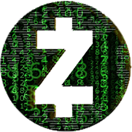
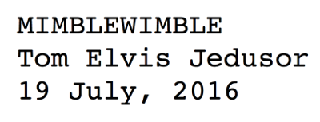
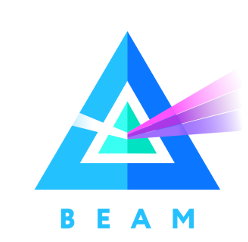
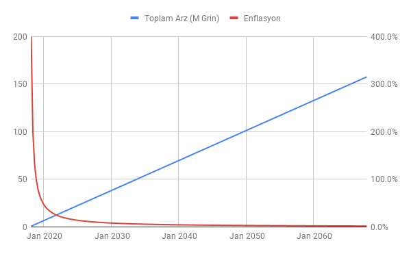
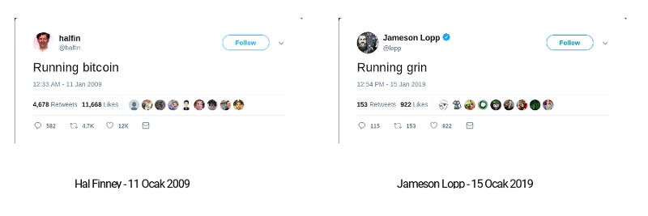
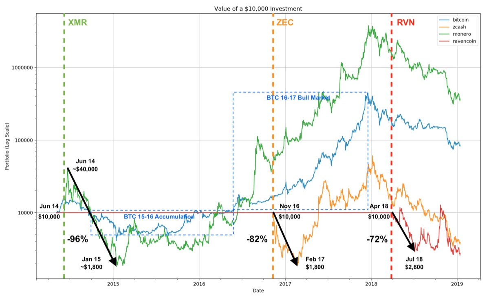
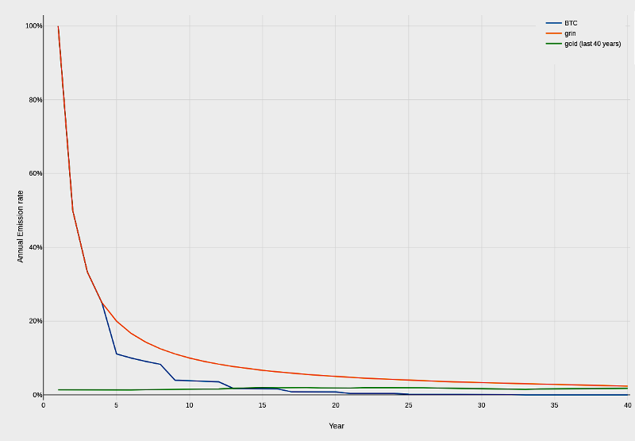
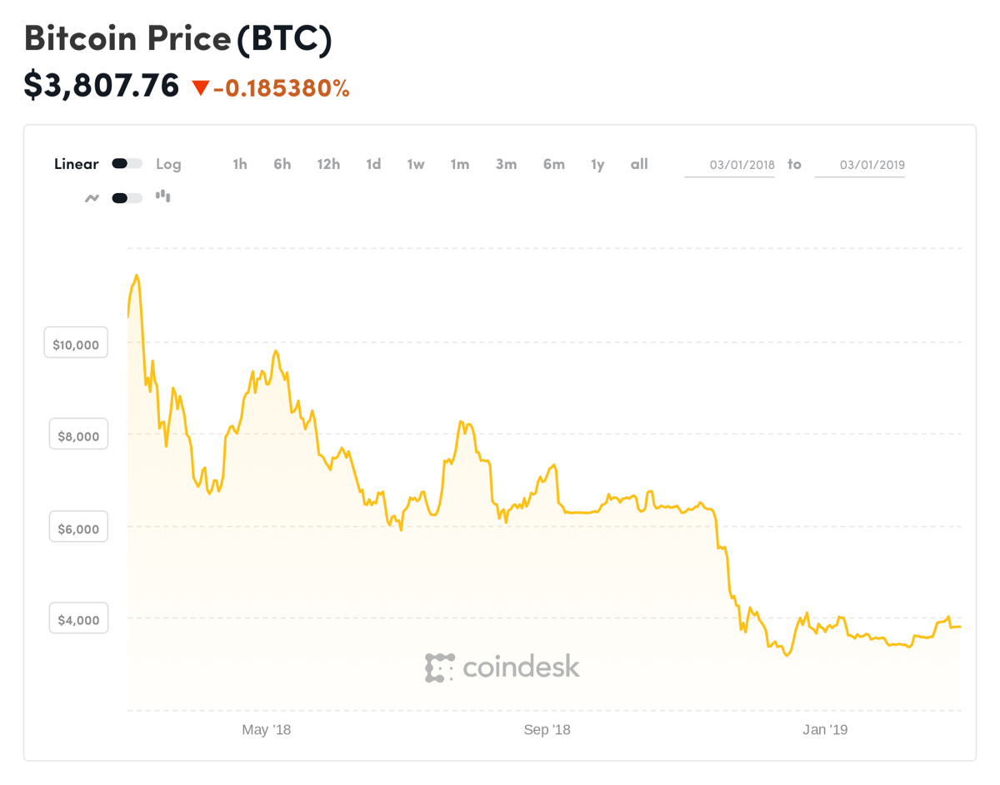
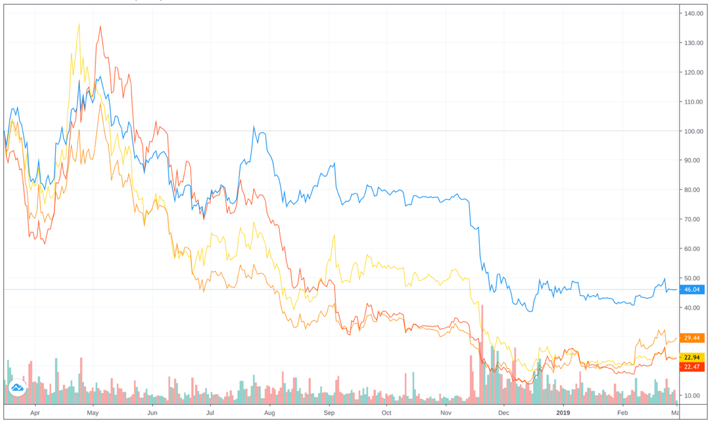
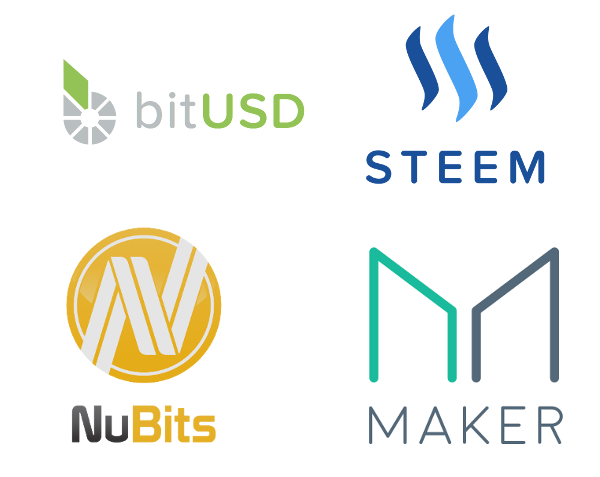

*Bitcoin ve Ethereum dışında diğer önemli Blockchain sistemlerine de bakalım kısaca:*

Şimdi de Bitcoin’in eksik kaldığı düşünülen alanlarda bu eksikleri kapatmak için kurulmuş olan alternatif paralara kısaca altcoinlere bakalım. Bitcoin temel olarak değer saklama işlevi görmeyi amaçladığı için onu geliştiren yazılımcılar yeniklikten ziyade güvenirliğe önem veriyorlar ve bu nedenle Bitcoin’in yeterince pratik olmadığı ve bu yönde çalışmalarda ağır kaldığı yönünde eleştiriler var. Bir de Bitcoin size tam olarak gizlilik sağlamıyor, bu yönünü eksik bulanlar da bir hayli fazla. İşte altcoinler temel olarak bu eksiklikleri gidermek amacıyla ortaya çıkmış kripto paralar. Genel olarak Blockchain bazlı sistemi kullanıyorlar, ancak detaylarda Bitcoin’den ayrılıyorlar.

## Litecoin, Bitcoin’in zıpır kardeşi olabilir mi? {#litecoin-bitcoinin-zipir-kardesi-olabilir-mi}

<figure markdown="1">

<figcaption markdown="span">Image by [designwebjae](https://pixabay.com/users/designwebjae-1753371/)[^1] from [Pixabay](https://pixabay.com/illustrations/image-set-internet-vectors-3046593/)[^2]</figcaption>
</figure>

Litecoin, Bitcoin benzeri paralar içinde Bitcoin’e en benzeyeni. Kurucusu, Charlie Lee adında MIT mezunu bir genç. Hatırlarsanız, Bitcoin benzeri sistemler için Açık Kaynak metodunu benimsemişler demiştik. Bu şu demek: İsteyen herhangi biri mevcut sistemi yürüten yazılımı alıp aynısını kurabilir ve çalıştırabilir. İşte Charlie’nin yaptığı da aynen bu.

Litecoin, iki konuda Bitcoin’den ayrışıyor. Birincisi, hani hep diyoruz Bitcoin on dakikada bir bir ödül veriyor. Bu ödül aslında o on dakika içinde yapılmış işlemlerin teyidi anlamına geliyor. Yani Bitcoin ile bir işlem yaptığınızda örneğin mal satıp Bitcoin aldığınızda, işlemin gerçekten doğrulandığını görmek için on dakika beklemeniz gerekiyor (genelde bu süre ama kimileri daha sağlam olsun diye bu sürenin birkaç katını bekliyorlar). Litecoin ise bu on dakikalık onay süresini 2,5 dakikaya indiriyor. Böylece satıcı olarak aldığınız paranın hakikaten size ait olduğunu yaklaşık 1/4 sürede kesinleştiriyorsunuz.

Litecoin’in ikinci farklılığı ise madenciler alanında. Hani şu işlemleri on dakikada bir teyit eden makineler. Burada ileride bir bölümde daha detaylı ele alacağımız gibi makineler bir bulmaca çözmeye çalışıyorlar. Başlangıçta, evinizdeki laptop aracılığıyla bu bulmacayı çözme ihtimaliniz vardı. Ancak sisteme çok kuvvetli makineler girmeye başladığından beri evde bu işi yapıp bulmacayı çözme ve para kazanma ihtimaliniz çok azaldı. İşte Litecoin, bulmacanın yapısını bu tip büyük makinelerin avantajını azaltarak evde işi yapan küçük oyuncuların avantajına olacak bir hale getirdi. Bu bir nevi, çok kuvvetli makinelerin sistemi tekeline almasının önüne geçmeyi amaçlayan bir yöntem.

İşte bu kadar. Bu iki özellik dışında Litecoin, Bitcoin’in aynısı. Litecoin, Bitcoin ile oldukça yakından çalışıyor, rakipten ziyade küçük kardeş gibi. Litecoin, teknolojik olarak yapılan değişikliklerin laboratuvarı gibi kullanılıyor, bir nevi yeni deneyler burada yapılıyor.

Kısacası, Litecoin yukarıda bahsettiğimiz iki yenilik ile daha pratik olmaya çalışarak paranın iki özelliğinden (değer depolama ve alışveriş aracı olma) yola çıkarak alışveriş için daha pratik ve uygun bir çözüm olmaya çalışıyor.

## Monero, biraz fazla mı gizli? {#monero-biraz-fazla-mi-gizli}

<figure markdown="1">

<figcaption markdown="span">Image by [designwebjae](https://pixabay.com/users/designwebjae-1753371/)[^3] from [Pixabay](https://pixabay.com/illustrations/image-set-internet-vectors-3046593/)[^4]</figcaption>
</figure>

Monero’nun Bitcoin’den farkı gizlilik konusuna verdiği önem.

Konu şu: Normalde Bitcoin ile bir işlem yaptığınızda, satıcı olarak siz Bitcoin’i diğer tarafa gönderiyorsunuz ve kendi Özel Anahtarınız ile bu işlemi onaylıyorsunuz. Dolayısıyla, paranın geldiği adres belli ve açık. Sizin kim olduğunuz bilinmiyor ama size gelen paralar ve sizden giden paralar görülebiliyor.

Pratikte bunun ne önemi var derseniz, kimi durumlarda özellikle kanun dışı aktiviteler içine girmiş kimi hesaplar, eğer kimi borsalar tarafından fark edilirse bloke edilebiliyorlar. [Parayı para yapan özelliklerden bahsettiğimiz bölümümüzde](/Sorularla_Blockchain/bolum-5/bitcoin-para-mi-gercekten/) bahsettiğimiz özelliklerden biri paranın her bir parçasının birbirine eşit olması idi ve orada Bitcoin’in örneğin Altın’a göre dezavantajlı olduğundan bahsetmiştik. İşte ana nedeni bu: Normalde her Bitcoin’in eşit değere sahip olması gerekirken, burada bazı hesaplarda bulunan Bitcoin diğerleri ile aynı değere sahip değil.

Monero ise buna şöyle bir önlem bulmuş. Bir hesaptan diğer hesaba para gönderildiğinde, gönderilen parayı sadece gönderen parti değil onunla birlikte on farklı (rastgele) taraf da imzalıyor. Gerçekten paranın sahibi imzaladığı için işlem gerçekleşiyor ama on kişiden hangisi olduğu bilinmediği için paranın gerçek sahibinin adresini anlamak mümkün değil!

Bunun dışında Monero, Litecoin’e benzer şekilde pratiklik olarak her on dakika yerine iki dakikada bir teyit işlemi yapıyor ve madencilik işinin birkaç büyük aktör elinde toplanmasını önlemek için de Litecoin benzeri bir ödül sistemi kullanıyor.

Kısacası Monero, hem Litecoin gibi pratik, hem de ondan daha da gizli bir para sunuyor.

## Dash, biraz fazla mı karanlık? {#dash-biraz-fazla-mi-karanlik}

<figure markdown="1">

<figcaption markdown="span">Image by [designwebjae](https://pixabay.com/users/designwebjae-1753371/)[^5] from [Pixabay](https://pixabay.com/illustrations/image-set-internet-vectors-3046593/)[^6]</figcaption>
</figure>

Dash de aynı Monero gibi, hem gönderici/alıcı adreslerini gizliyor, hem de hızlı işlem yapabilmek için teyit sürelerini indirmiş durumda.

Monero’ya göre iki yıl sonra 2014 yılında başlatılan Dash, Evan Duffield adında birinin ürünü. Oldukça iyi bir pazarlama ekibi var, ve bu nedenle son yıllarda paranın değerinde ciddi bir artış yakaladılar. Ancak gizlilik anlamındaki şöhretleri iyi mi kötü mü tartışılır. Örneğin, Doğu Avrupalı yasadışı iş yapan yapıların, son zamanlarda Dash kullanmaya başladıkları söyleniyor (bu yapılar Bitcoin’i yeterince gizli olmadığı için çoktan bıraktılar).

Ancak Dash ile ilgili teknik olarak en büyük soru işareti başlangıcı. Konu şu: Bitcoin (Litecoin ve Monero da aynı şekilde), ilk kurulduğunda yapılan ilk işlem ile on dakika sonra Bitcoin dağıtmaya başladı. Sonrasında da eşit aralıklar ile her on dakikada bir Bitcoin dağıtarak sistemi sürdürdü.

Dash ise ilk 3 yılda yarattığı paranın %30’unu bir “hata” sonucu çalışmaya başladıktan sonraki 24 saat içinde yarattı. Normalde, henüz başlangıçta bu tip sorunlar yaşanabildiği için (zira hepsi deneysel bu paraların) geliştirici sistemi restart edip baştan başlatabilir. Ama Dash öyle yapmadı ve çalışmaya devam etti. Dolayısıyla parayı yaratan kişi ve etrafındaki çok ufak bir ekip, tüm paranın %30’unu en baştan ellerine aldılar. Oldukça şüpheli bir durum ve düpedüz haksız rekabet var.

Kısacası, Dash, Monero gibi gizlilik ve pratiklik alanında ön plana çıkıyor ancak kuşkulu geçmişi nedeniyle onun kadar saygın bir kripto para değil.

## Zcash, sınıfın parlak çocuğu mu yoksa? {#zcash-sinifin-parlak-cocugu-mu-yoksa}

<figure markdown="1">

<figcaption markdown="span">Image by [designwebjae](https://pixabay.com/users/designwebjae-1753371/)[^7] from [Pixabay](https://pixabay.com/illustrations/image-set-internet-vectors-3046593/)[^8]</figcaption>
</figure>

Zcash, gerek Monero gerekse Dash’den daha sonra, 2016 yılında ortaya çıkan ve büyük bir ilgi gören kripto para. Kurulduğu andan itibaren büyük bir ilgi gördü. Bunun iki nedeni var. Birincisi kurucusu Zooko Wilcox’un Dijital Para alanında çok eskiden beri bilinen ve saygın biri olması. İkincisi ise diğer alternatif kripto paralar ilk çıktıklarında çok ufak bir geliştirici topluluk dışında bilinmez iken, son yıllarda artan ilgi nedeniyle Zcash’in daha aktif hale gelmeden hemen hemen bu alandaki herkes tarafından biliniyor olması.

Zcash gizlilik konusunda Monero’dan da ileri gitmiş durumda. Bitcoin’de parayı gönderenin ve alıcının adresleri açıkken, Monero’da bu adresler gizli kalıyor demiştik. Zcash ise kullandığı sistemle gönderilen miktarı bile gizli tutuyor. Bir nevi açık olan hiçbir nokta yok. Sadece bir taraftan (ki kim olduğu belli değil), diğer tarafa (yine kim olduğu belli değil) bir dijital “şey” (ne olduğu belli değil) gönderiyorsunuz.

Zcash, kurucusu ve etrafındaki ekip nedeniyle bu alanda belli bir saygınlığa sahip. Ancak, henüz Monero gibi büyük ve sağlam bir topluluk oluşturmuş ve altyapılarını tamamlamış değiller. Gelecekte neye dönüşeceklerini hep birlikte göreceğiz.

## MimbleWimble aranan mahremiyet büyüsü mü? {#mimblewimble-aranan-mahremiyet-buyusu-mu}

*Bugünlerde kripto dünyasındaki yeni ‘hip’ konudan bahsedeceğiz bu bölümde. Nedir bu yeni dalga? MimbleWimble!*

“Zamanında buralar hep dutluktu” diyenleri bilirsiniz. Hepimiz bu tip kaçırdığımız fırsatlara yanarız. Bundan on yıl önce ortaya çıkan Bitcoin’in ilk yıllarını da benzer şekilde es geçtik. Peki bir sonraki Bitcoin’in çıkışının şu aralar, daha doğrusu 15 Ocak’ta gerçekleştiğini söylesek size? Doğru mu gerçekten bu? Şu andan bunu kesin olarak bilmeye imkân yok tabii, ama belki de öyledir kim bilir? Gelin kararı siz verin.

Teknik olduğu için bir parça karışık ama basitleştirmek için üç parçaya ayıralım anlatacağımızı:

- Bu kısımda başlangıç seviyesinde bu teknolojinin teknik olmayan kısmına, felsefi ve ekonomik boyutuna MimbleWimble üzerinden bakacağız.
- İkinci kısımda MimbleWimble üzerine kurulan en heyecanlı uygulama olan Grin parasına değineceğiz.
- Üçüncü kısımda ise, işin teknik kısmına yani diğer iki kısımda felsefi ve ekonomik olarak bahsedilen konuların teknolojik olarak ‘nasıl’ gerçekleştirildiğine göz atacağız.

Nereden çıktı bu MimbleWimble?

MibleWimble 2016 Ağustos ayında kripto paralar üzerine uğraşan bir grup yazılımcının kendi aralarında yazıştıkları chat ortamına Tom Elvis Jedusor rumuzlu biri tarafından aniden bırakılan bir tanıtım yazısı (White Paper) ile girdi.

<figure markdown="1">

<figcaption markdown="span">MimbleWimble White Paper  Kaynak: [Github](https://github.com/mimblewimble/docs/wiki/MimbleWimble-Origin)[^9]</figcaption>
</figure>

Tom Elvis Jedusor, o yazıyı bıraktıktan sonra kayıplara karıştı. Chat ortamındaki diğer yazılımcılar White Paper’ı incelediler, bahsedilenlerin güvenirliğini, kripto olarak sağlamlığını test ettiler ve gerçekten yeni bir ‘olay’ ile karşılaştıklarını anladılar.

2016 yılının sonuna doğru Ignotus Peverell rumuzlu bir başka kullanıcı projenin liderliğini ele aldı. MimbleWimble adı verilen o proje Ignotus liderliğinde sayısı gittikçe artan bir yazılımcı ordusu etrafında büyümeye ve gelişmeye başladı. En son 2019 yılının 15 Ocak tarihinde artık perdelerini dünyaya açar hale geldi MimbleWimble’in ilk uygulaması olan Grin.

Ne garip isimler bunlar?

Gerçekten değil mi? Yukarıdaki paragrafta ismi geçen şahısların hiçbiri gerçek değil. Ama hepsinin bir ortak özelliği var. O da Harry Potter ile ilişkili olmaları! Gelin kim kimdir bakalım:

- MimbleWimble:  Yeni teknolojinin altyapısı olan protokol. Harry Potter’ın [Deathly Hallows](https://en.0wikipedia.org/wiki/Harry_Potter_and_the_Deathly_Hallows)[^10] serisinden bir büyü. Amacı bir kişinin dilini bağlayarak büyü yapabilmek için gerekli kelimeleri anlaşılır şekilde söylemesini önlemek.
- Tommy Elvis Jedusor:  MimbleWimble’in kurucusunun rumuzu. Harry Potter’daki kötü karakter Voldemort’un Fransızca karşılığı.

- Grin:  MimbleWimble üzerine kurulu en tanınmış uygulama (detaylar bir sonraki kısımda). Yine Harry Potter öykülerinden birindeki Gringott’s büyücülük bankasının adı.

<figure markdown="1">

<figcaption markdown="span">Kaynak: [Grin](https://grin-tech.org/)[^11]</figcaption>
</figure>

- Ignotus Peverell:  Grin projesinin lideri. Harry Potter’daki görünmezlik pelerinini üreten büyücü

- [Luna Lovegood](https://www.pottermore.com/features/seven-reasons-to-love-luna-lovegood)[^12], *[Seamus Finnigan](https://www.pottermore.com/explore-the-story/seamus-finnigan)*[^13]*, [Percy Weasley](https://www.pottermore.com/features/in-defence-of-percy-weasley)*[^14]:

Grin projesindeki diğer yazılımcıların rumuzları. Hepsi Harry Potter ailesinden karakterler

Nedir özünde MimbleWimble?

MimbleWimble özünde Bitcoin’in yaşadığı iki ana sıkıntıyı aşmak için yaratıldı: Gizlilik (mahremiyet) ve hantallık.

*Gizli (Mahrem)*

Daha önceki bölümlerimizde bahsetmiştik: Bitcoin aslında mahrem bir sistem değil, sözde gizli demek daha doğru. Bitcoin ile yapılan bir işlemde gizli olan kısım sadece kullanıcı adları yerine adresler kullanılması. Ama gizli olmayan kısımları da alabildiğine şeffaf. Örneğin yapılan bir işlemde gönderilen para miktarı. 2009 yılında yapılmış bir işlemde bile ne kadar para transferi yapıldığını görebiliyorsunuz.

Ancak kullanıcı adlarının gizli olması aslında çok da mahremiyet yaratmıyor. Adreslerin gerçekleştirdiği işlemler teknik olarak takip edilebiliyor, dolayısı ile kanunsuz biri ile bir alışveriş yapmanız durumunda hesabınızın mimlenme ihtimali var. Bunu sadece kanun dışı işlemler olarak düşünmeyin. Baskıcı rejimlerde yaşayanların adreslerinin rejimler tarafından belirlenmesi ve o kişilerin rejim tarafından baskı altına alınması da olası.

İşte Bitcoin üzerindeki bu sıkıntılar, bireylerin özgürlüğünü kendine şiar edinmiş bir grup yazılımcı kesiminin (bunlara ‘cypherpunk’ da deniyor) tam mahremiyet sağlayacak bir protokol arayışına girmesine neden oldu. Bu şekilde ortaya çıkmış Monero, Dash, Zcash benzeri pek çok kripto para da var (bu paralardan şu [bölümde](/Sorularla_Blockchain/bolum-6/diger-kripto-paralar-neler/) bahsetmiştik).

MimbleWimble, kuruluş amacı itibariyle tam bir gizlilik sağlamayı amaçlayan bir protokol. MimbleWimble ile yapılan işlemlerde ne işleme taraf olan alıcı ve satıcı ne de işlem miktarı belli. “Öyle olunca hile hurda olmuyor mu?” diye soracak olursanız sizi işin teknik kısmını anlattığımız kısıma bekleriz.

*Basit (Hafif)*

Bunun dışında MimbleWimble’in diğer temel özelliği ise basit ve hafif bir program olması. Teknik olmayanları çok da ilgilendiren bir konu değil aslında. Hatırlarsanız daha önce Bitcoin’de 2009 yılından bugüne yapılmış bütün işlemleri görebiliyorsunuz demiştik. Bu işlemlerin hepsi Bitcoin sistemindeki tüm makineler tarafından tutuluyor. Bu da her bir makine için gigabaytlarca bilgi demek. Bu kadar çok bilgi tutulması sistemin hantallaşmasına sebep oluyor. MimbleWimble üzerine kurulan uygulamalar burada da güvenlikten ödün vermeden basit bir sistem kurmayı hedefliyorlar.

Ne gibi uygulamaları var?

Yukarıda bahsederken iki uygulaması olduğundan bahsetmiştik. Bu iki uygulama Beam ve Grin.

MimbleWimble başka diğer pek çok proje gibi açık kaynak bir yazılım. Açık kaynak yazılımların en önemli özelliği isteyenin istediği noktada projeyi istediği şekilde geliştirebilmesi. Burada da iki farklı grup projeyi birbirinden çok farklı yerlere götürmüş durumda.

*Beam*

<figure markdown="1">

<figcaption markdown="span">Kaynak: [Beam](https://www.beam.mw/)[^15]</figcaption>
</figure>

MimbleWimble üzerine çıkan iki projeden biri olan [Beam](https://www.beam.mw/)[^16], İsrailli bir girişimci olan [Alexander Zaidelson](https://twitter.com/azaidelson)[^17]’un CEO’luk yaptığı bir oluşum. 2018 sonbaharında 400 Bin ABD Doları yatırım alan proje, derli toplu bir şekilde MimbleWimble üzerine Beam adlı kripto parayı kurmak için uğraşıyor. Dertli toplu derken, bir ekibe sahip olması, kendilerine çizdikleri bir yol planına sahip olması, yatırım alması, Beam parasını açtıklarında kurucular için kendilerine bir para ayırmaları gibi özellikler. Zcash benzeri ICO yapan bir kripto paranın geçtiği tüm süreçlerin benzerini yapmaya çalışıyorlar. Ocak ayı başında da paralarını dünyaya açtılar.

Asıl dikkate değer MimbleWimble uygulaması Grin. Detaylarına bakalım:

Grin nedir?

MimbleWimble’in çıktığı ikinci proje olan Grin, çıkış olarak Bitcoin’ çok benziyor.

Örneğin, lideri olan Ignotus Peverell’in kim olduğunu kesinlikle bilinmiyor. Ignotus Peverell geçtiğimiz yıl yapılan Grin konferansına text-to-speech teknolojisi ile katıldı. Katılımcıların sorularını, yazdığı metni seslendiren bir yazılım aracılığı ile [cevaplandırdı](https://youtu.be/k6tCnw6shgQ)[^18].

Bunun yanında Grin girişim sermayesi benzeri herhangi bir yatırım almadı, bundan sonra da sadece crowdfunding (kitlesel fonlama) ile yoluna devam etmeyi planlıyor. Bunu özellikle önemsiyorlar zira yatırım aldıklarında aslında gerçekten odaklanmaları gereken gizlilik ve kullanılabilirlik alanları yerine yatırımcıya vaad ettiklerini gerçekleştirebilmek adına değer artırıcı konulara zaman ayırmak zorunda kalmaktan korkuyorlar. Zaten ne bir ofisleri var ne de bir organizasyonları, aynı Bitcoin’in ilk günlerindeki gibiler.

Grin yaratıcıları, Bitcoin’in para saklama aracı olarak piyasanın ağır ağabeyi olarak hâkimiyetini sürdüreceğini, kendi paraları olan Grin’in ise ödeme aracı olarak kullanıcılara pratik ve tam gizlilik sağlayan bir mekanizma kuracağını düşünüyorlar.

Bunu gerçekleştirebilmek için de teknik olarak basit, hafif ve gizli bir para yaratmanın yanında ekonomik olarak da Bitcoin gibi deflasyona yol açan (giderek azalan) bir para yaratım politikası yerine, enflasyonist (sabit olarak aynı hızda artan) bir [para yaratım politikası](https://www.tokendaily.co/blog/on-grin-mimblewimble-and-monetary-policy)[^19] sürdüreceklerini açıklıyorlar.

Bu para politikası aslında ilginç bir detay: Para sabit şekilde artacağı için, ikinci yıl ilk yıl piyasaya çıkan kadar para yaratılacak. Üçüncü yıl o ana kadar yaratılmış toplam para stokunun %50'si, dördüncü yıl %33'ü, onuncu yıl 10%u olacak şekilde giderek azalan oranda. Bu nedenle ilk yıllarda para arzı çok fazla olduğu için yani ciddi bir enflasyon yaşayacağı için insanlar parayı ellerinde tutmak yerine (paranın değer saklama özelliği) alışverişte kullanacaklar (paranın ödeme aracı özelliği). Ancak ilk 15–20 yıl sonrası yıllık enflasyon %2'lere inip arz mevcut para miktarına göre iyice azalınca parayı elde tutmak değerli hale gelecek.

<figure><figcaption>Grin Para Politikası</figcaption></figure>

Peki neden popüler oldu bu kadar bu Grin?

Grin’in bu kadar popüler olmasının belki de en önemli nedeni yukarıda da bahsetmeye çalıştığımız Bitcoin benzeri cypherpunk köklere sahip olması. Zira cypherpunk ekibi bireyin özgürlüğünü ve devlet benzeri otoritelere karşı bağımsızlığını savunurken, bunu bir organizasyon altında yapmaları durumunda, otoritelerin uygulayacakları baskılar ile organizasyonlarını ezeceği, kişileri ise hapis de dahil türlü yaptırımlar ile yıldıracağı korkusunu taşıyorlar. Kişilerin gizliliğini ve bağımsızlığını savunabilmek için kendilerinin de gizli olması gerektiğine inanıyorlar. (Bu nedenle Satoshi ismini gizli tuttu, Wikileaks aracılığıyla Bitcoin ortaya çıktığı anda sırra kadem bastı — tüm hikayesi bu bölümde).

Bitcoin benzeri felsefeye sahip bir oluşum olarak başka kripto paralar (Monero, Dash, Zcash) gibi kurucu ekip olarak para yaratımı başlamadan kendilerine baştan bir pay almamaları onları kripto camiası içinde saygın bir yere koyuyor. Çünkü “[premine](https://www.cryptocompare.com/coins/guides/what-is-a-premine/)[^20]” ya da “founders’ share” de denen bu tip bir uygulamanın adil bir paylaşım olmayacağına inanıyorlar.

Bunun yanında Bitcoin’in başlangıcındaki hızlı gelişimi ve fırsatı kaçıran ciddi bir kesim de, şimdi yeni çıkan bu oluşuma erken katılarak oluşacak fırsatlardan olabildiğince çabuk faydalanma peşinde — ama bu kesimin bir sonraki kısmı okumasında fayda var.

<figure markdown="1">

<figcaption markdown="span">On yıl ara ile [Hal Finney](https://twitter.com/halfin/status/1110302988)[^21] ile [Jameson Lopp](https://twitter.com/lopp/status/1085203546579128321)[^22]</figcaption>
</figure>

Ama sadece cypherpunk topluluğu değil Grin’i popüler yapan. Her ne kadar dışarıdan yatırım almasa da girişim sermayeleri bir şekilde projeye destek oluyorlar. Nasıl mı? Önceki bir [bölümde](/Sorularla_Blockchain/bolum-5/madencilik-2-0/) bahsettiğimiz değişen yatırımcılık kapsamında. Grin 15 Ocak itibari ile çalışmaya başladı ve işlemler karşılığı madencilere para yaratma hakkı verdi. İşte pek çok girişim sermayesi de şu anda para harcayıp makine satın alarak ve enerji harcayarak madencilik yapıyor. Amaçları Grin parasına rekabet artmadan erkenden sahip olabilmek.

Yine de bu yatırımcıların, benzer şekilde para yaratımına başlamadan önce büyük sükse yapmış “mahremiyet” esaslı diğer paraların yaratılmaya başladıktan sonraki sürede geçirdikleri değer değişimlerini iyi incelemelerinde fayda var. Bakın, Monero, Zcash ve Ravencoin, ilk çıkışlarından sonra değerlerini ne kadar kaybetmiş:

<figure markdown="1">

<figcaption markdown="span">Monero, Zcash ve Ravencoin ilk çıkış sonrası seyirleri —Kaynak [ByteSize Capital](https://twitter.com/ByteSizeCapital/status/1085155010495709184/photo/1)[^23]</figcaption>
</figure>

Bir başka hipotez ise şu: Bitcoin artık para olarak değer saklama (SoV- Store of Value) konusunda kendini kanıtladı. İnsanlar ona bir değer atfediyor. Üstelik arzı kısıtlı olması değerinin artacağı yönündeki beklentileri de artırıyor aynı zamanda. Ancak Bitcoin teknik kısıtlarından ve yavaş gelişiminden dolayı paranın bir diğer önemli özelliği olan ödeme aracı (MoE- Medium of Exchange) olma konusunda ise geride kalıyor. ([Lightning Network](/Sorularla_Blockchain/bolum-5/lightning-network/) gibi bu alanda çalışan girişimler var tabii). Dolayısıyla pazarda özünde bir ödeme aracı olacak bir başka paraya ihtiyaç hala var gibi. Grin de Bitcoin’e yakın felsefesi ve mahremiyet konusunda ön plana çıkan özellikleri ile bu boşluğu doldurmaya en büyük aday.

Neleri eleştiriliyor?

Grin ile ilgili eleştirilerin ana odak noktası, aslında övünerek bahsettikleri yatırım almama konusu. Bazıları, Grin yaratıcı ekibinin dış bir yatırım almaması nedeniyle kendini baskı altında hissetmeyeceği ve bu nedenle koydukları hedefleri zamanında gerçekleştirmek için kendilerini zorlamayacakları düşüncesinde.

Bunun dışında eleştirilen konulardan biri de ekonomik: Grin’in para yaratma politikası. Bitcoin’in fiyatının artmasındaki en önemli konulardan biri zamanla kullanımı artarken yaratılan Bitcoin’in azalacak olması. Piyasadaki Grin miktarının sürekli artacak olması onu Bitcoin benzeri spekülatif bir değer artışına gitmesini engelleyebilir. Grin’in buna yanıtı şu: “Bitcoin’in başlangıcında fazla fazla yaratılan para, hasbelkader işi başında dalgayı yakalayanlara inanılmaz kazançlar sağladı ancak yaratılan değer ufak bir azınlığın elinde kaldı. Biz bu yaratılacak değeri daha geniş bir kitleye dağıtmak için daha egaliter bir yapı öngörüyoruz, bu nedenle para arzının sürekli olarak artıracağız.”

Akla gelen soru işaretlerinden biri de gizlilik ile geniş kitleler tarafından adaptasyon arasındaki çelişki. Biliyorsunuz özellikle kripto para borsaları bu dünyaya adım atmanın en temel yollarından biri. Ancak merkezi çalışan kripto para borsaları otoritelerin denetimi altında olduğu için müşterilerinin gerçek bilinen kişiler olduğunu sıkı takip etmek zorundalar (AML/KYC prosedürleri ile). Grin gibi tam gizli olduğunu iddia eden bir para bu borsalarda nasıl işlem görecek? İşlem gördüğü durumda gizlilikten ödün vermiş olacak mı? Ya da hiçbir ödün vermeyecek ve geniş kitleler tarafından adapte edilmeyen, sadece baskı altındaki rejimlerde yaşayanlar tarafından kullanılan ufak (niş) bir para olarak mı kalacak? Grin yaratıcıları Bitcoin üzerine inşaa edilen Lightning Network gibi ikinci katman uygulamaların benzerlerinin Grin üzerine kurulabileceğini ve isteyenin bu uygulamalar ile kripto para borsalarında işlem yapabileceğini iddia ediyorlar. Gizlilik ile geniş kitle adaptasyonu bir arada nasıl yürüyecek göreceğiz.

Grin’e teknik olarak bakalım mı?

Kripto para dünyasında her gün yeni değişik bir ortaya çıkıyor. Her ne kadar ICO piyasalarının geçtiğimiz yılın ikinci yarısından bu yana popülerliğini kaybetmiş ve kripto paralara ilgili bir kısım kitlenin hevesini kırmış olsa da, bu alanda çalışan girişimciler üzerinde çalıştıkları projeleri yavaş yavaş ayağa kaldırmaya devam ediyorlar. MimbleWimble ve özellikle Grin, bu alanda Bitcoin’in eksik olduğu düşünülen gizlilik alanında devrim yaratacağını düşünen, Monero, Dash, Zcash benzeri yeni bir para. Eğer işin teknik olarak daha detayına girmek isterseniz, aşağıdaki kısım ilginizi çekebilir.

Gizlilik (Mahremiyet) ne kadar önemli?

Aslında MimbleWimble, Bitcoin’in üzerine kurulduğu teknolojiyi daha gizli hale getirmeye yarayan bir protokol. Ne kastediyoruz bakalım:

MimbleWimble’da ne kullanıcılar ne de işlem miktarları görünecek. Nasıl olacak bu?

*Adres yok yaşasın cüzdanlar*

Öncelikle sistemde paranın gidip geleceği hesaplar olmayacak. Bunun yerine cüzdanlar kullanılacak.

Normalde Bitcoin sisteminde hesaptan para ‘input’ olarak sisteme girer, input karşılığı da aynı miktarda output çıkardı (bu output’a UTXO denirdi). Sistemdeki makinalar çıkan bu UTXO’ları toplar ve değişmediğini gördüklerinde “tamam” derlerdi “sistemde çifte harcama yapılmamış” (şu bölümde değiniyoruz bu konuya)

Grin sisteminde ise input yok, çünkü input yaratacak adresler kullanılmıyor. Bunun yerine sistemde sadece output’lar yani UTXO’lar var. Bunlar da cüzdanlar aracılığı ile kullanılıyor. Sistem iki kullanıcının bir şekilde (on-line ya da off-line) kendi arasında ne tip bir işlem yapacağı konusunda iletişime geçip anlaşma yapması esasına dayanıyor.

Örnek ile açıklayalım: Ayşe Bora’ya 100 Grin göndermek istiyorsa iki taraf kendi Özel Anahtarlarını kullanarak bir işlem yaratıyor ve bunu sisteme yolluyorlar. Biraz daha açalım: Ayşe bu işlemi başlatırken kendi Özel Anahtarı ile bir adres yaratır ve bunu Bora’ya gönderir. Bora’nın bu sırada online olmasına gerek yok. Bora Ayşe’nin gönderdiği işlemi kendi Özel Anahtarı ile şifreler. Sonrasında bu işlem sisteme girilir. Dolayısıyla sistem sadece iki kullanıcının kendi arasında anlaşarak bir işlem gerçekleştirdiğini görür ama sonuçta sadece para el değiştirdiği ve yeni bir para yaratılmadığı için bir sorun yaşanmaz.

*Blok içinde detay bilgi yok*

MimbleWimble’da bütün işlemlerin bir araya getirildiği bloklarda da Bitcoin’de olduğu gibi işlemler tek tek görülmüyor. Bunun yerine bütün işlemlerin bir toplamı var — dolayısı ile kim ne işlem yaptı [görmek mümkün deği](https://blockonomi.com/grin-mimblewimble/)[^24][l](https://blockonomi.com/grin-mimblewimble/). Benzer şekilde karıştırma/toplamayı CoinJoin denen bir işlem ile Bitcoin üzerinde ikinci bir katman olarak yapmak da mümkün. MimblewWimble CoinJoin’i kendi ana sisteminin bir parçası olarak kullanıyor.

*IP adresleri de gizleniyor*

Bitcoin’de adresler belli olduğu için para nereden geldi, nereye gitti biliniyor. Bu nedenle kullanıcıları bir şekilde takip etmek ya da paranın izini sürmek mümkün oluyor (ekstra önlemler alarak bunu engellemeniz mümkün ama bun önlemler ikinci seviye genelde sistemin özünde yok). Çünkü Bitcoin’de bir işlem yaptığınızda bunu sistem ağındaki bir makineye (düğüm-node) gönderiyorsunuz o da tüm sisteme yayıyor. İlk gönderilen node’un biliniyor olması, sizin genelde bu node’u kullanmanız gibi teknik nedenler, aslında bu parayı izi sürülebilir bir hale getiriyor.

<figure markdown="1">

<figcaption markdown="span">Image by [Bru-nO](https://pixabay.com/users/Bru-nO-1161770/)[^25] from [Pixabay](https://pixabay.com/images/id-3363850/)[^26]</figcaption>
</figure>

Mimblewimble da ise öyle değil. Burada gizlilik çözümü olarak [Dandelion](https://github.com/mimblewimble/grin/blob/master/doc/dandelion/dandelion.md)[^27] adı verilen bir protokol kullanılıyor. (Dandelion kara hindiba çiçeği demek, bu çiçeğin özelliği açmadan önce tek bir sap ve yapraktan oluşup açtıktan sonra serpilmesi). MimbleWimble’da siz sisteme bir işlem gönderdiğinizde bunu alan makine rastgele bir başka makineye gönderiyor, o bir başkasına ve böyle böyle ilk gönderen makinanın izinin sürülemeyeceği bir “bozma (fluff)” sürecinden geçiliyor.

Peki ya Basitlik/Hafiflik?

*Tam güncelleme vs kısmi güncelleme*

Bitcoin sisteminin teknik olarak sıkıntılarından biri sistem içindeki makinelerin (node-düğüm) işlemleri teyit etmek için kendi içlerinde tüm blockchain sistemini tutuyor olmaları. Bu data şu anda [200 GB civarında ve giderek artıyor](https://www.blockchain.com/en/charts/blocks-size)[^28]. Herhangi bir bilgisayarın sisteme girmesi için bu datayı yüklemesi oldukça uzun bir zaman.

Grin sisteminde, bir bilgisayar tüm bu datayı tutmak yerine fast sync denen bir metod ile son 2000 bloğu güncelleme (sync) yaparak dakikalar içinde sistemi kullanabilir hale geliyor.

*Gizlilik vs hafiflik (ve dolayısıyla ölçeklenmeye)*

Gizlilik aslında ölçeklendirme ile çelişkili bir kavram. Neden? Çünkü ne kadar gizlilik isterseniz o kadar işin içine şifreleme mekanizmaları giriyor. Ne kadar şifreleme mekanizması koyarsanız sistem üzerinde saklayacağınız bilgiyi o kadar artırıyorsunuz. Bu da sistemin ağırlaşmasına neden oluyor. Özellikle sistemi büyütmek ve geniş kitlelere yaymak istediğinizde ölçeklendirme (scaling) problemi yaşar hale geliyorsunuz.

*Hız vs fonksiyon*

Bunun yanında Grin’in Bitcoin’e göre önemli bir eksikliği içinde ayrı kod yazımına (scripting) izin vermemesi. Bitcoin’i genelde para transferi için kullanıyoruz ama aslında herhangi bir dijital varlık ya da bilginin transferi için de kullanabiliriz. Bunu sağlayan içindeki scripting mekanizması. Ancak bu fonksiyon aynı zamanda ekstra yük getirip blokların büyüklüğünün artmasına ve sisteme yük bindirmesine yol açıyor.

Grin bu tip scripting mekanizması içermiyor. İşe yaradığı tek alan para transferi. Kendisini ödeme aracı olarak konumlandırdığı için daha hızlı olabilmek adına böyle bir farklılaşmaya gitmiş Grin yazılımcıları.

*Uzlaşma Mekanizması*

Aslında MimbleWimble teknik altyapı olarak Bitcoin’e oldukça benziyor.

Örneğin, aynı Bitcoin gibi uzlaşma mekanizması olarak makinelerin enerji kullanması prensibinden hareket eden Proof-of-Work mekanizmasını kullanıyor (PoW’yi ne olduğu ile ilgili detaylı bilgiyi şu bölümde bulabilirsiniz).

Grin’in kullandığı PoW versiyonunun adı [Cuckoo Cycle](https://medium.com/codechain/cuckoo-cycle-c337e30c6c99)[^29]. Bu versiyonun özelliği Bitcoin sistemini domine etmeye başlayan ASIC tipi madencilik yapan ihtisas makinelerinin etkisini azaltmak. Grin başlangıçta ASIC resistant denen sistemi kullanarak olabildiğince küçük bireysel madencinin sistemin içinde olmasını istiyor. Ancak uzun vadede bunun beyhude bir çaba olduğunu düşünüyorlar ve kademeli olarak ASIC tipi makinelerin de sisteme girmesine izin verecekler.

*Öğütme (Hashing)*

Aynı zamanda Grin içindeki işlemleri gerçekleştirirken kullanılacak öğütme mekanizmasının, ileride çok kuvvetli makinalar (quantum computers) tarafından kırılacağı iddia edilen Bitcoin mekanizmalarına benzer akibeti yaşamamak için ‘quantum resistant’ denen çok güçlü mekanizmalar olması planlanıyor.

*Bloklama ve zorluk dereceleri*

Bitcoin sistemindeki madencilere sorduğu soruların zorluk derecesini iki haftada bir ayarlıyor. Bu zorluk ayarlamasını yaparken bulmacanın çözülme hızına bakıyor ve hızlı yani 10 dakikadan çabuk çözülüyor ise zorlaştırıyor eğer 10 dakikadan uzun sürüyor ise kolaylaştırıyor. Grin bu zorluk ayarlamasını çok daha hızlı bir şekilde yapacak. Aynı Bitcoin sonrası çıkan başka pek çok Blockchain sisteminin yaptığı gibi.

Bitcoin sisteminde işlemler 10 dakikada bir toplanıp blok oluşturulurken Grin’de bu dakikada bir olacak. Bitcoin şu anda 10 dakikalık blok oluşturma sonrası 12,5 BTC ödül verirken Grin dakikada bir 60 Grin verecek. Grin’de Bitcoin’de dört yılda bir yaşanan azalma da yok, dolayısı ile ileride eğer devam ederse piyasada bol miktarda Grin olacak.

Neden Lightning gibi ikinci bir katman değil de ayrı bir para?

Peki MimbleWimble bir protokol olarak Lightning Network gibi Bitcoin üzerine ikinci bir katman olarak uyarlanamaz mıydı? Ayrı bir paraya ihtiyaç var mıydı? Buna teknik olarak verilen cevap ikinci bir katman olarak yapılacak bir yazılımın geriye dönük olarak da uyumlu olması için çok fazla çalışma gerekeceği. Yine de çok tatmin edici bir açıklama değil.

Bir başka neden bir kısım Bitcoin geliştiricisinin yarın öbür gün Bitcoin’in başına bir ‘şey’ gelmesi (teknik konular vb.) halinde kendilerine bir B planı araması ve Grin’in de bu alana önemli bir aday olarak görmeleri.

Bir başka neden de Bitcoin’in artık genel kabul gören ciddi bir yapı olması nedeniyle üzerine yapılan değişikliklerin çok yavaş olması. Grin yeni bir teknoloji olduğu için (Rust dilinde yazılıyor) hızlı gelişime imkân veren bir yapısı var.

Sorunları sıkıntıları neler?

Grin’in izleyeceği enflasyon yaratan para politikası aslında gelecekte fiyatının çok değerlenmesinin önündeki en büyük engellerden. Peki neden böyle bir para politikası izliyor Grin?

1. Bitcoin’in azalan emisyon özelliği nedeniyle para ödeme aracı değil değer saklama aracı olarak kullanıldığı düşünülüyor. Grin sürekli olarak bir supply yaratarak ödeme aracı olarak kullanılmak istiyor
2. Bitcoin örneğinde ilk madenciler sonrasındaki ciddi değer yükselmesinden dolayı inanılmaz paralar kazandılar (satoshinin kullanmasa bile [1 milyon BTC’si olduğu biliniyor](http://time.com/money/5002378/bitcoin-creator-nakamoto-billionaire/)[^30]). Grin, daha ‘adil’ bir dağıtım süreci öngörüyor ve kendi emisyon hacimlerinin altına benzeyeceğini iddia ediyor. Grafik bu söylemi doğruluyor.

<figure markdown="1">

<figcaption markdown="span">Bitcoin, Altın ve Grin emisyon hacimleri % olarak (Kaynak: [Bobby Digital - Plot.ly](https://plot.ly/~Bobby_Digital/1/#/)[^31][)](https://plot.ly/~Bobby_Digital/1/#/)</figcaption>
</figure>

Bunun yanında işlemlere hız katmak amacıyla scripting özelliğini yok etmesi ileride Grin’in sadece para transferi için kullanılacak bir araç olarak fonksiyonlarında sınırlamalar yaratabilir. Ancak üzerine inşaa edilebilecek ikinci seviye katmanlar ve ek yazılımlar ile bu sorun giderilebilir gibi görünüyor.

Sonuç

Gördüğünüz gibi kripto para dünyası Bitcoin’den ibaret değil ve pek çok Bitcoin benzeri kripto para var. Muhtemelen daha da çıkmaya devam edecek. Teknoloji geliştikçe, bilinç arttıkça, yeni ihtiyaçlar doğdukça ya da mevcut kripto paralar bu ihtiyaçlara cevap vermekte zorlandıkça yenileri çıkabilir. Peki bu alternatif kripto paralar ya da yeni çıkacaklar Bitcoin’in tahtını sarsabilir mi? Altın gibi kendisine yavaş yavaş saygın bir yer edinen, 2009’dan beri tıkır tıkır çalışan ve basit anlamı ile değer saklama konusunu başarı ile karşılayan Bitcoin’i şu aşamada alt etmeleri zor görünüyor. Ama nasıl dünyada tek bir para birimi yok ise, Kripto Dünyası’nda da sadece Bitcoin olmayacak, bu diğer paralar da pastadan pay almaya devam edecekler.

## SabitParalar dalgalı denizler içinde sakin sular sunar mı bize? {#sabitparalar-dalgali-denizler-icinde-sakin-sular-sunar-mi-bize}

*kripto paraların inişli çıkışlı dünyasında sakin bir liman arayanlara — SabitParalar nedir, ne işe yararlar? Aşağıda:*

Geçtiğimiz günlerde bir yemekte Bitcoin ile ilgili konuşurken, bir dostum “İyi ama Bitcoin ile bir mal sattın, parayı alıp dolara dönmek istediğinde bir bakıyorsun o sırada paranın değeri değişivermiş, ne anladım bu işten — neden Bitcoin kullanayım ki?” şeklinde bir serzenişte bulundu. Haklı mı? Mevcut durumda haklı. Baksanıza Bitcoin’in son bir yıldaki değişimini gösteren grafiğe:

<figure markdown="1">

<figcaption markdown="span">Bitcoin — 2018 yılı içindeki değişim (Kaynak: [Coindesk](https://www.coindesk.com/price/)[^32][)](https://www.coindesk.com/price/)</figcaption>
</figure>

Sadece Bitcoin değil tabii. Diğer kripto paralar da böyle — hatta onların durumu daha da kötü. Aşağıda son iki ayın grafiği var. İki ay öncesine göre yüzde olarak dört büyük kripto paranın değişimini gösteriyor. Genelde hepsi değer kaybetmiş ama oranları o kadar değişken ki… Örneğin son iki ayda Bitcoin başlangıç noktasına göre bir ara %27’ye varan oranda değer kaybetmiş ama son zamanlarda toparlayıp, yazı tarihi itibariyle %4 değer kazanmış. Benzer dönemde, başlangıç seviyesine göre bir noktada Ethereum %36, Litecoin %43, Monero ise %37 daha düşük değerden işlem görmüş, sonra toparlanmışlar (hala başlangıca göre düşük olmalarına rağmen). Can mı dayanır bu iniş-çıkışa?

<figure markdown="1">

<figcaption markdown="span">Son bir yıl yüzde değişim — Bitcoin(Mavi), Ethereum(Kırmızı), Litecoin(Turuncu), Monero(Sarı) (Kaynak: [Multicoincharts](https://www.multicoincharts.com/?chart=COINBASE:BTCUSD)[^33] )</figcaption>
</figure>

Hatırlarsanız bundan önceki bir [bölümde](/Sorularla_Blockchain/bolum-5/bitcoin-para-mi-gercekten/) “Bitcoin para mıdır, değil midir?” diye uzun uzun tartışmış, Bitcoin’i Altın ve devletler tarafından basılan ve şu an tedavülde olan kâğıt para (itibari para da deniyor) ile karşılaştırmıştık.

Fazla dalga bulantı yapar değil mi?

Bitcoin bir para olarak “değer saklama” işlevini gayet iyi yerine getiriyor ama “alışverişe aracılık etme” konusunda belli yerlerde kullanılsa da hala genel bir kullanıma girmiş değil. Bunun ana nedeni de, kısa vadeli işlemler için itibari paralara (ülke merkez bankalarının bastıkları) karşı anlık ciddi dalgalanmalar olması nedeniyle pratik olmaması.

Ama bu dalgalanmalar için alınacak çok da bir önlem yok. Zira Bitcoin’in fiyatını diğer tüm paralarda ya da hisse senetlerinde olduğu gibi borsalarda alım satım yapanlar belirliyor. Normalde itibari paralarda parayı basan merkezi otorite (merkez bankaları) piyasada bir oyuncu olarak yer alıp fiyattaki ani zıplamaları önlüyorlar. Kripto para dünyasında böyle arkada duran bir ağır abi yok - kaldı ki zaten böyle bir oyuncunun varlığı, kripto paraların özündeki “merkezi otoriteye olan ihtiyacı sıfırlamak” felsefesine de taban taban zıt bir durum olurdu.

Ani zıplamalar, bu tip paraları al-sat (spekülatif) amacı ile tutan kişiler ve kurumlar için bulunmaz nimet. Piyasaları yakından takip eden, 7/24 bu piyasalardaki eğilimleri (trendleri) izleyenler için çok karlı fırsatlar sunuyor. Ama bu çok ufak bir kesim. Toplumun kalanının bu tip bir dalgalanmayı takip etmek için ne isteği ne de zamanı var. Eğer kripto paraların günlük hayatımıza girmesi hedefleniyor ise, getirdiği kolaylıklardan faydalanmak için bu paraları kullanmak isteyecek çok büyük bir kesimin daha az dalganan bir araca ihtiyacı var.

Acaba fiyatı sabit olan bir kripto para yapılamaz mıydı? Güzel soru ama kendi içinde o kadar çok çelişki barındırıyor ki. Örneğin sabit para ne demek, neye göre sabit?… Çoğunuzun aklına dolar geldiğine eminim. Peki dolar sabit bir para mı? Yoo, tabii ki hayır!

<figure markdown="1">

<figcaption markdown="span">Yağmurlu havalarda sığınılacak şemsiye: ABD Doları (Image by [Gerd Altmann](https://pixabay.com/users/geralt-9301/)[^34] from [Pixabay](https://pixabay.com/images/id-226717/)[^35])</figcaption>
</figure>

Stabil bir para aslında kendi içinde oksimoron (zıt şekilde çelişkili) iki ifade. O zaman belki de şu soruyu sormak daha mantıklı: Tamam, öyle stabil olmasın da en azından doların euro karşısında yaşadığı gibi dalgalanmaları hafif olsun, denizde hafif dalgalanmalar hissedelim, öyle her akşam yattığımızda acaba yarın sabah %10 zengin mi uyanacağım yoksa %10 fakir mi diye yüreğimiz ağzımızda olmasın. Bakın bu daha mantıklı bir soru — cevabı için de şu günlerde harıl harıl çalışıyor insanlar… Çalıştıkları konu ise SabitPara (Stable coin) kavramı. Örnekleri uzun zamandır etrafta, ancak kullanım olarak hala gerideler…

Nedir bu SabitPara? Var mı böyle bir “şey” gerçekten?

Efendim, kripto para dünyasındaki dalgalanmanın neden olduğu zararının özünde getireceği pek çok faydaya ağır bastığını ve bunun da bu paraların yaygın kitlelerce kullanımını sekteye uğrattığını fark eden girişimciler uzun zamandır yeni tip daha stabil paralar yaratmak için çalışıyorlar.

Peki nasıl bir zarar veriyor bu dalganmalar? Şöyle bir [benzerlik](https://blog.havven.io/we-need-a-decentralised-stablecoin-b3e13346c74f)[^36] kurmak mümkün: Şu an yaşadığımız ve kâğıt paralardan oluşan dünyayı bir kıta olarak düşünün — her tür ekonomik işlemin kâğıt paralar ile gerçekleştirildiği. Bir de bu kıtaya yakın küçücük bir ada düşünün. İçinde pek çok güzellikler olan bir yer. Adı da Kripto adası olsun. Ancak bu adaya gidip gelmek zor. Botlar var ve bu botlar ile her gün belli sayıda insan oldukça zahmetli bir şekilde bu adaya ulaşıyor. Ama gelmesi zor olduğu gibi geri dönmesi de zor. Peki bu adaya şöyle dört şerit gidiş-dört şerit geliş geniş bir köprü yapılsaydı? O zaman insanlar rahatça gider gelirlerdi. Hatta günde birkaç kere gidip gelebilirlerdi. Ne de olsa ulaşım kolay, o kadar zahmete değer artık…

İşte SabitPara’lar bir nevi bu köprüler aslında… kripto paranız var ise bunu kullanmak çok basit. Daha önce anlattık, elinizdeki Bitcoin ile dünyanın her yerine 10 dakika içinde istediğiniz parayı gönderiyorsunuz. Ama normal kâğıt para dünyasından kripto para dünyasına girmek hem zahmetli, hem masraflı hem de vakit alıyor. Varlığınızı iniş-çıkışlardan dolayı kripto para olarak tutmak istemiyor, ama bir yandan da getirdiği kolaylıklardan faydalanmak istiyorsanız alın bir SabitPara, varlığınız SabitPara’da dursun, istediğinizde istediğiniz başka kripto paraya (örneğin Bitcoin’e) anında çevirin işleminizi yapın. Ya da bir yerden Bitcoin mi geldi, değerini kaybetme riski yaşamadan anında SabitPara’ya çevirin, içiniz rahat olsun.

SabitParalar neye göre sabit?

Yukarıda yazdığımız sorunlara çözüm bulabilmek için nasıl yapalım da bu parayı sabitleyelim düşünürken, ilk akla gelen fikir “öyle bir para yaratalım ki dolara endekslenmiş olsun, bankada dolar tutmakla borsada bu parayı tutmak birbirinin tıpatıp aynısı olsun” olmuş. Bu düşüncenin sonucu ortaya çıkan pek çok para var.

Mantıklı mı? Bir dereceye kadar evet. Neden mi? Bir kere başta dediğimiz gibi ABD Doları’na bağlı olan bir para, diğer paralar karşısında aynen ABD Doları gibi dalgalanacak. Dolayısı ile çok sabit sayılmaz. Teorik olarak yine Dolar gibi ABD’de yıllık enflasyon ne kadar ise senelik o kadar değer kaybına uğrayacak. Ama bunlar zaten bildiğimiz konular — yine de Bitcoin vb paraya göre daha stabil olacak değil mi? Teorik olarak evet.

Sabitparalar içinde en bilineni ise Tether (USDT). Nedir bu Tether? Nasıl çalışır?

En büyük SabitPara Tether neye benzer?

2015 yılında kurulan Tether’in çalışma mantığı aslında basit. Şöyle demiş kuranlar: Tether’i ABD Doları’na endeksleyelim. Öyle ki her zaman 1 Tether 1 Dolara eşit olsun. Tether satın almak isteyen getirsin dolarını o kadarlık Tether alsın. Bunun için de yaratılan (satılan) her Tether için o kadarlık parayı bir bankada hesaba yatırmışlar. Yani piyasada bulunan her Tetherin karşılığı olarak bankada aynı miktarda dolar bulundurmuşlar. Dolayısıyla, Dolar teminatlı bir SabitPara yaratılmış Tether ile.

<figure markdown="1">

<figcaption markdown="span">Kaynak: [Tether](https://tether.to/)[^37]</figcaption>
</figure>

Ancak yine de başka sorunları yok değil. Örneğin, kripto para dediğimiz dünyanın merkeziyetçilikten uzak olması gerek — neden? Çünkü, (bu işin gurusu Nick Szabo’nun da dediği gibi) [merkezi her kurum aslında bir güvenlik açığı yaratır](https://nakamotoinstitute.org/trusted-third-parties/)[^38]. Halbuki, Tether’de teminat olarak paralar bir bankaya yatırılıyor. O bankada paralar ne kadar güvenli? Ya banka bir gün sıkıntıya girer hatta belki batarsa? Teorik bu tehlikeleri geçtik diyelim — gerçekten bankaya yatırılan ABD Doları karşılığı kadar mı para yaratıldı? Ya daha fazla yaratıldı ise? Kim denetleyecek? Banka ya da bir denetleme kuruluşu. Çalışma prensibini şeffaflık üzerine kurulmuş kripto para dünyasına (örneğin açık kaynak bazlı ekosistem)) oldukça yabancı kavramlar bunlar... Nitekim geçtiğimiz yıl Aralık ayında ABD resmi makamları Tether’e [soruşturma açarak](https://www.bloomberg.com/news/articles/2018-01-30/crypto-exchange-bitfinex-tether-said-to-get-subpoenaed-by-cftc)[^39] bahsedilen rakamların gerçekten teminat altında olup olmadığı ile ilgili inceleme başlattı. Ya yarın öbür gün ABD hükümeti Tether’in varlıklarına el koyarsa? Şu an öyle bir durum yok ama isterse yapma gücü var!

Bunun yanında bir de büyüklük (ölçekleme) sorunu var. Eğer hedeflenen vizyon bir gün bu kripto paranın tüm dünyada kullanılacak hale gelmesi ise bahsettiğimiz milyarlarca dolarlık bir ekonomik büyüklük. Ne yapacaksınız, tüm bu büyüklüğün karşılığı ABD Doları’nı bankaya mı yatıracaksınız? Yatırabilirsiniz tabii bir sorun yok ama bu büyüklüğe ulaşmak için geçeceğiniz yolları hem zorlu hale getirecek bu teminat sistemi hem de oldukça yavaşlatacak. Hızlı bir şekilde bu sistemin büyümesi oldukça zor olacak gibi görünüyor.

Sonuç olarak Tether şu anda belli bir işlevi yerine getiriyor. İşe de yarıyor. Ama yine de mevcut dünyada kullanılan bir işlevin Kripto dünyasına adapte edilmeye çalışılmış hali gibi. Şifreli Harikalar Dünyası’nın içindeki vizyona (bağımsız, başta merkez bankaları olmak üzere merkezi otorite etkisinden uzak, dağıtık bir yapı) ise henüz çok uzak. Muhtemelen o vizyona diğer SabitParalar daha yakın olacaklar.

Kripto para teminatlı SabitParalar, o nasıl oluyor?

Başlığa bakınca konu bir parça daha çetrefilleşiyor değil mi? Haklısınız. Kripto parayı teminat olarak kullanan SabitParalar da ne demek? Açıklamaya çalışalım:

Efendim, Tether’i açıklarken pek çok sıkıntıları olduğundan bahsetmiştik. Bu sıkıntılardan en önemlisi, Tether’in yarattığı her SabitPara için o paraya eşit değerde ABD Dolarını bir bankada tuttuğunu söylemiştik. Yani adem-i merkezi bir şekilde çalışması gereken şifreli bir kripto para için çok çelişkili ve işin ruhuna aykırı bir durum idi bu. Ya bir gün o paraya el konursa? Ne de olsa merkezi olarak bir banka hesabında tutuluyor (bu arada bankanın neresi olduğu gizli tutuluyor. Bir ara ABD’deki Wells Fargo Bank idi ancak Wells Fargo -birilerinin etkisiyle diyelim- onlar ile iş yapmayı bıraktı, şimdilerde Porto Riko’da bir yerde olduğu [söyleniyor](https://www.bloomberg.com/news/articles/2018-05-24/bitfinex-said-to-find-bank-in-puerto-rico-after-wells-fargo-exit)[^40]).

Biliyorsunuz teknolojik dünyada çare tükenmez — nerede bir sıkıntı var, onlarca çözüm türer. SabitParanın teminatını merkezi olarak tutma sıkıntı ise o zaman o teminatı da merkezi olmayan dağıtık bir hale getirelim. Nasıl? Teminatı da ABD doları yerine bir başka kripto para yaparak tabii!. Böyle ciddi sayıda bir para çıkmış, BitShares ([BitUSD](https://coinmarketcap.com/currencies/bitusd/)[^41]), NuBits ([USNBT](https://coinmarketcap.com/currencies/nubits/)[^42]), Steem Dollars ([SBD](https://coinmarketcap.com/currencies/steem-dollars/)[^43]). Sırada olanlar da var Alchemint ve BitBay gibi. Bu paralardan biri olan Maker DAO’ya ([DAI](https://coinmarketcap.com/currencies/dai/)[^44]) daha önceki [bölümlerimizde](/Sorularla_Blockchain/bolum-2/finans-dunyasindan-ornekler-neler/) detaylıca baktık

<figure markdown="1">

<figcaption markdown="span">Diğer SabitParalar: [BitUSD](https://bitshares.org/technology/price-stable-cryptocurrencies)[^45], [Steem](https://steem.com/)[^46], [NuBits](https://nubits.com/)[^47], [Maker DAI](https://makerdao.com/en/dai)[^48]</figcaption>
</figure>

Artıları neler böyle bir SabitPara’nın? Aslında yukarıda bahsettiğimiz Tether’in merkezi olmasından dolayı duyulan tüm sıkıntıları önlüyor. Bir kere teminat kripto para olarak şeffaf bir şekilde tutulacak. Öyle bir bankada yeterli para var mıymış, yok muymuş endişelenmeye gerek yok. Bir adres belirler ve dünyaya ilan edersiniz. teminat olacak kripto parayı bu adrese gönderirsiniz, isteyen istediği zaman gidip bakabilir, para gerçekten o adreste mi diye. Sonra vay efendim ABD hükümeti gelir de el koyarmış gibi bir dert de yok — neye el koyacaksınız? Sonra işin doğasına uygun — hızlı çabuk olarak büyüyebilir gerekirse, sorun da çıkmaz.

Ama tabii bu tip SabitParalar’ın alması gereken daha çok yol var. Bir kere, Tether gibi ABD Dolarına endeklemişler kendilerini bu paralar. Burada bir sorun yok, zaten istenen de -şu aşamada- bu. Sorun, teminat olarak kripto para gösteriyorsunuz ama kripto paraların kendisi çok oynak. Ya bu teminatın değeri çok düşer ve SabitParayı da etkilerse? Bunu önlemek için Tether’deki 1 Tether=1 ABD Doları’nın çok üzerinde bir teminat koyuyor SabitParalar — bir nevi önlem almak adına iyi, ama çok dalgalı bir ortamda o bile işe yaramayabilir.

Teminatsız SabitParalar!

Buraya kadar hala okumaya devam edip kaybolmadı iseniz bravo. O zaman sizin için konuyu daha da karıştıralım! :)

Yukarıda bahsettiğimiz Tether ve diğer SabitParalar biliyorsunuz kendilerini ABD Dolarına bağlar iken ya ABD Doları ya da değer olarak ona yakın miktarda kripto parayı teminat olarak alıyorlardı. Bir kısım SabitParalar ise “Boşverin bu teminat vesaire almayı, biz bir algoritma yapalım, teminatı toptan yok edelim” demişler.

Nasıl yapmışlar bunu? Kısacası, hatırlarsanız bir bölümümüzde Akıllı Kontratlardan bahsetmiştik. İşte bu sistemi kuranlar — sanal bir Merkez Bankası yaratıp, bu bankanın işleyişini bir Akıllı Kontrat’a bağlamışlar. Ne zaman SabitPara’ya talep artıyor, bolca SabitPara yaratarak paranın değerini 1 ABD Doları seviyesine getiriyorlar. Ne zaman paraya talep düşüyor, mevcut SabitParalar’dan bir kısmını yok ederek (yani parayı azaltarak) değerini artırıyorlar. Bu SabitParalar için öne çıkanlar Basis ve Saga ([SAGA](https://coinmarketcap.com/currencies/sagacoin/)[^49]).

<figure markdown="1">

<figcaption markdown="span">[Basis](https://www.basis.io/)[^50] ve [Saga](https://www.saga.org/)[^51]</figcaption>
</figure>

Son bahsettiğimiz Teminatsız SabitPara kavramı henüz çok daha yeni. Bu konsepte inananlar (ki Kripto dünyasının ağır topları var burada) önceki SabitParalara göre çok daha büyük potansiyeli olduğunu düşünüyorlar bu SabitParalar’ın. Ancak üzerinde düşünülmesi, açıklarının bulunması, gerçekten çalışıp çalışmadığının görülmesi gerek, bunun için de zamana ihtiyaç var. Örneğin Basis kurucuları 2018 yılının sonlarında sürdürülebilir bir model kuramadıklarını [belirterek](https://techcrunch.com/2018/12/13/basis-backed-with-133-million-from-top-vcs-to-build-a-price-stable-cryptocurrency-says-its-shutting-down-and-returning-the-money/)[^52] dükkanı kapattılar ve yatırımcılardan topladıkları 130 Milyon ABD Doları’nın büyük bir kısmını geri iade ettiler.

Sonuç

SabitParalar eğer söz verdikleri vizyonu gerçekleştirebilirler ise çok büyük bir potansiyel arz ediyorlar. Ancak, yine diğer pek çok kripto para ya da Blockchain projesinde olduğu gibi konuşmak için çok erken ve daha alınacak çok yol var.

Aslında belki de en ilgi çekici olanı da bu: Teknolojik olarak bir devrim oldu diyoruz. Bitcoin ve benzeri kripto paralar çıkıyor. Ama sonra diyoruz ki, “Bu paralar çok ilginç, çok farklı işe yarar özellikleri var, ama şu şu nedenden dolayı kullanamayız”. Girişimciler bu üzerinde takılıp zaman kaybetmiyorlar, “nasıl oldururuz”un peşinde koşuyorlar. Gelen geri bildirimler ile yeni yeni özellikleri olan bir üst seviye ürün çıkarıyorlar.

SabitPara olarak ilk çıkan örnekler belki yeterli değil, henüz çok erken. Ama bu insanları merak ve daha iyisini yapmaktan alıkoymuyor. Bu paraları kullanıyor, sorunlar ile karşılaşıyorlar. Tekrar deniyorlar, bu sefer daha iyisini yapıyorlar. Önemli olan burada bir vizyon olması ve yavaş yavaş, adım adım o vizyona doğru yaklaşılması. Hemen sonuç beklemeyin, sabredin ve bir vizyon düşleyin, sonra da o vizyona ulaşırken yapacağınız yolculuğun (inişli çıkışlı) tadını çıkarmaya bakın! …

[^1]: [https://pixabay.com/users/geralt-9301/](https://pixabay.com/users/geralt-9301/)

[^2]: [https://pixabay.com/images/id-442924/](https://pixabay.com/images/id-442924/)

[^3]: [https://pixabay.com/users/geralt-9301/](https://pixabay.com/users/geralt-9301/)

[^4]: [https://pixabay.com/images/id-442924/](https://pixabay.com/images/id-442924/)

[^5]: [https://pixabay.com/users/geralt-9301/](https://pixabay.com/users/geralt-9301/)

[^6]: [https://pixabay.com/images/id-442924/](https://pixabay.com/images/id-442924/)

[^7]: [https://pixabay.com/users/geralt-9301/](https://pixabay.com/users/geralt-9301/)

[^8]: [https://pixabay.com/images/id-442924/](https://pixabay.com/images/id-442924/)

[^9]: [https://github.com/mimblewimble/docs/wiki/MimbleWimble-Origin](https://github.com/mimblewimble/docs/wiki/MimbleWimble-Origin)

[^10]: [https://en.wikipedia.org/wiki/Harry\_Potter\_and\_the\_Deathly\_Hallows](https://en.wikipedia.org/wiki/Harry_Potter_and_the_Deathly_Hallows)

[^11]: [https://grin-tech.org/](https://grin-tech.org/)

[^12]: [https://www.pottermore.com/features/seven-reasons-to-love-luna-lovegood](https://www.pottermore.com/features/seven-reasons-to-love-luna-lovegood)

[^13]: [https://www.pottermore.com/explore-the-story/seamus-finnigan](https://www.pottermore.com/explore-the-story/seamus-finnigan)

[^14]: [https://www.pottermore.com/features/in-defence-of-percy-weasley](https://www.pottermore.com/features/in-defence-of-percy-weasley)

[^15]: [https://www.beam.mw/](https://www.beam.mw/)

[^16]: [https://www.beam.mw/](https://www.beam.mw/)

[^17]: [https://twitter.com/azaidelson](https://twitter.com/azaidelson)

[^18]: [https://youtu.be/k6tCnw6shgQ](https://youtu.be/k6tCnw6shgQ)

[^19]: [https://www.tokendaily.co/blog/on-grin-mimblewimble-and-monetary-policy](https://www.tokendaily.co/blog/on-grin-mimblewimble-and-monetary-policy)

[^20]: [https://www.cryptocompare.com/coins/guides/what-is-a-premine/](https://www.cryptocompare.com/coins/guides/what-is-a-premine/)

[^21]: [https://twitter.com/halfin/status/1110302988](https://twitter.com/halfin/status/1110302988)

[^22]: [https://twitter.com/lopp/status/1085203546579128321](https://twitter.com/lopp/status/1085203546579128321)

[^23]: [https://twitter.com/ByteSizeCapital/status/1085155010495709184/photo/1](https://twitter.com/ByteSizeCapital/status/1085155010495709184/photo/1)

[^24]: [https://blockonomi.com/grin-mimblewimble/](https://blockonomi.com/grin-mimblewimble/)

[^25]: [https://pixabay.com/users/Bru-nO-1161770/](https://pixabay.com/users/Bru-nO-1161770/)

[^26]: [https://pixabay.com/images/id-3363850/](https://pixabay.com/images/id-3363850/)

[^27]: [https://github.com/mimblewimble/grin/blob/master/doc/dandelion/dandelion.md](https://github.com/mimblewimble/grin/blob/master/doc/dandelion/dandelion.md)

[^28]: [https://www.blockchain.com/en/charts/blocks-size](https://www.blockchain.com/en/charts/blocks-size)

[^29]: [https://medium.com/codechain/cuckoo-cycle-c337e30c6c99](https://medium.com/codechain/cuckoo-cycle-c337e30c6c99)

[^30]: [http://time.com/money/5002378/bitcoin-creator-nakamoto-billionaire/](http://time.com/money/5002378/bitcoin-creator-nakamoto-billionaire/)

[^31]: [https://plot.ly/~Bobby\_Digital/1/#/](https://plot.ly/~Bobby_Digital/1/#/)

[^32]: [https://www.coindesk.com/price/](https://www.coindesk.com/price/bitcoin)

[^33]: [https://www.multicoincharts.com/?chart=COINBASE:BTCUSD](https://www.multicoincharts.com/?chart=COINBASE:BTCUSD)

[^34]: [https://pixabay.com/users/geralt-9301/](https://pixabay.com/users/geralt-9301/)

[^35]: [https://pixabay.com/images/id-226717/](https://pixabay.com/images/id-226717/)

[^36]: [https://blog.havven.io/we-need-a-decentralised-stablecoin-b3e13346c74f](https://blog.havven.io/we-need-a-decentralised-stablecoin-b3e13346c74f)

[^37]: [https://tether.to/](https://tether.to/)

[^38]: https://nakamotoinstitute.org/trusted-third-parties/

[^39]: https://www.bloomberg.com/news/articles/2018-01-30/crypto-exchange-bitfinex-tether-said-to-get-subpoenaed-by-cftc

[^40]: https://www.bloomberg.com/news/articles/2018-05-24/bitfinex-said-to-find-bank-in-puerto-rico-after-wells-fargo-exit

[^41]: [https://coinmarketcap.com/currencies/bitusd/](https://coinmarketcap.com/currencies/bitusd/)

[^42]: [https://coinmarketcap.com/currencies/nubits/](https://coinmarketcap.com/currencies/nubits/)

[^43]: [https://coinmarketcap.com/currencies/steem-dollars/](https://coinmarketcap.com/currencies/steem-dollars/)

[^44]: [https://coinmarketcap.com/currencies/dai/](https://coinmarketcap.com/currencies/dai/)

[^45]: [https://bitshares.org/technology/price-stable-cryptocurrencies](https://bitshares.org/technology/price-stable-cryptocurrencies)

[^46]: [https://steem.com/](https://steem.com/)

[^47]: [https://nubits.com/](https://nubits.com/)

[^48]: [https://makerdao.com/en/dai](https://makerdao.com/en/dai)

[^49]: [https://coinmarketcap.com/currencies/sagacoin/](https://coinmarketcap.com/currencies/sagacoin/)

[^50]: [https://www.basis.io/](https://www.basis.io/)

[^51]: [https://www.saga.org/](https://www.saga.org/)

[^52]: [https://techcrunch.com/2018/12/13/basis-backed-with-133-million-from-top-vcs-to-build-a-price-stable-cryptocurrency-says-its-shutting-down-and-returning-the-money/](https://techcrunch.com/2018/12/13/basis-backed-with-133-million-from-top-vcs-to-build-a-price-stable-cryptocurrency-says-its-shutting-down-and-returning-the-money/)
