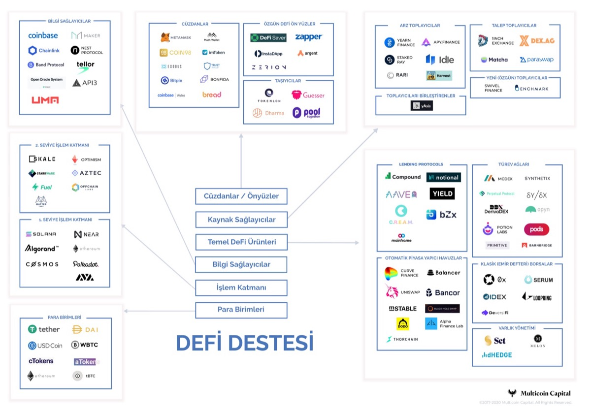

DeFi yani merkeziyetsiz finans henüz yeni bir oluşum. Kökleri daha eskiye dayansa da genel olarak 2017 yılında gerçekleşen kripto halka arzlarını (ki İngilizce Initial Coin Offering ICO deniyor) başlangıç noktası alabiliriz. Halka arz furyası sırasında fikirlerine yatırım alan girişimlerin, geliştirdikleri projelerin üzerinde yaptıkları deneme-yanılma çalışmalarının meyvelerini ancak iki yıl sonra 2020 yılının yaz aylarında almaya başlamaları ile çıkışa geçmiş bir hareket.

DeFi alanında kullanıcılara sunulan ilk ürünlere baktığımızda, bunların pek çoğunun aslında şu anda klasik finans dediğimiz mevcut finans piyasası aktörlerinin sunduğu ürünlere benzerlik gösterdiğini görüyoruz. Bunun temel nedeninin, öncelikle kullanıcının aşina olduğu ürünlere yakınlık göstermesi olarak düşünebiliriz.

Ancak bir önceki kısımda bahsettiğimiz birlikte çalışılabilirlik, açık kaynak kullanımı gibi temel özelikleri nedeniyle DeFi’nin klasik finansın sunduğu hizmetlerin çok daha ötesini sunabileceğini söylemek çok da kehanet sayılmaz.

## Klasik finans ile DeFi'nin temel farkı {#klasik-finans-ile-definin-temel-farki}

Yukarıda bahsettiğimiz özellikler nedeniyle DeFi’nin çalışma prensiplerinin, temelde klasik finanstan farklılık gösterdiğini söyleyebiliriz. Neler bunlar, kısaca değinelim:

Klasik finans dünyasının aktörleri, geçmişten gelen “korumacı” zihniyetin devamı olarak bir “silo” (kendi içinde var olan ve dışarı ile iletişimi son derece kısıtlı) şeklinde çalışırlar. Ne demek silo? Kullanıcı, varlığını bir finans kurumuna emanet eder ve sadece o finans kurumunun sunduğu ürünleri kullanabilir. Başka kurumlara ait ürünleri kullanmak isterse, o kurumlarda hesap açarak varlığını yatırması gerekir.

Finans kurumu, aylarca hatta yıllarca çalışarak müşterileri için ürünler hazırlar ve onlara sunar. Bu ürünlerin gelişmesine ait telif haklarını sıkı sıkıya kayıt ettirir ve başkalarının kullanımı hâlinde mahkemelerde hakkını arar.

DeFi’de ise bu durum kökten değişiyor. Öncelikle kullanıcı, varlığını hizmet sağlayıcıya emanet etmez. Varlık, kullanıcının elektronik cüzdanında durur (Son bölümümüzde bu konuya detaylıca bakacağız). Kullanıcı, hizmet sağlayıcı ile çalışmak istediği anda; cüzdanını bağlar, hizmeti kullanır, sonra ilişkiyi keser. Üstelik, DeFi ürünleri birlikte çalışabildiği için, aldığı bir DeFi ürününü götürüp başka bir protokolde de kullanabilir.

Bunun yanında, açık kaynak sayesinde ürün geliştirme süreçleri DeFi için oldukça kısa. Bu dünyada, telif hakları gibi konular yok denecek kadar az (nadir görülen bir örneği Uniswap bölümünde görebilirsiniz). Zira, bırakın ürünlerin nasıl dizayn edildiğini; ürünün kaynak kodları yani onu oluşturan her parça, isteyen herkesin görebileceği şekilde açık.

## Dikey yapılanma yerine yatay yapılanma {#dikey-yapilanma-yerine-yatay-yapilanma}

Dolayısıyla, klasik finansın dikey yapılanmasına karşılık DeFi, yatay bir yapılanma sağlar. Yani, sunulan hizmetler katman katman ayrılabilir. Her katmanda da birbiri ile yarışan servis sağlayıcılar bulunur. Servis sağlayıcılar diğer katmanlardaki ürünler ile birlikte çalışabildikleri için, kullanıcı her katmandan istediğini seçerek kendi risk/getiri profiline uygun kişiselleştirilmiş ürünler çıkarabilir. Bu alandaki yatırımcılardan Multicoin Capital, ‘DeFi yığını’ (ya da istiflenmiş destesi) olarak adlandırdığı DeFi ekosistemini aşağıdaki şemada gayet güzel bir şekilde anlatıyor:

<figure><figcaption>DeFi Destesi (DeFi Stack) Kaynak: <a href="https://multicoin.capital/2020/11/24/the-defi-stack/">Multicoin Capital</a></figcaption></figure>

DeFi destesindeki altı parçayı, en alttan (yani temel altyapıdan) en üste (yani kullanıcıya) dokunan şekilde sıralayıp, her bir katmandan birer cümle ile bahsetmekte fayda var:

**Para birimleri (Unit of Value):** İşin en temelinde para birimleri var. Neden? Ortada bir para birimi yani değer olmalı ki kullanıcı varlığını saklayabilsin ve o varlık ile finansal işlem yapabilsin. DeFi’de kullanılan para birimleri; BTC, ETH gibi kıymeti kendinden menkul kriptoparalar olabildiği gibi, değeri ABD doları gibi itibari paralara dayanan stabil para dediğimiz kriptoparalar da olabiliyor.

**İşlem katmanı (Transaction layer):** Kullanıcı, kendine ait bir değeri olduktan sonra bu değeri saklayabileceği ve finansal işlemlerini gerçekleştirebileceği bir alan arar. İşte temel olarak blokzincirler burada DeFi’nin ihtiyacı olan altyapı hizmetini verirler.

Bu kitapta genelde blokzincir olarak Ethereum’dan bahsedildiğini göreceksiniz. Bunun temel nedenleri arasında; Ethereum’un Bitcoin’den sonra çıkmış en popüler blokzincir olması, kendisini bir akıllı kontrat platformu olarak sunması ve DeFi protokollerinin ağırlıklı bir çoğunluğuna ev sahipliği yapması geliyor.

Teknolojinin her alanında olduğu gibi burada da Ethereum’un rakipleri var ancak şu anda hemen hemen hepsi emekleme aşamasında. Gelecekte, bu rakiplerden bir ya da birkaçının Ethereum’a ciddi bir rakip olabileceğini de görebiliriz.

Ethereum'un rakiplerinin ataklarına karşılık verdiği cevaplardan bir tanesi 2022 yılında görücüye çıkaracağı yeni versiyonu olacak. ETH 2.0 olarak adlandırılan bu versiyonun en büyük özelliği, Ethereum blokzincirinin yatay olarak genişletilerek üzerindeki yükün dağıtılması (teknik olarak İngilizce'de 'sharding' denen bir yenilik). Bu yapıldığında, şu an bir adet olan [Ethereum blokzinciri sayısı 64'e çıkacak.](https://ethereum.org/en/eth2/shard-chains/)

Öte yandan 2021 yılının ilk aylarında, DeFi’nin patlamasıyla birlikte Ethereum blokzincirine yoğun bir talep olduğu ve bunun işlem ücretlerinde ciddi bir yükselişe neden olduğu da bir gerçek. Bu nedenle özellikle Ethereum üzerine kurulu ikinci seviye çözümler, ağın üzerindeki yükü alması, belli hizmetlerin hem ucuz hem de hızlı bir şekilde gerçekleşebilmesi için kritik.

**Bilgi Sağlayıcılar:** DeFi dünyasının temel taşı olan akıllı kontratlar, işlemleri gerçekleştirmek için dış dünyadan bilgi alma ihtiyacı duyarlar ancak doğaları gereği dış dünya ile bağlantıları bulunmaz. Bilgi sağlayıcılar (İngilizcede ‘oracle’), blokzincir ile dış dünya arasında bilgi taşımada bir köprü vazifesi gören önemli altyapı parçalarında biri. Bilgi sağlayıcılar ve bu alanın en büyüğü olan Chainlink ile ilgili detaylı bilgiyi ilerleyen sayfalarımızda bulabilirsiniz.

### Temel DeFi ürünleri {#temel-defi-urunleri}

İşte aslında en çok konuşulan ve DeFi dünyasına yeni adım atanların ilk karşılaştıkları DeFi ürünleri bu kategorinin içinde. Başlangıçta klasik finansı taklit eden ürünlerle işe başlayan, şimdilerde yavaş yavaş DeFi’nin temel avantajlarını kullanarak klasik dünyada hayal bile edilemeyecek yeni ürünler sunan protokoller. Ürün ya da protokol olarak adlandırdığımız bu yapıların her biri, aslına bakarsınız özünde akıllı kontrat da denen bir yazılım parçası.

İncelememize bu alandaki en eski protokollerden MakerDAO ile başlayacak ve yedi temel ürüne detaylıca göz atacağız.

### Kaynak Sağlayıcılar/Toplayıcılar {#kaynak-saglayicilar-toplayicilar}

DeFi dünyasında binlerce farklı hizmet olması, kullanıcıya alternatif sunma açısından fayda sağlasa da bir noktadan sonra aklını da karıştırabiliyor. DeFi ürünlerinin “birlikte çalışabilirlik” temel prensibine göre oluşturulması sayesinde, artık farklı hizmetleri karşılaştırmak ve en optimum hizmet kombinasyonunu bulmak mümkün (ki bu optimum nokta; risk algısı, kazanç beklentisi, işlemleri en hızlı/ucuz yapma gibi farklı parametrelere göre kişiden kişiye değişir).

### Cüzdanlar/Önyüzler {#cuzdanlar-onyuzler}

DeFi dünyasında bireye özgürlük ya da güç veren en önemli öğenin cüzdanlar olduğunu söyleyebiliriz. Cüzdanlar, aynı zamanda bu dünyaya ilk adımını atan bir kullanıcının elinde olması gereken temel araçlardan. Perakendede bir söz vardır: “Müşteriye kim dokunuyorsa en güçlü odur.” denir. Cüzdanlar için de DeFi’nin kullanıcıya dokunma noktaları diyebiliriz. (Bu alana ilk kez adım atacaklara yönelik cüzdan ve kaynak sağlayıcıları ile ilgili detaylı bilgiler son kısmımızda yer alıyor).

## Sırada neler var? {#sirada-neler-var}

Yukarıdaki DeFi destesinde bulunan parçalardan:

- İlk olarak açıkladığımız ve destenin en altında bulanan üç parçaya, yani 'Para Birimleri', 'İşlem Katmanı' ve 'Bilgi Sağlayıcılar' parçalarına, bir sonraki kısım olan 'DeFi'nin Altyapı Taşları' kısmında
- 'Temel DeFi Ürünleri' olarak adlandırabileceğimiz, kullanıcıların daha aşina olduğu DeFi protokollerine bu kısımda
- En üstte bulunan 'Kaynak Sağlayıcılar' ve ' Cüzdanlar/Önyüzler' parçalarına ise en son kısım olan 'DeFi Dünyasına Adım Atacaklar İçin Pratik Bilgiler' kısmında

değiniyor olacağız.
