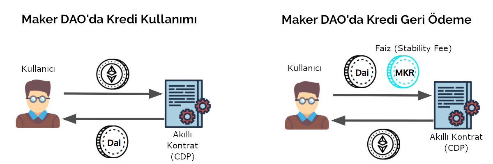
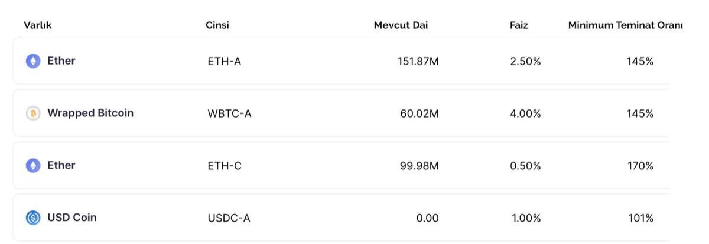
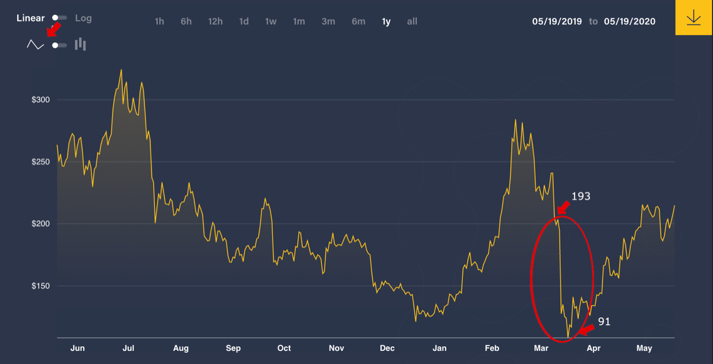

Kitabımızın birinci kısmında, finans dünyasında yeni başlayan DeFi hareketine ve para transferi ile başlayan aracılık hizmetlerinin makinelere aktarılması işinin daha başka hangi alanlara yayılabileceğine değinmiştik. İşte karşınızda bu alanlardan ilki olan kredili işlemlerin en yaygın olarak kullanılanı MakerDAO.

## MakerDAO nedir? {#makerdao-nedir}

MakerDAO kullanıcıların kendi başlarına kredi yaratabilecekleri bir platform. Kullanıcılar sahip oldukları kriptoparaları teminat olarak veriyorlar ve sistemde bulunan akıllı kontrat da bu teminat karşılığı Dai yaratıp kullanıcının cüzdanına yolluyor. Sonra bu Dai’yi borsalarda 1 ABD doları karşılığı satıp, o parayı istedikleri gibi kullanıyorlar. Yarattıkları (yani borç aldıkları) bu Dai’yi belli bir faiz ödeyerek istedikleri süre tutuyorlar; yeter ki teminatları borçlarını karşılasın. Sonrasında istedikleri zaman borsadan Dai satın alıp, bu Dai’yi sisteme gönderiyor, bu sayede borçlarını kapatıyor ve başlangıçta koydukları teminatlarını geri alabiliyorlar. Sistem de kullanıcının gönderdiği bu Dai’yi yok ediyor (ki buna İngilizcede ‘burn’ yani ‘yakmak’ deniyor). Sistemin işleyişi için gerekli önemli kararlar (örneğin faiz oranları gibi) yine bir merkezden ziyade kullanıcılar tarafından oylama yöntemi ile alınıyor.

### Nasıl çalışıyor? {#nasil-calisiyor}

Kullanıcı, elindeki ['sağlam' sayılan kriptoparaları](https://oasis.app/borrow) teminat olarak gösteriyor. Teminat olarak göstermek demek kriptoparayı sisteme kilitlemek anlamına geliyor. Örneğin, gönderilen her 150 birim ETH için akıllı kontrat 100 birime kadar Dai verebiliyor. Kullanıcı, borsalarda 1 ABD Doları'na yakın değerden işlem gören Dai'yi isterse başka stabil paralara çevirebilir ya da başka kriptoparaları satın almak için kullanabilir. Borç alınan paranın bir maliyeti var; kullanıcı dilediği noktada faizi ile anaparası borcunu piyasadan Dai satın alıp sisteme ödeyebilir ve ETH'sine geri kavuşur.

<figure><figcaption>Maker DAO sistemi kullanımı. Kaynak: <a href="https://medium.com/tokenanalyst/measuring-maker-dai-stability-f74c23108128">Token Analyst</a></figcaption></figure>

### İnsanlar neden kullanıyor? {#insanlar-neden-kullaniyor}

Temel kullanımı bir örnek ile açıklayalım: Kişinin ani olarak paraya ihtiyacı var; mevcut yatırımı ETH olarak duruyor ancak ETH’nin yükseleceğini düşündüğü için satmak istemiyor. Bu sistemi kullanarak hem nakit ihtiyacını karşılayabilir hem de ETH’nin getireceği kârdan yararlanmaya devam ediyor (Tabii ki, ETH’nin düşmesi durumunda oluşacak zarar riskini taşıyarak).

Öte taraftan, hatırı sayılır bir kitle de, bu sistemi spekülasyon amaçlı kullanmakta. Mevcut varlıklarını teminat gösterip stabil bir para olan Dai borçlanıyorlar ve bu borç ile gidip yükseleceğini düşündükleri kriptoparalara yatırım yapıyorlar.

### Kredi maliyeti ne? {#kredi-maliyeti-ne}

Kredinin maliyetleri, kullanılan teminatın cinsine ve seçilen teminatın yeterlilik oranına göre değişkenlik gösteriyor. Örneğin; Mayıs 2021 itibariyle en çok kullanılan işlem olan ‘ETH’yi kilitleyip %150 teminat oranı ile Dai borçlanma’ işleminin maliyeti yıllık %5.5 oranında. Faiz oranının değiştirilmesine, sistemin yönetim tokenine sahip olanlar karar veriyor.

<figure><figcaption>MakerDAO kredi maliyetleri - Kasım 2021 itibariyle. Kaynak: <a href="https://oasis.app/borrow">MakerDAO</a></figcaption></figure>

### Ya ETH çok düşer de teminatımın altına inerse? {#ya-eth-cok-duser-de-teminatimin-altina-inerse}

Buna dikkat etmek gerekiyor işte. Zira ETH’nin değeri düşerse kullanıcının ekstra ETH yüklemesi lazım. Ya da kullanıcılar en başta koymaları gerekenden daha fazla ETH'yi sisteme kilitliyorlar. Aksi takdirde, yani teminat oranı %150'nin altına düşer ise sistem kullanıcının ETH’sini “bozuyor” ve [%13 gibi bir ceza](https://oasis.app/borrow/vaults/open/ETH-C) sonrası (İngilizce [liquidation fee](https://community-development.makerdao.com/en/learn/vaults/liquidation/) olarak tanımlanıyor) borcu düşüp, kalan teminatı kullanıcıya geri veriyor.

Şu anda sistemde kilitli tutulan teminat rakamının kullanılan krediye oranının, Haziran 2021 itibariyle [yaklaşık %350 olduğunu görüyoruz](https://daistats.com/#/collateral). Yani insanlar, kullandıkları krediler için gerekli minimum limit olan %150’nin üzerine ekstra teminat koymuşlar.

### Kim borç veriyor bu sisteme? {#kim-borc-veriyor-bu-sisteme}

Aslında kimse kimseye borç vermiyor. Kullanıcı elindeki ETH’yi teminat olarak koyuyor, akıllı kontrat bunun karşılığı Dai basıp kullanıcının hesabına yatırıyor.

### Dai parası nasıl stabil kalıyor peki? {#dai-parasi-nasil-stabil-kaliyor-peki}

Dai, bir ABD dolarına denk olacak şekilde planlanmış ancak işlem gördüğü borsalara baktığınızda fiyatı aşağı ya da yukarı gidebiliyor. MakerDAO yaratıcıları, fiyatın iniş ve çıkış olduğu durumda tekrar 1 ABD dolarına gelmesinin otomatik olacağını düşünüyorlar. Nasıl? Açıklayalım:

Örneğin, Dai fiyatında bir düşüş oldu. Böyle bir durumda, geçmişte Dai yaratıp borç almış olanlar, kredilerini ucuza kapatma fırsatı bulabilecekler ve Dai satın alacaklar. Bu da Dai fiyatının artarak dengeye gelmesini sağlayacak. Benzer şekilde Dai fiyatında bir artış olduğunda (1 ABD dolarından daha yüksek bir fiyata geldiğinde), insanlar ellerindeki ETH’leri sisteme gönderip Dai yaratacaklar. 1 ABD doları maliyetle yarattıkları Dai’yi piyasada 1 ABD dolarının üzerinde bozdurarak kâr elde edecekler. Bu bahsettiğimiz her iki duruma finans piyasalarında arbitraj deniyor ve likit piyasalar arbitraj fırsatlarını hızlıca değerlendirip sistemi tekrar dengeye getiriyorlar.

### Dai dışında sistemin bir de yönetim tokeni olan MKR var {#dai-disinda-sistemin-bir-de-yonetim-tokeni-olan-mkr-var}

Teknik olarak çok detaya girmedik ancak Dai dışında MakerDAO’nun bir parası daha var; MKR. Dai’yi sistemin parası, MKR’yi ise sistemin sermayesi ya da yönetim tokeni olarak düşünebiliriz. Para alışverişleri Dai ile yapılırken ve Dai, ABD dolarına sabitlenmiş bir para iken, bu para üzerindeki faiz MKR üzerinden ödeniyor. MKR sahibi olanlar aynı zamanda sistemin yönetiminde söz sahibi oluyorlar. Örneğin; teminat oranlarının belirlenmesi ya da sistemdeki ani düşüşlerde çalıştırılacak mekanizmaların prensiplerinin belirlenmesi gibi.

Bu arada olası bir kriz durumunda, MKR, bir nevi acil durumda kırılacak cam gibi de çalışıyor. Eğer teminat olarak tutulan paraların değerinde ani ve büyük bir düşüş yaşanır da teminat miktarı kredinin altına düşerse, o zaman aradaki fark MKR yaratılarak karşılanıyor. MKR’nin emisyonunu artıran bu hareket, onun değerini düşüreceği için MKR sahipleri açısından olumsuz bir durum. Dolayısıyla MKR sahipleri ellerinde tuttukları tokenlerin değeri böyle bir olay nedeniyle azalmasın diye teminat oranı vb. rakamlarda olabildiğince tutucu davranmak zorundalar. Sistem bu alanda da bir nevi otokontrol yaratmış durumda.

Bunun yanında Dai fiyatında aşırı bir düşüş olduğu durumlar için de acil durum senaryoları hazırlanmış; ama şu aşamada çok teknik kaldığı için ilgilenenleri MakerDAO'nun [Tanıtım Dokümanı](https://makerdao.com/en/whitepaper/)‘nı (İngilizcesi White Paper) okumaya davet ederek konuyu kapatıyoruz.

## Peki başarılı olmuş mu MakerDAO? {#peki-basarili-olmus-mu-makerdao}

MakerDAO tamamen otomatik bir sistem. Arada herhangi bir aracı yok. Karmaşık anlaşmalar, kâğıt, imza vs. yok. Sistem tamamen kodlanmış makineler aracılığıyla işliyor. Teminatınızı koyuyorsunuz, paranızı alıyorsunuz. Teminatınız %150’nin altına düşerse de ETH’niz bozduruluyor ve kredi borcunuzun üzerindeki teminatınız hesabınıza yatıyor. Bu nedenle kredi vermenin getirdiği kâğıt ve bürokrasi masrafından kurtulmak, sistemin en önemli avantajlarından biri.

Sistemin en büyük riski, ETH’nin yaşayabileceği ani değer kayıpları. Zira ETH’nin aniden %33 değer kaybetmesi durumunda 150 birimlik teminatlar 100 birime düşebilir ve sistem bu ETH’leri satana kadar kredi miktarının altına da inebilir (her ne kadar kişilerin tuttuğu teminat oranının genelde %200 civarında olması sistemi oldukça rahatlatsa da). MakerDAO sistemi henüz küçük sayılabilir ama çok daha büyümesi durumunda, olası ani düşüşler tüm ETH değerini bile etkileyecek hâle gelebilir.

### Mart 2020 Kara Perşembe krizi {#mart-2020-kara-persembe-krizi}

Peki aradan geçen zamanda hiç kriz yaşadı mı MakerDAO? Gayet tabii. Yine de öncelikle şunu belirtmekte fayda var: Bu tip ürünler/platformlar deneysel ve yeni. O yüzden sorun çıkması gayet normal. Neden?

Birincisi, nihayetinde bunlar birer yazılım. Yazılımları insanlar yazıyor. Kullanılmadan önce detaylı gözden geçiriliyor ve test ediliyor olsa da hata olması çok normal. Bir diğer neden ise, sistemin tasarımcılarının her türlü senaryoyu öngörmelerinin mümkün olmaması. Sistem kullanıldıkça kimi sorunları ortaya çıkıyor ve bunlar zaman içinde gideriliyor ve sonuçta sistem 'kurşun geçirmez' bir hale geliyor. (Bu arada hemen belirtelim; MakerDAO'nun akıllı kontratları için yaptırdığı [dış denetimler de var](https://security.makerdao.com/audit-reports). )

MakerDAO da benzer bir sorunu 2020 yılının Mart ayı içinde yaşadı.

<figure><figcaption>ETH'nin yıllık değişimi ve 12 Mart günü %53 düşmesi <a href="https://www.coindesk.com/price/ethereum">Kaynak</a></figcaption></figure>

12 Mart günü ETH fiyatının %53 düşmesi nedeniyle neredeyse bütün kredilerin karşılığı olan teminatlar pula döndü. Ne oldu tam olarak? Mesela 100 ETH’ye denk gelecek bir kredi almak istiyorsunuz. Aldığınız kredi Dai cinsinden, Dai ise dolara sabitlenmiş bir para. Bunun için minimum 150 ETH teminat koymanız lazım. Ama siz ihtiyatlı davranıp 200 ETH koydunuz. ETH bir günde %53 değer kaybedince dolar cinsinden 200 ETH teminatınız, bırakın aldığınız kredinin 150%’sini karşılamayı, bir anda %94’ünü karşılar hâle geliyor (200x(1- 0.53)=94). Bu durumda da sistem teminatınızı bozuyor ve paranız yanıyor.

Böyle bir durumda makul olanı; ya ekstradan ETH koyarak ya da yarattığınız Dai’lerin bir kısmını geri vererek teminatı yeniden %150’nin üzerine çıkarıp kredinizin yanmasını önlemek. Ancak tam o sırada benzer şekilde işlem yapmak isteyenlerden dolayı ETH işlemleri için kullanılan gas ücretlerinin zıplaması ve sistemsel sorunlar nedeniyle pek çok kişi 12 Mart günü teminatlarını tamamlayamadı. Açıkta kalan krediler açık artırma sistemi ile satılırken, sistemsel bir hatadan dolayı pek çok kontrat sıfır değer ile satıldı. Böyle yaklaşık 5 milyon ABD doları kadar büyüklükte bir kontrat bu durumdan etkilendi.

MakerDAO yöneticileri, sistemin güvenliğini sağlayan MKR token sahiplerine dönerek zarar görenleri zor durumdan kurtaracak bir plan önerdiler. Bu sayede kontratı yananların durumları düzeltildi.

Daha sonrasında, 19 Mayıs 2021’de, bir yıl önce yukarıda değindiğimize benzer bir olay daha yaşandı. Bu sefer, ETH bir önceki günün kapanışına göre gün içinde bir ara %45 değer kaybetse de MakerDAO sistemsel ya da kullanıcıya etki edecek herhangi bir sıkıntı yaşamadı.

## Gelecek nasıl görünüyor? {#gelecek-nasil-gorunuyor}

DeFi’nin geniş kesimlerce benimsenmesi için birkaç alanda gelişme kaydetmesi gerekiyor:

- Kullanıcı dostu arayüzlerin gelişmesi
- Daha geniş kesimlerce ulaşılabilir olması
- Likiditenin artması
- Volatilitenin (değerdeki beklenmedik iniş-çıkışların) azalması
- Türev olarak kullanılan alt varlıkların olgunlaşması (Örneğin; ETH’de yaşanan yukarıda anlattığımız kriz)
- Ürünlerin üzerine kuruldukları altyapı teknolojilerinin çok daha kusursuz hâle gelmesi

Tüm DeFi protokollerinde yukarıda saydığımız konularda yavaş yavaş ilerleme olduğunu görüyoruz. Bir borç yaratma protokolü olan MakerDAO da yavaş yavaş olgunluğa ulaşmaya başladı. Şu aşamada en büyük hedefleri tamamen merkeziyetsiz bir yapıya kavuşabilmek. Bunun için de yaptıkları en önemli iş, başlangıcından beri sistemin lokomotifi olan geliştirici ekibin içinde yer aldığı MakerDAO vakfını yavaş yavaş kaldırmak olacak.

MakerDAO sistemi içinde uzunca bir süredir stratejik kararlar MKR sahipleri tarafından veriliyordu. MakerDAO Foundation olarak adlandırılan geliştirici ekip, MKR sahiplerinin aldığı kararları uyguluyorlardı. Bunu yaparken de masraflarını kaşılamak için kendilerine tahsis edilmiş olan MKR paraları kullanıyorlardı. 2021 yılının Mart ayında aldıkları bir kararla ellerinde kalan MKR’lerin kullanım hakkını MKR sahiplerine bırakıyorlar. Bundan sonra bağımsız ekipler; MakerDAO’nun geliştirme, pazarlama ya da dış ilişkilerini sürdürecekler. Ekipler, hangi alanda çalışıp karşılığında ne kadar bütçe istediklerini MKR sahiplerine sunacaklar. MKR sahiplerinin oylaması sonucu, kendilerine bütçe verilen ekipler çalışmaya devam edecekler. Bu, DeFi protokolleri içinde belki de en uç nokta.
