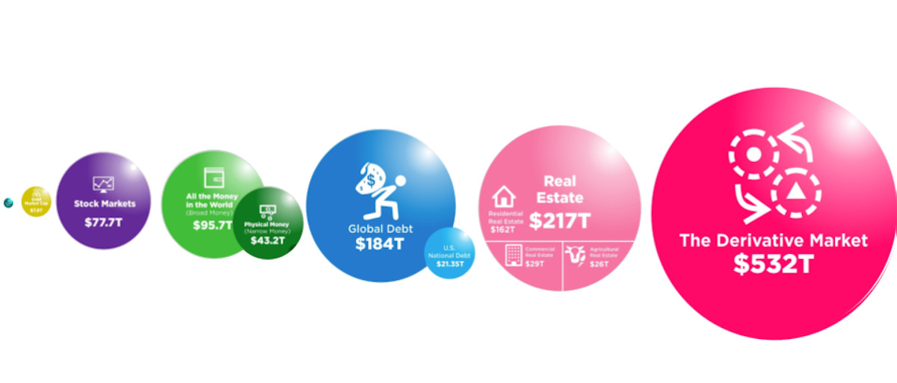
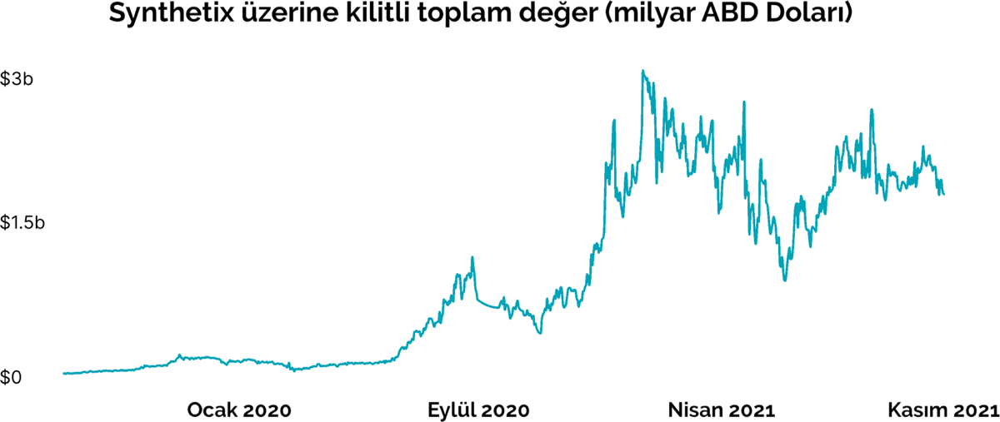
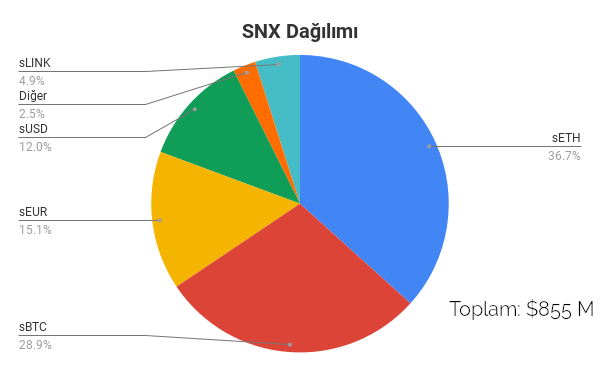

DeFi yani merkeziyetsiz finansın temel amacı, klasik anlamda finans alanında bize yardım eden aracıları ortadan kaldırmak ya da onlardan daha ucuz bir alternatif olmak. Bu aracılardan ilk akla gelen de bankalar ama DeFi yalnızca bankalara olan ihtiyacı ortadan kaldırmıyor. Finans piyasalarındaki her türlü aracı, DeFi oyuncularının tehdidi altında ve hiçbir klasik piyasa, DeFi’den kendini korumak konusunda rahat olmamalı. Bakın onlardan biri daha: Türev piyasaları.

## Nedir türev piyasaları? {#nedir-turev-piyasalari}

Türev, adı üzerinde türetilmiş demek. Yani herhangi bir varlıktan türemiş bir enstrüman. Peki, bu tam olarak ne demek?

En basit tabiri ile şöyle açıklayalım: Alım satıma açık her varlığın bir değeri var. Bu değer zaman içinde azalır ya da artar. Klasik anlamda kazanç sağlamak için bu varlığı elinizde tutar, düşük fiyattan alır (ya da üretir) ve yüksek fiyattan satarsınız ama bunu yapabilmek için o varlığı elinizde tutmalısınız.

Peki ya bu varlığı elinizde tutmak istemiyor ama değer değişimlerinden fayda sağlamak istiyorsanız? Olabilir mi? Olur tabii, neden olmasın? İşte türev piyasalar temel itibariyle bunu sağlıyor; herhangi bir varlığı belli bir fiyattan almak isteyen bir taraf ile aynı fiyattan satmak isteyen bir başka tarafı, bahsedilen varlığın elde olmasına ihtiyaç duymadan bir araya getiriyor. Örneklerini ise aslında çoğumuz duymuşuzdur; vadeli işlemler olarak geçen futures, forwards, options, swaps gibi.

Aslında türev piyasalarının asıl çıkış amacı getirinin ikiz kardeşi olan riski yönetmek. Özellikle alım-satım yapanların gelecekte oluşabilecek her tür duruma karşı kendilerini korumak ve risklerini azaltmak için türev piyasalarını kullandığını da hızlıca belirtelim.

Türev piyasaları DeFi hareketinin en hızlı büyüyen aktörlerinden. Böyle olması da normal zira klasik anlamda piyasalara baktığınızda aslında en hızlı büyüyen ve en büyük hâle gelen pazarın türevler olduğunu görüyorsunuz. Aşağıdaki grafik küçük olabilir ama büyüklükleri göstermesi açısından oldukça etkileyici:

<figure><figcaption>Tüm dünyadaki ekonomik büyüklükler (Ocak 2019). En sağda en büyük pazar olarak türev piyasaları var. Onu sırasıyla; gayrimenkul, kredi, fiziki/dijital para, hisse senedi ve altın izliyor. En soldaki ufak noktayı okuyamadıysanız dertlenmeyin: “'toplam kriptopara pazarı' kendisi :) <a href="https://howmuch.net/articles/visualizing-the-biggest-economic-bubbles">Kaynak</a></figcaption></figure>

## Neden merkezi olmayan DeFi türev piyasalarına ihtiyaç var? {#neden-merkezi-olmayan-defi-turev-piyasalarina-ihtiyac-var}

Aslına bakarsanız, türev piyasalarında faaliyet gösteren merkezi oyuncular ve sistemler gayet pratik, hızlı ve müşterinin istediği çözümleri sunabilen sistemler. Peki o zaman bunu merkeziyetsiz olarak sunmaya gerek var mı? Her ne kadar daha çok küçük olsalar da hızla büyümeleri, bu alanda da DeFi ürünlere ihtiyaç olduğunu gösteriyor. Neden?

En önemli nedenlerden biri sisteme giriş kolaylığı. Merkezi olarak türev ürünleri sunan piyasalara girmek için gerekli prosedür hem zahmetli hem de kimileri için (örneğin coğrafi kısıtlar, yeterince maddi servete sahip olmama gibi nedenlerle) imkânsız. Eğer kriptoparalarla bir haşır neşirliğiniz varsa, örneğin ETH tutan bir cüzdana sahipseniz, merkeziyetsiz borsalarda işlem yapmaya başlama süreniz dakikalar ile ölçülebiliyor.

Bunun yanında DeFi türev oyuncuları klasik türev hizmeti verenlerin sunabildiği her tür fiziki piyasaya ait varlıkların çok daha ötesinde hizmetler sunabiliyorlar kullanıcılara. Örneğin, son zamanlarda adını sıkça duymaya başladığımız getirici çiftçiliği (İngilizcede ‘yield farming’) benzeri ürünler ile DeFi üzerinden farklı yollardan ekstra kazanç sağlamak da mümkün.

Bunun yanında DeFi ürünlerini kullanmanın bir başka avantajı, önceki kısımda da bahsettiğimiz; kullanıcıya verilen güç. Özellikle herhangi bir türev pazarından aldığınız herhangi bir ürünü, bir başka DeFi platformu üzerinden satabiliyorsunuz. Ne de olsa kontratı yapan kişi olarak kontrat sizin. O kontrat Ethereum zinciri üzerine işleniyor ve anahtarı sizde. İşlem yapmak için daha kârlı bir platform bulduğunuz anda cüzdanınızı saniyeler içinde o platforma bağlayıp işlemi oradan gerçekleştirebilirsiniz.

Gelin şimdi de 2020 yılının yaz aylarında bu alanın lideri haline gelen sentetik ürünler piyasası [Synthetix](https://www.synthetix.io/community)‘i inceleyelim:

## Synthetix ne yapar? {#synthetix-ne-yapar}

Türev piyasalarının yükselen yıldızı Synthetix, Avustralya çıkışlı bir ekibin ürünü (Kripto dünyasının en önemli özelliklerinden biri, fiziki dünyada nerede olduğunuzun o kadar da önemli olmaması. O nedenle bir gün Türkiye’den de benzer şekilde başarılı girişimlerin çıkacağını görmek en büyük umudumuz). Ekip, kriptoparaların halka açılması olarak da adlandırdığımız ICO (Initial Coin Offering) piyasasının en sıcak olduğu 2018 yılının başlarında, yaklaşık 30 milyon ABD doları yatırım alarak projeyi hayata geçirdi. 2020 yılının başlarına kadar likidite sıkıntıları nedeniyle istenen hacimlere ulaşamayan sistem, sonrasında DeFi piyasasına olan ilginin artmasının da etkisiyle yaz ayları içinde adeta uçuşa geçti.

<figure><figcaption>2020-2021 yılları Synthetix’de kilitlenen para miktarı. Kaynak: <a href="https://defillama.com/protocol/synthetix/all/USD">DefiLlama</a></figcaption></figure>

## Nasıl çalışıyor sistem? {#nasil-calisiyor-sistem}

Sistemin çalışması kısaca şöyle: Normalde bir türev piyasasında alan ve satan olarak iki parti bulunması gerekirken, Synthetix’de al-sat işleminde bir taraf var bir de karşısında bir havuz. Havuz kısmına birazdan değineceğiz ama gelin öncelikle işin basit kısmından, sistemi kullanmak isteyen yani al-sat işlemi yapanlardan (İngilizcede ‘trader’) başlayalım ve basitlik adına bu kişilere “kullanıcı” diyelim.

### Nasıl işlem yapıyor kullanıcılar Synthetix sisteminde? {#nasil-islem-yapiyor-kullanicilar-synthetix-sisteminde}

Kullanıcılar, özünde herhangi bir varlığa sahip olmadan, o varlığın riskini (yani getiri ya da götürüsünü) almak isteyen kişiler oluyor.

Synthetix sistemi herhangi bir şekilde gerçek bir varlığa dayanmıyor. Onun yerine her bir ürünün sentetik denen türevi var. Bu ürünleri alabilmek için kullanıcının öncelikle sistemin parasına sahip olması lazım. O para da sentetik bir ürün: adı da **sUSD**.

sUSD, değeri ABD Doları'na çıpalanmış bir stabil para. Bu parayı elde edebilmenin iki yolu var. Birincisi çeşitli borsalardan sUSD satın almak (- ki o borsaların listesini [bu bağlantıda](https://www.coingecko.com/en/coins/susd) bulabilirsiniz- ), ikincisi ise az sonra detaylı anlatacağımız “paydaş” yöntemi.

Kullanıcı elindeki sUSD ile sistemde bulunan herhangi bir sentetik ürünü alabiliyor. Örneğin Bitcoin satın almak isterse gerçek BTC’yi değil, onun sentetik türevi olan sBTC’yi alıyor. Canı istediğinde ise sBTC’yi sistemde sUSD karşılığı satıp, eline geçen sUSD’yi de yine aynı şekilde kriptopara borsalarında satarak sistemden çıkabiliyor.

Klasik piyasalar yerine neden burada işlem yapsın bir kullanıcı? Kitabın ilk kısmında kısaca değinmiştik. DeFi piyasaları, interneti olan herkesin erişimine açık; klasik borsalarda olduğu gibi “nitelikli” bir kesime özel değil. Öte yandan özellikle çok al-sat yapanlar için, ürünlerin sentetik olması nedeniyle kullanıcılar herhangi bir üründen diğerine çok rahat geçebiliyor ve bu geçişler sırasında herhangi bir kayıp yaşamıyorlar.

### Synthetix’de ne tip ürünler var ? {#synthetixde-ne-tip-urunler-var}

Beş ayrı kategori var; itibari paralar, emtialar, kriptoparalar, kriptopara endeksleri ve kriptopara fiyatlarını tersten izleyen inverse-kriptoparalar.. Bu beş kategoride, Mayıs 2021 itibariyle; 16 tanesi aktif toplam [71 adet ürün](https://dashboard.synthetix.io/) bulunuyor.[^1]

### Peki sistemdeki ürünlerin fiyatlarını kim belirliyor? {#peki-sistemdeki-urunlerin-fiyatlarini-kim-belirliyor}

Sistemde iki taraf olmadığı ve yaratılan türev ürünlerin hepsi sistem içi ürünler olduğu için bu ürünlerin fiyatlarının belirlenmesinde, piyasa fiyatları göz önüne alınıyor. Merkezi olmayan sistemlerde piyasa fiyatlamaları genelde oracle denen dış (off-chain) bilgi sağlayıcılardan geliyor. Synthetix oracle olarak [Chainlink’i kullanıyor](https://blog.synthetix.io/chainlink-decentralizes-first-wave-of-synthetix-price-feeds/) ve piyasa bilgilerini her üç dakikada bir alıp güncelliyor.

Buraya kadar her şey basit ve anlaşılır umarım. Eğer amacınız sadece sentetik ürün alıp satmak ise o zaman bu kadarı yeterli belki de. Ancak “bu değirmenin suyu nereden geliyor, havuz nasıl çalışıyor?” şeklinde aklınıza takılan sorular varsa o zaman okumaya devam.

## Sorular, sorular… {#sorular-sorular}

Örneğin birkaç soru var hemen akıllara gelen:

- Kullanıcılara karşı risk alan havuz nasıl oluyor? Arkasında kim var? Güvenilir mi? Nasıl merkeziyetsiz oluyor?
- Bu sUSD ne menem bir şeydir? Nereden çıkmış, neden ben kullanıcı olarak sUSD satın almak için para vereyim?
- Sonra yarın öbür gün sBTC’mi satmak istediğimde yerine bana verecekleri sUSD’yi alacak biri çıkacak mı?
- Bir sUSD bir ABD Doları’na eşit diye kim söylüyor, kim böyle bir garanti veriyor? Verilen garanti ne kadar güvenilir?
- Sonra yarın öbür gün örneğin bütün kullanıcılar Bitcoin’in yükseleceğin düşünüp sBTC alırsa ve BTC iki katına çıkarsa kim ödeyecek bu kârı bu kullanıcılara?
- Bunların hepsi çok makul sorular ve hepsine cevap vermeden içimizin rahat etmesi mümkün değil. Ayrıca kimi sorulara cevap verdikçe yeni sorular da takılacak aklımıza. Malum, sistem oldukça karışık. Gelin tek tek bakalım bu sorulara:

### Hepimizin çok sevdiği havuz problemi, tekrar karşımızda. {#hepimizin-cok-sevdigi-havuz-problemi-tekrar-karsimizda}

Synthetix sistemini aslında sanal bir ülke gibi düşünmek mümkün. Nasıl bir ülkenin Merkez Bankası, o ülkede dolaşımda olan parayı basar, burada da benzeri var: Synthetix sisteminin para birimi olan sUSD’yi basanlar da aslında o ülkenin Merkez Bankası oluyor. Tek fark burada sUSD’yi basan bir kurum değil merkezi olmayan binlerce kişi (Bu kişilere İngilizce'de “staker” deniyor; Türkçe çevirisi tam olarak yok, yatırımcı, para koyucu, hissedar denebilir ama bu bölüm özelinde 'paydaş' terimini kullanacağız).

Biliyorsunuz, merkez bankasının bastığı ve tedavüle soktuğu para esasında bankanın o parayı kullananlara yani halka bir borcudur. Synthetix’de de benzer şekilde paydaşlar sUSD basıp havuza koyarak sistemi kullananlara borçlanıyorlar.

Şimdilerde artık o nosyonu kaybettik gerçi ama yirminci yüzyılın başlarında Merkez Bankaları para bastıklarında, bunun ödemesinin garantisi olarak stoklarında altın tutarlardı. Synthetix’de de sUSD basan paydaşlar bu borçlarına karşılık Synthetix’in kendi tokeni olan SNX’i teminat olarak göstermek zorundalar.

Havuzun çalışma sistemi ise şöyle: Her bir paydaş yarattığı sUSD oranında havuzun borcuna ortak oluyor. Eğer kullanıcılar yani işlem yapanlar sBTC aldı ve sonrasında sBTC yükseldi ise, o zaman havuzun borcu büyüyor. Tam tersi durumda işlem yapan zarar ederse (bu örnekte olduğu gibi sBTC fiyatı düşerse) o zaman da havuz kâr etmiş oluyor ve paydaşların da aynı oranda borcu düşüyor.

### sUSD nasıl yaratılıyor? {#susd-nasil-yaratiliyor}

sUSD yaratımında teminat olarak konan SNX, borsalarda alıp satılan bir token. Paydaş, SNX satın alıp sisteme kilitleyip karşılığında sUSD basabiliyor. Merkez bankası eskiden birebir altın karşılığında para basardı. Ama altın dediğimiz maden binlerce yıldır ortada olan ve belli bir değeri olan bir varlık. Hiç SNX ile altın bir olur mu? Olmaz tabii.

O nedenle, paydaşlar sUSD basarken SNX olarak çok daha fazlasını tutmak zorundalar. Ne kadar? Şu anda teminat oranı %600. Yani 600 ABD Doları değerinde SNX’i teminat gösterirse ancak 100 ABD Doları karşılığı sUSD basabiliyor. (Karşılaştırma olarak MakerDAO’da bu oran %150, yani bir ABD Doları karşılığı olan bir DAI basmak için 1.5 ABD Doları karşılığı ETH koymak gerekiyor ki [Synthetix de ETH teminatlı benzer bir modeli deniyor şu aralar](https://blog.synthetix.io/ether-collateral-second-trial/). Bu arada başlangıçta %700 olan bu oran 2020 yılının sonuna doğru %600'e indirildi)

### Peki nereden geliyor bu SNX? {#peki-nereden-geliyor-bu-snx}

Havuz sistemine SNX kilitleyip, sUSD basan ve bunun karşılığında para kazanan paydaşlardan. 2018 yılında, 100 milyon adet olarak basılan SNX; ekibe, erken yatırımcılara ve yapılan halka arza (ICO) katılan küçük yatırımcılara dağıtılmış. Aslında orijinalde planlanan tüm SNX miktarı bu iken; sonrasında ekip, para politikasını değiştirmeye ve [2024 yılına kadar ekstra 145 milyon SNX daha dağıtmaya karar vermiş](https://messari.io/asset/synthetix/profile#launch). (Nasıl dağıtılacağı bir sonraki bölümde)

Peki bir paydaş neden SNX alsın ve kendini riske atsın? Öncelikle SNX basılmaya başladığı günden bugüne çok ciddi değer kazandı. Ağustos 2020 itibariyle SNX piyasa değeri 700 milyon ABD doları civarında. Ama bu spekülatif bir değer. SNX tokenin paydaşlara nakit getirisi var mı? Gelin bir de ona bakalım şimdi.

### Bu paydaşlar nereden para kazanıyorlar? {#bu-paydaslar-nereden-para-kazaniyorlar}

Havuzdan borç alarak sUSD yaratanların iki temel kazancı var.

Bunlardan birincisi, kullanıcıların havuzda yaptıkları işlemler için (örneğin sBTC satın almak gibi) ödediği komisyonlar (şu anda %0.3). Bu komisyonlar havuza kâr olarak yazılıyor ve her hafta hesaplanıp sUSD yaratan paydaşlara veriliyor.

İkincisi ise sUSD yaratanlar havuza can suyu yani likidite sağladıkları için her hafta sistem tarafından belli bir ödüle sahip oluyorlar. Ödül ise bir önceki bölümde bahsettiğimiz her yıl basılacak olan ekstra SNX’ler. Paydaşlar, yarattıkları sUSD bazında oransal olarak bu SNX’lerden kazanıyorlar. Aynı Bitcoin sistemini korumak için enerji sarf eden madencilerde olduğu gibi.

Bunun yanında tabii ki kullanıcılar yaptıkları al-sat işlemlerinden kâr ederlerse bu kâr havuzun zararı oluyor ve havuzdan kullanıcılara ödeniyor. Benzer şekilde zarar ederlerse, bu zarar havuzun kârı olarak havuza aktarılıyor ve sonunda SNX sahiplerinin oluyor.

### sUSD yaratan paydaş bununla neler yapabilir? {#susd-yaratan-paydas-bununla-neler-yapabilir}

Paydaş yarattığı sUSD ile sBTC ve benzeri türev ürünler satın alabiliyor ve kendisi de sistemin bir kullanıcısı olabiliyor.

Sadece bununla sınırlı değil yapabildikleri: sUSD’yi kriptopara borsalarında satabiliyor ya da sUSD’yi alıp başka platformlarda (örneğin [Aave](https://aave.com/)) borç vermekte kullanabiliyor.

Bütün bunların hiçbirini yapmayıp sUSD’yi öylece boşta da tutabilir paydaşlar, ancak bu oldukça riskli! Zira sUSD yarattığınız her noktada havuzda işlem yapan kullanıcıların karşı riskini de (kâr ya da zararı da) almış oluyorsunuz.

### “Peki ben havuzun nimetlerinden yararlanmak istiyorum ancak riskini almak istemiyorum” derseniz? {#peki-ben-havuzun-nimetlerinden-yararlanmak-istiyorum-ancak-riskini-almak}

O da mümkün. Nasıl mı? Böyle bir durumda paydaş yarattığı sUSD ile gidip sistem üzerindeki yapılmış sentetik işlemlerin oransal olarak aynısını kendisi de gerçekleştirir (hatta bunu endeks fonu gibi otomatik yapan araçlar da var). Böylece riskini karşılamış (hedge etmiş) olur; havuz kaybederse paydaş o kaybettiği parayı kullanıcı olarak yaptığı karşı işlemden kazanmış olur.

### SNX’in değeri değişince ne oluyor? {#snxin-degeri-degisince-ne-oluyor}

Peki ya SNX’in değeri değişince ne oluyor? Öyle ya borsada alınıp satılan bir token bu. SNX’in değer değişikliği teminatın değerinin de aynı şekilde değişmesi anlamına geliyor.

Eğer SNX fiyatı artarsa, o zaman paydaşın teminat miktarı benzer şekilde artıyor ve %600’e gelecek kadar ekstra sUSD basma (yani ekstra borçlanma) hakkına sahip oluyor.

Peki ya düşerse? O zaman da teminat oranının altına düşme riski beliriyor. Bu durumda izlenebilecek iki seçecek var; ya piyasadan SNX satın alarak teminat oranını %600’e yükseltecek ya da borçlandığı sUSD’lerin bir kısmını ödeyerek (buna para yakma da deniyor) minimum teminat oranına çıkacak. Peki paydaş bu ikisini de yapmaz ise ne oluyor? Öyle ya, sanal dünya bu, nasıl zorlayacaksınız?

Öncelikle teminat oranı %600’ün altına düşerse; paydaş, havuzun verdiği komisyon kârları ve ödül paralardan yararlanamıyor. Bu kâr ve ödüller, teminatı yeterli olan diğer paydaşlara dağıtılıyor.

Bunun da ötesinde eğer [teminat miktarı %200’ün altına düşerse o zaman kontrat tasfiye ediliyor](https://blog.synthetix.io/liquidation-faqs/#:~:text=Liquidation%20ratio%3A%20200%25,Liquidation%20penalty%3A%2010%25) ve minimum teminat miktarına getirene kadar paydaşın kilitlediği bütün SNX’ler satılıp, sUSD yakılarak borç azaltılıyor.

### sUSD’nin stabil kalacağını nasıl garanti ediyorlar? {#susdnin-stabil-kalacagini-nasil-garanti-ediyorlar}

Aslında böyle bir garanti yok; ancak sistemin işleyişine baktığınızda neden bir sUSD, bir Amerikan dolarına eşit olur, anlaşılıyor. Başta da yazdığımız gibi, paydaşlar sUSD’yi basarak sisteme borçlanıyorlar ve bu borcu kapatmak için sUSD yakmak zorundalar.

Eğer sUSD’nin değeri 1 ABD dolarının altına düşerse, paydaşların piyasadan ucuza sUSD satın alıp borçlarını kapatmasını beklersiniz. Örneğin sUSD 90 cent seviyesine düştü. Sistemde 1000 sUSD yaratmış (ve o sırada yaklaşık 1000 ABD doları eline almış) bir paydaş, hemen gidip 1000 adet sUSD’ye 900 ABD doları vererek sahip olup borcu olan 1000 sUSD’yi yakar ve 100 ABD doları kâr eder.

Peki ya sUSD’nin değeri yükseldi ve 1.10 ABD dolarına geldi. O zaman da yine paydaşların hemen sisteme SNX kilitleyip karşılığında sUSD yarattığını görürsünüz. Aynı örnekten gidersek bir paydaş böyle bir durumda 1000 sUSD yaratıp bunu 1.10 ABD dolarından sattığında otomatik olarak 100 dolar kâr eder.

## Peki riskler neler? {#peki-riskler-neler}

Geldik DeFi ile ilgili hemen hemen her yazıda bahsettiğimiz risk olayına. Efendim, DeFi’da riskler çok ama türev piyasalarında riskler, klasik piyasalara göre daha da fazla!

### Genel olarak türev piyasasındaki riskler {#genel-olarak-turev-piyasasindaki-riskler}

Neden? Çünkü türev piyasalarının ana enstrümanı risk ve bu riski dağıtmak, ama riski dağıtmak amacıyla oluşturulan yeni türev enstrümanları ile riskin gerçekleştiği durumda meydana gelen hasar, çok daha fazla hâle gelebiliyor. (Örneğin 2008 yılında ABD’de patlayan krizin sorumlusu olarak gayrimenkul fiyatları gösterilir ama özünde sorunu krize dönüştürüp kat be kat artmasına neden olan türev piyasalarıdır.)

DeFi üzerindeki türev piyasaları da benzer şekilde oldukça riskli. Öncelikle üzerine kurulu oldukları varlıkların riskini taşıyorlar. Eğer kaldıraçlı işlem yapıyorsanız borçlandığınız orana göre çıpaladığınız varlıktaki değişim size 10 ile 100 kat daha fazla etki edebiliyor.

Onun da üstünde, hep bahsettiğimiz yazılı oldukları akıllı kontratları kodlanmasında yaşanabilecek hatalar sorun yaratabiliyor.

Keza bu tip ürünleri kullanırken, hep teminat vermek zorundasınız. Teminat, DeFi piyasalarında genelde kriptopara. Bu kriptoparalardaki değer değişiminin, teminatınızı azaltması riski var. Eğer istenen teminat oranlarının altında kalırsanız ceza ile birlikte likide olur ve ciddi bir kayba uğrarsınız.

Öte yandan özellikle türev piyasalarında rezerv para olarak kullanılan sabit (ya da stabil) paralar dediğimiz, genelde ABD dolarına bağlı olan kriptoparalar (USDT, USDC gibi), aslında kendileri de bir nevi türev ürünler yani akıllı kontratlar ile yazılmış kod parçacıkları. Bu paraların karşılığı ABD doları olarak gerçekten bankada tutuluyor mu, bu da bir risk.

Özetle protokol üzerine protokol, üzerine protokol şeklinde türeyen bu ürünlerde her bir protokolün getirdiği riskleri de göğüslemek zorunda kullanıcılar.

Bu kadar riskten bahsedince gözünüz korkabilir, çok normal ancak unutmayın ki risklerin yanında bu risklerden korunmak için önlemler de var.

Öncelikle, bu tür ürünleri kullandığınız durumda sistem karşı taraf riskini engellemek için mutlaka teminat yatırılmasını istiyor. Bu teminatlar, DeFi ürünlerde normalin de üzerinde oldukça yüksek rakamlar.

İkincisi bu kontratların çoğunluğu dış denetim (İngilizcede ‘audit’) geçiriyorlar. Denetim geçirmek, “her şey süper, kontrat çok güvenli” anlamına gelmiyor tabii ki. Ancak yine de biz konunun dışındakilere, en azından kod yazımı anlamında bir hata olmadığı konusunda bir parça rahatlık veriyor.

Tabii yine de bunlara güvenmezseniz (ki kimse “neden güvenmiyorsun?” diyemez) o zaman elinizde olmayan teknik risklerden sizi koruyacak sigorta yaptırmak da mümkün.

### Synthetix'e özgü riskler {#synthetixe-ozgu-riskler}

“Sistem çok güzel kurulmuş, riskler yok mu?” derseniz, hâlâ akla takılan ya da risk olarak görülebilecek alanlar var.

Birinci ve en önemlisi, yazıdan anlaşılıyor olmalı ama tekrar edelim: Başka DeFi ürünlerde likidite sağlamak için para koyduğunuzda, genel olarak düşük riskli ürünlere yatırım yapıyorsunuz. Synthetix’de ise SNX aldığınız ve sUSD yarattığınız noktada havuzun borcuna ve riskine ortak oluyorsunuz ve bu ufak bir risk değil.

Bununla bağlantılı ikinci temel risk ise şu: Yapılan işlemlerin ağırlık olarak bir tarafa kayması sonucu riskin ve havuzun borcunun bir anda büyümesi. Örneğin Ağustos 2020 itibariyle sistemde sBTC tutanların oranı %22.

<figure><figcaption>SNX ürünlerinin Kasım 2021 itibariyle dağılımı <a href="https://dashboard.synthetix.io/">Kaynak</a></figcaption></figure>

Bu oran %100’lere yaklaşırsa ve aniden Bitcoin fiyatı iki katına çıkarsa, o zaman bu işlem yapanlara havuz bu parayı nasıl ödeyecek? Paydaşlar havuza para koymaya devam edecekler mi? Yoksa “elimde tuttuğum SNX’ler feda olsun, ben borcumu ödemiyorum” deyip sistemden kaçabilirler mi? Özellikle, bir panik havası ile SNX’in değeri de düşmeye başlarsa. (Elbette yukarıda bahsettiğimiz gibi teminat miktarı yaklaşık %600 oranlarında; bu, endişeleri gidermekte bir miktar faydalı olabilir, keza %200’ün altında teminat oranlarında kontratın bozulup borcun kapanıyor olması da. Yine de bu durum, ani teminat düşüşlerinde risk olmadığı anlamına gelmiyor.)

Ayrıca şunu da unutmamak lazım, bu teminat SNX değeri üzerinden belirleniyor. SNX fiyatı, 2019 yazında 30 cent iken bir yıl sonra 6 ABD dolarına kadar geldi. SNX değeri artınca, paydaşların teminat miktarları da artıyor ve paydaşlar daha fazla sUSD üretebiliyorlar, bu da likiditeyi artırdığı gibi riski de artırıyor. Yarın öbür gün SNX fiyatında hızlı bir düşüş yaşanırsa, teminatların istenen seviyenin altında kalmasının getirdiği streslere sistem ne kadar dayanıklı? Önceden tahmin etmek

Yukarıdaki iki konu gibi risk olmasa da, sistem ile ilgili bir başka sıkıntı da yüksek gas fiyatları (sistemde borç yaratmak gibi işlemleri gerçekleştirmek için kullanılan Ethereum blokzinciri kullanmanın bedeli). Bunun da temel nedeni; türev işlemlerinin, karmaşıklığından dolayı Ethereum sistemine ağır gelmesi. Synthetix ekibi, bunun önüne geçmek için Ethereum üzerine ikinci seviye çözümlerden olan [Optimistic üzerinden çalışıyor](https://blog.synthetix.io/oks-update/).

**Not:** *Kontratların nasıl likide* *edileceği ile ilgili detaylı bilgiye* *[şu linkten](https://blog.synthetix.io/liquidation-faqs/#:~:text=Liquidation%20ratio%3A%20200%25,Liquidation%20penalty%3A%2010%25)* *ulaşabilirsiniz*

[^1]: *Synthetix üzerindeki her bir sentetik ürüne kısaca Synth deniyor; ancak çok fazla terim olmaması adına dipnot olarak buraya bırakıyoruz.*
