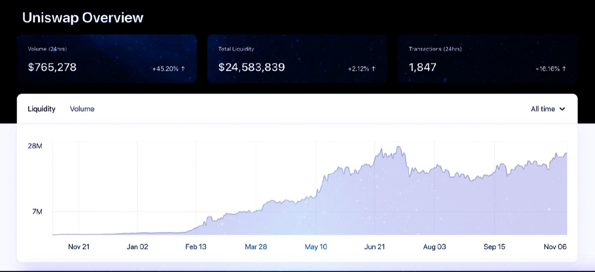

Bu bölümde DeFi dünyası oyuncularının data ve analiz ihtiyacını karşılamaya yönelik yeni, ancak önemli bir işlevi yerine getiren The Graph Protocol’den bahsedeceğiz.

[The Graph Protocol](https://thegraph.com/), DeFi ürünler ile dış dünya arasında köprü görevi gören bir aracı. Hatırlarsanız bir önceki bölümde, DeFi’nin önemli altyapı sağlayıcılarından olan [Chainlink](https://chain.link/) üzerine [detaylı bir analiz](https://turansert.com/genel/2020/12/22/definin-bilgi-kaynagi-oracle.html) yapmıştık. The Graph de işlevi farklı olsa da genel olarak Chainlink’e oldukça benziyor.

## Nedir Graph? Ne işe yarar? Kimler kullanır? {#nedir-graph-ne-ise-yarar-kimler-kullanir}

The Graph, blokzincirlerin ya da onların üzerinde yaşayan DeFi ürünlerinin performansları hakkında bilgi ve analiz sunan bir hizmet. Tam olarak yaptığı; blokzincirlerin yarattığı bilgileri (data ya da veri denebilir bunlara) toplamak, arama yapılacak hâle sokmak (endekslemek) ve ihtiyaç duyanların hizmetine sunmak.

<figure><figcaption>Image by <a href="https://pixabay.com/users/geralt-9301/">Gerd Altmann</a> from <a href="https://pixabay.com/">Pixabay</a></figcaption></figure>

İhtiyaç duyanlar kimler? Başka başka DeFi servisleri, yatırımcılar ya da yatırımcılara danışmanlık verenler.

DeFi dünyası 7/24 çalışan bir dünya. Bilgiye neredeyse gerçek zamanlı ihtiyaç duyuyorsunuz. Size bu tip analizler için hazır araçlar sunan siteler de mevcut. Peki, tam istediğiniz gibi bir analiz seti bulabiliyor musunuz ya da o site, analizde kullandığı bilgileri, sizin istediğiniz yerden mi alıyor?

Normalde DeFi alanında bir girişim olarak böyle bir bilgiye ihtiyaç duyuyorsanız, yapmanız gereken kendi iç ekiplerinizi kullanıp ihtiyaç duyduğunuz bu araçları sıfırdan yaratmak, yani yazmak. İyi de bir DeFi ürünü olarak zamana karşı yarışıyorsunuz. Rakipler her gün yeni bir özellik sunuyorlar. İnsan kaynağı deseniz zaten kısıtlı. Kısıtlı insan kaynağınızı kendi ana ürününüzü geliştirmek için mi kullanmak istersiniz, yoksa bu tip bir ikincil ihtiyaç için mi?

İşte Graph size herhangi bir blokzincire ait bilgileri istediğiniz formatta alıp istediğiniz şekilde analiz etmenizi sağlayacak bir platform sunuyor. Üstelik istediğiniz zaman ya da sıklıkta yaptırıyor, kullandığınız kadar para ödüyorsunuz. Tabii ki en büyük avantajı, bunu merkeziyetsiz yani aracılar olmadan daha güvenilir bir şekilde gerçekleştiriyorsunuz.

### Bir örnek mi versek? {#bir-ornek-mi-versek}

Burada basit bir örnek vermek konuyu somutlaştırmak açısından iyi olabilir. En bilinen örnek olan Uniswap’tan başlayalım: (Yine bir hatırlatma: [Uniswap](https://uniswap.org/), merkeziyetsiz finans dünyasının en büyük takas borsası. Ne olduğu ve nasıl çalıştığı ile ilgili 'Uniswap ve DeFi'nin merkeziyetsiz borsaları' bölümüne göz atabilirsiniz).

Uniswap üzerinde 2020 yılının Şubat ayı içinde toplam [4.2 milyon adet alım-satım işlemi](https://duneanalytics.com/danrobinson/uniswap-combined-metrics) gerçekleşmiş. Bu, Ethereum zinciri üzerine yazılmış bu kadar sayıda işlem demek. Bütün bunlar, Uniswap içindeki [167 adet farklı havuz](https://info.uniswap.org/pairs) içinde olmuş. Her bir havuzdaki işlemleri, hacimleri ve havuzların dinamiklerini düşünürseniz, işleyip analiz edebileceğiniz milyonlarca bilgi var. İşte bu işlemlerin ve havuzların durumunu anlık ya da belli tarih aralıkları içinde dönemsel olarak almak isterseniz, The Graph sistemini kullanabilirsiniz.

<figure><figcaption>En basitinden The Graph kullanılan bir Uniswap grafik örneği. Kaynak: <a href="https://thegraph.com/blog/uniswap-built-on-the-graph">The Graph</a></figcaption></figure>

Hemen belirtelim, son kullanıcıların bu üründen yararlanarak analiz yapması oldukça zor. Zira basit de olsa veri tabanlarında bilgi sorgulama ile ilgili teknik yeterliliğe sahip olmak gerekiyor.

### The Graph’in diğer hizmet sağlayıcılardan farkı ne? {#the-graphin-diger-hizmet-saglayicilardan-farki-ne}

The Graph’i kuran ekip, sistemi olabildiğince merkeziyetsiz yapmak için oldukça çaba sarf etmiş. Örneğin; Chainlink sisteminden söz ederken, her ne kadar müşterileri olan platformlar merkeziyetsiz olsa da sistemin oldukça merkezi olduğunu belirtmiştik.

The Graph’de ise daha merkeziyetsiz bir sistem görüyoruz. Öncelikle sisteme giriş ve çıkış izne tabi değil. İşleyiş de olabildiğince kendi kendine oluyor.

The Graph sisteminin işleyişini yürütenler, ağırlıklı olarak ağ üzerindeki bağımsız aktörler (ya da İngilizce ‘node’ da denilen düğümler). Dataları toplayan, endeksleyen, istenen analizleri çıkaran, datanın doğruluğunu sağlayanlar bunlar. (Detaylı bilgi için en dipteki nota bakabilirsiniz).

The Graph ekibi ise birkaç yerde işin içinde:

Ortaya çıkarılan endeks ya da analizlerin, ihtiyaç sahiplerine düzgün bir şekilde tanıtılması için [Graph Explorer](https://thegraph.com/explorer/) isimli bir dApp kurmuşlar (bir nevi pazar yeri). Bu oldukça kritik. Zira küratörler tarafından; en kaliteli endeksler ortaya çıkarılmalı ki, bunlar talep sahipleri tarafından görülebilsin, kullanılsın ve küratör ve endeksçilere para kazandırsın. Ham data, IPFS denilen merkeziyetsiz protokolde tutulsa da; Graph Explorer’daki endeks ve analiz bilgileri şimdilik merkezi bir yerde tutuluyor. Gelecekte bu hizmetin merkeziyetsiz bir şekilde sunulması için çalışmalar sürüyor.

Bunun yanında, başlangıçta endeksçilerin hatalı bilgi vermesi gibi konularda karar verici olan ekip olsa da bu daha sonra protokolün yönetimine bırakılacak.

### Rakipleri var mı? Gelecek nasıl görünüyor? {#rakipleri-var-mi-gelecek-nasil-gorunuyor}

The Graph şu ana kadar endeksleme ve arama/sorgulama alanındaki bilinen en merkeziyetsiz model. Rakipleri merkezi yapılar: DeFi alanında bilinen en ünlü merkezi servisler [Dune Analytics](https://duneanalytics.com/home), [Glassnode](https://glassnode.com/) ve [Nansen](https://nansen.ai/). Bunun yanında [Google BigQuery](https://cloud.google.com/bigquery) gibi genel arama hizmetleri de mevcut.

Bütün merkezi servislerde yukarıda bahsettiğimiz güvenilirlik sıkıntısının yanında istenen hizmeti tam olarak alamama sorunu var. Blokzincirler inanılmaz bilgi/veri üretiyorlar ve doğru anlamlı veriye ulaşmak çok kritik. Merkezi servisler çok daha oturmuş verilerle çalışırken, bir yatırımcı yeni ortaya çıkan bir blokzincirle ilgili bir analiz yapmak istediğinde merkezi servislerde aradığını bulamıyor. Bu anlamda The Graph tam onların istediği gibi bir bilgi akışı ve analiz sağlayabiliyor.

Bakalım bu alanda da her alanda olduğu gibi, merkezi platformların hızlı ve kullanıcı dostu arayüzleri ile merkeziyetsiz platformların daha az kullanışlı ama eğilip bükülebilir ve tarafsız yapısı arasındaki tatlı rekabette kim ön plana çıkacak. Şu an görünen her iki hizmetin de farklı alıcıları olacağı ve pazarda kendilerine yer bulacakları şeklinde.

Bu arada şunu unutmamakta fayda var; oldukça kuvvetli bir yatırımcı ordusunu arkasına alan, token değeri olarak da çok iyi bir yükseliş yakalayan The Graph, şu an için merkezi rakiplerinin önünde değil. Üstelik bu rakiplerden ayrışacağını belirttiği merkeziyetsizlik konusunda ise daha önünde alacağı çok yol var. Muhtemelen yatırımcıları değer olarak The Graph’ın arkasında olmaya devam edecekler; ancak ürün başarıyı bu söz verdiği merkeziyetsizliği başarabildiği ölçüde kazanacak.

Şimdi de gelin Graph dünyasının aktörlerine ve sistemin nasıl çalıştığına daha yakından bakalım.

## Sistem nasıl çalışıyor? {#sistem-nasil-calisiyor}

Graph tam bir oracle sayılmaz, zira oracle protokolüne servis sağlayan dış aracılar (oracle düğümleri) harici dünyadan aldıkları bilgiyi akıllı kontrata aktarıyorlar.

The Graph’te ise köprü biraz daha farklı işliyor. Blokzincir içinden alınan bilgi, anlamlı bir hâle getirildikten sonra hem zincir içi hem de zincir dışı ihtiyaç sahiplerine dağıtılıyor.

<figure><figcaption>Image by <a href="https://pixabay.com/users/geralt-9301/">Gerd Altmann</a> from <a href="https://pixabay.com/">Pixabay</a></figcaption></figure>

The Graph, şu aralar çok popüler olan Proof-of-Stake sistemini kullanıyor. Burada konuya yabancı olanlar için hemen bir parantez açalım: Bitcoin, Proof-of-Work denen güvenlik sistemini kullanıyor; hani şu, “ama çok enerji harcıyor” diye büyük eleştiri kaynağı olan, madenciler tarafından yürütülen sistemi. Ethereum da aynı sistemi kullanmakla birlikte önümüzdeki yıl içinde Proof-of-Stake mekanizmasına geçecek. Bu mekanizmada; sistemin güvenliğini sağlayanlar, bunu kendi mal varlıklarını teminat göstererek garanti edecekler. Böylece eskiden kol gücü yani emek ile korunan sistem, artık zenginlik yani kapital ile korunmaya başlayacak. Parantezi kapatıp konumuza geri dönelim:

### Aktörler kimler? {#aktorler-kimler}

<strong><em>Endeksçiler:</em></strong>

The Graph sisteminde endeksçiler (İngilizcede ‘indexers’), ağın düğümlerini oluşturuyorlar. Bu arkadaşlar blokzincirler hakkındaki bilgileri düzenli bir şekilde tutup, bu bilgilerle ilgili arama yapıldığında hem endeksleme karşılığı ödül hem de arama yapma karşılığı bir ücret almaya hak kazanıyorlar.

<strong><em>Yetkilendiriciler:</em></strong>

Tabii önüne gelen endeksçi olamıyor. Bunun için bir miktar parayı (sistemin parası GRT) teminat göstermek gerekiyor. Ya paranız yoksa? Demokrasilerde ve blokzincirlerde çare tükenmez!. O zaman, yetkilendiriciler (delegators) imdadınıza yetişiyor. Bu kişiler, parası olan ancak endeksleme/arama gibi ağır işçilik yapmak istemeyen sermayedarlar. Paralarını işini iyi yapan endeksçilere veriyor, karşılığında yapılan iş karşılığı kazanılan ödül ya da ücretlerden bir kısmını alıyorlar. Sistemde [Mart 2021 itibariyle 157 endeksçi](https://network.thegraph.com/participants?selected=Indexers) ve [5,696 adet yetkilendirici](https://network.thegraph.com/participants?selected=Delegators) bulunmakta.

<strong><em>Küratörler:</em></strong>

Bunun dışında, bir de küratörler (İngilizcede ‘curators’) var. Bunlar, akıllı sınıfı (!) temsil ediyorlar. Küratörlerin yaptığı, hangi bilgi kaynaklarında hangi analizlerin para yapacağını önceden kestirmek. Böyle bir “cevher” bulduklarında, hemen analize para (yine sistemin parası olan GRT) kilitliyorlar. Eğer analiz tutarsa, getirinin bir kısmına hak kazanıyorlar. Burada, hızlı ve kaliteli analiz bulmak çok önemli; erken bulan kazanıyor, zira öyle “analizi ben buldum kimseye kaptırmam” gibi bir münhasırlık yok. Bir analizin kaliteli ve potansiyel olduğunu gören herkes para yatırır, endeksçiler de daha ilgi gören analizler için iş yaparlar. İlk bulan ve para yatıran iyi getiriler elde ederken, daha sonradan katılanlar daha az gelir elde eder.

<strong><em>Kullanıcılar:</em></strong>

Bir de kullanıcılar var ki bunlar genelde DeFi ürünleri oluyor. Örneğin; DeFi dünyasının ağır topları Uniswap ve Synthetix The Graph’in modellerini kullanıyorlar. Nasıl belli bilgilerini depolamak için bulut üzerinde yer kiralıyorlar, benzer şekilde modellemeleri için The Graph’i tercih ediyorlar. Gerekli işi yapmak için ekip tutmak, server kiralamak yerine; sistemi kullandıkça ödeme yaptıkları için bu model açıkçası onların da işine geliyor. Zira, DeFi dünyasının en büyüklerinden [Uniswap’ın 2021 yılının Ocak ayında sadece 11 çalışanı olduğunu](https://twitter.com/haydenzadams/status/1346575665940860929) söylersek, neden böyle bir servise ihtiyaç duydukları sanırım daha iyi anlaşılır.

### Neden para konuyor sisteme? {#neden-para-konuyor-sisteme}

Sistem merkezi değil demiştik. Bu nedenle isteyen sisteme girip endeksçi, yetkilendirici ya da küratör olabiliyor. Peki ya bu kişiler kötü niyetli ise? Özellikle endeks tutanlar, yanlış bilgi sağlamak ya da endekslemek söz konusu olursa koydukları paranın tümünü kaybedebiliyorlar. Hemen belirtelim teminatlarını uzun bir süreliğine koydukları için bilginin yanlış olduğu sonradan anlaşılsa bile cezayı yiyorlar. Küratör ve yetkilendiriciler bilgi sağlamadıkları için böyle bir ağır cezaya tabi değiller; ama onlar da eğer yanlış ata oynar yani yanlış analiz ya da endeksçi seçerlerse, paralarını geri çekerken bir ücret ödüyorlar.

Para konmasının bir diğer nedeni de önüne gelenin içeri girip sistemi çöplük hâline getirmesini önlemek. Zira, böyle bir durumda kaliteli endeksleme yapanları bulmak zorlaşıyor ve genel sistem itibarı bozuluyor.

## The Graph üzerine son birkaç söz {#the-graph-uzerine-son-birkac-soz}

The Graph protokolü, merkeziyetsiz blokzincir dünyasının yarattığı bol veriyi tarafsız bir şekilde tarayıp, endeksleyip, kullanıcıların sorgulamasına sunan ve bu dünyanın ruhuna uygun olarak merkeziyetsizleşmeyi kendine hedef seçmiş bir DeFi ürünü. Şu an için Ethereum bazlı olarak çalışan protokol, bakalım merkeziyetsizlik yolundaki yürüyüşüne devam edip sonrasında vazgeçilmez bir DeFi hizmet sağlayıcı olabilecek mi?
