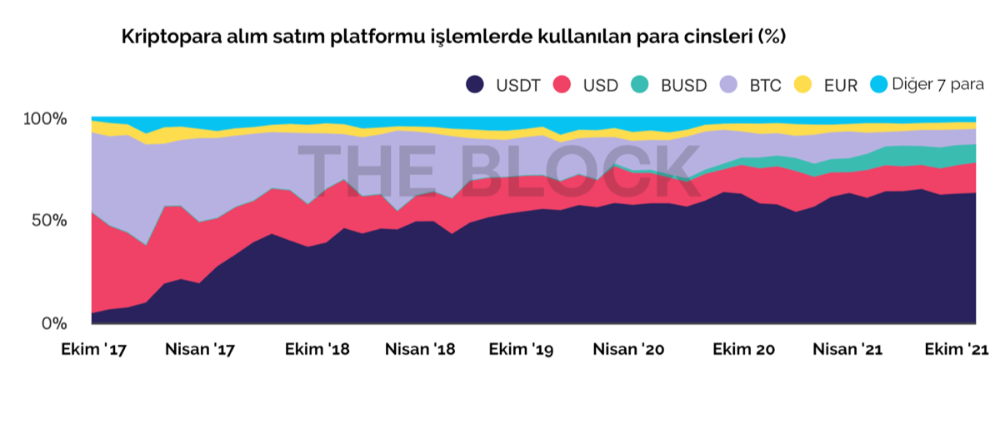
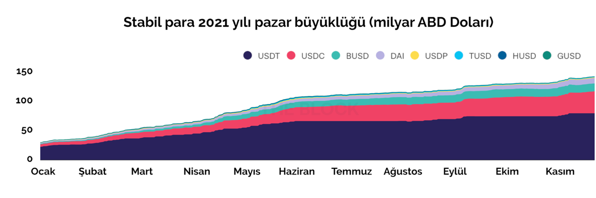
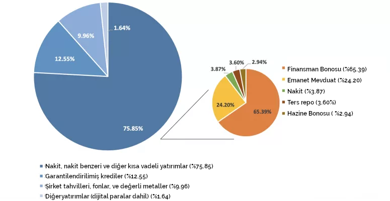
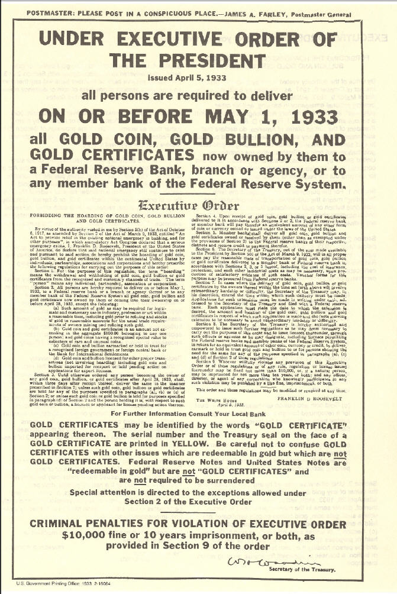

Kripto dünyasının en büyük ve eski varlığı Bitcoin, bir para olarak “değer saklama” işlevini gayet iyi yerine getiriyor ama “alışverişe aracılık etme” konusunda belli yerlerde kullanılsa da hâlâ genel bir kullanıma girmiş değil. Bunun ana nedeni de kısa vadeli işlemler için fiat paralara karşı dalgalanmalar yaşaması.

Bu dalgalanmalar için alınacak çok da bir önlem yok. Zira Bitcoin’in fiyatını, diğer tüm paralarda ya da hisse senetlerinde olduğu gibi borsalarda alım satım yapanlar belirliyor. Normalde fiat paralarda parayı basan merkezi otoriteler (merkez bankaları) piyasada bir oyuncu olarak yer alıp fiyattaki ani zıplamaları önlüyorlar. Kriptopara dünyasında böyle arkada duran bir güç yok. Kaldı ki böyle bir yapı, kriptoparaların özündeki “merkezi otoriteye olan ihtiyacı sıfırlamak” hedefi ile ciddi bir çelişki yaratırdı.

Aslına bakarsanız, fiyattaki ani iniş ve çıkışlar, bu tip paraları al-sat (spekülatif) amacı ile tutan kişiler ve kurumlar için bulunmaz bir nimet ama bunlar çok ufak bir kesim. Toplumun kalanının bu tip bir dalgalanmayı takip etmek için ne isteği ne de zamanı var. Eğer kriptoparaların günlük hayatımıza girmesi hedefleniyor ise bu paraları getirdiği kolaylıklardan faydalanmak için kullanmak isteyecek çok büyük bir kesimin, daha az dalgalanan bir araca ihtiyacı var.

<figure><figcaption>Yağmurlu havalarda sığınılacak şemsiye. Image by <a href="https://pixabay.com/users/geralt-9301/">Gerd Altmann</a> from <a href="https://pixabay.com/">Pixabay</a></figcaption></figure>

## Nedir bu stabil para? {#nedir-bu-stabil-para}

Kriptopara dünyasındaki dalgalanmanın neden olduğu zararın, getirdiği pek çok faydaya ağır bastığını ve bunun da bu paraların yaygın kitlelerce kullanımını sekteye uğrattığını gören girişimciler, uzun zamandır yeni tip daha stabil paralar yaratmak için çalışıyorlar.

Peki, nasıl bir zarar veriyor bu dalgalanmalar? Şöyle bir benzerlik kurmak mümkün: Şu an yaşadığımız dünyayı her tür ekonomik işlemin kâğıt paralar ile gerçekleştirildiği bir kıta olarak düşünün. Bir de bu kıtaya yakın küçücük bir adayı gözünüzün önüne getirin; kripto adası. Bu ada oldukça eğlenceli, ancak bir sorun var, o da çok gürültülü olması. Arada bir eğlence iyi ama sakin bir yer arıyorsanız, yine ana karaya dönmek zorunda kalıyorsunuz. Ne ki, bu adaya gidip gelmek zor. Botlar var ve bu botlar ile her gün belli sayıda insan oldukça zahmetli bir şekilde adaya gidebiliyor. Gitmesi kolay olmadığı gibi geri dönmesi de zor. Peki ya, adanın içinde şöyle sakin bir yer olsa da, insanlar hiç ana karaya dönmeden orada dinlenebilseler?

İşte stabil paralar bir nevi kripto dünyasındaki bu sakin alanlar. Kripto dünyası çok hareketli ve riskli. Arada bir kriptoparayı sattığınızda tekrar geri kâğıt para dünyasında dönmek hem zahmetli ve masraflı hem de vakit alıyor. Varlığınızı iniş-çıkışlardan dolayı kriptopara olarak tutmak istemiyor, ama bir yandan da getirdiği kolaylıklardan faydalanmak mı istiyorsunuz? Alın bir stabil para, varlığınız orada dursun, istediğinizde istediğiniz başka kriptoparaya anında çevirin, işleminizi yapın. Bir yerden kriptopara mı geldi? Değerini kaybetme riski yaşamadan anında stabil paraya çevirin, içiniz rahat olsun.

## Stabil paralar neye göre stabil? {#stabil-paralar-neye-gore-stabil}

Yukarıda yazdığımız sorunlara çözüm bulabilmek için nasıl yapalım da bu parayı sabitleyelim diye düşünürken ilk akla gelen fikir, “Öyle bir para yaratalım ki dolara endekslenmiş olsun, bankada dolar tutmakla borsada bu parayı tutmak birbirinin tıpatıp aynısı olsun.” olmuş. Bu düşüncenin sonucu ortaya çıkan pek çok para var.

Mantıklı mı? Bir dereceye kadar evet. Neden mi? Bir kere başta dediğimiz gibi ABD dolarına bağlı olan bir para, diğer paralar karşısında aynen ABD doları gibi dalgalanacak. Dolayısı ile çok sabit sayılmaz. Teorik olarak yine dolar gibi; ABD’de yıllık enflasyon ne kadar ise senelik o kadar değer kaybına uğrayacak ama bunlar zaten bildiğimiz konular. Yine de Bitcoin gibi bir kriptoparaya göre daha stabil olacak değil mi? Teorik olarak evet.

Şimdi gelin stabil olarak adlandırılan para çeşitlerine bakalım.

## Arkasında itibari (fiat) para olan paralar: Tether ve USDC {#arkasinda-itibari-fiat-para-olan-paralar-tether-ve-usdc}

Kripto dünyasında, özellikle alım satım işlemlerinde kriptopara kullanma olayı, son zamanlarda ciddi bir artış gösterdi. Aşağıdaki grafik bu durumu çok net bir şekilde özetliyor:

<figure><figcaption>Dokuz büyük merkezi borsada işlem yaparken kullanılan para cinsi oranları. Kaynak: <a href="https://www.theblockcrypto.com/data/crypto-markets/spot/share-of-trade-volume-by-pair-denomination">TheBlock</a></figcaption></figure>

Mayıs 2017 yılında, dokuz büyük merkezi borsada yapılan alım-satım işlemlerinde yaklaşık %54 oranında BTC kullanılırken, 2021 yılı Haziran ayında bu oran %7,5’a inmiş. Aynı şekilde 2017 yılında borsalarda %40 oranında kullanılan USD ve EURO, 2021 yılında %15’e gerilemiş. Buna karşın, borsalarda kullanılan stabil para oranı ise 2017 yılında sadece %6 iken, 2021’de %87.5’a ulaşmış. Çarpıcı değil mi?

Peki, stabil paralar arasında en yaygın kullanılanları hangisi? Burada da pazar liderinin tartışmasız Tether olduğunu görüyoruz:

<figure><figcaption>Tedavüle çıkan stabil kriptopara miktarı Kaynak: <a href="https://www.theblockcrypto.com/data/decentralized-finance/stablecoins/total-stablecoin-supply-daily">TheBlock</a></figcaption></figure>

Öte yandan, Tether’in hemen arkasından gelmekte olan USDC’nin pazar payını artırdığı da gözden kaçmıyor. Gelin şimdi Tether’in hikâyesini dinleyelim:

### Tether {#tether}

2015 yılında kurulan Tether’in, yani USDT’nin çalışma mantığı aslında basit. Şöyle demiş kuranlar: “USDT’yi ABD dolarına endeksleyelim. Öyle ki her zaman 1 USDT 1 Dolara eşit olsun. İsteyen gelip yatırdığı dolar kadarlık USDT alsın. Bunun için de yaratılan (satılan) her USDT için ederi kadar doları bir bankada hesapta tutalım.” Böylece, Tether ile birlikte dolar teminatlı stabil bir para yaratılmış.

Teoride güzel ancak pratikte belli sorunlar var. Örneğin, kriptopara dediğimiz dünyanın, merkeziyetçilikten uzak olması gerek. Neden? Çünkü, bu işin gurusu Nick Szabo’nun da dediği gibi [merkezi her kurum aslında bir güvenlik açığı yaratır](https://nakamotoinstitute.org/trusted-third-parties/). Halbuki, burada teminat olarak paralar bir bankaya yatırılıyor. O bankada paralar ne kadar güvenli? Ya banka bir gün sıkıntıya girer ya da batarsa?

Bu teorik tehlikeleri geçtik diyelim. Gerçekten bankaya yatırılan ABD doları karşılığı kadar mı para yaratıldı? Kim denetleyecek? Banka ya da bir denetleme kuruluşu. Çalışma prensibi şeffaflık üzerine kurulmuş kriptopara dünyasına (örneğin, açık kaynak bazlı ekosistem) oldukça yabancı kavramlar. Zaten Tether de uzunca bir süredir gizlediği rakamları ABD resmi makamları ile yaptığı anlaşma sonrası Mayıs 2021’de açıkladı. Sonuçlar çok fazla ses getirmese de aslında oldukça kaygı verici:

<figure><figcaption>Mayıs 2021’de açıklanan Tether’in elinde tuttuğu varlıklar. Kaynak: <a href="https://tether.to/tether-releases-breakdown-of-its-reserves/">Tether</a></figcaption></figure>

Gördüğünüz gibi Tether, yaratılan USDT’lerin karşılığı olarak %75 nakit tuttuğunu söylüyor. Detaylara bakınca, aslında “nakit” denen paranın içinde %65 Commercial Paper yani özel şirketlerin çıkardığı kâğıtlar var. İstendiği anda paraya çevrilme özelliğinden dolayı “nakit” olarak adlandırılan bu kâğıtların, gerçekten ihtiyaç hâlinde geri alınacağı ne malum? Gerçekten nakit olarak tutulan para sadece %3.9 oranında.

Sonuç olarak USDT şu anda belli bir işlevi yerine getiriyor. İşe de yarıyor. Özellikle ABD dışındaki merkezi borsalarda ağırlıklı olarak kullanımda olan para USDT ancak gerek banka hesaplarının şeffaf olmaması, gerekse açıkladığı rakamların bile “itibari parayı arkasına alan stabil para” tanımına tam olarak uymaması nedeniyle dikkat edilmesinde fayda olan bir kriptopara.

### USDC {#usdc}

Yukarıda saydığımız USDT’nin arkasından gelen ikinci büyük para olan USDC, özellikle 2021 yılında ciddi bir atak yapmış durumda. Bunun temel nedeninin, ABD’de kanun koyucular ile kurdukları iyi ilişkiler olduğu söylenebilir. Zira, USDC yaratılırken dayanak olarak kullanılan para ABD bankalarında birebir olarak tutuluyor.

Her ne kadar özel şirketler tarafından çıkarılmış olsa da, ABD banka hesapları ile garanti altına alınmış olan USDC’yi aslında bir nevi ABD tarafından çıkarılan merkez bankası dijital parası gibi görmek çok da yanlış olmaz. Örneğin, 2020 yılının Kasım ayında, Venezuela resmi hükümetinin ülkede bulunan banka hesaplarına el koyan ABD makamları, bu paraları muhalefet hükümetine resmi banka kanallarını kullanarak iletemediği için para USDC olarak [gönderildi](https://www.coindesk.com/circle-usdc-venezuela-airtm).

Gelecekte de USDC’nin yavaş yavaş USDT ile benzer ağırlığa geleceğini söylemek kahinlik olmaz.

## Kriptopara teminatlı stabil paralar {#kriptopara-teminatli-stabil-paralar}

Başlığa bakınca konu bir parça daha çetrefilleşiyor değil mi? Haklısınız. Kriptoparayı teminat olarak kullanan stabil para da ne demek? Açıklamaya çalışalım:

Efendim, Tether’i açıklarken pek çok sıkıntıları olduğundan bahsetmiştik. Bu sıkıntılardan en önemlisinin, yaratılan her USDT için teoride o kadar ABD Dolarını bir bankada tutması olduğunu söylemiştik. Yani adem-i merkezi bir şekilde çalışması gereken şifreli bir kriptopara için çok çelişkili ve işin ruhuna aykırı bir durumdu bu. Ya bir gün o paraya el konursa? Ne de olsa merkezi olarak bir banka hesabında tutuluyor (Bu banka bir zamanlar, ABD’deki Wells Fargo Bank idi; ancak Wells Fargo, birilerinin etkisiyle diyelim, onlar ile iş yapmayı bıraktı, şimdiler para Bahamalar’da Tether’e ait Deltec Bank’ta [tutuluyor](https://www.coindesk.com/tether-bank-deltec-stablecoin-reserves)).

Biliyorsunuz teknolojik dünyada çare tükenmez. Nerede bir sıkıntı var; orada onlarca çözüm türer. Stabil paranın teminatını merkezi olarak tutma sıkıntısı ise, o zaman o teminatı da merkezi olmayan dağıtık bir hâle getirelim. Nasıl? Teminatı da ABD Doları yerine bir başka kriptopara yaparak tabii! Böyle ciddi sayıda bir para çıkmış, BitShares ([BitUSD](https://coinmarketcap.com/currencies/bitusd/)), NuBits ([USNBT](https://coinmarketcap.com/currencies/nubits/)), Steem Dollars ([SBD](https://coinmarketcap.com/currencies/steem-dollars/)), Maker DAO ([Dai](https://coinmarketcap.com/currencies/dai/)) gibi.

Kriptopara teminatlı stabil paraların en büyüğünün, Maker DAO’nun parası olan DAI olduğunu belirtelim. Bu konuda “Maker DAO: Kişiye özel merkez bankası” bölümümüzde detaylı bir açıklama bulabilirsiniz. DAI, merkeziyetsiz olması itibariyle DeFi dünyasının çok sevdiği bir para.

## Teminatsız stabil paralar! {#teminatsiz-stabil-paralar}

Buraya kadar hâlâ okumaya devam edip kaybolmadıysanız bravo. O zaman sizin için konuyu daha da karıştıralım!:)

Yukarıda bahsettiğimiz Tether ve diğer stabil paralar, kendilerini ABD dolarına bağlarken, ya ABD doları ya da değer olarak ondan çok daha fazla miktarda kriptoparayı teminat olarak alıyorlardı. Bir kısım stabil paralar ise “Boşverin bu teminat alma olayını, biz bir algoritma yapalım, teminatı toptan yok edelim.” demişler.

Nasıl yapmışlar bunu? Sistemi kuranlar, sanal bir Merkez Bankası yaratıp bu bankanın işleyişini bir akıllı kontrata bağlamışlar (Akıllı kontratların ne olduğuna ‘Ethereum: DeFi’nin Altyapısı’ bölümünde detaylıca bakmıştık). Buna göre, eğer stabil paraya talep artar ve bunun sonucu değeri yükselirse, bolca stabil para yaratarak paranın değerini 1 ABD doları seviyesine getiriyorlar. Benzer şekilde, eğer bir nedenle paraya talep düşerse, mevcut stabil paralardan bir kısmını yok ederek (yani parayı azaltarak) değerini artırıyorlar.

Teminatsız stabil para kavramının henüz çok daha yeni olduğunu belirtelim. Şu ana kadar başta 130 milyon ABD doları yatırım toplayıp sonrasında kanuni sıkıntılar nedeniyle dükkânı kapatan Basis olmak üzere pek çok proje, bu konuda başarısız oldular. Göreceli olarak hâlâ devam eden Ampleforth’a bir göz atalım dilerseniz:

## Ampleforth: İlginç bir parasal deney {#ampleforth-ilginc-bir-parasal-deney}

Ampleforth bir deney. Nihai hedefi; alışverişte kullanılabilecek kadar stabil, ancak Bitcoin benzeri değeri kendinden menkul bir para olmak ve bunu yaparken de hem stabil paraların hem de Bitcoin’in zayıf yanlarını güçlendirecek çözümler getirmek. Önce bu sıkıntılara bir göz atalım:

<strong><em>Stabil paraların sıkıntısı</em></strong>

Piyasada yeterince stabil kriptopara varken neden Ampleforth’a ihtiyaç olsun? Çünkü stabil paralar, özünde bir itibari paraya bağlılar. (İtibari paraların, devletlerin merkez bankaları tarafından basılan ABD Doları, Euro benzeri paralar olduğunu tekrar hatırlatalım) Bu itibari paralar, görünüşte değerlerini koruyor gibi görünseler de aslında uzun vadede sürekli değer kaybı yaşıyorlar. Amerika Birleşik Devletleri altını 1933 yılında onsu [20 ABD Doları’ndan halktan toplamıştı](https://en.wikipedia.org/wiki/Executive_Order_6102) (enflasyon etkisini yedirseniz bile günümüzde 408 ABD Doları’na geliyor); şu anda altın 2,000 ABD doları seviyelerinde. Şimdi ABD Doları’nın değerinin sabit kaldığını söyleyebilir misiniz?

<figure><figcaption>ABD hükümetinin halktan zorla altın topladığı meşhur 6102 sayılı emir. Kaynak: <a href="https://en.wikipedia.org/wiki/Executive_Order_6102">Wikipedia</a></figcaption></figure>

Ayrıca bu stabil kriptoparalar ödemeler konusunda çözüm olsalar da, bir önceki bölümde bahsettiğimiz gibi bu paraları basanların, ağırlıklı bir kısmının merkezi yapılar olması beraberinde yeni sorunlar getiriyor. Örneğin, Tether’in müşteri hesaplarını dondurabilme gücü (2020 yılının Eylül ayında yaşanan Kucoin hack olayında, 33 milyon ABD Dolarını [dondurdular](https://news.bitcoin.com/kucoin-hacked-for-150-million-in-bitcoin-bitfinex-and-tether-freeze-33-million-of-the-stolen-funds/#:~:text=5-,Kucoin%20Hacked%20for%20%24150%20Million%20in%20Bitcoin%3B%20Bitfinex%20and%20Tether,bitcoin%20and%20multiple%20ERC20%20tokens.)) kripto dünyasının bireylere en büyük faydası olarak da bilinen “dijital varlığa tümüyle sahip olma” özelliğinin nasıl delik deşik edildiğinin de bir göstergesi aslında.

<strong><em>Bitcoin’in sıkıntısı</em></strong>

Bitcoin benzeri sınırlı arza sahip paralar teori olarak güzel; değer anlamında hiçbir kuruma bağlı olmayan, bütünüyle bağımsız, sansüre karşı dayanıklı ve sınırlı arzı ile değerini teorik olarak koruması gereken bir para. Pratikte ise bu sınırlı miktardaki arz, bir yandan artıp azalan talep ile karşılaştığında ortaya son derece oynak bir para çıkıyor. Her ne kadar uzun vadede, son on yılda yaşanan fiyat artışının en önemli nedenlerinden birinin bu kısıtlı arz olduğu düşünülse de kısa vadelerde oluşan oynaklık sinirleri zorlayacak seviyede.

**İşte Ampleforth, bir yandan Bitcoin gibi uzun vadede yatırımcısına değeri artacak bir varlık sunarken; diğer yandan stabil paralar gibi kısa vadede değeri değişmeyen ve bu sayede alışverişlerde kullanılabilecek bir para yaratma hedefinde.**

Peki, nasıl bir taşla iki kuş vuracak? Anlatalım:

### Nasıl çalışıyor Ampleforth? {#nasil-calisiyor-ampleforth}

Ampleforth, fiyat tarafında görülen oynaklığı önlemek adına, talepte meydana gelebilecek değişimlerin fiyata radikal etki etmesinin önüne geçmek, yani paranın değerini dengelemek için paranın arzının değiştirilmesi prensibine dayanıyor. Hem de ne değiştirmek! Gelin biraz daha açalım bunu:

Ampleforth otomatik olarak (insan eli değmeden) çalışan bir algoritma. Bir başka deyişle 'kod kanundur' desturunu uygulayan bir protokol. **Algoritmanın tek bir hedefi var: O da sistemin parası AMPL’yi sabit bir değerde tutmak.** Bu değer, 2019 yılındaki 1 ABD Dolarına eşitlenmiş. 2021 yılı Haziran ayında bu rakam enflasyon giydirilmiş [olarak 1.042 ABD Doları seviyesinde](https://www.ampleforth.org/dashboard/).

Bir sistemin parasını sabit tutarken, yatırımcıların ilgisini nasıl çekebilirsiniz? Öyle ya, hisse değeri sabit kalırsa benim varlığımın değeri de aynı kalır. İşte burada yatırım ile ilgili kafamızdaki klasik kalıpları şöyle bir yeniden gözden geçirmekte fayda var:

<strong><em>Önce bir zihnimizi açıp ezber bozalım</em></strong>

Bir şirketin hisse senedini satın aldığımızda, yatırımımızın toplam değeri; şirketin toplam hisse senetlerinden elimizde kaç tanesi varsa, bunun her bir hissenin değeri ile çarpılması sonucu ortaya çıkar. Genelde, elimizde tuttuğumuz hisse senedi adedi sık değişmediği için yatırımımızın toplam değerindeki değişimi, hisse senedindeki hareketlerden hesaplarız. Bir başka deyişle; bir adet hissenin değeri yatırımımızın değerini bulmada bize “kısa yol” olur.

Ampleforth ise, yukarıda yazdık, her bir tokenin (yani hissenin) değerini sabit tutmak istiyor. Nasıl olacak bu? Örneğin, bir anda tokene bir talep oldu ve insanlar çılgınca AMPL almaya başladılar. Fiyat nasıl aynı kalacak? Kalmalı mı? Token değerini sabit tutmak ile yatırımın değerini artırmak birbiri ile çelişiyor mu? İşte burada, yukarıdaki paragraftaki önyargımızı bir kenara bırakalım.

**Bakmamız gereken; tüm sistemin değeri ve bizim onun içindeki toplam payımızın büyüklüğü olmalı. Token’in değeri değil.**

Peki, nasıl olacak bu? Toplam değerin iki çarpanı var demiştik; toplam token adedi ve her bir tokenin değeri. Eğer talep artışından dolayı sistemin toplam değerinin artması bekleniyor ama bir yandan da bir tokenin değerinin sabit kalması isteniyorsa o zaman token adedini artırırız!

Ezberlerimizi yeterince bozduk mu? :)

Sistemin nasıl çalışacağını gelin bir de örnek üzerinden anlatalım:

<strong><em>AMPL token fiyatı yükselirse ne oluyor?</em></strong>

Varsayalım, 1 AMPL 1 ABD dolarına eşit ve yatırımcımızın da 100 AMPL’si var, yani 100 ABD dolarına eş bir yatırımı. Bir anda piyasalarda AMPL’ye talep oldu ve AMPL fiyatı 1.5 ABD dolarına çıktı. İşte o zaman algoritma otomatik olarak devreye giriyor (mevcut fiyat ile hedef arasında artı/eksi %5’den fazla fark olursa algoritma çalışıyor) ve her bir AMPL karşılığı yatırımcılara 0.5 AMPL daha veriyor. Yatırımcımızın artık 150 AMPL’si var!

Buraya kadar her şey otomatik (yani el değmeden) çalıştı. Piyasa fiyatını gören sistem, para arzını otomatik artırdı. Bundan sonrasında beklenen, piyasanın tepkisel davranması ve paranın bollaşması ile birlikte fiyatın hedeflenen seviyeye düşmesi. Başta ne demiştik: Sistemin hedefi AMPL’nin 1 ABD dolarına geri dönmesi. Sistemin para yaratmasının arkasında yatan düşünce şu: Eğer bir anda, insanların elindeki yatırım 1 ABD doları iken fiyat artışından dolayı 1.5 ABD dolarına, sonrasında AMPL artışından dolayı 1.5 AMPL x 1.5 ABD doları = 2.25 ABD dolarına çıkarsa, insanlar, özellikle al-sat yapanlar, kârı realize etmek için ellerindeki AMPL’yi satarlar. Bu da AMPL fiyatını düşürür. Nereye kadar? Fiyat tekrar 1 AMPL = 1 ABD doları olana kadar.

Böyle olunca ne oldu? Hızlı hareket eden al-satçılar ciddi bir para kazandılar. Sistemin buna bir itirazı yok, zira sistemin tek isteği, AMPL fiyatının tekrar 1 ABD dolarına dönmesi. Peki, alım satım yapmayıp ellerinde tutanlar? Onlar da aslında ekstra bir kâr/zarar etmediler. Yukarıdaki yatırımcımızın başlangıçtaki yatırımı 100 dolar idi. Sonra sistem onlara AMPL verdiği için ellerinde 150 AMPL oldu ve bu para ilk anda 225 ABD dolarına eşitti. Ancak fiyat tekrar 1 ABD dolar seviyesine geldiğinde, son durumda yatırımın değeri 150 ABD dolarına çıktı. Yani ilk fiyat artışı sonrası gibi yatırımcı %50 kazancı cebine koymuş oldu.

Aslına bakarsanız, AMPL sisteminin yapmaya çalıştığı, paranın arzını artırarak yatırımcılar üzerindeki etkiyi büyütmek ve onların daha hızlı reaksiyon vermesini sağlamak. Biraz açalım bu dediğimizi: Diyelim ki aldığınız bir tokende %60 kazanç beklentiniz var, eğer token size %60 kazandırırsa yeterli olduğunu düşünüp satacaksınız. Yukarıdaki senaryoda eğer para arzı sabit kalsa idi, fiyat %50 arttığından dolayı satmayacaktınız. Şimdi ise elinizdeki tokenlerin sayısı da artınca toplam kazancınız bir anda %125’e çıktı; hemen harekete geçip satmaz mısınız? Sizin gibi satmaya başlayanlar olacaktır, bunun sonucu token fiyatı düşmeye başlar ama hâlâ kazanç yüksek olduğu için beklentinizin gerçekleşeceği rakama kadar satmaya devam edersiniz. İşte böyle böyle düşen token fiyatı, sistemi hedeflediği noktaya kadar getirir.

Bir başka bakış açısından; **sistem kendi içinde talebin değişmesinden dolayı oluşabilecek fiyat hareketlerindeki volatilite yükünü, arzı değiştirerek fiyattan yani sistemden alıp, yatırımcıya geçiriyor**. Bir önceki paragrafı tekrar edelim: Arzı değiştiriyor, dolayısıyla yatırımcılar hisse fiyatındaki değişimin daha da fazlasını varlıklarındaki değişimlerde hissedip daha hızlı bir şekilde aksiyon alıyorlar, bu da hisse fiyatını eski haline döndürüyor.

<strong><em>Peki ya fiyat düşerse?</em></strong>

Tabii bir de madalyonun öbür yüzü var. Ya talepte bir azalma olur ve token değeri bir anda düşerse? Örneğin, hisse değeri %50 değer kaybetti ve 1 AMPL 0.5 ABD dolarına eşit hâle geldi.

İşte orada da sistem tam tersi çalışıyor. Yatırımcıların cüzdanlarındaki AMPL’lerin yarısını ellerinden alıyor! Yok artık! Evet, aynen öyle. Niye? Aslında mantık yukarıda anlattığımızın aynısı. Sistem şöyle düşünüyor:

“Ampleforth’un toplam sistem değeri düşüyor olabilir ama bu beni ilgilendirmiyor. Beni ilgilendiren, 1 AMPL’nin tekrar 1 ABD dolarına denk hâle gelmesi. İnsanlar satıyor AMPL’leri; demek ki piyasada AMPL bolluğu var. Ben bu AMPL’leri piyasadan çekersem hem arz azalmış olacak hem de AMPL sistem değeri düştüğü için ucuzlamış olacak. Bunu gören yatırımcılar, nasıl hisse değeri düştüğünde o hisseyi almaya çalışıyorlarsa; burada da AMPL sistem değeri kat be kat düştüğü için almaya koşacaklar.”

Yukarıdaki örnekten devam edersek: Başlangıçta 100 ABD dolarına eş 100 AMPL vardı elinizde. Token değer kaybedince varlığınız önce 100 AMPL x 0.5 ABD doları (50 cent) = 50 ABD doları seviyesine düştü. Sonra bir de sistem elinizdeki AMPL’lerin yarısını aldı, dolayısıyla varlığınız bir anda geçici olarak 50 AMPL x 0.5 ABD doları (50 cent) = 25 ABD dolarına geriledi. Sizin sistem içindeki payınız hiç değişmedi. AMPL sistemi değer kaybetti. AMPL kendi içinde %50 değer kaybetti, ancak tüm sistem %75 değer kaybetmiş oldu. Bu kadar ucuzlamış bir sistemi almak için üşüşen yatırımcılardan dolayı AMPL tekrar değer kazandı, nereye kadar? Dengenin oturacağı 1 AMPL = 1 ABD doları seviyesine kadar. O zaman son durumda varlığınız ne oldu? 50 AMPL x 1 ABD doları = 50 ABD doları. Varlığınız değer kaybetti mi? Gayet tabii, zira talep azaldığı için zaten başta kaybetmiştiniz onu. Geçici olarak arz kısılmasından dolayı daha da kaybettiniz ama en sonunda %50 kaybettiğiniz ilk noktaya döndünüz.

<strong><em>Fiyat konusundaki bu ısrar neden?</em></strong>

Hisse (ya da token) fiyatını sabit tutmak neden önemli? Bir paranın, alım-satım ve ticaret için kullanımı, ancak değerinin “gerçek” anlamda sabit olması durumunda gerçekleşebilir. Öte yandan, yatırımcılar tarafından bu paranın rağbet görmesi için varlığın değerinin artması gerekir. İşte Ampleforth, sabit değerli ve alışverişlerde güvenle kullanılabilecek bir para yarattıktan sonra, bu paranın rağbet görmesi durumunda yatırımcısına da değer kazandıracak bir enstrümana dönüşmesini sağlıyor; sabit paralardan en büyük farkı bu. Kullanan için sabit para, yatırımcısı için eğer kabul görüp yaygınlaşır ise değer kazandırıcı bir enstrüman.

Yani tekrar edecek olursak: **Yatırımcılar, AMPL’nin sabit değerli bir para olarak kullanımının yaygınlaşmasını, bu sayede AMPL tokenine yönelik talebin artmasını; artan talebi karşılamak amacıyla ekstra AMPL token çıkarılmasını, dolayısıyla Ampleforth sisteminin toplam ağ değerinin artmasını bekliyorlar**. Artan Ampleforth sistem değeri sonucu ortaya çıkan ekstra AMPL’ler de yatırımcılara dağıtılacağı için AMPL değeri sabit kalsa bile toplam yatırımlarından kâr sağlama beklentisi içindeler.

### Ampleforth’un vizyonu {#ampleforthun-vizyonu}

Ampleforth’un arzı ile oynamak suretiyle üçlü aşamalı bir vizyonu var aslında:

<strong><em>İlk aşama</em></strong>

İlk aşama, kısa vadede portföyünde kripto varlık tutanlara risklerini dağıtmada yardımcı olmak. Çıkış noktaları şu: Bitcoin, piyasanın büyüğü olarak yüksek bir ağırlığa sahip. Dolayısıyla piyasadaki kriptoparaların büyük bir çoğunluğu, ağırlıklı olarak Bitcoin ile ortak hareket ediyorlar. Yani Bitcoin artarsa artıyorlar, azalırsa azalıyorlar (genellikle bu artış ve azalışları daha uç noktalarda yaşıyorlar). Ampleforth yaratıcıları, paralarının ilk çıkış aşamasında öyle hemen stabil bir hâle gelmesini beklemiyorlar. Bunun yerine, yarattıkları strateji sayesinde AMPL değerindeki değişimlerin diğer bütün kriptoparalardan farklı şekilde yol alacağını, bunun da portföy yöneticilerine riski çeşitlendirerek azaltmak konusunda bir opsiyon sunacağını düşünüyorlar.

<strong><em>İkinci aşama:</em></strong>

İkinci aşamada ise AMPL’nin artık bir rezerv para olarak kullanılarak geniş kitlelere yayılması var. Bunun için önce, ilk aşamadaki AMPL fiyatındaki dalgalanmanın zaman geçtikçe azalması gerekiyor. AMPL özünde, Tether ya da DAI gibi değeri itibari başka bir paraya bağlı olmayan; Bitcoin, Ethereum benzeri kıymeti kendinden menkul, bağımsız ve sansürlenemez bir para. İtibari paraların merkez bankalarının hadsiz hudutsuz para basmalarından dolayı ciddi değer kaybetmeleri ve rezerv para fonksiyonlarının ortadan kalkmasını bekleyenler var. Bu nedenle AMPL fikrini ortaya atan ekibin, rezerv para olarak sansüre uğramayacak, tam anlamıyla kullanıcıların sahip olabileceği, değeri büyük dalgalanmalar göstermeyen bir rezerv para olma hedefleri var.

Rezerv para ile tam olarak ne kastedildiğini biraz daha açalım: Daha önceki bir bölümde MakerDAO sistemi ile merkeziyetsiz olarak kişilerin kendilerine kredi yaratmasını anlatmıştık. Hatırlarsanız basitçe şöyle idi: Kişi teminat olarak ETH yatırıyor, sistem yani akıllı kontrat bunun karşılığında kişiye DAI borç veriyor. Normalde kredilerde en büyük sorun karşı partinin aldığı borcu ödememe riskidir ve bu riske karşılık teminat alınır. Teminat alınan ETH, değeri çok inişli çıkışlı bir para, kredi olarak alınan DAI ise adı üstünde stabil bir para olduğu için, sistem riski azaltmak adına %150 oranında teminat istiyor. 100 birim DAI alacaksanız, 150 birime denk gelecek kadar ETH koymalısınız. Tekrar edelim, bu kadar yüksek bir teminat istenmesinin nedeni, ETH’nin fiyatının yarın öbür gün ciddi değer kaybetmesi olasılığı. Peki ya bunun yerine, değerini aşağı yukarı koruyan bir para, teminat olarak verilebilseydi? O zaman, bu kadar yüksek bir teminatın sisteme kilitlemesi gerekmezdi. İşte Ampleforth, AMPL’yi ETH ya da Bitcoin gibi değeri kendinden menkul ama stabil olması sayesinde DeFi sistemlerde rezerv para olarak kullanılacak bir para yapmayı hedefliyor.

Bu arada şunu da hemen belirtelim: Bir DeFi projesi olarak Ampleforth, şu aşamada bu alanın en yaygın kullanılan ağı olan Ethereum’u kullanıyor. Yani AMPL özünde ERC 20 standardı ile çalışan bir token. Aslında, AMPL kendini blokzincir bağımsız bir ürün olarak konumlandırıyor. Yani; yarın öbür gün, aynı Tether örneğinde olduğu gibi AMPL’nin başka blokzincir platformlarında kullanılmasının önünde herhangi bir engel yok.

<strong><em>Üçüncü aşama:</em></strong>

Üçüncü aşamada ise kullanımın yaygınlaşması ve arzın artması ile birlikte artık geniş kitleler tarafından ödemeler için kullanılabilecek, güvenli ve bağımsız bir para olma hedefi var. Yani aslında bir nevi Satoshi’nin, Bitcoin’e başlangıçta koyduğu vizyona ulaşmak. Uzun vadede yeterli büyüklüğe ulaşıldığında, volatilitenin azalması ile birlikte paraya olan talebin ancak büyük makro ekonomik değişiklikler olması durumunda değişiklik göstereceğini, bunun da şimdiki gibi sık olmasa da yapılacak arz değişiklikleri ile yatırımcılara yansıtılacağını düşünüyorlar.

Tabii bu arada geniş kitlelere yayılmasında teknik olarak belli engeller de olabilir. Merkezi borsalarda işlem görmek yaygınlaşma için önemli ancak böyle bir durumda, müşteri cüzdanlarının bu borsalarda nasıl işleneceği konusunda teknik sorunlar çıkabilir. Özellikle kullanıcıların verdikleri emirler gerçekleşmeden önce yapılan para arzı artışı ya da kısıtlamaların müşteri cüzdanlarına nasıl yansıtılacağı, operasyonel olarak borsaların başını bir hayli ağrıtabilir.

### Sıkıntılar/riskler neler Ampleforth’da? {#sikintilar-riskler-neler-ampleforthda}

<strong><em>Ya bir girdabın içinde fiyat düşmeye devam ederse?</em></strong>

Ampleforth’da arz kısılması ancak fiyat belli bir seviyenin altına düştüğü zaman gerçekleşiyor. O zaman akla ilk gelen soru: Ya arz azalımından dolayı fiyat azalır ve geri yükselmez ise, bir süre sonra fiyat yükselmediği için arz biraz daha düşerse, acaba sonsuz bir döngüye girer miyiz?

<figure><figcaption>Image by <a href="https://pixabay.com/users/gdj-1086657/">Gordon Johnson</a> from <a href="https://pixabay.com/">Pixabay</a></figcaption></figure>

Bitcoin ya da her tür token için aslında benzer bir risk söz konusu. Fiyat düşünce panik başlar, satışlar artar, sonra fiyat daha da düşer, daha da panik olur gibi. Bitcoin, geçmişte pek çok kez benzer düşüşleri yaşasa da sonunda toparlandı. Ampleforth’da da bu iniş çıkışı, üstelik dramatik bir şekilde yaşama ihtimali var gibi görünüyor. Sadece fiyat değil, elinizdeki adet de azalıyor. Tamamen farklı, alışık olmadığımız bir sistem deneyi.

Fiyatın, bir süre sonra bandın içine geleceğini düşünenlerin argümanı şu: Öncelikle AMPL’deki azalışlara denk gelecek arz değişimleri (rebase de deniyor buna) günlük olarak hesaplansa da artışlar 10 günlük bir vade içinde yapılıyor. Yani %10’luk bir artış, her gün %1’lik bir arz artışı demek.

Fiyatın ve arzın birlikte düşmesi durumunda aslında tüm sistemin değeri dramatik olarak düşmüş olacak, bu da dışarıdan izleyenlere ucuza alım fırsatı doğuracak. Öte yandan tokeni elinde tutan kişilerin, fiyatın bu kadar düşmesi halinde ellerindeki ürünleri ucuzdan satma yerine beklemeyi tercih edeceği düşünülüyor ([aynı geçmişte Bitcoin’de olduğu gibi](https://coincodex.com/article/2703/top-5-largest-bitcoin-crashes-in-history/)). **Dolayısıyla sisteme güven çok kritik ve Ampleforth’un da bu güveni inşa edebilmesi için zamana ihtiyaç var.**

AMPL yatırımcısının, token ile ilgili değerlendirme yaparken bakması gereken temel indikatör; diğer bütün tokenlerin aksine token fiyatı değil, tüm AMPL ağının toplam değeri olmalı.

<strong><em>Türev enstrümanları AMPL için sorun yaratır mı?</em></strong>

AMPL ile ilgili soru işaretlerinden bir tanesi de FTX benzeri merkezi borsalarda kote olan kriptoparanın, türev işlemleri sonucunda ortaya çıkan “açığa satış” durumu olarak görünüyor. Çok aşina olmayanlar için tekrarlayalım: Açığa satış, elinizde olmayan bir hisseyi (ya da tokeni), sonradan yerine koymak şartıyla şimdiden satmak. Bunu özellikle fiyatın düşmesini beklediğiniz durumlarda yaparsınız. Yukarıda bahsettiğimiz gibi, AMPL denge fiyatına ulaşabilmek adına ilk aşamada tüm ağın değerini azaltan ilginç bir sisteme sahip. Açığa satışlar, bu tüm ağ değerindeki değişimlerin çok daha hızlı gerçekleşmesini sağlayabilirler. Dolayısıyla şüphe duyanlar için yukarıdaki girdap, çok daha hızlı çalışıp sistemi çökertebilir. AMPL savunucuları için ise fiyatın hızlı düşmesiyle tekrar toparlanma hızlıca gerçekleşebilir. Hangi tarafa inanmak istersiniz? Seçim sizin.

<strong><em>Yeterli talep/adaptasyon olacak mı?</em></strong>

Ampleforth’un gelecek planları ile ilgili üç aşamadan bahsetmiştik. *Birinci aşamada*, öyle “stabil bir para kurayım” gibi bir derdi yok. Öncelikle, kendine has dalgalanmasından dolayı, ellerinde kriptopara portföyü tutanlara riski dağıtacakları bir alternatif sunmak istiyor.

Eğer bu ilk aşamayı başarılı bir şekilde geçebilirse; *ikinci aşamada*, hayal ettikleri dünyada portföy yöneticileri, AMPL’deki fiyat değişimlerinde hemen kâr fırsatı görüp harekete geçecekler ve paranın değerini hedef seviyelere getirecekler. Bir yandan da ellerinde tuttukları AMPL’leri rezerv para olarak kullanıp, başka paraları borç alabilecek ve başka yatırımlara girecekler. Neden AMPL’yi yeni yatırımlarda kullanmayıp, başka para borç alacaklar? Çünkü AMPL’nin değeri aynı kalsa da talebin artması durumunda portföylerinde oluşacak artışları kaçırmak istemeyecekler. Bunun yerine AMPL’yi teminat gösterip; örneğin, Tether borçlanmak işlerine gelecek. Aynı zamanda AMPL değeri çok az değişen bir para olduğu için, borçlanma anlamında iyi bir teminat olacak. Örneğin; MakerDAO’da kredi almak için %150 değerinde ETH teminat verilirken (ETH çok riskli olduğu için), AMPL için bu teminat oranı çok daha düşük belirlenecek.

*Üçüncü aşama* ise AMPL değerinin iyice stabil hâle gelmesi nedeniyle, yalnızca arbitraj yapıp para kazanmak isteyen portföy yöneticilerinin değil; alışverişlerde kullanılmak üzere geniş kitlelerin de ilgisini çekecek hâle gelmesi.

Yukarıdaki üç aşamanın hepsi yaygınlaşma ve adaptasyon üzerine kurulu. Bu adaptasyon gerçekleşecek mi? En büyük sorun bu. Öncelikle, portföy yöneticileri önlerinde onlarca kripto içi ve dışı yatırım fırsatı dururken, AMPL için zaman harcayacaklar mı? Onun fiyat hareketlerini inceleyip, arzın artışlarını tahmin etmek gibi, normalde başka kriptoparalarda hiç uğraşmadıkları yeni parametrelere kafa yoracaklar mı? Zira yormazlar ise AMPL fiyat olarak istenen hedef aralığına gelmez. İlgi az olursa yaygınlaşma da gecikir ya da hiç olmaz. AMPL savunucuları, geçmişte Bitcoin için de benzer tereddütlerin olduğunu ama zamanın bu tip kuşkuları gidermede en iyi ilaç olduğunu düşünüyorlar.

### Ampleforth üzerine son birkaç söz {#ampleforth-uzerine-son-birkac-soz}

Ampleforth, Bitcoin sonrası ortaya çıkan ve kripto dünyasının geniş kitlelere yayılabilmesi için ortaya konan deneysel çözümler içinde makroekonomik para politikalarına odaklanmış bir kriptopara. Ekonomide teori olarak ortaya konan kavramların, gerçek hayatta nasıl gelişeceğini göstermesi açısından ilginç bir deney.

Ampleforth, diğer başka DeFi girişimlerine göre oldukça yeni bir proje. Ekip her ne kadar iki yıldır bir arada olsa da asıl çıkışlarını DeFi’ye olan ilginin arttığı Temmuz 2020’den itibaren yaşadılar. Sonrasında, 2021’in bahar aylarında merkeziyetsizlik yolunda bir adım atarak kendi yönetim tokeni olan FORTH’u çıkarıp bu tokenin önemli bir kısmını, elinde uzun süre AMPL tutmuş ve bundan dolayı zarar etmiş kullanıcılara dağıttılar. AMPL, henüz geniş kesimler tarafından kullanılmıyor, o nedenle yukarıda bahsettiğimiz üç aşamalı vizyonun, henüz ilk aşamasını bile geçtikleri söylenemez. Rakip olarak çıkan pek çok proje olduğunu da düşünürsek işleri hiç de kolay değil.
