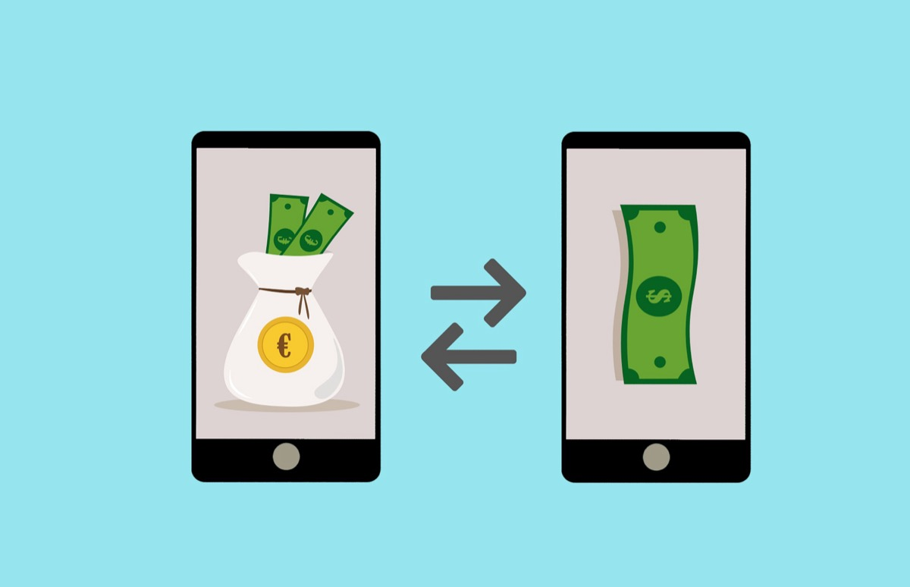

Cüzdanlar, DeFi dünyasına girişin ilk adımı. Bu bölümde; elektronik cüzdan ne demek, nasıl cüzdan sahibi oluruz ve cüzdanlar ne kadar güvenli sorularına yanıt arayalım:

<figure><figcaption>Image by <a href="https://pixabay.com/users/mohamed_hassan-5229782">mohamed Hassan</a> from <a href="https://pixabay.com/">Pixabay</a></figcaption></figure>

## DeFi dünyasına girişte ilk adım: Cüzdanlar {#defi-dunyasina-giriste-ilk-adim-cuzdanlar}

Cüzdanların en kritik noktası, içinde tuttukları varlığın tek sahibinin sadece ve sadece cüzdan sahibi son kullanıcı olması. Bu neden önemli?

DeFi dünyasındaki hemen hemen tüm ürünler, özünde size bir işlem yapabilmeniz için yardımcı olan araçlar. Bu, aslında bu dünyanın klasik dünyadan en büyük farkı. Zira, klasik dünyadaki aracılar, sizin adınıza işlem yapabilmek için sizin varlığınızı kendi üzerlerine almak zorundalar; aksi pek mümkün değil.

Örneğin, paranızı yatırımda kullanmak ve faiz almak mı istiyorsunuz? Parayı bankaya emanet vermek zorundasınız. DeFi dünyasında ise paranın sahipliği her zaman kullanıcıda kalır. Aynı örnekten devam edersek, bunu bir nevi evde kasada sakladığınız paranıza bir yandan faiz almak şeklinde düşünebiliriz.

Bu dünyada kullanıcı, istediği zaman ürüne sahip olur, istediği zaman da o üründen çıkar. Bütün bunları ise kendisine ait elektronik cüzdan sayesinde yapar. Yani DeFi dünyasında hareket etmek istiyorsanız, kriptoparanız olmalı ve bu kriptoparanız size ait elektronik cüzdanda durmalı.

İşte bu nedenle elektronik cüzdan kullanıcı için çok önemli. Bu dünyaya adım atabilmek ve sonrasında finansal olarak gücü elinde tutabilmek için gerekli.

## Nedir bu elektronik cüzdan? {#nedir-bu-elektronik-cuzdan}

Evet, kripto cüzdan ya da elektronik cüzdan kişinin kripto dünyasında hür bir şekilde gezebilmesi ve varlıkların kontrolünü kendinde hissedebilmesi için elindeki en büyük araç.

Öncelikle cüzdan dediğimiz ‘şeyin’ aslında bir email adresinden farksız olduğunu tekrar hatırlatalım. **Kripto dünyasında değer, sahiplik olarak da adlandırabileceğimiz her tür bilgi blokzincir üzerinde saklanır.** Cüzdan ise blokzincir üzerindeki bu bilgi ya da varlığın bize ait olduğunu kanıtlayan, bir nevi blokzincir ile kullanıcı arasında köprü vazifesi gören bir araç aslında. Kriptoparanız cüzdanda durmaz, cüzdan blokzincirde kayıtlı olan varlığınıza ulaşım sağlar.

Bir başka açıdan, paranızı borsada tutuyorsanız, aslında o borsaya borç vermiş oluyorsunuz. O paranın sahibi borsa oluyor. Eğer paraya tam olarak sahip olmak isterseniz, o zaman borsadan cüzdanınıza çekmeniz gerekir.

### Kritik olan cüzdan değil tohum sözcük grubu {#kritik-olan-cuzdan-degil-tohum-sozcuk-grubu}

Cüzdan sahibi olmak ne kadar önemli olsa da asıl kritik olan bu cüzdan üzerinde saklanan bize ait bilgiler. Kimsenin görmemesi için şifreli olarak saklanan bu bilgileri açmak sadece özel anahtar ile mümkün. Bu anahtara ait bilgileri kaybetmemek ve kimse ile paylaşmamak kullanıcı için son derece önemli.

Bu arada, kullanıcı kolaylığı olması açısından anahtar nispeten basitleştirilmiş; özel anahtarı genelde 12 ya da 24 kelimeli bir parola gibi düşünebilirsiniz. İngilizce bir sözlükten seçilen bu kelimelere bir bütün hâlinde “seed phrase” deniyor (recovery phrase, seed recovery, backup phrase gibi farklı adlandırmaları da var). Türkçeye “tohum sözcük grubu” şeklinde çevirirsek yanlış olmaz.

Bu sözcük grubu elinizin altında olduğu sürece, istediğiniz elektronik cüzdan üzerinden blokzincirdeki varlığınıza ulaşabilirsiniz. Dolayısıyla tek bir elektronik cüzdana bağlı değilsiniz, yeter ki bu kelime grubunu kaybetmeyin. Konuya başlamadan bunu bilmekte fayda var.

### Cüzdanlar güvenli mi? {#cuzdanlar-guvenli-mi}

Fiziki güvenlik gibi dijital güvenliğin de katmanları var. Bir sonraki bölümümüzde, farklı cüzdanları incelerken hangilerinin daha güvenli olduğuna da bakacağız. Bir yandan da güvenlik ile kullanım rahatlığı arasında bazen bir taraf öbürüne göre daha ağır basabiliyor, bunu da hesaba katmakta fayda var.

Kripto dünyası, yukarıda bahsettiğimiz çelişkiyi gidermek için son yıllarda önemli adımlar attı. Şu anda hem güvenli hem de kullanışlı ürünler bulmak mümkün. Cüzdan seçimi, oldukça fazla kişisel tercih içerdiği için (güvenlik ya da pratikliğin seçilmesi anlamında), buradan bir tavsiye vermeyeceğiz. İlerleyen bölümlerimizde sık kullanılan birkaç cüzdan örneği olacak, bunları daha bir gönül rahatlığı içinde kullanabilirsiniz.

Genel olarak güvenlik alanında standartlar oturmaya başlamış durumda. O nedenle geniş kesimlere yayılmış. Örneğin mobil uygulama olarak milyonlarca indirilmiş cüzdanların nispeten daha güvenli olduğunu düşünebilirsiniz.

## Kripto cüzdan nasıl yaratılıyor? Çeşitleri ne? {#kripto-cuzdan-nasil-yaratiliyor-cesitleri-ne}

Kripto cüzdanların (ya da bir diğer deyişle ‘dijital elektronik cüzdanların’), hangi araç üzerinde yarattığınıza göre değişen farklı çeşitleri var. Nelermiş kısaca bakalım:

### Web sitesi üzerinden {#web-sitesi-uzerinden}

Bir web sitesine giriyorsunuz, (örneğin [Blockchain Info](https://www.blockchain.com/)) ve oradan kendinize bir kullanıcı adı ile şifre alıyorsunuz. Site size otomatik olarak özel ve genel anahtar yaratıyor. Sonrasında buradaki hesabınıza kriptopara (bu site örneğinde Bitcoin ve Ethereum) gönderebilir ve alabilirsiniz. Bir bankanın online websitesinden bir farkı yok; rahat ve pratik. Sıkıntısı, online bir site olduğu için yarın öbür gün bu sitenin hack edilmesi (yani bilgilerin dışarı sızdırılması). Ufak bir ihtimal; ancak sonuç olarak burası da merkezi bir sistem.

### Bilgisayar ile {#bilgisayar-ile}

Güvenilir bir yazılım programı buluyorsunuz ve bu programı bilgisayarınıza yüklüyorsunuz. Program içinde özel ve genel anahtarlarınızı yaratıyorsunuz. Sonra bu program üzerinden kriptopara gönderebiliyor ya da alabiliyorsunuz. Bu tip yazılımların özellikle açık kaynak yazılımlar olmasına dikkat etmek gerek. Bu alanda [Electrum](https://electrum.org/#home) isimli yaygın bir şekilde kullanılıyor ancak %100 güvenli olduğuna dair kimse garanti veremez. Kendi araştırmanızı yapmanızı ve içinizin rahat edeceği bir programı kullanmanız tavsiye ederim.

### Mobil üzerinden {#mobil-uzerinden}

Cep telefonunuza App Store ya da Google Play üzerinden program yükleyip (örneğin, Bitcoin için Blockstream tarafından üretilen Green Wallet ya da DeFi için Metamask) kriptoparanızı cep telefonunuzda taşıyabilirsiniz. Oldukça pratik bir yöntem, ancak yukarıda olduğu gibi telefonunuza dışarıdan bağlantı yapılıp bilgileriniz çalınırsa sıkıntı çekebilirsiniz.

### Fiziki cüzdan (Hardware Wallet) {#fiziki-cuzdan-hardware-wallet}

Bunlar günlük hayatta kullandığımız USB cinsi küçük ekipmanlar. Özel ve genel anahtarınızı burada yaratıp, işlem yapmak istedikçe bu USB çubuğunu bilgisayara takıyor ve online (çevrim içi) olarak kullanıyorsunuz. İşiniz bitince çubuğu çıkarıp offline (çevrim dışı) oluyor ve dijital dünyadan gelecek tehlikelere karşı kendinizi koruyorsunuz. Pratik; ancak USB çubuklar oldukça pahalı. Eğer büyük miktarlarda kriptoparanız var ise, o zaman bu cüzdanlar tavsiye edilebilir. (Örnek: [Ledger](https://www.ledger.com/), [Trezor](https://trezor.io/))

### Kağıt kalem {#kagit-kalem}

Gördünüz mü, yine geldik kalem kağıda :) İsterseniz kendiniz hiçbir programa sahip olmadan da özel ve genel anahtar yaratabilirsiniz. Bunun için yapmanız gereken; bu konuda uzmanlaşmış açık kaynak kodlu bir web sitesine gidip (Bitcoin için [BitAddress](https://www.bitaddress.org/) bir örnek olabilir) bir dakika içinde anahtarları yaratabilirsiniz. Sonrasında yapmanız gereken bu anahtarları bir kağıda not etmeniz. İşte bu kadar. Genel anahtarı bir arkadaşınıza gönderip size kriptopara göndermesini söyleyin. Sonrasında da [Blockchain Info](https://www.blockchain.com/en/explorer) ya da [Block Explorer](https://blockexplorer.com/) gibi halka açık adreslerden hesap hareketlerinizi inceleyin. (Tek yapmanız gereken sitedeki arama çubuğuna genel anahtarınızı girmek). Satmak istediğinizde ise yine [Blockchain Info](https://www.blockchain.com/en/explorer) gibi bir siteyi kullanıp, paranızı istediğiniz bir kripto hesabına gönderebilirsiniz. Bu tip adresler genel olarak güvenli gibi görülse de, oluştururken birinin sizi görmesi, kötü niyetli kişilerce bu tip sitelerin kopyalarının yapılmış olması, kullandığınız kağıdın eskimesi, yıpranması ya da kaybolması gibi nedenlerle, uzmanlar tarafından çok da tavsiye edilmiyorlar.

## Peki ya şifremi ya da bilgisayarımı/telefonumu kaybedersem? {#peki-ya-sifremi-ya-da-bilgisayarimi-telefonumu-kaybedersem}

Yukarıdaki ilk üç alternatif bir “kaybolma” senaryosu da içeriyor; web sitesinin şifresini unutabilirsiniz, bilgisayarınız çökebilir, cep telefonunuz çalınabilir. Hemen hepsinin bu tür durumlar için benzer çözümleri var. Size kayıt olurken (ya da özel ve genel anahtarları yaratırken) 12 adet birbirinden bağımsız kelime veriyorlar. Bu kelimeleri bir yere (mümkünse bir kâğıda) yazın ve bir kenarda saklayın. Olası bir kayıp yaşandığında, özel ve genel anahtarlarınızı, bu 12 kelimeyi doğru sıra ile yazmanız durumunda geri kazanabileceksiniz. Fiziki cüzdanların, çok farklı felaket senaryosu çözümleri var. Her bir üreticinin web sitesinden detaylarını öğrenebilirsiniz. Son alternatif kâğıtta ise kağıdı alıp ağzı bağlı bir torbaya koyun (ki su baskını gibi durumda ıslanıp yazılar okunaksız bir hâle gelmesin) ve sakın kaybetmeyin. Kaybettiğiniz noktada geri dönüş yok.

## Hangi cüzdan bana göre? {#hangi-cuzdan-bana-gore}

Sonuç olarak kripto cüzdanlar oldukça güvenli araçlar. Yukarıda bahsettiğimiz kötü senaryoların herhangi biri, bankada işlem yaparsanız da başınıza gelebilir. Bankada, genelde bu tip durum ortaya çıktığında yetkililer ile konuşup kaybettiğiniz parayı geri alma ihtimaliniz var. Kriptopara dünyasında ise konuşacağınız bir mercii yok. O nedenle kritik olan, gerekli önlemleri baştan almak. Nedir bu önlemler?

1. Yukarıda bahsettiğim 12 kelimeyi unutmayacağınız bir köşede tutmak.
2. Pratik olması bakımından, işlem yapmayı planladığınız ufak bir miktarı kriptopara borsasında tutmak ki böylece ani değişimlerde hızlıca işlem yapabilin.
3. Göreceli daha büyük ama yine işlem yapabileceğiniz bir miktarı bilgisayar ya da cep telefonunda tutmak. Burada da işlem yapmak için parayı kriptopara borsasına göndermeniz gerekli ve bu da oldukça süre (genelde on dakika ama bazen uzayabilir) alıyor. Hemen işlem yapamıyorsunuz.
4. Eğer büyük yatırımcı iseniz ve uzun vadeli olarak kriptopara tutacaksanız; fiziki cüzdan satın almak.

## DeFi için genelde hangi cüzdanlar kullanılıyor? {#defi-icin-genelde-hangi-cuzdanlar-kullaniliyor}

DeFi için genel olarak online, mobil ya da hardware cüzdanlar kullanılıyor. Mobil cüzdan dediğimiz aslında bir uygulama. Telefonunuzun işletim sistemine göre Apple Store ya da Google Play üzerinden indirip çalıştırıyorsunuz.

<figure><figcaption>Image by <a href="https://pixabay.com/users/mohamed_hassan-5229782">mohamed Hassan</a> from <a href="https://pixabay.com/">Pixabay</a></figcaption></figure>

Uygulamayı açtığınızda, yeni bir hesap oluşturabilir ya da daha önce bahsettiğimiz 12 kelime elinizin altında ise bunları girerek sahip olduğunuz varlıklarınızın bulunduğu hesaba ulaşabilirsiniz. Eğer yeni bir hesap yarattı iseniz, az önce [yazdığımızı bir kez daha hatırlatalım](https://turansert.com/genel/2021/01/30/elektronik-cuzdan-ile-DeFiye-adim-atmak.html): Bu 12 kelimeyi not alıp güvenli bir yerde saklamak çok kritik, aksi halde cüzdanınızda bir sorun olduğunda hesabınızdaki varlıklara bu 12 kelime olmadan ulaşamazsınız!

<figure><figcaption>12 kelimeyi kaybetmemeyi ne kadar söylesek az (<a href="http://www.ranzey.com/generators/bart/index.html">Kaynak</a>)</figcaption></figure>

DeFi dünyası genel olarak Ethereum blokzinciri üzerinden çalıştığı için yazılarımızda genellikle Ethereum üzerinde çalışan cüzdanlardan bahsedeceğiz. Bitcoin ile Ethereum farklı zincirler oldukları için ilk zamanlarda çıkan cüzdanlar genelde ya birinde ya diğerinde çalışıyordu. Şimdi her iki blokzincire ulaşmaya yarayan cüzdanlar da var.

Burada, iki farklı mobil cüzdan tipine değineceğiz:

### Wallet Connect {#wallet-connect}

Wallet Connect, farklı cüzdanlar ile farklı DeFi uygulamalarının bir arada çalışmasını sağlayan bir standart. Kullanımı oldukça basit. Tek bilmeniz gereken, telefonunuza yüklediğiniz mobil uygulamanın Wallet Connect standardına sahip olduğuna emin olmanız. Genelde, uygulamaların pek çoğunda bu özellik var.

Bilgisayarınızdaki tarayıcı üzerinden herhangi bir DeFi uygulamasına girdiğinizde, sağ üstte bulunan “Cüzdanı Bağla” tuşuna bastığınızda, karşınıza gelen alternatiflerden Wallet Connect’i seçiyorsunuz. Bu seçimi yaptığınızda karşınıza bir QR kod çıkıyor. Sonrasında telefonunuzdaki cüzdan uygulamasını açıp, içindeki QR kod okuyucu üzerinden bilgisayar ekranındaki kodu okutuyorsunuz. Bu, telefonunuz aracılığıyla bilgisayarınızı blokzincire bağlıyor.

Wallet Connect standardı ile kurulmuş pek çok cüzdan mevcut. Bunların içinden kullanıcı kolaylığı ile Argent ön plana çıkıyor. Argent, tamamen ilk cüzdan deneyimi yaşayanlar için kurgulanmış bir uygulama. Oldukça kullanışlı ve temiz bir arayüze sahip, yukarıda bahsettiğimiz 12 kelimeyi tutmak istemeyen ve parasının çalınmasından çekinenler için alternatif çözümler üreten bir cüzdan.

### Metamask {#metamask}

Metamask, neredeyse tüm DeFi dünyasının otomatik cüzdanı olmuş durumda. Bunun temel nedeni kullanım rahatlığı.

Her ne kadar DeFi platformları mobil telefonlardan kullanılabiliyor olsalar da işlemlerin karmaşık yapısı nedeniyle bilgisayar başında olmak çok daha verimli oluyor. Farklı web sitelerine bağlanmak için Wallet Connect kullanmak rahat ama daha rahatı Metamask. Neden? Çünkü Metamask tarayıcınız içine yükleyebileceğiniz bir eklenti.

Wallet Connect gibi “telefonunu çıkar, uygulamayı aç, ekrandaki QR kodu okut” gibi detaylar yok burada. DeFi platformunda sağ yukarıdaki “Cüzdan Bağla” tuşu üzerinden Metamask’ı seçip onay verdiğinizde bağlanmış oluyorsunuz.

Bu arada 2020 yılının sonuna doğru Metamask, mobil cüzdanlar için de bir uygulama yarattı. Tarayıcınız üzerinden izlediğiniz hesabınızı, benzer şekilde telefonunuzdan da takip edebiliyorsunuz.

Metamask’ın nasıl kullanılacağı ile ilgili [Aybars Dorman’ın detaylı yazısını okuyabilirsiniz](https://medium.com/blockchainist-center/metamask-dijital-c%C3%BCzdan%C4%B1-nedir-63ebfed21b47)

## Cüzdanlar, alanlarını geliştiriyor {#cuzdanlar-alanlarini-gelistiriyor}

Perakende sektöründe temel bir anlayış vardır: Son kullanıcıya kim dokunuyor ise en avantajlı olan odur. Kripto dünyasında da kullanıcıya son dokunanlar cüzdanlar. Bu nedenle ilerleyen dönemlerde değer bakımından ciddi bir avantaja sahip olacaklar.

Zaten cüzdanlar da bu avantajı kullanmaya başladılar bile. Cüzdan içinde yeni özellikler çıkararak kullanıcıyı olabildiğince kendilerine bağlamaya başladılar. Örneğin kullanıcılar Metamask üzerinden sadece varlıkları görmek değil, artık onları alıp satma imkânına da sahipler. Metamask token satmak isteyen kullanıcılarına yaklaşık 10 farklı borsadan fiyat toplayarak en uygununu sunuyor.

Benzer şekilde Argent de son zamanlarda DeFi üzerinde gittikçe ön plana çıkan getiri çiftçiliği alanında yatırım yapabilmeleri için kullanımı kolay ve anlaşılır bir arayüz sunuyor.

Bir sonraki bölümümüzde, cüzdan kurduktan sonra DeFi dünyasında nasıl işlem yapıldığına bakacağız.
