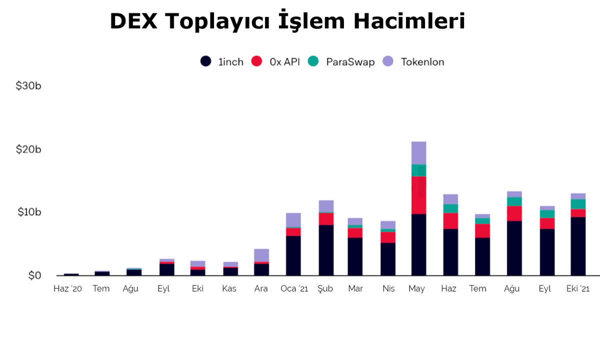

Bu bölümde klasik dünyadan alışık olmadığımız, daha çok DeFi dünyasının kullanıcılara sunduğu bir yenilik olan “toplayıcılar” adı verilen uygulamalardan bahsedeceğiz.

## DeFi’nin girift yapısı {#definin-girift-yapisi}

DeFi felsefesinin temel yapı taşlarından biri “açık olmak”. Bu açık olmanın bir özelliği de ürünlerin belli bir standart ile yaratılması ve birbirleri ile geçişken olarak kullanılabilmesi. Ne demek bu?

Klasik dünyadan bir örnek üzerinden açıklayacak olursak, bankada tuttuğunuz mevduatı bankaya sormadan teminat olarak gösterip başka bir kurumdan kredi almak, sonra da o kredi ile farklı bir aracı kuruma ait bir fona yatırım yapmak şeklinde düşünebilirsiniz “açık olma” özelliğini. “Olmaz öyle şey” diyebilirsiniz. Haklısınız, klasik dünyada bu çok zor.

DeFi için durum daha farklı. Neredeyse her ürün bir başkası ile birlikte kullanılabiliyor. Bu da kullanıcıya daha önce hiç tanışmadığı farklı yenilikler ve kolaylıklar sağlayabiliyor.

Öte yandan bu yenilikler, aynı zamanda kendi içinde belli komplikasyonları da beraberinde getiriyor. Gelin önce bu sıkıntılardan birinden, sonra da DeFi’nin buna karşı geliştirdiği çözümden bahsedelim.

### Merkeziyetsiz borsaların avantajı ve dezavantajı {#merkeziyetsiz-borsalarin-avantaji-ve-dezavantaji}

Merkeziyetsiz borsalar, tokenlerini elektronik cüzdanında tutan DeFi kullanıcıları için en rahat alım-satım platformları (Bu konuda ‘Uniswap ve DeFi’nin merkeziyetsiz borsaları’ bölümünde detaylı bilgi alabilirsiniz).

DeFi kullanıcıları, genelde merkezi borsalara gitmiyorlar. Neden? Merkezi borsalara kayıt olmak için yığınla belge, fotoğraf vs. vermek gerekiyor. Sonra başka bir merkezi borsaya geçmek istersen, ona da tekrar kayıt yaptırman gerekli. Sanki klasik dünyadaki bankaları andırıyor değil mi?

Kullanıcı bunun yerine merkeziyetsiz borsaları tercih edebiliyor. Zira, böyle bir borsayı kullanmak için yapması gereken tek hareket, ilgili siteye gitmek ve kendi elektronik cüzdanını bağlamak. Bu kadar basit.

Bu olayın güzel tarafı, ancak bunun da birtakım sorunları var. Neler mesela? En önemli konu tabii ki işlem fiyatı. Her bir borsada arz ve talebin farklı olması nedeniyle fiyatlar farklılık gösterebiliyor. Öte yandan borsada bulunan likidite de önemli. Zira likit olmayan bir token alımında, fiyatın ufak bir alım ya da satım hareketinde ciddi bir hareket göstermesi mümkün.

Bir başka konu ise kullanıcının alım yapmak istediği sırada, başka alıcıların da işlem yapması sonucu fiyatın bir anda değişebilmesi. Burada kullanıcı ne kadarlık bir fiyat değişimine (ki buna İngilizcede ‘slippage’ deniyor) izin vereceğini (genelde %1-2 gibi) seçebiliyor.

Son olarak, kullanıcının işlem yaparken, işlemi ne kadar hızlı gerçekleştirmek istediği. Eğer çok hızlı bir şekilde işlemini gerçekleştirmek istiyorsa, o zaman blokzincir sırasında öne geçebilir; ancak bunun ciddi bir maliyeti var. Alternatif olarak “benim işim acil ya da kritik değil” diye düşünerek daha düşük bir madenci işlem ücreti seçebilir. Böyle bir durumda, hem gecikmeye razı olmalı hem de o işlem blokzincire yazılana kadar araya giren başkaları olabileceği için fiyatın değişme riskini göze almalı.

### Kullanıcı, hangi borsayı kullanacağını nasıl seçecek? Burada işin içine 'toplayıcılar' giriyor {#kullanici-hangi-borsayi-kullanacagini-nasil-sececek-burada-isin-icine}

İşte yukarıda saydığımız farklı senaryolardan dolayı, tokenlerin fiyatı borsadan borsaya farklılık gösteriyor. Ne yapacak kullanıcı? Sekiz farklı borsa için ekranını açık tutup hangisi iyi ise ondan mı işlem yapacak?

<figure><figcaption>Image by <a href="https://pixabay.com/users/mohamed_hassan-5229782/">mohamed Hassan</a> from <a href="https://pixabay.com/">Pixabay</a></figcaption></figure>

İşte DeFi burada kullanıcının imdadına yetişiyor. Toplayıcı (İngilizcede ‘aggregator’) dediğimiz merkeziyetsiz hizmet sağlayıcıları, kullanıcı işlem yapmak istediğinde, hemen bütün merkeziyetsiz borsalar ile iletişim kuruyor, token için en iyi fiyat vereni buluyor ve kullanıcının önüne getiriyor.

Bunun yanında toplayıcıların şöyle bir avantajı da bulunuyor: Kullanıcı, normalde tokenini bir merkeziyetsiz borsada satmak isterse, o borsaya blokzincir üzerinde iki konuda izin vermesi gerekiyor. Birincisi, o borsanın kişinin parasına dokunabileceğine dair bir izin. İkincisi de hangi fiyat üzerinden işlem yapabileceğine dair bir başka izin. Bu da blokzincire işlenecek iki farklı işlem demek. Ethereum blokzincirinin yoğunluğunu düşünürseniz, birinci işlem (parayı kullanmaya izin verme) nereden baksanız 5-10 ABD doları tutuyor.

Şimdi düşünün; bir kullanıcı borsalara teker teker bakacak, uygun fiyatlısını bulacak, sonra borsa parasını kullanabilsin diye izin verecek (komisyon ödeyecek) en sonunda da işlemin fiyatına onay verecek. Hem zaman hem de para kaybı.

Bunun yerine, toplayıcıya parasını kullanma konusunda izin verdiğinde, sonrasında toplayıcı bunu hangi borsada kullanırsa kullansın tekrar bir izin vermesine gerek yok. Bu da kullanıcı için ekstra işlem maliyetinden kaçınması demek.

## Kimler var toplayıcı olarak? {#kimler-var-toplayici-olarak}

2020 yılının Nisan ayı itibariyle, piyasada üç büyük toplayıcı bulunuyor. Bunlar; [1inch](https://1inch.exchange/#/), [Matcha](https://matcha.xyz/) ve [ParaSwap](https://paraswap.io/) olarak sıralanıyor.

<figure><figcaption>Merkeziyetsiz işlem toplayıcı hacimleri Kaynak: <a href="https://www.theblockcrypto.com/data/decentralized-finance/dex-non-custodial/dex-aggregator-trade-volume">TheBlock</a></figcaption></figure>

2020 yılının Mayıs ayında başlayan DeFi piyasasındaki canlanmanın, gecikmeli olarak toplayıcılara da ulaştığını söylemek yanlış olmaz. Bunun birkaç nedeni var. Öncelikle, piyasalarda böyle bir ihtiyaç olduğu geç anlaşıldı. Öte yandan, bu piyasanın lideri olan 1inch, 2020 Aralık ve 2021 Şubat aylarında yaptığı iki “airdrop” ile geniş kitlelerin uygulamayı kullanmasını sağladı (‘airdrop’, kullanıcılara platformu kullanmaları için verilen teşviklere deniyor).

1inch bunun yanında, 2021 Mart ayı içinde Ethereum blokzinciri yanında daha önce de bahsettiğimiz rakip [Binance Smart Chain](https://www.binance.org/en/smartChain) için de toplayıcılık hizmeti vermeye başladı. Bu da kullanım alanını genişletmek konusunda 1inch’e ekstra avantaj veriyor.

Piyasanın daha küçük oyuncularından Matcha ise temiz ve kullanışlı arayüzü ile 1inch’ten farklılaşmaya çalışıyor.

Normalde merkeziyetsiz borsalar, örneğin Uniswap, havuz sistemiyle çalıştığı için limitli emir kullanımına uygun değil. “Limitli emir nedir?” diye sorarsanız: İşlem yapmak istediğiniz fiyatı belirliyorsunuz, sistem de işleminizi tokenin fiyatı sizin belirlediğiniz değere geldiği zaman gerçekleştiriyor. Hem 1inch hem de Matcha, piyasa emirleri dışında limitli emir verebilme imkânı da sunuyorlar. Burada kullanıcıların, limitli emir verirken ödedikleri ücretlere dikkat etmesi ve işlemlerin gerçekleşmeme ya da çok geç gerçekleşme ihtimali olduğunu aklından çıkarmaması gerekiyor.

1inch ile ilgili geçtiğimiz aylarda ortaya çıkan bir konuya da yer vermekte fayda var. Yukarıda “slippage”, yani “kullanıcının işlem emri vermesiyle işlemin gerçekleşmesi sırasında araya girenlerden dolayı fiyatın negatif etkilenmesi” durumundan bahsetmiştik. Kimi zaman bunun tersi de olabiliyor. Kullanıcı bir tokeni almak için teklif yaptığında, başka birileri aynı tokeni satmak için işlem yaptıkları için token fiyatı ucuzlayabiliyor. 1inch böyle bir durumda “positive slippage” denen bu farkı kullanıcıya vermeyip cebine atıyor. Etik mi? Kullanıcı istediği fiyattan aldığı için bir sorun yok gibi görünüyor ama yine de ağızda hoş bir tat bırakmadığı kesin.

### Cüzdanlar da artık bu işi yapıyorlar {#cuzdanlar-da-artik-bu-isi-yapiyorlar}

Önceki bölümde bahsettiğimiz elektronik cüzdanlar da artık cüzdan içinden farklı borsalarda işlem yapabilme imkânı veriyorlar. Bu alanda, DeFi alanının en büyüğü olan Metamask ön plana çıkıyor. Cüzdan içinden doğrudan alım-satım yapabilmek büyük rahatlık ancak kullanıcıların ödedikleri komisyonları takip etmelerinde fayda var.
