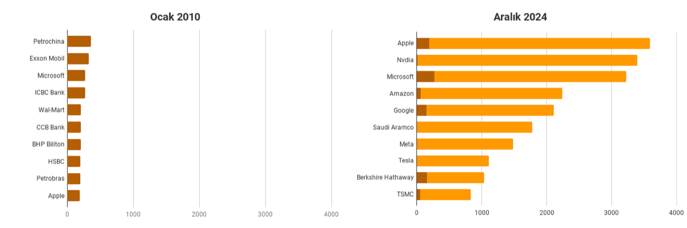

## Web 1.0’dan Web 2.0’a geçiş {#web-1-0dan-web-2-0a-gecis}

Web 1.0, ticari kaygılardan uzak, daha uzun vadeli ve internetin temel altyapı taşlarını oluşturan protokol ve basit uygulamaların ortaya çıktığı bir dönem. Ücretsiz ortaya çıkan temel standartlar, sonrasındaki gelişmenin en itici güçlerinden biri oldu.

Web 1.0’dan Web 2.0’a geçiş doğal olarak, öyle bir günde olan bir olaydan ziyade bir süreç şeklinde gerçekleşti. Sürecin başlangıç aşamasını üniversiteler ve ordu tarafından kullanılan iletişim ağının ticari işletmelere açıldığı 90’ların başı olarak kabul edebiliriz. Bu noktada ticari internet hizmet sağlayıcı dediğimiz ISP’lerin (Internet Service Provider) ortaya çıkması milat olarak kabul edilebilir.

Çok kısaca Web 2.0’ı internetin ticarileşmesi olarak adlandırabiliriz.

## Neden Web 2.0’a ihtiyaç duyuldu? {#neden-web-2-0a-ihtiyac-duyuldu}

Yukarıda da belirttiğimiz gibi, internetin ilk kurulduğu yıllarda, odak noktası altyapının düzgün bir şekilde gelişmesi olmuş, bu teknolojinin kullanıcısının ihtiyaçları göz ardı edilmişti. Zira, kullanıcıların ihtiyaçlarına uygun geliştirmelerin bilimsel açıdan çok bir karşılığı yoktu. Web 1.0’ı geliştiren araştırmacılar, üniversiteleri adına ‘araştırma fonlarına’ başvurduklarında, ancak teknik olarak belli geliştirmeler yapma sözü verdiklerinde para alabiliyorlardı. Açıkçası o zamanlar kullanıcıyı çok da düşünen yoktu.

Web 1.0’ın sonlarına doğru artık temel altyapı ve standartlar oturdukça, internetin bireylere getirebileceği potansiyel de fark edilmeye başlandı. İnternetin oluşturduğu ağ sayesinde, insanların çok hızlı bir şekilde iletişime geçebilecekleri, ticari faaliyetlerde bulunabilecekleri anlaşıldı. Anlaşıldı anlaşılmasına da, bir sorun vardı, o da interneti kullanmak hâlâ oldukça zordu. Faydalarını anlamak için interneti kullanmak gerekiyordu ama bunun için evinizde bir bilgisayar olması, bir internet servis sağlayıcıdan yüksek miktarda ücret vererek bağlantı almanız, telefon üzerinden internete bağlanmanız, bunu yaparken de servisin sık sık kopması sorunlarına göğüs germeniz gerekiyordu.

## Web 2.0’ın doğuşu {#web-2-0in-dogusu}

Web 2.0 ile birlikte, farkedilen bu ticari potansiyelin gerçeğe dönüşme süreci başladı.

Öncelikle, geliştirme anlamında liderlik, üniversitelerden özel sektöre doğru kaymaya başladı. Özel sektör içinde de doğal bir işbölümü oluştu. Büyük şirketlerin araştırma birimleri donanıma odaklanırken, kullanıcı dostu uygulamaların geliştirilmesi start-up’ların işi oldu.

Bu noktada ortaya çıkan binlerce girişim ellerinde internetin potansiyelini gösteren gösterişli vizyon dokümanları ile girişim sermayelerinin kapısını çalıp milyonlarca dolar para topladılar. Süreç içinde giderek şişen internet balonu 2001 yılının ortalarında patladı ve verdiği hedefleri tutturamayan onlarca start-up kapanmak zorunda kaldı.

Yine de, bunca kriz ve batış öyküsü içinde ayakta kalabilen Amazon, Google gibi örnekler, Web 2.0’ın ticari potansiyelini ortaya çıkarmayı başardılar.

## Peki neydi Web 2.0’ın özellikleri? {#peki-neydi-web-2-0in-ozellikleri}

Web 2.0 aslında bir nevi Web 1.0’ın anti-tezi gibiydi. Gelin temel özelliklerine hızlı bir şekilde bakalım:

**Üstyapı uygulamaları:** Web 1.0 genelde altyapı projelerine odaklanırken, yeni Web 2.0 bu altyapı projelerinin üzerine kurulu uygulamalardan oluştu. Bu uygulamalar, daha çok son kullanıcıya yönelik idi. Bu uygulamaların temel hedefi, olabildiğince çok sayıda kullanıcıya ulaşabilmek oldu. Kullanıcının neyi beğenip neyi beğenmeyeceğini bilmek o kadar da kolay bir iş değil. Kimi özellikler geniş kitlelerce benimsenirken, kimileri beklentileri karşılamıyor. Bu nedenle Web 2.0 uygulamaları, kullanıcının tepkisine göre hızlı bir şekilde kendilerini geliştirip değiştirdiler. Yani, Web 1.0’ın ağır ama emin adımlarla ilerleyen altyapı projelerinin yerini, hızlı şekilde geliştirilen ve hata yapmaktan korkmayan uygulamalar aldı.

**Ticari ve kapalı:** Web 2.0 girişimleri çalışmalarını fonlamak için girişim sermayesinden para aldılar. Girişim sermayeleri genelde riskli projelere girerler, yaptıkları yatırımlarda ‘para batırma’ riskleri yüksek olduğu için başarılı yatırımlarından ciddi getiri beklerler. Web 2.0 ekipleri de yatırımcının bu beklentisine cevap verebilmek için çok kısa sürede başarılı olabilmenin yollarını aradılar. Geliştirdikleri ürünler başkaları tarafından kopyalanmasın diye onları mülkiyet ve telif hakları ile korudular ve yazılımlarını ‘ticari sır’ olarak sakladılar. Diğer yandan bu girişimler için müşteriyi yakalamak ve onu bırakmamak en önemli hedef kriterlerinden biri oldu. Bu hedefe ulaşabilmek için müşteriye ihtiyaç duyduğu tüm ürünleri bir bütün halinde sunup, onu kendi kurdukları dışarıya kapalı bir dünyanın içine hapsetmeye çalıştılar.

**Kullanıcı dostu:** Web 1.0 dünyasının odağının altyapı olduğundan ve kullanıcıyı çok da önemsemediğinden bahsetmiştik. Müşteriyi ilk plana alan Web 2.0 girişimleri geliştirdikleri kullanıcı dostu uygulamalar ile aynı zamanda internetin geniş kesimlerce benimsenmesinde önemli bir rol oynadılar.

**Merkezi yapılar:** İnternetin getirdiği büyük ticari potansiyel, bu dönemde ortaya çıkan girişimlerin çok ciddi büyümesini sağladı. Başlangıçta girişim sermayesi parası ile büyüyen girişimler sıra yarattıkları katma değeri ekip ve yatırımcı arasında pay etmeye gelince kendilerini bir yol ayrımında buldular. Ya halka arz olacaklar ya da bir başka şirkete satılacaklardı. Halka arz olanlar için artık hesap verdikleri makam Wall Street idi. Şirket hisselerini satın alan ve bu sayede şirket yönetim kuruluna temsilci sokan Wall Street fonları şirketlere şöyle bir gözdağı veriyorlardı: “Ya bana her üç ayda bir açıkladığın bilançolarında sürekli bir büyüme gösterirsin ya da seni bir başka büyük balığa yem ederim”. Bu tehdidi sürekli ensesinde hisseden girişimlerin önünde ise iki yol kalıyordu. Ya organik büyüme gösterecekler ya da başka girişimleri satın alarak Wall Street’e bir hikaye yaratacaklardı. İşte bu gördüğünüz sarmal, zaman içinde sayıca az ama birer dev haline gelmiş girişimler çıkarttı.

2010 yılı ile 2024 yıllarında dünyanın en değerli on şirketini gösteren aşağıdaki tablo bu alandaki ortaya çıkan devleri net bir şekilde ortaya koyuyor:

<figure><figcaption>Dünyanın en değerli 10 şirketi (2010 ve 2024 - milyar ABD Doları)</figcaption></figure>

*Solda 2010 yılında piyasa değeri olarak dünyanın en değerli halka açık on şirketini görüyorsunuz. Ağırlıklı olarak petrol ve finans sektörlerinden oluşuyor. Teknoloji dünyasından sadece Microsoft ve Apple listeye girebilmiş. 2024 yılı sonuna geldiğimizde ilk beşin tamamı olmak üzere toplam yedi firma teknoloji kökenli.*

Gücün konsantre halde birkaç merkezde toplanması beraberinde kimi sorunları getirdi ki, gelin şimdi ona bakalım.

## Web 2.0’ın sorunları neler? {#web-2-0in-sorunlari-neler}

Web 2.0’ın başarılı şirketlerinin genelde girişim sermayesi ile fonlandığına değinmiştik. Girişim sermayesi, verdiği paranın karşılığında hızlı ve yüksek getiri bekler. Eski dönemde klasik şirketler için başarıya giden yol, hızlı ve kârlı bir şekilde nakit akışı yaratmaktan geçiyordu. Teknolojinin hayatımıza girdiği bu dönemde ise yeni bir başarı kriteri ile tanıştık: Ne pahasına olursa olsun kullanıcı sayısını olabildiğince hızlı bir şekilde artırmak. Öyle ki, bu dönem girişimlerinde eskinin altın başarı kuralı olan ‘nakit akımı’ yasaklı bir kelime halini aldı, onun yerine girişimlerin cevaplaması gereken en önemli soru “kaç kullanıcıya ulaştın?” oldu.

Rüzgarı arkasına alarak çok hızlı büyüme yakalayan teknoloji devleri, yaptıkları dev halka arzlar ile kendilerini fonlayan girişim sermayelerine inanılmaz getiriler sağladı. Ne var ki, halka açılma sonrası şirket hisselerinin yeni sahibi olan Wall Street fonları teknoloji devlerinden sadece büyüme değil ‘nakit akışı’ da istemeye başladılar. Zaten milyarlarca kullanıcıya ulaştığınızda eski büyüme hızlarını yakalamanız çok da mümkün olmuyor.

İşte bu nedenle teknoloji devleri, her üç ayda bir ‘earnings call’ denilen toplantılar ile karşısına çıktıkları yatırım fonlarına yeni bir hikaye yaratma telaşına düştüler. Peki yeni hikaye ne oldu? Mevcut müşteriyi olabildiğince çok değerlendirmek (kaba tabiriyle ‘sağmak’) ve müşteriden kazandığı parayı artırmak. Bunu yapabilmek için teknoloji devleri her tür yolu denemeye başladılar. Facebook ve Google iş modellerini, olabildiğince çok müşteri kazandıktan sonra onlara reklam satmak olarak belirlediler. O nedenle dünyanın en büyük iki reklam ajansının bu iki şirket olduğu söylenir hep.

Daha fazla reklam satabilmek için birkaç yol denediler. Bunlardan biri, müşteriye özel reklamlar oldu. Açık havada bilboardlara reklam verdiğinizde, o reklamı binlerce kişi görüyor ama bunların %99’unda reklam bir etki bırakmıyor. Oysa, örneğin bir bebek maması reklamını yeni çocuğu olmuş bir anneye göstermek, reklamın etkisini onlarca kez artırıyor. Peki bu bilgiyi nasıl edinecek Facebook? Çok basit, yeni doğmuş çocuğunun fotoğraflarını arkadaşları ile paylaşan annelerden.

Bir süre sonra artık bunların da yatırımcılara yetmediğini gördük. Zira Wall Street obur bir iştah ile sürekli daha fazla kâr istiyordu. Teknoloji devleri bunu karşılayabilmek için bizimle ilgili daha çok bilgi sahibi olma yoluna gittiler. Ne yaptılar bunun için? Örneğin, telefonlarımızın mikrofonlarını kullanma izni alıp, bizi dinlemeye başladılar. Bu sayede, örneğin eşiniz ile kahvaltı masasında çamaşır makinenizin bozulduğunu konuştuğunuzda, daha masadan kalkmadan size yeni çamaşır makinesi reklamları göstermeye başladılar.

Reklamlar para kazanmanın bir yönü, ancak bu da yetmemeye başladı bu devlere. Sonrasında kullanıcılar hakkındaki bilgileri, başka şirketlere satmaya başladılar. ‘Reklam vermek’ adı altında alınan bu bilgilerin, 2010’lu yıllar içinde kişilerin seçimlerde politik davranışlarını değiştirmek için kullanıldığını da okuduk sonradan (bu konuda Netflix’de bulunan Facebook’un Cambridge Analytica skandalını anlatan filmine mutlaka göz atın).
