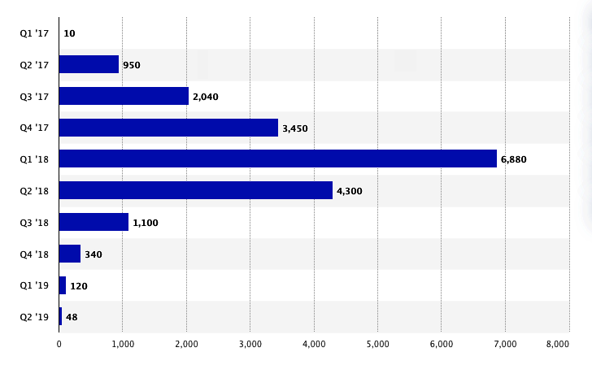

## Web3’ün doğuşu {#web3un-dogusu}

Web3 dediğimiz hareketin doğuşu, Web 2.0’ın tehlikelerini önceden kestiren bir grubun kendi arasındaki tartışmalar ile başlar. Bu grup kendilerine cypherpunks (şifrepunk) denen dijital dünyada kurulmuş bir oluşum. Kişinin dijital dünyadaki haklarının önemine dem vuran ve ticari olarak ortaya çıkan yapıların, para ve güç kazanmak adına bu hakları nasıl tehlikeye atabileceğini sezen bir ekip.

Özellikle Web 2.0 ile birlikte birkaç teknoloji devinde toplanan büyük güce tepki olarak ortaya çıkan bu ekibin temel düşünce yapısı şu şekilde idi:

Dijital dünyada kişiler arası her tür ilişkiyi aracı olmadan çözmek neredeyse imkansız. Zira, dijital dünyada aracıların çok kritik görevleri var. Nedir bu görevler? Bu dünyada kişilerin birbirine güven duyması zor, çünkü burası ‘global bir köy’. Birilerinin karşınızdaki kişinin doğru kişi olduğunu teyit etmesi gerekiyor. Bunu da ancak ‘herkesin bildiği/tanıdığı aracılar’ yapabilir.

Üstelik dijital dünyada herhangi bir şekilde değer tutabilmek de neredeyse imkansız. Zira, bu dünya 1 ve 0’lardan oluşan bir dünya. Fiziki olarak elle tutulur bir varlık yok. 1 ve 0, dijital oldukları için silinebilir, değiştirilebilir. Neye nasıl güveneceksiniz? Diğer yandan bu 1 ve 0’lar istenildiği kadar çoğaltılabilir, üstelik orjinalinden hiçbir farkı olmadan. Bir anda herhangi bir ürünü, örneğin bir mp3 müzik dosyasını binlerce kopya haline getirebilirsiniz. O zaman da evrensel bir kanun devreye giriyor; eğer herhangi bir eşya ya da ürün ne kadar çok piyasada olursa değeri o kadar azalır. Burada da ancak aracılar kişinin elinde tuttuğu dijital varlığın gerçekten tek ve doğru olduğunu onaylayabilir.

İyi ama güvenmek zorunda kaldığımız bu aracılar da bütün gücü ellerinde topluyorlar. Bu sayede, dijital dünyanın getirdiği nimetlerden aslan payını kapıyor, bu da yetmezmiş gibi bir de kullanıcının dijital haklarını ayaklar altına alıyorlar.

Öyleyse temel soru şuna dönüşüyor:

“Dijital dünyada, fiziki dünyada olduğu gibi bir varlığa nasıl sahip olacağım? Bu varlık kopyalanmadan değerini nasıl koruyacak? Bu varlığın bana ait olduğunu nasıl kanıtlayacağım? Bu varlığı başkalarına herhangi bir aracı olmadan nasıl transfer edeceğim? Eğer aracılardan kurtulamayacaksam, acaba dev haline gelmiş aracıların karşısında elimi daha güçlendirebilir miyim? Bu sayede, oluşan katma değerden daha fazla pay alabilir miyim?”

İşte bütün bu kritik soruların çözümünü blokzincir teknolojisi verdi.

## Ne getiriyor blokzincir teknolojisi? {#ne-getiriyor-blokzincir-teknolojisi}

Blokzincir teknolojisi üç temel unsuru bir araya getirmeyi başardı. Bunlardan ilk ikisi zaten uzun yıllardır hayatımızdaydı. Birincisi internet (kişisel görüşüme göre en büyük teknolojik devrimdir) ki Web 1.0 ve Web 2.0 ile iyice olgunlaştı. İkincisi, şifreleme teknolojileri, ki bu da 1980’lerden itibaren üniversitelerde yapılan yoğun araştırmalar sonucu günlük hayatta kullanılabilir hale geldi.

Üçüncü kritik unsur ise ‘uzlaşma mekanizması’ oldu. İşte bu son madde, Satoshi Nakamoto denen kişinin ya da kişilerin ortaya koyduğu en büyük yenilik olarak karşımıza çıkıyor. Madem dijital dünyada aracısız olmayı beceremiyoruz, bunun yerine güç odağı haline gelen bu aracılar tarafından sağlanan hizmeti binlerce makineye bölüp verelim. O zaman güç dağılmış olacak. Sorun, bu binlerce makine nasıl bir arada hareket edecekler? İşte, bu kritik engel Nakomoto uzlaşması denen sistem ile aşıldı.

Binlerce makinenin uyumlu bir şekilde hareket etmesi birkaç konuda işimize yarıyor. Öncelikle, herhangi bir yerden emir almadan, yapılan işlemleri doğru bir şekilde kayıt ediyorlar. İkincisi de, geriye dönük işlemlerin değiştirilmesinin önüne geçiyorlar. İşte bu iki sorun çözüldüğünde, insanların ikili ilişkilerde ihtiyaç duydukları en kritik konu çözülmüş oluyor: güven. Bu sayede, insanlar artık güven içinde bir dijital varlığa sahip olabiliyorlar, onun doğruluğunu ve tek olduğunu kanıtlayabiliyorlar. O varlığa herhangi bir otoritenin onayı olmadan değer atfedebiliyorlar ve bu varlığı yine güven içinde bir başkasına devredebiliyorlar.

İşte blokzincirin sağladığı teknolojik olanaklar, Web 2.0 dünyasının güçlü merkezi yapılarının karşısına, topluluklar tarafından oluşturulan ve odağına merkeziyetsizliği alan Web3 girişimlerinin çıkmasını sağladı.

## Web3’ün kısa tarihi {#web3un-kisa-tarihi}

İlk uygulama alanının 2009 yılında Bitcoin ile başladığı merkeziyetsiz Web3 dünyasının asıl genişlemesi Bitcoin sonrası ortaya çıkan girişimlerden Ethereum ile oldu.

Bitcoin’i geliştiren topluluk içinde bir grup, bu teknolojinin daha da genişletilerek başka sektörlerde devrimsel bir etki yaratabileceğini düşünüyordu. Başını dahi çocuk Vitalik Buterin’in çektiği bu grup, Bitcoin topluluğunun diğer üyelerinin direnci ile karşılaştılar. Topluluk içinde ağır basan görüş Bitcoin’in temel misyonu olan ‘sansüre dayanıklı dijital para’ kavramının hayati bir öneme sahip olduğu idi. Bu nedenle, yapılacak başka geliştirmeler ile gözü bu odaktan ayırmanın işi sulandıracağını ve hedefe ulaşmayı imkansız kılacağını savunuyorlardı.

Bunun üzerine Vitalik Buterin’in başını çektiği bir grup, Bitcoin topluluğundan ayrılarak Ethereum’u kurdular. Ethereum kendisine misyon olarak ‘üzerine her tür uygulamanın kurulabileceği merkeziyetsiz bir altyapı’ olmayı seçti.

Sonrasında pek çok girişim Ethereum benzeri altyapı projesi olabilmek için çaba gösterdi. Bunların bir çoğu günümüze kadar devam ediyor olsa da, bu alanda liderlik hep Ethereum’da kaldı.

Bu süreçte en önemli olaylardan biri 2017 yılında yaşanan ICO (initial coin offering) furyası idi. Bitcoin topluluğu projenin geliştirilmesi için dışarıdan herhangi bir fonlama almamıştı. Ethereum kurucuları ise farklı bir yol izleyerek projenin başında halktan yaklaşık 18 milyon ABD dolar topladılar. Bir ETH’nin yaklaşık 31 cent’e satıldığı 2014 yılındaki bu finansman turu sonrası ETH fiyatının 2017 yılı Ocak ayında yaklaşık 35 kat artarak 10 ABD dolarına, aynı yılın sonunda ise 750 ABD dolarına fırlaması denklemi bir anda değiştirdi. Yatırımcı iştahı benzersiz seviyelere geldi ve bu iştahı fırsat gören pek çok yatırım inanılmaz bir finansman sağladı.

<figure><figcaption>2017-19 yılları arası ICO’lardan sağlanan finansman (milyon ABD Doları)</figcaption></figure>

*2017-2019 yılları arasında üçer aylık bazda ICO’lardan sağlanan finansman. (*<strong><em>Kaynak</em></strong>*: [Statisca](https://www.statista.com/statistics/804748/worldwide-amount-crytocurrency-ico-projects/))*

Sonrasında ise heyecanı fırsat bilerek piyasaya giren kötü projelerin yanında beklentileri karşılayamayan iyi projeler, yatırımcıları ICO pazarından soğuttular. Pek çok yatırımcı onlarca kat para kazanma hayaliyle girdikleri pazardan ciddi zararlar yaparak kaçmak zorunda kaldı. Piyasa yaklaşık üç yıl süren bir kış uykusuna girdi.

Ayıların hakim olduğu bu dönem, aslına bakarsanız girişimler için o kadar da kötü geçmedi. Zira boğa dönemlerinde tüm piyasanın ve yatırımcıların gözleri yükselen token değerlerinde iken, ayı dönemleri insanların, projelerin gerçekten bir değer ifade edip etmediğine odaklandığı zamanlar oluyor. Bu kış sezonu da benzer şekilde iyi ekiplerin projelerini oluşturdukları, kimi zaman temelden değiştirdikleri kimi zaman ufak tefek oynamalar yaparak kullanıcıların ihtiyaç duyduğu alanları bulmaya çalıştıkları bir dönem oldu.

2020 yılında patlayan pandemi ve sonrasında ABD’nin uyguladığı para politikasını gevşeterek insanların evlerine harcamaları için çek yollaması Web3 dünyasının yeniden canlanmak için aradığı itici güç oldu.

Öncelikle 2020 yazında, merkeziyetsiz finans dediğimiz Web3 finans alanındaki uygulamalarının ciddi bir çıkış yakaladığını gördük. Arkasından NFT olarak bilinen dijital varlık sahiplik sertifikaları özellikle sanat piyasalarından başlayarak popülerlik yakaladı. Bunların devamının oyun ve metaverse alanında gelmesi bekleniyordu ancak özellikle finansal piyasalarda 2022 yılında patlak veren krizler, Web3 rüzgarının hız kesmesine neden oldu. Kitabımızın üçüncü bölümünün sonunda yaşanan krizlerden örnekleri detaylı olarak göreceksiniz. 2023 yılını krizden aldığı yaraları sarmakla geçiren Web3 dünyası, 2024 yılında ABD’de işlem görmeye başlayan ETF’ler ve başkanlık seçimlerinin etkisiyle birlikte tekrar hız kazanmaya başladı.

## Web3’ün özellikleri {#web3un-ozellikleri}

Web3 dünyasının felsefesinde kısaca Web 1.0’ın getirdiği özgürlüğü Web 2.0’ın kullanıcı kolaylığı ile birleştirerek, bizlere her iki dünyanın en iyi özelliklerinden oluşan hibrit bir çözüm sunmak var.

**Yepyeni bir mimari:** Web 2.0 teknolojileri kendilerine Web 1.0’ın getirdiği mimariyi baz almışlar ve uygulamalarını bunların üzerine kurmuşlardı. Web3, temeline merkeziyetsizliği aldığı için baştan aşağı yeni bir mimari ile kuruluyor. Bu mimarinin altyapısı olan blokzincirler, ilk kuruluş aşamasını hemen hemen bitirdi ve üstlerine uygulamalar kurulacak seviyeye geldiler.

Yine de blokzincirlerin tam olarak oturduğunu söylemek zor. Daha önlerinde alacakları çok yol var. Şu an için çözmeleri gereken temel sorunların başında ileride oluşabilecek yüksek talebe yanıt vermek geliyor. Bunun için öncelikle ölçeklenme sorununu çözmeleri gerekiyor. Bununla birlikte, halletmeleri gereken bir başka konu ise, özellikle değerin (ya da varlıkların) farklı zincirler arasında rahatça dolaşımını sağlayacak çözümlerin geliştirilmesi.

Blokzincir altyapısı üzerine kurulan uygulamalar da yavaş yavaş olgunlaşıyorlar. Özellikle ilk kurulduklarında çok fazla dış saldırıya uğrayan bu uygulamalar, zamanla açıklarını kapatarak ‘kurşun geçirmez’ olma yolunda bir hayli ilerleme katettiler. Şu an için uygulamaların önündeki en büyük engel Web 2.0’da olduğu gibi kullanıcı dostu olabilmek. Zira, Web3’ün kullanıcılara sağladığı önemli faydalar var ancak sistemin karmaşıklığı ve güvenlik sorunları nedeniyle kullanıcılar henüz istenen seviyede bu uygulamaları benimseyemediler.

**Açık kaynak:** Web3 dünyası uygulamaları Web 1.0’da olduğu gibi açık kaynak üzerine kuruluyor. Açık kaynak, artık herkes tarafından biliniyor ama konuya aşina olmayanlar için bir cümle ile özetlersek: ‘Bilginin paylaşımı ve güven teşkil etmek için kullandığımız yazılımların kodlarının herkes tarafından görülebilir ve kopyalanabilir olarak sunulması’ diyebiliriz.

Bu konu oldukça önemli. Web 2.0 dünyasının hizmet sağlayıcıları genelde şirket yapısı ile kuruluyorlar. Bu da yerleşik ofisleri olması ve bu ofislerin kurulu olduğu ülkelerin kanun ve kuralları ile hareket etmelerini gerektiriyor. Web3 ise tamamen dijital bir dünya. Buradaki hizmet sağlayıcılar birer şirket değil yazılım. Elbette bu yazılımları geliştiren ekipler var ama bunların kim olduğunu bilmemiz gerekmiyor. O zaman nasıl güveneceğiz bu yazılımlara? İşte açık kaynak bunu sağlıyor. Yazılımın amacı dışında kullanılmadığına emin olmamız için kodlarını herkese açarak adeta röntgenini çekmemize olanak veriyor.

Bu durumun girişimler için artıları ve eksileri var. Artı yönü açık kaynak sayesinde, ekipler karşılaştıkları herhangi bir problemin daha önce başkaları tarafından nasıl çözüldüğünü görüp kopyalayabiliyorlar. Normalde gizlilik içeren Web 2.0’da her ekip aynı problemi kendi içinde çözmek için ayrı ayrı çaba gösterirken, Web3 dünyasında ‘her sorun sadece bir kez çözülüyor’. Bu da ekiplerin gereksiz problemler ile vakit kaybetmesi yerine yeni problemlerin çözümüne odaklanabilmesini yani hızlı ilerlemeyi sağlıyor. Bu durumun eksi yönü ise şu: Web3 çok dinamik ve talepkar bir dünya. Ekiplerin bir dakika bile soluklanmasına olanak yok. Ortaya çıkan her yenilik rakipler tarafından anında kopyalanıyor. Sadece bununla da sınırlı değil; ekibin verdiği hizmete entegre olmuş diğer uygulamalar da çıkan her yeniliğe kendilerini çok hızlı bir şekilde adapte ediyor. Sonuç olarak bu dünyada ağır hareket eden ekipler rekabette anında geride kalıyor.

**Ticari yapılar:** Web3 dünyası girişimlerinin Web 2.0 ‘daki rakipleri gibi ticari olduğunu söyleyelim. Web3 girişimleri henüz daha altyapı aşamasında iken, yukarıda bahsettiğimiz ICO’lar aracılığıyla girişim sermayesi finansmanı ile tanıştılar. Bu da girişimlerin çok daha ticari ve kâr odaklı olmasına yol açtı. Yalnız bu dünyadaki girişimci yatırımcı dengesi Web 2.0’a göre oldukça farklı. Web 2.0’da girişimin yarattığı katma değer, ekip ve yatırımcılar arasında paylaşılırken, Web3 dünyasında bu değerden pay bekleyen gönüllüler, onaylayıcılar ve kullanıcılar da resmin içine giriyorlar. Bu paydaşlara ‘Web3 dünyasının aktörleri’ bölümünde detaylı olarak değiniyoruz.

**Merkeziyetsizlik:** Web3 dünyası oyuncularının en temel özelliklerinden biri de merkeziyetsiz olmaları. Bunu bir nevi ‘özüne dönüş’ olarak da nitelendirebiliriz. Web’in ilk kurulan altyapı protokolleri (TCP/IP, HTTP), herkesin erişimine açık ve izin gerektirmeyen bir yapıya sahiptiler. Bunun arkasından gelen Web 2.0 girişimleri ise daha merkezi girişimlerdi. Bu merkezilik, gücün tek elde toplanmasına, bu da gücün daha kontrol edilebilir olmasına neden oldu. Gücü kontrol edenler kimler? Başta Web 2.0 girişimlerinin kurulmuş olduğu ülkelerdeki politikacılar olmak üzere ‘dış güçler’ ya da toplum üzerinde etki sahibi sivil oluşumlar bu güçlerden sadece birkaçı. Bu güçler kendi ajandalarını bu girişimler üzerinden topluma empoze etmek konusunda oldukça maharetliler. Örneğin, ABD’nin bir Çin girişimi olan Tiktok’un kendi ülkesindeki faaliyetlerinin ABD’li yatırımcılara devredilmesini [istemesi](https://webrazzi.com/2024/03/14/tiktok-yasagi-abd-nin-yeni-yasa-tasarisi-nedeniyle-tekrar-gundemde/), bu konunun devletler için ne kadar önemli görüldüğünü gösteriyor.

İşte Web3 girişimleri, bireylerin sahip olduğu dijital varlıklar üzerinde düşünce ve eğilimlerinden dolayı herhangi bir sansür yaşamamaları için kurdukları altyapıları özellikle dağıtık bir şekilde tasarlıyorlar.

Burada şu konuya açıklık getirmekte fayda var: Merkeziyetsizlik öyle ‘ha deyince’ bir anda olacak bir özellik değil. Bir Web3 girişimi en başta atak ve çevik davranmak için merkezi olarak kurulur. Zamanla, dışarıdan gelen geliştiriciler ve kullanıcılar sayesinde daha merkeziyetsiz bir yapıya doğru ilerler. Merkeziyetsizlik yolunda en önemli aşamalardan biri, kurucu ekibin stratejik kararları merkeziyetsiz otonom yapı dediğimiz DAO’ya bırakması. Bir nevi yönetim devri de diyebileceğimiz bu sürecin en önemli adımlarından biri projenin bir yönetişim tokeni çıkarması ve bu tokenin ekip, yatırımcılar, projeye destek sağlayan dış geliştirici ve kullanıcılar arasında paylaştırılması. Kitabımızın beşinci bölümü olan ‘Tokenleştirme’ kısmında bu konuya daha detaylı eğileceğiz.

## Web3’ün sıkıntıları ve problemleri neler? {#web3un-sikintilari-ve-problemleri-neler}

Elbette her yeni çıkan teknoloji gibi Web3’ün de yaşadığı sıkıntılar ve aşması gereken engeller var. Üstelik bu engeller öyle küçümsenecek kadar küçük de değil. Yine de Web3 girişimlerinin özellikle altyapılarını tamamladıktan sonra bu engelleri aşmak için her geçen gün yeni denemeler yaptığını söylemek mümkün.

Web3’ün önündeki en büyük engel henüz gündelik hayatımıza tam anlamıyla giriş yapamaması. Aslına bakarsanız teknoloji alanındaki hemen hemen her girişimin önündeki en büyük sorun budur ve bunu aşanlar zaten unicorn (1 milyar ABD dolarını aşan) ya da decacorn (10 milyar ABD dolarını aşan) statüsüne erişiyorlar. Bu sorunun çözülebilmesi için Web3’ün aşması gereken engeller ise şu şekilde sıralanabilir:

**Ürün-pazar uyumu:** Web3 girişimleri içinde ürün-pazar uyumunu çözebilenler sayıca çok az. Son kullanıcının gerçekten kullanmak isteyeceği ürünleri bulabilmek ve bunu Web 2.0 girişimlerine göre daha avantajlı bir şekilde kullanıcıya sunabilmek gerçekten çok zor.

Şu an için ‘dijital bir saklama aracı’ olarak kendine yer edinmiş olan Bitcoin bu anlamda kullanıcıya en net ‘değer önerisi’ sunabilen ürün. Onda bile, Bitcoin’in ilk çıkış amacının kullanıcının dijital dünyada kişiler arası para transferine aracılık olduğunu ve geçen yıllar içinde bu amaçtan yavaş yavaş uzaklaştığını belirtelim. Buna en açık örnek, geçmişte borsalarda kriptopara alım-satımı yapılırken işlem çifti olarak kullanılan Bitcoin’in yerini stabil paralara bırakmış olması verilebilir.

Stabil paralar demişken, Bitcoin’in yanında kendine kullanıcı açısından en net değer önerisi yaratan diğer ürünün bu kategori olduğunu belirtelim.

Yukarıdakiler dışında altyapı projesi olarak Ethereum ya da Solana gibi üzerine kurulu uygulamalara hizmet veren B2B (kurumlara hizmet veren) diyebileceğimiz projeler de belirli bir başarı sağladılar.

Konu son kullanıcının hayatına dokunacak projelere geldiğinde orada biraz duraksamaya başlıyoruz. Sektörün içindekilerin gördüğü ancak itiraf edemediği en önemli sorunlardan biri kullanıcıların şu an bu dünyada aktif olmalarının temel nedeni ‘gelecekteki başarı’ için erkenden pay kapma hevesi.

Bu yazdıklarımdan sektörün geneli için karamsar bir tablo çizdiğim sonucuna varmayın lütfen. Teknolojinin her alanında olduğu gibi burada da gerçek faydaların ortaya çıkması ancak deneme yanılma yöntemi ile bulunacak. Bu bulunana kadar insanların buraya ‘spekülasyon’ amaçlı bakması çok normal.

**Kullanıcı dostu uygulamalar:** Kullanıcılara ‘net fayda’ sağlayan Web3 ürünleri gelecek gelmesine ama o zamana kadar da Web3 uygulamalarının kullanıcı deneyimi konusunda hâlâ alacak çok yolu var.

İlk kez bu dünyaya adım atan kişilerin bu uygulamaları kullanması o kadar zor ki! İşe cüzdanlardan başlayabiliriz örneğin. Bu dünyadaki uygulamaları kullanmak isteyen biri genelde ‘arkadaş tavsiyesi’ ile çok kullanılan cüzdanlardan birini yükler telefonuna ya da bilgisayarına. Bunu hepimiz itiraf edelim artık: Cüzdanların güvenliğini sağlamaya yarayan 12 ya da 24 kelimenin kendisi son kullanıcı için daha büyük bir güvenlik riski yaratıyor. Web 2.0 dünyasında şifresini unuttuğunda hızlıca email ya da telefonu üzerinden uygulamasına ulaşan kullanıcıya “12 ya da 24 kelimeni unutursan her şeyini kaybedersin ha!” demek, o kullanıcıyı daha en baştan kaybetmek ile eş değer aslında.

Bu sorunun çözümünü sağlayan bir Türk ekibin kurduğu Clave gibi girişimler bulunmakta. Bu tip ‘akıllı kontrat’ kullanan cüzdanlar bu dünyaya girişteki bu en büyük sorunu çözüyorlar. Bunun üzerine, Web3 dünyasının sunduğu hemen her uygulamaya anında bağlanabilme ve staking gibi gelir elde edebilme özelliklerini eklediğimizde, bu cüzdanlar Web 2.0 dünyasının uygulamalarının birkaç adım önüne geçiyorlar. Yine de bu tip ürünlerin daha geniş kitlelerce kullanılabilmesi için bu cüzdan standardının Ethereum altyapısına kökten getirilmesi gerekiyor. Bu tip geliştirmeler Ethereum yol haritası üzerinde var ve şu an için önceliklendirilmeye çalışılıyor[^1].

**Ağlar arası değer taşınması:**

Bir altyapı olarak blokzincirlerin her biri kendi çapında ayrı bir dünya. Blokzincir üzerine kurulan uygulamalar (bir başka deyişle akıllı kontratlar) sadece o ağ üzerinde çalışıyorlar. Kullanıcıların değer atfettiği herhangi bir dijital varlık da benzer şekilde sadece o ağ üzerinde çalışıyor. Bu değerin farklı zincirlere aktarılması köprü dediğimiz aracılar ile yapılıyor (köprüler ile ilgili daha detaylı bilgiyi bir sonraki bölümümüz olan Web3’ün yapı taşlarında bulabilirsiniz). Yine de bir dijital varlığı en büyük zincir olan Ethereum ile başka ağlara arasında taşımak (örneğin Ethereum üzerinde kurulu ikinci seviye ağlara ya da rakip Solana gibi zincirlere) ne yazık ki oldukça zahmetli.

Zincirler arasında değer değişimi konusunda önemli problemlerden biri de, her blokzincir için ayrı cüzdan standartları olması. Örneğin kullanıcılar Ethereum ve onunla uyumlu Avalanche benzeri birinci seviye ağlar için aynı cüzdanı kullanabiliyor. Bu cüzdan çoğunlukla Metamask cüzdanı oluyor. Gelgelelim Metamask Ethereum uyumlu zincirler dışında çalışmadığı için kullanıcı Solana ağına geçtiğinde Phantom, Cosmos ağına geçtiğinde Keplr cüzdanı kullanmak zorunda kalıyor.

Öte yandan uygulama ya da cüzdan kullanırken kullanıcının yapmak istediği her adımı cüzdan üzerinden tek tek belirlemesi ve onay vermesi gerekiyor. Bu da aslına bakarsanız oldukça zahmetli ve kullanıcıdan teknolojik okuryazarlık bekleyen bir iş.

Yukarıda bahsedilen sorunlar genelde yazılım ile ilgili oldukları için çözümleri o kadar da zor değil. Yavaş yavaş görmeye başladık bile. Birden fazla büyük ağı destekleyen cüzdanlar (örneğin Phantom) bunlardan biri. Bir diğer çözüm Metamask’ın kendi üzerine snap adını verdiği eklentiler getirerek farklı ağlara destek vermesi. Öte yandan daha büyük bir çözüm olarak, ciddi bir kullanım kolaylığı sağlayan ve yeni bir teknoloji olan intent’ler var. Bu konuda daha detaylı bilgiyi bir sonraki bölümümüzde bulabilirsiniz.

Aslına bakarsanız, nihai vizyonda, kullanıcının hangi blokzinciri kullandığını bilmesine bile gerek yok. O kendini en rahat hissettiği uygulama üzerinden ona en uygun çözümü sunan kanalı kullanarak işlemini yapıyor olmalı (bu ‘uygun’ çözüm en hızlı/en ucuz/en kârlı gibi kişiden kişiye farklılık gösterebilir). Bu vizyonun gerçekleşmesi o kadar da zor değil, sadece zamana ihtiyaç var.

## Web3 hangi alanlarda hayatımıza girecek? Bizlere ne tip faydalar sağlayacak? {#web3-hangi-alanlarda-hayatimiza-girecek-bizlere-ne-tip-faydalar-saglayacak}

Web3 hareketinin hangi alanlarda hayatımıza gireceği ile ilgili öncelikle birkaç temel gerekliliği hatırlatmakta fayda var. Zira, verilen örneklerde sıkça ‘sap ile samanın birbirine karıştırıldığını’ görüyoruz.

İlk ve en önemli gerekliliğin dijitalleşme olduğunu unutmamamız gerekiyor. Blokzincir teknolojisi özellikle aracıların çok ve maliyetin yüksek olduğu pek çok alanda fayda sağlayabilir, ancak bunun ön koşulu dijitalleşme. Örneğin, 2015 yılında blokzincir teknolojisinin öneminden bahsedilirken en çok kulanılan örnek tedarik zinciri ve lojistik olurdu. Bunun temel nedeni, bu alanda aracıların çok olması. Hatta bu alanda bir zamanlar özel blokzincirlerin lideri olan IBM tarafından oluşturulan Hyperledger protokolünün yayınladığı raporlarda, bir buzdolabının Avrupa’dan Afrika’ya gelirken nasıl yüzlerce onaydan geçtiğinden bahsedilir. Doğru, ancak ufak bir sorun var. Tedarik zinciri dünyası ve bu dünyadaki ilişkiler dijitalleşmiş değil ki? Dijital olmayan bir dünyada blokzincir teknolojisini uygulayabilmek için önce tüm süreçlerinizi dijitale geçirmeniz lazım. Zaten IBM’in bu alanda Merck ile yaptığı iş birliği de maalesef [istenen sonuçları vermedi](https://cointelegraph.com/news/the-ibm-maersk-blockchain-effort-was-doomed-to-fail-from-the-start).

Blokzincir teknolojisi dijitalleşmesini tamamlamış ya da ‘digital-native’ dediğimiz dijital dünyaya doğmuş sektörlerde hayatımıza girecek. Peki hangi sektörler bunlar? Daha da önemlisi ne tip faydalar sağlayacak kullanıcılara? Gelin birkaç örnek üzerinden anlamaya çalışalım:

**Oyun ve sosyal medya:** Dijital oyunlar ve sosyal medya son yirmi yılda hayatımıza giren, dijital dünyaya doğmuş alanlar. Burası, kullanıcılara hizmet verenlerin onlara ait bilgileri kullandığı ve manipüle ettiği bir pazar. Ortaya çıkan katma değer, ya stüdyolar ya da sosyal medya aracıları tarafından parsellenmiş durumda.

Web3 ile birlikte ortaya çıkan alternatif modeller, kullanıcıların dijital hayatta kurduğu ilişkilere ve yarattığı içeriklere tam olarak sahip olmalarını sağlıyor. Ne faydası var bunun? İki temel fayda sayabiliriz:

Birincisi, kullanıcı herhangi bir hizmet sağlayıcının boyunduruğu altına girmek zorunda kalmıyor. Nasıl oluyor bu? Yarattığı içeriği ve kurduğu ilişkileri blokzincir üzerine yazıp aracıları sadece bu bilgilere ulaşmada kullanarak. Bu sayede bir aracının aldığı aksiyon hoşuna gitmez ise anında başka bir aracıya geçebiliyor.

İkincisi ise, kullanıcı artık dijital dünyada geçirdiği zaman ve sarf ettiği çaba üzerinden ödül kazanabiliyor. Yeni başlayan play-to-earn modeller ile Web3’ün bu alana sızması başladı bile. Her ne kadar bundan birkaç yıl önce ciddi kullanıcı çeken Web3 protokolleri son zamanlarda eski heyecanlarını yitirmiş gibi görünseler de bu alanda denemeler tüm hızıyla devam ediyor. Özellikle topluluk yaratma konusunda öne çıkan Animoca Brands benzeri kurumlar önümüzdeki dönemde bu alanın öncüsü olmaya adaylar.

**NFT’ler:** Fiziki varlıkların yerini artık dijital sahiplik sertifikaları almaya başlıyor. Bu sayede, dijital dünyada kısıtlı miktarda varlık üretimi, bunun sahiplenilmesi ve başkalarına transferi gerçek olmaya başlıyor. Bununla da sınırlı kalmıyor potansiyel. Sahipliğin parçalara bölünmesinden, sonraki satışlardan pay almaya, müşteri segmentasyonuna kadar giden farklı katma değer yaratma ve bu değerden pay alma imkanları mevcut. Özellikle beşinci bölümde bahsettiğimiz dijital varlıkların tokenizasyonu konusu ile birlikte artık coğrafi sınırlara takılmaksızın hızlı ve ucuz bir şekilde global pazarlarda işlem yapmak mümkün hale geliyor.

**DAO’lar:** Web3 dünyasının temel ekonomik aktörü topluluklar. Merkeziyetsiz otonom yapılar (DAO’lar) Web3 dünyasındaki girişimlerin paydaşları arasındaki sosyal koordinasyonu sağlamak için kullanılan temel araçlar haline geliyor.

Yeni dünyada iş yapış biçimleri artık değişiyor. Eskiden bir projeyi ya da girişimi gerçekleştirmek için bir şirket kurulması gerekirken bunun yerini binlerce kişinin hızlıca bir araya gelerek kurduğu dijital kooperatifler alıyor. Çalışan tarafında ise bir şirkete bağlı kalmak yerine, birkaç DAO’da çalışabilme fırsatı ortaya çıkıyor. Çoğu başarısız olacak bu modellerden kimilerinin dünyanın en değerli şirketleri içine girmesi yakın vadede olmasa bile uzun vadede gerçekleşebilecek bir ihtimal.

**Kriptoparalar:** Web3 dünyasının kurduğu ekonominin yürütülmesi kriptoparalar aracılığıyla olacak.

Eskinin sivil toplum inisiyatifleri genelde gönüllülük esasına göre yürüyor olsa da, Web 2.0 dünyasının cebi şişkin aktörleri ile bu şekilde rekabet edebilmek mümkün değil. Web3 girişimlerini kuran DAO’ların sürdürülebilir olması için sürekli bir teşvik mekanizması ortaya konması gerekiyor. Bu teşvik mekanizması da ancak token ile gerçekleştirilebiliyor.

Teşvik mekanizmasının temel iki aşaması var. Kuruluş aşamasında sistem paydaşlarına yaptıkları katkılar karşılığı bir token verilmesi gerekiyor. Bu, girişim daha henüz değer yaratmadan önce kısıtlı bir süre için kullanılabilecek bir aşama. Asıl önemli olan, girişimin verdiği hizmetin kullanıcılara bir değer ifade etmesi. Bu sayede, kullanıcılar sistemin tokenini ellerinde tutmaya ya da harcamaya karar veriyorlar. Bu da tokenin değerli kalmasını ve elinde token tutan paydaşların girişime katkı vermeye devam etmesini sağlıyor.

Merkeziyetsiz felsefesine uygun olarak, bu paraların eskinin merkez bankaları tarafından basılan itibari paralar yerine, her bir ekosistemin kendisi tarafından çıkarılan kriptoparalar olması da doğal bir gelişim olarak değerlendirilmeli.

**DeFi - merkeziyetsiz finans:** Son olarak, yukarıdaki ekosistemin gelişmesi, potansiyelin değerlendirilmesi, yatırım yapılabilmesi, bunun için sermaye ihtiyacının karşılanması gibi klasik finansın temel görevlerinin de, yine merkeziyetsizlik felsefesine uygun olarak DeFi tarafından yapılmasını beklemek yanlış olmaz.

Finans alanının, Web3 girişimleri tarafından ilk hedef tahtası seçilmesinin iki temel nedeni var. Birincisi finans sektörünün neredeyse tamamen dijitalleşmesi. İkincisi ise finans alanının temel değer önerisinin ‘kullanıcıya güven vermek’ olması. Blokzincirin temel fonksiyonunun ‘kişiler arasındaki güven ihtiyacını sıfıra indirmek’ olduğunu düşündüğümüzde Web3 ile finans arasındaki direkt ilişkiyi görmek zor değil.

Klasik anlamda finans sektörünün özellikle otoriteler tarafından sıkı bir denetime tutulması söz konusu. Bu, müşterilerin paralarını ‘emanet tutmaları’ nedeniyle çok normal olsa da, maalesef finans kurumlarını olabildiğince ‘muhafazakar’ davranmaya itiyor. Bunun sonucu olarak da klasik finansal sektör zaman içinde toplumu kucaklayıcı değil ‘dışlayıcı’ bir tutum sergilemeye başladı. Web3 dünyası bu satırları okuyan biz elit kesimin değil, finans sistemine erişimi olmayan 2.4 milyar insanı kucaklamaya hedefliyor.

**Diğer alanlar:** Yukarıdaki öne çıkan konuların ötesinde, kendisine merkeziyetsizliği eksen alan pek çok girişimin farklı alanlarda çabaladığını görmek mümkün. Örnek mi istiyorsunuz? Merkeziyetsiz bilim, merkeziyetsiz fiziksel altyapı, dijital kimlik, sosyal yardım ve merkeziyetsiz yapay zeka bu alanlardan sadece birkaçı. Bunların her birine ‘Web3’ün kullanım alanları’ bölümümüzde detaylı olarak değineceğiz.

[^1]: Nisan 2025’de gerçekleşen son Ethereum sürümü içinde yer alan bir güncelleme (EIP 7702) bu soruna kısmen çare olmayı hedefliyor.
