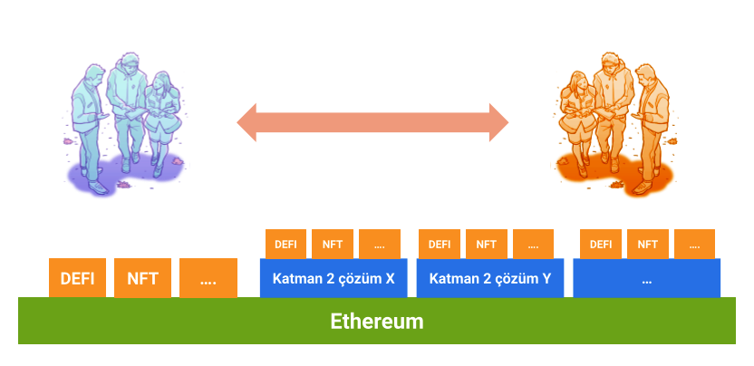
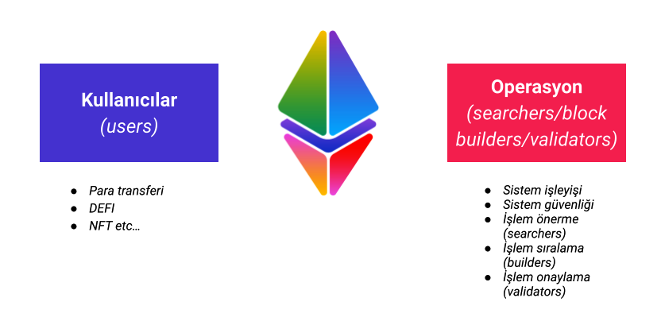
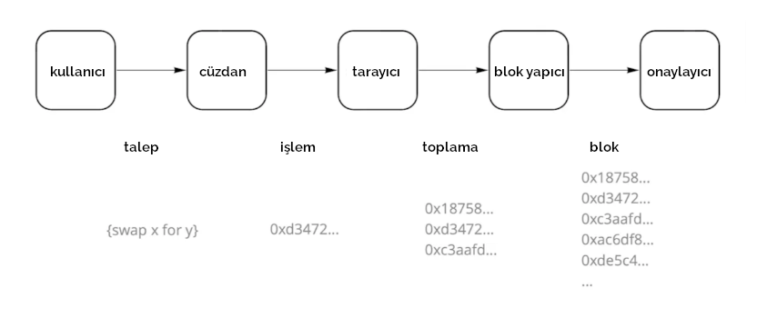
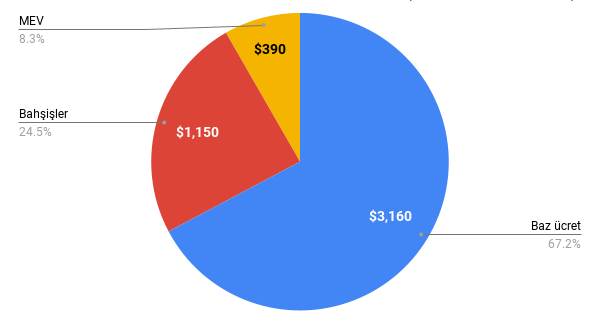
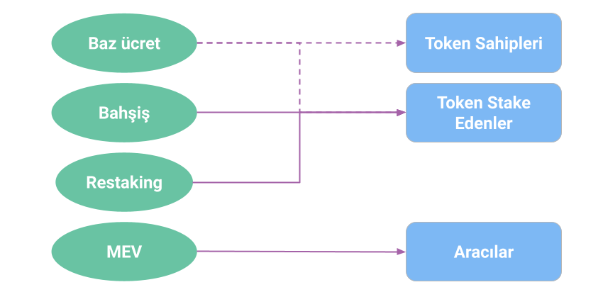
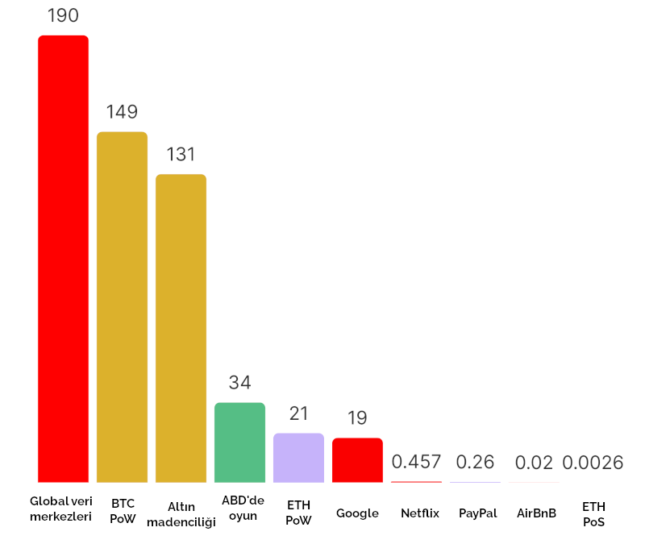
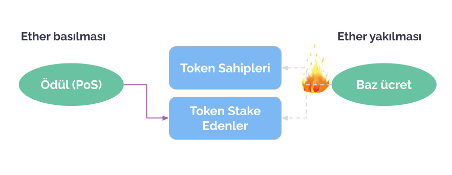
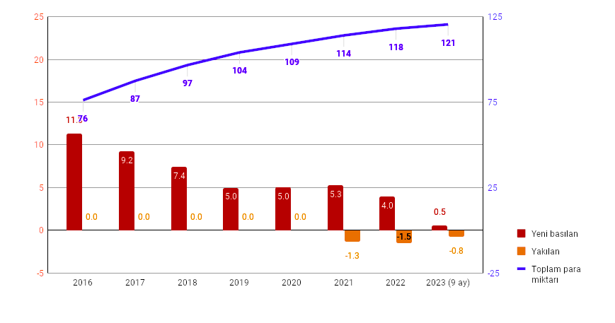
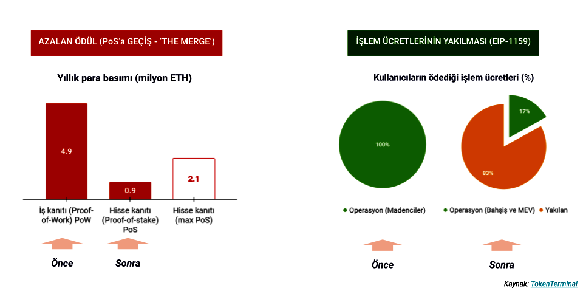
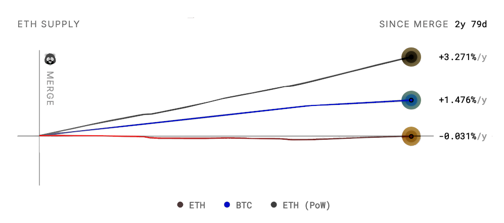

Ekonomisinin nasıl çalıştığını anlayabilmek için öncelikle Ethereum’u bir tanımlamak gerek.

## Nedir Ethereum? {#nedir-ethereum}

Akla ilk gelen soru “acaba bir şirket mi Ethereum?” oluyor ama pek öyle değil; onun yerine Ethereum’u bir ülkeye benzetmek daha uygun kaçabilir. Hatta bir adım öteye giderek, üzerinde yavaş yavaş gelişmeye başlayan ve ikinci seviye olarak adlandırılan blokzincirleri de katacak olursak, Ethereum’a eyaletlerden oluşan bir ‘birleşik devlet’ demek belki de daha doğru. Bu devletin içinde farklı farklı aktörler var. Kimler bunlar diye bakacak olursak:

<figure><figcaption>Ethereum birleşik devletleri</figcaption></figure>

*Kullanıcılar, kullandıkları uygulamalar, ikinci seviye çözümler ve en altta ana zincir ile birlikte karşınızda Ethereum birleşik devletleri*

## Ethereum sistemini kimler kullanıyor? {#ethereum-sistemini-kimler-kullaniyor}

Ethereum sisteminin en önemli aktörü kullanıcılar. Biraz daha açarsak, kendi aralarında varlık transfer eden ya da akıllı kontratlar aracılığıyla farklı uygulamalar (protokoller) üzerinde işlem yapan kişiler ya da uygulamalar. Bu kişiler yaptıkları işlem karşılığı bir ‘işlem ücreti’ ödüyorlar. İşte Ethereum ekonomisinin temel girdisi kullanıcıların ödedikleri işlem ücretleri.

Kullanıcıların işlem yapmak için kullandıkları uygulamaları Ethereum üzerinde alan kiralayan işyerleri gibi düşünebiliriz. Bu uygulamalar, merkeziyetsiz finanstan (DeFi) NFT koleksiyonlarına, dijital kimliklerden merkeziyetsiz sosyal medyaya uzanan geniş bir yelpazede kullanıcılarına hizmet veriyorlar. İşlemleri yaparken ortaya çıkan Ethereum’u kullanma bedelini (yani alan kirasını) ise uygulamalar değil kullanıcılar ödüyorlar[^1].

Kullanıcılar dışında ikinci önemli aktör, Ethereum üzerine kurulu ikinci seviye çözümler. İkinci seviye çözümleri, yukarıda bahsettiğimiz ‘birleşik devlet’ içinde bulunan eyaletlere benzetebiliriz. Bu çözümlerin her biri kendi içlerinde otonom birer blokzincir aslında. Bu blokzincirler, güvenliğinden faydalandıkları Ethereum ağına aynı kullanıcılar gibi işlem ücreti (yani alan kirası) ödüyorlar.

Peki bu ödenen ücretler nereye gidiyor? Temel olarak bu ücretler işlemlerin gerçekleşmesine aracılık eden ve sistemin güvenliğini sağlayanlara ödeniyor. Bitcoin sisteminde ve yakın zamana kadar Ethereum’da bu işi madenciler gerçekleştiriyordu. Ethereum, 15 Eylül 2022’de sistemini değiştirerek madencileri devreden çıkardı. Yerine bu işi ellerindeki ETH’yi (Ethereum zincirinin parası) sisteme rehin eden kişilere yaptırıyor (bu kişilere kısaca onaylayıcı -İngilizcesi validator- deniyor).

Ethereum’un ekonomik büyüklüğünü anlamak için sistemin yukarıdaki aktörler üzerinden kazandığı gelirlere bakmak, bizlere iyi bir fikir verebilir.

## Nedir Ethereum’un gelirleri? {#nedir-ethereumun-gelirleri}

Ethereum’un birkaç gelir kalemi mevcut. Bu kalemlere bakmadan önce Ethereum’un tam olarak ne fayda sağladığına bakmak gerekiyor. Ethereum’un sunduğu temel hizmet, dijital dünyada kullanıcıların kendi aralarında başta finansal olmak üzere her tür ilişkiyi güvenli bir şekilde yapabilecekleri bir alan sağlamak. Peki bunu nasıl yapıyor? Kullanıcılara üzerinde işlem yapabilecekleri bir blok alanı satarak.

<figure><figcaption>Ethereum blok alanını kullananlar</figcaption></figure>

*Kullanıcılar, DeFi platformları ve ikinci seviye çözümler Ethereum’un blok alanının sistemin operasyon (işleyiş ve güvenlik) görevini yürütenlere işlem ücreti öderler*

### Ethereum’un işlem gelirleri {#islem-gelirleri}

Kullanıcılar bu blok alanını kullanabilmek için bir işlem ücreti ödüyorlar. İşte bu işlem ücretleri Ethereum’un en önemli ve büyük gelir kalemi. Kişi yaptığı herhangi bir işlemin güvenli bir şekilde gerçekleştirilmesi ve değiştirilemez bir şekilde saklanması için Ethereum altyapısına bir ücret ödemek zorunda. Bahsettiğimiz işlemler bir başkasına para göndermekten, platformlar üzerinde akıllı kontrat kullanarak finansal işlemler (örneğin mevduat yatırma ya da kredi alma gibi) yapmaya uzanan geniş bir yelpazeye yayılıyor. Kısıtlı bir hizmet alanına sahip olan Ethereum sisteminde, kullanıcıların yapmak istedikleri işlemler, ilk olarak mempool diye adlandırılan bir ‘bekleme odasına’ alınır. Bu odada hangi işlemlerin hangi sıra ile gerçekleşeceğini belirlemek için bir haraç-mezat sistemi işler. Genel olarak daha yüksek ücret ödeyenlerin işlemleri sırada öne geçer. Kullanıcılar burada Ethereum’a ödenecek ‘**baz ücret**‘i yüksek tutmanın yanında sistemin işleyişini sağlayan onaylayıcılara bir parça ‘**bahşiş**’ vererek öne geçmeye çalışırlar. İşlem ücretlerinin içinde önemli bir kısım, kimi kullanıcıların işlemlerini daha hızlı yapabilmek için ödedikleri fazla ücretlerden gelir.

### Ethereum’un MEV gelirleri {#mev-gelirleri}

Kullanıcıların işlem yapmak için gönderdikleri emirleri sıraya koymak, blokları oluşturan aracıların işi. Bu aracılara, işlemleri tarayanlar (tarayıcılar) ve işlemleri blok haline getirenler (‘blok yapıcılar’) deniyor.

<figure><figcaption>Ethereum sistemi içinde değer akışı</figcaption></figure>

*Ethereum sistemi içindeki bir işlemin gerçekleşmesi için kullanılan aracılar*

Aracılar burada işlemleri sıraya koyarken, kendileri için en kârlı olacak işlemleri bloklara dahil ederler. Hangi işlemler daha kârlı olabilir?

Birincisi, yukarıda bahsettiğimiz yüksek bahşiş veren kullanıcılara ait işlemler. Bu oldukça makul ancak işin ufak bir kısmı.

Bunun yanında blok yapıcılar, havuzda duran tüm emirleri gördükleri için sıralamayı etkileyecek farklı emirleri de bloğa alabilirler. Ne gibi? Örneğin merkeziyetsiz bir borsadan ETH almak istediniz. Bir etherin fiyatı 2000 dolar olsun. Siz almak istediğinizde oluşan talepten dolayı, o borsada etherin fiyatı 2001 dolara çıktı. Blok yapıcı, sizin işleminizin arkasına bir satış işlemi koyarak elindeki etheri 2001 dolardan satıp borsadaki fiyatı tekrar 2000’e getirir. Böylece bir dolar kâr etmiş olur. Arbitraj olarak adlandırılan bu işlemler piyasanın düzenli işlemesi için fonksiyonel bir görev görür. Bu örnekteki hareketi blok yapıcı tarafından gerçekleştirilen iyi niyetli bir işlem olarak görebiliriz.

Bunun bir de ‘kötü niyetli’ olan kısmı var. Kimi zaman blok yapıcılar, sizin yapmayı planladığınız bir alım emrini görüp, bloğun içine sizin önünüze geçecek bir emir koyabilirler. Ucuzdan bir alım işlemi gerçekleştirip, size aynı tokeni daha pahalıya satarlar. İşte bu da blok yapıcılar tarafından kullanılan ‘kötü niyetli’ bir işlem olarak adlandırılır.

Kısaca **MEV geliri** (İngilizcesi ‘maksimum extractable value’ olan terimi Türkçeye ‘maksimum sağlanan değer’ şeklinde çevirebiliriz) olarak adlandırılan yukarıda saydığımız iyi ve kötü niyetli ücretler, Ethereum sisteminin yarattığı ikinci büyük gelir kalemi. Peki bu ne kadar adil bir sistem? Çok adil sayılmaz, zaten Ethereum geliştiricileri de önümüzdeki dönemde MEV’nin etkisini azaltacak bir dizi önlem hazırlıyorlar. (Sonraki bölümde bunlardan bahsedeceğiz.)

### Ethereum’un ekstra güvenlik gelirleri (restaking) {#ekstra-guvenlik-gelirleri-restaking}

Ethereum’un yarattığı bu iki ana gelir kalemi dışında, son dönemde başlayan bir başka gelir kalemi ise Ethereum’un güvenliğinden yararlanmak isteyen farklı platformlara verilecek ‘**güvenlik hizmeti**’ sayesinde kazanılacak ücretler. Henüz daha emekleme aşamasında olan bu hizmeti ilk alan platformun Eigenlayer olduğunu söylemek mümkün. Eigenlayer, platformların belirli bir ücret karşılığında Ethereum güvenliği için kullanılan (İngilizcesi stake edilen) etherlerinin kendi güvenlikleri için de kullanılmasını sağlayan (İngilizcesi restaking) bir pazar yeri.

Yukarıda bahsettiğimiz üç temel gelir kaleminin 2024 yılının ilk 11 ayındaki dağılımını aşağıdaki tabloda bulabilirsiniz.

<figure><figcaption>Ethereum gelirleri dağılımı <em>Blockworks tarafından hazırlanan grafikte verilen rakamlar üzerinden hesaplanmıştır (milyon ABD Doları). (Kaynak: Blockworks - <a href="https://x.com/smyyguy/status/1866145481564307763/photo/2">Dan Smith</a>)</em></figcaption></figure>

Bu değer kalemlerinin kimlere aktığını ise aşağıdaki tabloda özet olarak görebilirsiniz.

<figure><figcaption>Ethereum blok alanında oluşan değer nereye akıyor</figcaption></figure>

*Dört farklı şekilde oluşan gelirler kullanıcılardan aracılara doğru yukarıdaki gibi akar. Düz çizgiler direkt, kesik çizgiler ise dolaylı yoldan değer akışını gösteriyor. Örneğin baz ücretin artması, token sahiplerine direkt olarak gelir yazmıyor, ancak artan baz ücret daha fazla token yakımı demek bu da toplam token sayısının azalması ve oluşan toplam değerin daha az tokene bölünmesi anlamına geliyor.*

## Peki Ethereum’un giderleri neler? {#peki-giderleri-neler}

Ethereum’un gelirleri çok basit olarak yukarıdaki gibi. Peki bunları yaparken nasıl bir harcama yapıyor? Giderlere baktığımızda aslında çok da fazla masrafı olmadığını görüyoruz.

İşin özünde Ethereum bir ağ ve bu ağın işlemesi için tek gereken, ağı kullanan binlerce makinenin harcadığı elektrik. Bu elektrik harcaması, özellikle Bitcoin gibi madenciler üzerinden yürütülen sistemlerde oldukça dramatik bir boyutta. Ethereum ise 15 Eylül 2022’de sistemini değiştirerek (Bitcoin’in kullandığı Proof-of-Work, kısaca PoW Türkçesi ‘iş kanıtı’ sisteminden, daha yeni ağlarda kullanılan Proof-of-Stake kısaca PoS Türkçesi ‘hisse kanıtı’ sistemine geçerek) enerji tüketimini %99 oranında azalttı.

<figure><figcaption>Teknoloji alanındaki oyuncuların enerji harcaması</figcaption></figure>

*Farklı sistemlerin enerji harcamaları karşılaştırması (terawatt saat/yıl), (Kaynak: [Ethereum Foundation](https://ethereum.org/en/energy-consumption/))*

Ethereum, güvenliğini sağlamak amacıyla dış dünyaya minimal bir enerji kullanım bedeli ödüyor. Yüksek miktarda enerji harcayarak ağı koruyan Bitcoin madencilerinin yerine Ethereum sisteminin güvenliğini işlemlerin doğru yapıldığını onaylayan makineler sağlıyor (bunlara onaylayıcı İngilizcede validator deniyor). Bu makineler işlemlerin güvenliğini sağlamak için ellerinde tuttukları etherleri sisteme rehin ediyorlar. Karşılığında ise yaptıkları bu çalışma için ödül kazanıyorlar.

Onaylayıcılara verilen ödül ETH cinsinden. Bu da piyasadaki ETH miktarının artmasına neden oluyor. Bu verilen ödülün nasıl kategorize edileceği konusunda farklı görüşler mevcut. Bir yanda bunun Ethereum sisteminin bir gider kalemi olduğunu düşünenler var. Diğer yanda, piyasadaki ETH artışının Ethereum’un yarattığı değerin daha fazla ethere bölünmesi şeklinde bir etkisi olduğu, bu nedenle gider yazılmaması gerektiğini düşününen bir kesim de mevcut[^2]. Az sonra bu konuya daha detaylı değineceğiz.

Bunlar dışında, gelir kalemleri içinde saydığımız MEV, kullanıcılardan blokları oluşturanlara akan bir para olarak sistemin içinde bir gider kalemi olarak görülebilir.

## Ethereum’un parası ether (ETH) {#ethereumun-parasi-ether-eth}

ETH token sahipleri, Ethereum üzerinde yaratılan değere doğrudan ya da dolaylı şekilde sahip oluyorlar. Nasıl mı? Anlatalım:

ETH token sahiplerinin Ethereum sisteminin yarattığı değere direkt olarak sahip olabilmelerinin yolu, sistemin güvenliği ve işleyişine katkı vermelerinden geçiyor. Bunun için de Ethereum sisteminde bir onaylayıcı olmaları ve ellerindeki etheri sisteme rehin etmeleri (İngilizcesi ‘staking’ ya da ‘stake’) gerekiyor[^3].

Onaylayıcılar yaptıkları işlemler aracılığıyla iki çeşit kazanç elde ediyorlar. Bunlardan birincisi güvenliği sağladıkları için Ethereum sisteminin onlara verdiği ödül. Piyasadaki toplam ETH miktarı sistemin verdiği ödüller oranında yeni ETH basılarak artırılıyor. Bunun dışında, bir de kullanıcıların ödedikleri işlem ücretlerinin ‘bahşiş olarak verilen’ ufak bir kısmı onaylayıcılara ödeniyor. Bu para, kullanıcıdan onaylayıcıya akıyor ve piyasadaki toplam ETH miktarını değiştirmiyor.

Dolaylı yoldan elde edilen kazanç ise, verilen ücretlerin bir kısmının yakılması sonucu piyasadaki ETH miktarının azalması yoluyla oluyor. Yukarıda bahsettiğimiz ‘bahşiş’ dışında kullanıcıların ödediği tüm işlem ücretleri yakılıyor. Yani tedavülden kalkıyor.

<figure><figcaption>ETH basılması ve yakılması</figcaption></figure>

*Etherin doğuşu ve yakımının sistem aktörleri ile ilişkisi. Sol taraf sistemin bastığı parayı, sağ taraf ise sistemin yaktığı parayı göstermekte. Çizgili bağlantılar dolaylı etkiyi, düz çizgi bağlantılar ise direkt değer aktarımını göstermekte.*

Piyasadaki ETH miktarı verilen ödüller nedeniyle artıyor, kullanıcıların ödedikleri ücretlerin yakılması nedeniyle azalıyor. Peki bunun kullanıcılara nasıl bir etkisi var? ETH sayısı artınca, toplam oluşan değerden her bir ETH başına düşen pay azalıyor. Bu durumda, eğer elinde ETH tutan bir kullanıcı iseniz, sizin payınıza düşen değer de aynı oranda düşüyor. Diğer yandan, eğer tokeninizi sisteme kilitlediyseniz, ödülleri siz de aldığınız için toplam içindeki payınızı koruyorsunuz, dolayısıyla oluşan toplam değerden size düşen kısım aynı kalıyor.

Başlangıçtan bu yana piyasada bulunan ETH miktarının 2021 Ağustos’ta yakım işlemlerinin başlaması ve 2022 Eylül’de PoS sistemine geçiş sonrası nasıl değiştiğini aşağıdaki tablo net olarak açıklıyor.

<figure><figcaption>Ethereum para arzı değişimi (milyon ETH) <em>Ethereum sisteminde yıllar itibariyle para miktarının değişimi. (Kaynak: <a href="https://tokenterminal.com/resources/crypto-research/ethereum-investment-framework#the-business-model">Token Terminal</a>)</em></figcaption></figure>

Her ne kadar hâlâ toplam ETH arzının gelecekte ne olacağı bitcoin kadar belli olmasa da, en azından piyasadaki etherin yıllık artış miktarı %2.1’i ile sınırlanmış durumda. (Bu da teorik ve gerçekçi olmayan bir rakam; piyasadaki tüm etherlerin sisteme kilitlendiği ve hiç işlem yapılmadığı durumu gösteriyor. 2024 yılı Aralık ayı itibariyle toplam arzın sadece %28’i kilitli ve yakılan miktar ile birlikte piyasadaki toplam ETH miktarı POS sistemine geçiş sonrası hemen hemen aynı kalmış durumda)

### ETH için “ultra-sound money” söylemi nereden geliyor? {#ultra-sound-money-soylemi-nereden-geliyor}

Kripto dünyasının en büyüğü olan bitcoin, tam olarak tahmin edilebilir ve yıllar itibariyle azalan para arzı nedeniyle, sağlıklı bir para olarak adlandırılıyor (İngilizcesi ‘sound money’). Aslına bakarsanız bu, başı sıkışınca para arzını artıran merkez bankalarına dolaylı bir eleştiri.

Ethereum topluluğu ilk kurulduğunda isteyen herkesin üzerine program kurabileceği bir dünya bilgisayarı olma peşinde idi. Bu nedenle, bitcoine göre daha hızlı büyüyen bir para arzına sahiptiler.

Belki biraz da bu yüzden klasik yatırımcı gözünde bitcoin daha çok altına benzetilirken ETH gümüşe yakın olarak görüldü. Neden bitcoin altına benziyor? Altın bir maden olarak çok kısıtlı bir fayda sağlıyor: Belirli ürünler dışında endüstriyel bir kullanımı yok. Ancak yine de kısıtlı üretimi olması, çağlar boyunca alternatif yatırım araçlarına göre değerini koruyabilmesi nedeniyle altın hep bir değer saklama aracı olarak görüldü. Bu nedenle objektif olarak ileride getirebileceği değerin çok daha üstünde bir değerden işlem gördü. (Buna ekonomi dünyasında “parasal prim” İngilizcesi ‘monetary premium’ deniyor.) Bitcoin de benzer şekilde temel işlev olarak para transferinde çok kısıtlı olarak kullanılsa da sınırlı arzı ve alternatif yatırım araçlarına olan güvenin azalması (ya da portföy çeşitlendirme) nedeniyle dijital altın olarak değerlendirilip primli olarak işlem görüyor.

Ethereum ise başlangıçtan beri daha çok gümüşe benzetiliyor, zira bitcoin kadar sınırlı ve tahmin edilebilir bir arza sahip değil. Bir yandan da ether, aynı gümüşün endüstride kullanılması gibi finansal faaliyetlerde kullanılabiliyor. Böyle olunca ethere biçilen değer daha çok kullanımının ortaya çıkardığı nakit akımlarına bağlı olarak ölçülüyor.

Ethereum topluluğu kuruluşunda ilk olarak işin teknolojisine odaklanıp para tarafını ihmal etmişti. Zamanla altyapılar oturmaya başladıkça yaptıkları geliştirmeler ile etherin para politikasında ciddi değişiklikler yapmaya başladılar.

Öncelikle para arzının temel nedeni olan madencilere verilen ücretlerin önemli bir kısmını Ağustos 2021’de uygulamaya koydukları bir geliştirme ile (EIP-1559) yakmaya başladılar. Sonrasında, Eylül 2022’de başlayan PoS sistemi ile madencilere verilen ödülü toptan kaldırıp, bunun yerine onaylayıcılara daha önce madencilere verdiklerinin altıda biri kadar ödül vermeye başladılar.

<figure><figcaption>Ethereum para arzında yapılan iki büyük iyileştirme</figcaption></figure>

*Ethereum sisteminde gerçekleşen iki büyük değişim. (Kaynak: [Token Terminal](https://tokenterminal.com/resources/crypto-research/ethereum-investment-framework#the-business-model))*

Devrim niteliğindeki bu iki gelişme sonrası ETH arzı, BTC’nin çok daha altında gelmeye hatta pek çok zaman eksiye dönmeye başladı. Yani ETH sadece gümüş gibi işlevsel bir maden olmanın ötesinde altın gibi kısıtlı bir madene dönüşmeye başladı. İşte bu nedenle, Ethereum topluluğu içinde bir grup “Eğer Bitcoin’e sağlıklı para (sound money) diyorsanız, ETH’ye ‘ultra-sağlıklı para’ (ultra-sound money) demelisiniz” şeklinde bir söylem geliştirdi.

<figure><figcaption>ETH ve BTC’nin Ethereum’un birleşmesi sonrası para arzı</figcaption></figure>

*Ethereum ve Bitcoin para basımının, Ethereum PoS sistemine geçtikten sonraki dönem için karşılaştırması. Beyaz çizgi Ethereum PoS sistemine geçmeseydi yaşanacak artış miktarını, mavi çizgi ise PoS sistemine geçtikten sonra yaşanan artış miktarını gösteriyor. Mavi çizginin eksiyi göstermesi sistemin bastığından daha fazlasını yaktığını yani sistemdeki paranın (ETH) azaldığını gösteriyor. Ortadaki turuncu çizgi ise Bitcoin’in toplam arz artış oranı. (Kaynak: [Ultrasound Money](https://ultrasound.money/))*

Şaka (İngilizce ‘meme)’ olarak başlayan bu söylemin arkasında önemli bir mantık var aslına bakarsanız: Ethereum PoS sistemine geçtikten sonra, sistemin güvenliğini etherlerini rehin veren onaylayıcılar sağlıyorlar demiştik. ETH ne kadar ultra-sağlıklı para olarak kabul edilirse, üzerindeki parasal prim o kadar artacak. Bu artış etherin değerini artıracak. Etherin artan değeri, Ethereum sisteminin güvenliğini de artırmış olacak. Artan güvenlik ile birlikte Ethereum üzerine kurulu daha fazla uygulama ve ikinci seviye ağ göreceğiz. Bu uygulamaların Ethereum ana ağını kullanması ETH’ye olan talebi artıracak. Bu ETH’lerin bir kısmı işlem ücreti olarak yakılacak. ETH geliştiricilerinin beklentisi, bu döngünün kendi kendini besleyecek şekilde büyümeye devam etmesi yönünde.

## Ethereum’da önümüzdeki dönem neler getirecek? {#onumuzdeki-donem-neler-getirecek}

Önümüzdeki dönemde Ethereum ekosistemi, ölçeklenme, maliyetleri azaltma ve sansüre karşı daha merkeziyetsiz bir hale gelme konusunda çalışmalar yürütüyor. (Yapılan tüm çalışmaların yol haritasını Ethereum kurucusu Vitalik Buterin'in 2023 yılı sonunda yayınladığı [diyagramda](https://x.com/VitalikButerin/status/1741190491578810445) görebilirsiniz. Daha ayrıntılı açıklamalar içinse 2024 yılı sonunda paylaştığı [bir dizi makaleye](https://vitalik.eth.limo/general/2024/10/14/futures1.html) de göz atabilirsiniz.)

Gelin şimdi tek tek bu iyileştirmelerin önce teknik olarak ne işe yarayacağına, sonra da varsa ETH'nin para politikasına nasıl bir etki yapacağına bakalım. İlk konumuz ölçeklenme.

### Ölçeklenme ve maliyetlerin azaltılması {#olceklenme-ve-maliyetlerin-azaltilmasi}

#### Ölçeklenme: teknik olarak {#teknik-olarak}

Ölçeklenme, Ethereum'un geniş kesimlere ulaşan bir altyapı olmasının önündeki en büyük engel. Ethereum, ileride oluşabilecek yoğun talebi karşılamanın yolunu, üzerine gelecek yükü ikinci seviye çözümlere atmakta bulmuş durumda. Bu nedenle, Ethereum geliştiricilerinin şu an için odaklandığı temel geliştirmeler, ikinci seviye çözümlerin işlem maliyetlerini azaltmaya yönelik.

İkinci seviye çözümlerin temel masraf kalemi, üzerlerinde kullanıcılar tarafından yapılan binlerce işlemi Ethereum blokzinciri üzerine aktarma sırasında kullandıkları alan için ödedikleri ücret. Ethereum geliştiricileri, 13 Mart 2024 tarihinde uygulamaya aldıkları temel bir geliştirme ile (EIP-4844) ikinci seviye çözümlerin Ethereum'a aktarmaları gereken veri miktarını ciddi şekilde azalttılar. Hedef, bu sayede ikinci seviye çözümlerin saniyede 100,000 işlem yapmasına olanak verecek bir altyapı olmak.

Blokzincirlerin sağladığı en önemli faydalardan bir tanesi, geçmişe yönelik olarak işlemlerin kaydının değiştirilemez bir şekilde saklanıyor olması. Ethereum blokzinciri de kendi üzerinde geçmişte yapılmış tüm işlemlerin kaydını tutuyor. Sistem bunu sadece kendi üzerinde yapılan işlemlerden değil, ikinci seviye çözümlerden de aynı şekilde istiyor. Yani onlara “kendi üzerinizde yapılan tüm işlemlerin kayıtlarını bana aktarmalısın” diyor. Ve bu bilgi, Ethereum üzerindeki binlerce makinede tutuluyor. Halbuki, ikinci seviye çözümler için bu bilgilerin geçmişe yönelik o kadar detaylı tutulmasına gerek yok, bu işlemlerin doğru olduğunu gösteren basit kanıtların tutulması yeterli[^4].

Yukarıdaki geliştirmeler tamamlandıktan sonra daha uzun vadede ölçeklenme konusunda planlanan iki önemli geliştirme var. Bunlardan birincisi, ikinci seviye çözümlerin yanı sıra, Ethereum'un kendisi üzerindeki işlemleri de çok basit hale getirmek. Burada temel olarak amaçlanan, yeni gelişen teknolojiler (örneğin SNARK) sayesinde, onaylayıcıların üzerindeki işlem yükünü almak. Bu sayede, Ethereum ana sisteminin çok daha fazla kapasiteye sahip olması amaçlanıyor. Öyle ki, bir noktada sistem üzerindeki her bir onaylayıcının, ikinci seviye bir çözüm gibi yüzlerce işlemi bir anda yapabilmesi mümkün olabilecek. Bir diğer bakış açısıyla, şu an dışarıda olan ikinci seviye çözümlere benzer Ethereum içi ikinci seviye çözümler gelecek (Ingilizcede enshrined roll-up denen, sisteme işlenmiş çözümler)[^5].

İkinci geliştirme ise, onaylayıcılar üzerindeki yükü daha da azaltmayı planlıyor. Şu anki durumda, onaylayıcılar onaylamak üzere oldukları bloğun tamamını kontrol etmek zorundalar. İleride DAS (data-availability-sampling) denilen bir sistem ile artık bloğun ufak bir kısmını onaylayarak doğruluğunu kontrol edebilecekler.

Bu iki geliştirme ile onaylayıcıların üzerindeki yük azalıyor. Ne demek tam olarak bu, neye yarar? Onaylayıcıların üzerindeki yükün azalması demek, onaylayıcı olmak için gerekli makine gücünün azalması demek (örneğin, yüksek işlem kapasitesi gerektiren pahalı bir makine yerine akıllı bir saat kullanarak bile onaylayıcı olabilmek). Bunun da getireceği en büyük artı, sistemi yürütebilen daha fazla makine olması, bunun da sistemi daha merkeziyetsiz hale getirmesi. Bu, uzun vadede gerek büyüme gerekse sansüre dayanıklılık için olmazsa olmaz bir koşul.

#### Ölçeklenmenin ETH para politikasına etkisi {#eth-para-politikasina-etkisi}

Yukarıda yapılan iyileştirmelerin, ikinci seviye çözümlerin Ethereum’a ödeyeceği ücretleri düşüreceğini söyleyebiliriz. İyi de o zaman neden Ethereum geliştiricileri sistemin gelirlerini azaltacak bu iyileştirmeler için bu kadar çaba sarf ediyorlar? Bunun birkaç nedeni var.

Birincisi, Ethereum'un geçmişte yaşadığı sıkışıklıkların işlem ücretlerini ne kadar artırdığının görülmesi.

Ethereum geliştiricileri, bu tip bir sıkışıklığın önümüzdeki dönemde tekrarlanması durumunda kullanıcıların farklı ağlara kaçacağının farkındalar. Zira, onların beklentisi kullanıcı sayılarının yüz hatta binlerce kat artması. Bunu Ethereum üzerinde gerçekleştirmeleri mümkün olmadığı için işlem yükünü ikinci seviye çözümlere atmaya çalışıyorlar. İkinci seviye çözümler ise ancak işlem maliyetleri azalırsa bu yükü almaya razı olacaklar. Neden? Çünkü kullanıcıları kendilerine ancak düşük işlem ücreti uygularlarsa çekebilirler, bunun için de kendilerinin Ethereum’a ödeyecekleri ücretin (yani masraflarının) aynı oranda düşük olması gerekiyor. Burada karşılıklı bir çıkar ilişkisi söz konusu.

İkincisi, Ethereum geliştiricileri artık ağırlıklı olarak altyapı çözüm tarafına odaklanmış durumdalar. Kullanıcı perspektifinden uygulamaların geliştirilmesi kısmını ikinci seviye çözümlere bıraktıkları söylenebilir. Burada da olabildiğince çok ikinci seviye çözümün uygulamaya konmasının rekabeti artıracağını görüyorlar. Yeni ikinci seviye çözümler de ancak maliyetler azalırsa ortaya çıkar; geliştiriciler bunun da farkındalar.

Öte yandan Ethereum, ikinci seviye çözümleri bir anlamda kendisi için ücretsiz bir deney laboratuvarı olarak da görüyor. Girişim sermayesi parası ile desteklenen ikinci seviye çözümler, aralarındaki rekabet nedeniyle gerekli iyileştirmeleri hızlı bir şekilde yapıp yürürlüğe koyuyorlar. Bu geliştirmeler, ikinci seviyede kullanılıp olası potansiyel sorunlar giderildikten sonra birinci seviye için uyarlanabilir bir hale gelecekler.

Ethereum geliştiricilerinin ölçeklenme ile birlikte üzerinde çalıştıkları bir diğer konu ise MEV sorununu nihai bir çözüme kavuşturmak.

### MEV sorunu/konusu {#mev-sorunu-konusu}

#### MEV sorunu: teknik açıdan {#teknik-acidan}

Yukarıda ilk kısımda bahsettiğimiz MEV konusu Ethereum üzerinde bir kambur oluşturuyor. MEV sisteme iki yönden zarar veriyor. Birincisi, kullanıcıların yapmaya çalıştıkları işlemlerden elde edecekleri kârı azaltıyor. İkincisi ise MEV'i yaratan blok yapıcılarına aynı zamanda gelen işlemleri sansür edebilme gücü veriyor.

Bunu çözebilmek için geliştiriciler işlemlerin onaylanması sırasında çalışan aktörleri olabildiğince rekabet içine sokmaya çalışıyorlar. Kullanıcılar tarafından havuza düşen işlemleri yürürlüğe koyanlar ile işlemleri gerçekleştirenler şu aşamada ortak çalışıyorlar. Blok oluşturanların temel amacı, blok üzerinden elde edecekleri kârı maksimize ederek cebe atmak. Şu an için üzerinde çalışılan geliştirme ile (blok oluşturmayı öneren ile blok yapanların ayrılması, İngilizcesi ‘proposer-builder separation’ kısaca PBS) bu iki kesim arasındaki rekabetin artırılması planlanıyor.

Rekabeti artırmanın yanında, işlem havuzuna (bir deyişle bekleme odasına) düşen işlemlerin şifrelenmesi, blok yapıcıların sansür uygulama gücünü ortadan kaldıracak.

#### MEV sorununun ETH para politikasına etkisi {#eth-para-politikasina-etkisi-2}

Yukarıdaki geliştirmelerin toplu adı olan PBS uygulamasının ETH para politikasına çok net bir etkisi olacak. Zira PBS ile planlanan MEV ile ortaya çıkan gelirin paylaşımının değiştirilmesi. Birincisi bu gelirin önemli bir kısmının, rekabet nedeniyle blokları oluşturanların değil işlemleri onaylayanların yani ETH'yi stake edenlerin cebine gitmesi. İkincisi ise bu gelirlerin kalan kısmının yakılması. Dolayısıyla, şu an için tüm geliri cebine atan blok oluşturucularının gelirin sadece ufak bir kısmını alacak olması.

Bu sayede hem ETH stake edenlerin geliri artacak, hem de MEV burn ile piyasadaki ETH'nin sayısında azalma olacak.

### Kullanım kalitesinin artırılması {#kullanim-kalitesinin-artirilmasi}

Yukarıda bahsettiğimiz gibi, esasında Ethereum bir altyapı olarak kullanıcı ile ilgili konulardaki geliştirmeleri ikinci seviye çözümlere bırakma niyetinde. Yine de, belli standartların oturtulması amacıyla kimi geliştirmelerin Ethereum seviyesinde yapılması, ağın geniş kesimlerce kullanılması için oldukça önemli.

Bu geliştirmelerin en önemlisi Account Abstraction (AA) olarak adlandırılan hesap soyutlama. Oldukça teknik olarak görülebilecek bu geliştirme en basit anlatımı ile, kullanıcıların hesaplarını on-iki kelime ile koruyan sistemin getirdiği zorlukları ortadan kaldırma amacını taşıyor. On iki kelimeyi kaybetmenin sonucu hesaplara erişimin de kaybedilmesi korkusu bana sorarsanız, önemli bir kesimin kişisel cüzdan kullanmamasının en önemli nedenlerinden. AA ile hesapların birer akıllı kontrat haline gelmesi ve kullanıcının farklı mekanizmalar ile hesaplarına erişim imkanının verilmesi (örneğin; e-mail, touchID ve FaceID gibi çözümler ile cüzdana erişim) Ethereum'un geniş kesimlerce kullanılmasının önündeki en büyük engellerden birini ortadan kaldıracak.

[^1]: Uygulamaların Ethereum’a ücret ödediği yerler var tabii ama bunlar işlemlerin yanında daha küçük boyutta. Örneğin, uygulamanın yazıldığı akıllı kontratın Ethereum sistemine işlenmesi ya da uygulama tarafından kullanıcılara gönderilen her tür varlık (örneğin airdroplar) gibi.

[^2]: Ethereum’un para artışını merkez bankasının para basarak emisyonu artırması ya da bir şirketin hisse çıkarması şeklinde düşünebiliriz. Aynı şekilde ETH yakılmasını merkez bankasının piyasadan para çekmesi ya da bir şirketin kendi hisselerini satın alması (İngilizcede buy-back) şeklinde değerlendirebiliriz.

[^3]: Onaylayıcı olmak en az 32 ETH kilitlemek gibi bir minimum kapital ile sürekli çalışacak bir makine sahibi olmak ve Ethereum ağına bağlanacak uygun yazılımları yüklemek gibi teknik yetkinlikler gerektiriyor. Kullanıcılar bunun yerine belli bir ücret karşılığı (%5 ile %25 arası değişen komisyonlar ile) daha az miktarda ETH vererek likit staking tokenler aracılığıyla da ETH staking gelirinden faydalanabiliyorlar.

[^4]: Bu çözümlerin Ethereum'a gönderdiği işlemlerin doğruluğu için iki farklı standart var. Bunlardan biri Arbitrum, Optimum gibi sistemlerin kullandığı 'yedi gün boyunca itiraz edilmeyen işlemler doğru sayılır' prensibi. Diğeri ise zk (zero-knowledge) sistemlerin kullandığı, işlemlerin doğru olduğunun matematiksel olarak kantılanması prensibi. Her iki sistem için de kanıtların tutulması yeterli.

[^5]: Burada hemen akla, "o zaman ikinci seviye çözümler ıskartaya mı çıkacak?" sorusu gelebilir. Tam olarak öyle değil. Enshrined roll-up çözümleri, dışarıda kurulu ikinci seviye çözümlere göre çok daha güvenilir olacak - orası kesin. Ancak, bu çözümler Ethereum sistemine bire-bir bağlı oldukları için çok limitli olacaklar. Dışarıdaki ikinci seviye çözümler çok daha esnek hizmetler sunabilecekler. Örneğin, enshrined-rollup çözümler Ethereum'un kendi sanal işletim makinesini (EVM) kullanırken, ikinci seviye çözümler çok daha gelişmiş işletim makineleri kullanabilecekler.
