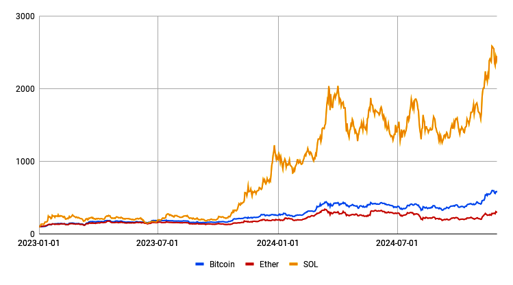
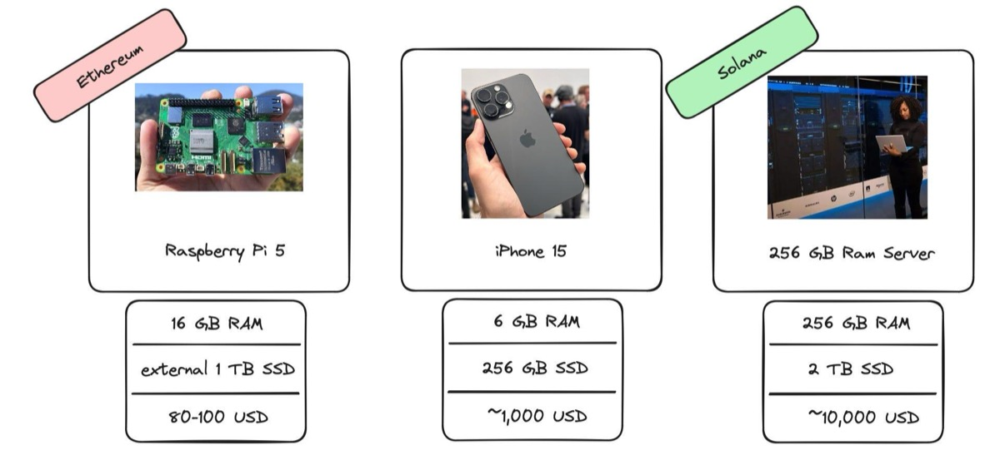
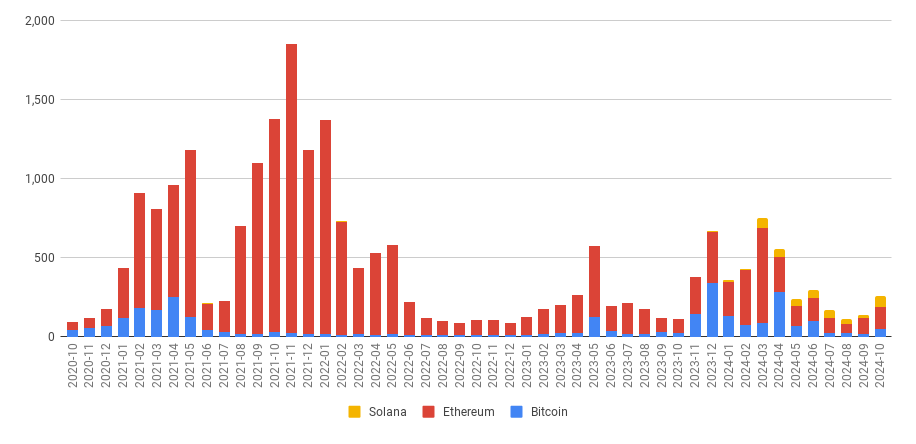

Bu kısımda, piyasanın en büyük üç oyuncusunun son dönem performanslarına bakıp, bizi gelecekte nelerin beklediğini anlamaya çalışacağız.

## Son dönemde neler yaşadık? {#son-donemde-neler-yasadik}

2020 ve 21 yıllarında yaşanan boğa sonrası 2022 yılında Terra Luna ekosisteminin ‘patlaması’ ile başlayan ve merkezi kredi verme kuruluşlarının ve FTX borsasının batışı ile doruğa çıkan ayı piyasası, 2023 yılı sonlarına doğru içine girdiği derin uykudan yavaş yavaş uyanmaya başladı.

2023 yılının son aylarındaki fiyat hareketlerine baktığımızda, Ethereum ağının parası olan etherin (ETH), Bitcoin sisteminin parası olan BTC (bir başka deyişle ‘bitcoin’[^1]) ile Solana sisteminin parası olan SOL’un gerisinde kaldığını görüyoruz.

<figure><figcaption>Bitcoin, ETH ve SOL fiyat grafiği <em>Üç büyük ağın 2023-2024 içindeki fiyat grafik değişimi. Karşılaştırma yapabilmek için 2023 yılı 1 Ocak tarihi 100 olarak alındı. (Kaynak: <a href="https://www.coingecko.com/en/coins/ethereum/historical_data?start=2022-12-31&amp;end=2024-01-05,#panel">CoinGecko</a>)</em></figcaption></figure>

Peki neden böyle bir performans ile karşılaştık? Neden bitcoin ve SOL hızlı hareket ederken ETH geride kaldı?

İlk olarak, kriptopara piyasalarının hâlâ emekleme aşamasında olduğunu ve klasik yatırım ürünlerinde bakılan temel kriter olan ‘yaratılan değer’ kavramının bu piyasalarda henüz oluşmadığını belirtmek gerek. Bu durum kripto piyasalarını spekülatif hareketlere çok daha duyarlı bir hale getiriyor. Spekülatif piyasaların ihtiyacı olan ‘mazot’ ise ‘söylem’ (ingilizcesi ‘narrative’). Peki yukarıda bahsettiğimiz üç kriptopara yatırımcılarına son dönemde nasıl bir söylem sundu?

Piyasanın lideri ve ağır abisi olan Bitcoin’in işi nispeten kolay. Öncelikle, bitcoin anlaşılması oldukça basit bir ürün. Odak noktası tek: Herkesin istediği şekilde kullanabileceği bir ‘dijital altın’ olmak. Bu herkesin anlayabileceği ve üzerinde rahatça birleşebileceği bir söylem. Teknik olarak kavramanın ‘zor’ olduğunu iddia edebilirsiniz ama orada da zaman bitcoin lehine işliyor. Tam 14 yıldır etrafta olan, arkasından binlerce kez ‘öldü’ söylentileri çıkan ama her seferinde inadına bir hamamböceği gibi ayakta kalan bir kriptopara var karşımızda. Böyle olunca da açıkçası insanlar işin teknik kısmına çok da bakmıyorlar.

Yatırımcıların bir ürünü değerlendirirken ikinci baktıkları konu ise beklentiler. İşte bitcoin kolay anlaşılabilir olma söyleminin yanına son dönemde üç temel beklentiyi koymayı başardı.

Bunlardan ilki, hükümetlerin para politikalarının sürdürülebilir olduğuna duyulan inancın azalması. Covid sonrası yaşanan parasal genişlemeyi takip eden daralmanın dozunun kaçmakta olduğu sıkça konuşulur oldu. Yeni bir genişleme olasılığında da piyasada alternatif bir yatırım aracı olan bitcoine talebin artacağı beklentisi oluşmuş durumda.

Bunun yanına özellikle kısa vadede ABD’de bitcoin spot ETF’lerine izin verilmesi beklentisinin eklendiğini belirtelim. 2013 yılından beri yapılan her tür ETF başvurusunu inatçı bir şekilde reddeden SEC’nin (yani ABD’nin sermaye piyasaları denetleyen kurulu), 2023 yılı yazında mahkemede kaybettiği Grayscale davası sonrası artık manevra alanı kalmamış gibi görünüyordu. Nitekim 2024 yılı Ocak ayı başında SEC Bitcoin ETF’lerini onaylamak ‘zorunda kaldı’. Sonrasında ise ETF’lere ciddi bir para girişinin olmasının Bitcoin fiyatına etki ettiğini gördük.

Üçüncü konu ise, 2024 Nisan ayında yaşanan Bitcoin yarılanması olayı. Her on dakikada bir verilen bitcoin ödüllerinin yarıya inmesi, piyasaya yeni girecek bitcoin miktarını azalttı. Ödül kazanmak için ciddi miktarda masraf yapan madencilerin bir kısmının bu masrafları karşılamak için kazandıkları ödülleri satmaları bitcoin üzerinde sürekli bir satış baskısı oluşturuyor[^2]. Ödülün yarıya inmesinin bu satış baskısını kırması bekleniyor. Bu arada, dört yılda bir gerçekleşen yarılanma nedeniyle gitgide azalan ödüllerin uzun vadede madenciliğin cazibesini azaltması tehlikesi de bulunuyor. Sistemin güvenliğini ve işlerliğini sağlayan madencilerin işi bırakması Bitcoin ağı için sıkıntı yaratabilir. Neyse ki, 2022 yılının sonlarına doğru ortaya çıkan Ordinals furyası sırasında Bitcoin ağı üzerindeki işlem miktarının ve alınan komisyonların artması, bu alandaki kaygıları bir parça dindirmiş görünüyor. (Ordinals ve Bitcoin üzerinde ‘yeşermeye’ başlayan ikinci seviye çözümlere ilerleyen satırlarda detaylıca değineceğiz).

## Yükselen yıldız SOL {#yukselen-yildiz-sol}

2023 yılında bu üç kriptopara içinde en büyük sürprizi Solana yaptı. Aslına bakarsanız, en koyu Solana taraftarları bile yılın başında böyle bir çıkışı beklemiyordu. 2021 yılı boğasının önemli oyuncularından olan SOL, sonraki ayı döneminde tüm kriptopara piyasası gibi bir düşüş yaşadı.

Ne var ki, Solana’nın acıları bununla da kalmadı; en büyük destekçisi olan FTX ve sahibi Sam Bankman Fried’in 2022 yılı Kasım ayında batması SOL’a derin bir darbe vurdu. Bir ara var oluşu sorgulanır hale gelen Solana, topluluğunun yoğun çabası ile ayakta kalmayı başararak ‘seni öldürmeyen güçlendirir’ sözünün canlı bir örneği haline geldi.

Yaptığı teknik geliştirmeler ile geçmiş yıllarda yaşadığı ‘ağın durması’ gibi sorunları da atlatan Solana, sonrasında yeni boğanın öncülerinden oldu. Bu liderliğin birkaç temel nedeni var ama en önemlisi Solana’da işlem yapmanın hem ucuz hem de hızlı olması. Bu sayede Solana, bir yanda piyasaya yeni girenlere rahatça işlem yapabilecekleri bir deneme alanı sunarken; diğer yanda spekülasyon için piyasada bulunan deneyimli oyuncuların daha fazla sayıda işlem yapabilmesine olanak veriyor. Bu hareketlilik, piyasaya yeni token çıkarmak isteyenlere tam aradıkları ortamı sağlıyor. Özellikle, ‘airdrop’ dediğimiz ‘uygulamalar ile etkileşime girme karşılığı alınan teşvik ödülleri’ ağa yeni kullanıcıların gelmesine yol açarak oluşan döngüyü tamamlıyor. Bu konuda Solana’nın çıkardığı cep telefonu sahiplerine bedava dağıtılan BONK ile ağın en önemli projelerinden Jupiter tarafından kullanıcılara verilen JUP tokenlerin gösterdiği performans Solana ağının büyümesine ciddi katkı sağladı.

Solana’nın yükselişinin daha ne kadar devam edeceğini ya da bu performansın uzun vadede sürdürülebilir olup olmadığını hep birlikte göreceğiz.

## BTC ile SOL arasına sıkışan ETH {#btc-ile-sol-arasina-sikisan-eth}

Bitcoin’den sonra ikinci büyük ağ olan Ethereum ve parası ETH (ether) 2020-21 yıllarındaki boğa piyasasının en gözde araçlarından biri olmuştu. Ne var ki, geçtiğimiz yılın sonuna doğru yaşanan yükselişte etherin BTC ve SOL’un gerisinde kaldığını gördük. Bu fark bir ara o kadar dramatik bir hal aldı ki, bundan birkaç yıl öncesinin ”Ethereum’un toplam değeri Bitcoin’i geçer mi?” tartışmalarının yerine bir noktada ‘Solana’nın toplam değeri Ethereum’u geçer mi?’ sorularının ön plana çıktığını gördük.

Peki durum ETH için o kadar kötü mü gerçekten? Gelin dilerseniz konuyu daha iyi anlamak için ilk olarak etheri rakipleri olan BTC ve SOL ile bir karşılaştıralım:

Öncelikle, söylem açısından Ethereum’un BTC ve SOL’un gerisinde kaldığını kabul edelim. Bitcoin, ‘dijital altın’ gibi basit ve anlaşılır bir söylem kullanırken, Ethereum’un ‘herkesin ulaşabildiği bir dünya bilgisayarı’ olma hedefi küçük yatırımcıda karşılık bulmuyor. Ethereum’un ileride bu hedefe ulaşmak için gerçekleştireceği pek çok geliştirme bulunsa da, bu teknik iyileştirmeler küçük yatırımcı için bir anlam ifade etmiyor.

Öte yandan, Ethereum sistemi Solana kadar ucuz değil. Ethereum üzerinde hâlâ büyük bir talep olsa da, Ethereum geliştiricileri merkeziyetsizlikten ödün vermemek için sundukları blok alanını kısıtlı tutuyorlar.

<figure></figure>

*Ethereum ile Solana çalıştıran makinelerin kapasite farkları. (Kaynak: [Florin Digital](https://florindigital.substack.com/p/verifiable-off-chain-compute-enabling))*

Fiyatları ucuzlatmanın bir yolu blok alanını büyütmek ancak büyüyen blok alanı sistemi yürütecek makinelerin donanım gereksinimini artırıyor. Bu durum daha az makinenin blokzincir yazılımını çalıştırabilmesi ve sonuç olarak sistemin merkezi hale gelmesine neden olabilir. Merkezi sistemlerin uzun vadede sansüre karşı dayanıklılık konusunda sıkıntıları ortaya çıkıyor.

Sonuç olarak Ethereum, kendine tek bir amaç edinmiş Bitcoin’in net söylemi ile, ucuz işlem ücretlerini ön plana çıkaran Solana’nın söylemi arasında sıkışmış görünüyor.

Peki çözüm yolu var mı, yoksa etherin geleceği karanlık mı?

## Etherin geleceği karanlık mı? {#etherin-gelecegi-karanlik-mi}

Bu soruya cevap verebilmek için Ethereum’un uzun vadeli stratejisini anlamak bize yardımcı olabilir. 2013 yılında kurulan Ethereum, yakından takip edenler için yavaş ama bir altyapı ağı olarak oldukça hızlı sayılabilecek birkaç büyük değişim yaşadı. Bunların en önemlisi, Bitcoin benzeri enerji harcamak üzerine kurulu güvenlik sistemini değiştirmesi oldu. İkinci büyük stratejik hamlesi ise, odak noktasını altyapıları geliştirmeye çevirmek ve kullanıcı ile etkileşimi ikinci seviye blokzincirlere bırakmak oldu[^3].

Ethereum bu ikinci stratejik hamle ile kısa vadeye oynamak yerine uzun vadeye odaklanmayı seçti; şimdi de bunun sancıları ile boğuşuyor. Şu an için Ethereum’un temel odağı, üzerinde kurulu her zincire eşit şekilde yaklaşan ve kullanıcılarının o zincirlerde tutacakları paraları güvenli bir şekilde saklayan bir altyapı olmak[^4]. Eğer kısa vadeye oynamayı seçseydi, blok alanını büyüterek işlem ücretlerini ucuzlatabilirdi ama o zaman uzun vadede yukarıda bahsettiğimiz merkezilik sıkıntısını yaşayabilirdi.

Merkezilik kullanıcılar için belki de şu aşamada çok bir anlam ifade etmiyor. Onlar daha çok ucuz işlem yapmanın ve yüksek getirinin peşindeler. Oysa ki, merkezi olmak bir ağı sansüre açık hale getiriyor. Eğer herkesin kullanımına açık nötr bir ağ olma hedefinde iseniz merkeziyetsizlikten ödün veremezsiniz. Aksi takdirde, birilerinin ‘doğru’ saydığını kabul edip ‘yanlış’ saydığını sansürlemeye başlarsınız. O zaman da şu soru ortaya çıkar: Kime göre doğru, kime göre yanlış? Bunun kararını bir altyapı olarak ağın vermemesi gerekir.

Ethereum geliştiricilerinin şu anki önceliği son kullanıcıya ucuz işlem yaptırmak ama bunu Ethereum ağında değil ikinci seviye çözümler üzerinde gerçekleştirmek. Örneğin, Ethereum üzerinde 2024 Mart ayında uygulamaya konan Dencun geliştirmesi ile ikinci seviye çözümlerin Ethereum’u kullanma maliyetleri ondan birine indi. Bu sayede, maliyetleri azalan ikinci seviye çözümlerde, kullanıcıların çok daha ucuza işlem yapabilmesinin yolu açıldı.

Yukarıdaki söylemin son kullanıcı açısından bir albenisi yok. Yeni gelen bireysel bir yatırımcının Ethereum ağını kullanması çok zor, zira işlem ücretleri inanılmaz yüksek. Öte yandan bu söylemin küçük yatırımcıda değil ama kurumsal yatırımcıda ciddi bir karşılığı var. Zira, Ethereum yüksek işlem ücreti uyguluyor ama bir yandan da yoğun bir şekilde kullanılmaya devam ediyor. İşlem ücretleri düşse bile üzerine kurulu onlarca ikinci seviye çözüm sayesinde kullanımı daha da artacak. Kurumsal yatırımcı için klasik anlamda gelir getiren bir ağ Ethereum. **Dolayısıyla Ethereum artık büyük yatırımcılara ve ikinci seviye ağlara hizmet veren bir altyapı haline dönüşüyor**.

<figure><figcaption>Bitcoin, Ethereum ve Solana aylık toplam işlem ücretleri</figcaption></figure>

*Üç büyük ağda son dört yılın aylık işlem ücretleri (milyon ABD Doları). (Kaynak: Dune Analytics-[@sankin](https://dune.com/queries/3275250/5482283))*

Kurumsal yatırımcılar öncelikle beklenti olarak daha net söylemler içeren bitcoine yöneldiler. Bitcoin ETF’lerinin onaylanması sonrası ise bu yatırımcıların gözü Ethereum ETF’lerinin onayına çevrildi. Bu da SEC’nin her tür diretmesine rağmen Temmuz 2024’de gerçekleşti.

Bununla birlikte kurumsal tarafta Ethereum’a ilgiyi artırabilecek birkaç gelişme daha var. Ethereum ağında planlanan yeni geliştirmeler ile ikinci seviye çözümlerin Solana benzeri rakipler ile işlem ücret açısından yarışabilir hale gelmesi sağlanacak. Bunun yanında Ethereum’un rehin edilmesi halinde yatırımcıya bonoya benzer ciddi bir getiri kazandırma özelliği var. Buna bir de, son zamanlarda popüler olan rehin edilen etherlerin aynı zamanda başka platformlarda kullanılarak ekstra getiri sağlanması özelliğini (ingilizcede buna ‘restaking’ deniyor) ekleyin.

Şimdi yukarıdaki iki söylemi düşünün. Bir tarafta airdrop ve hızlı token performansının getirdiği yüksek kazançlı ama bir o kadar da riskli ve uzun vadede sürdürülebilirliği soru işareti olan bir ağ. Diğer tarafta, daha ağır ama emin adımlarla ilerleyen ve yatırımcısına somut getiriler sağlayan bir ağ. Küçük yatırımcının tercihinin birinci, kurumsal yatırımcıların tercihinin ise ikinciden yana olacağını söylemek hiç de zor değil.

## Sonuç {#sonuc}

Bitcoin, net değer önerisi ve somut gelecek beklentileri ile kendisini özel bir yere konumlandırmış durumda. Uzun vadede onu etkileyecek biri pozitif diğeri soru işareti iki gelişme var.

Pozitif olan, zamanın Bitcoin’in lehine işliyor olması. Her geçen gün ona yakıştırılan ‘yıkılmaz’ sıfatı daha da sağlamlaşıyor. Makro ekonomide yaşanan sorunlar nedeniyle yaşanılan güven problemleri Bitcoin’e karşı ilginin gün geçtikçe artmasını sağlıyor.

Daha soru işareti olan durum, her dört yılda bir yarıya inen ödüller nedeniyle madenci ilgisinin azalmasının sistem güvenliği üzerinde yaratabileceği belirsizlik. Üzerine kurulabilecek yeni uygulamalar ya da ikinci seviye çözümler sayesinde artacak komisyonlar[^5] madencilerin imdadına yetişebilecek mi, bunu şu andan kestirebilmek zor.

Solana token teşvikleri ile yakaladığı ivmeyi daha sürdürülebilir hale getirme çabasında. Bunun için gerçekleştirmeyi planladığı yeni teknik geliştirmeler ile DeFi ve oyun alanında daha fazla söz sahibi olmayı planlıyor.

Ethereum tarafında ETF’lerin etkisi ancak 2024 yılı sonlarına doğru olumlu bir hava estirmeyi başardı. Uzun vadede ise topluluğun kullanıcılarına ne kadar ucuz ve güvenli bir oyun alanı sunacağı ve üzerine kurulu ikinci seviye çözümlerin ne kadar başarılı sağlayacağı önemli olacak.

[^1]: Tüm sistemin ismi büyük harfle başlayarak ‘Bitcoin’, sistemin parası ise tamamı küçük harf ile ‘bitcoin’ olarak adlandırılmakta.

[^2]: Özellikle ABD’de bulunan ve sermaye olarak kuvvetli madencilerin (Marathon ve Riot gibi) ellerindeki Bitcoin’leri satmadıklarını da ekleyelim.

[^3]: Bu Ethereum ile Solana arasındaki en temel fark aslında. Ethereum kullanıcılara blokzincirin farklı parçalarının farklı oyuncular tarafından sunulabileceği bir dünyayı hedeflerken, Solana daha çok temel işlevlerin tamamının kendi tarafından verildiği bir dünyaya oynuyor.

[^4]: Buna ingilizcede ‘credible neutrality’ deniyor, yani hiç kimseyi kayırmadan herkese eşit uzaklıkta güven sağlayan bir yapı.

[^5]: Her ne kadar içindekiler tarafından orijinal ‘dijital altın’ vizyonundan uzaklaşıyor diye eleştiriliyor olsa da.
