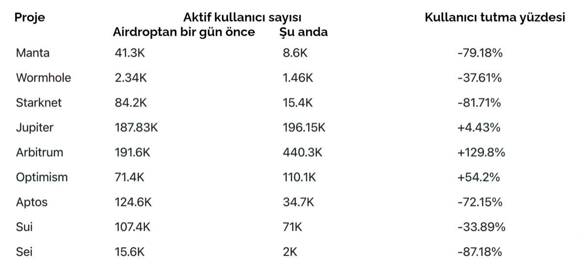
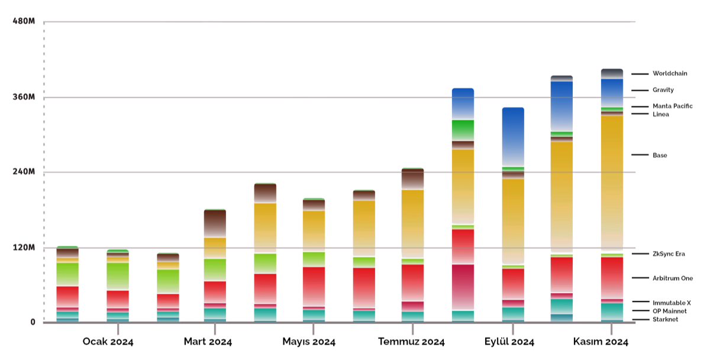
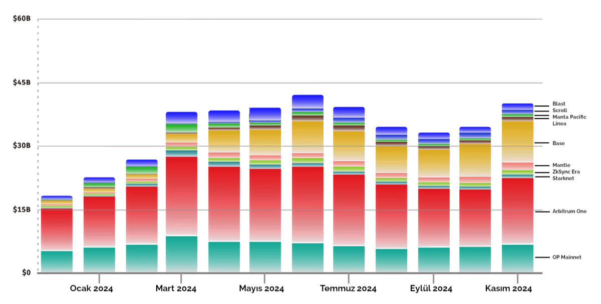
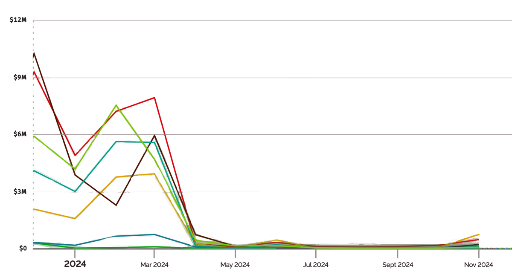

Bir önceki kısımda, blokzincir ağlarının temel sıkıntısı olan ölçeklenme sorununa değindik. Bu sorunu çözmeye yönelik olarak, eskiden beri süregelen monoblok (yani tek ya da yekpare) blokzincir yapısına karşı son dönemde ön plana çıkan modüler (yani legolar gibi birbirine kenetlenen farklı parçalardan oluşan) blokzincir yapılarını gördük.

Şimdi gelin hep birlikte bu modüler yapıya, akıllı kontrat platformlarının en büyüğü olan Ethereum’un üzerine inşa edilen ikinci seviye blokzincirlere bir göz atalım.

## Nedir ikinci seviye çözümler? {#nedir-ikinci-seviye-cozumler}

Ethereum’un kısıtları konusunda da değindiğimiz gibi, üstüne gelen yoğun talebi karşılayamayan Ethereum sistemi, merkeziyetsizlikten ödün vermeden büyüyebilmenin yolunu kimi fonksiyonlarını dışarıya atmakta buldu. Onun dışarı attığı fonksiyonları üzerine alanlar ise ikinci seviye çözümler oldu.

Hatırlayacak olursanız bir blokzincirin dört temel fonksiyonu var. Bunlar i) işlemi gerçekleştirmek, ii) yapılan işlemin doğruluğu konusunda uzlaşmak ve işlemleri sıralamak, iii) işlem sonuçlarını kesinleştirmek iv) işlem sonuçlarını anons etmek ve saklamak olarak sıralanıyorlar.

İkinci seviye çözümler, bu dört fonksiyon içinden Ethereum üzerinde en çok yer işgal eden ‘işlem gerçekleştirme’ fonksiyonunu üstlerine almaya talip. Tam olarak ne demek bu? Açıklayalım:

Ethereum diğer bütün ağlar gibi esasında bir yazılım. Bu ağ üzerinde bir uygulama geliştirmek ya da uygulamayı kullanmak istiyorsanız, sistemin kullandığı yazılım olan EVM’i işletmeniz gerekiyor (EVM, Ethereum Virtual Machine denen işlemcinin kısa adı. Türkçeye Ethereum Sanal Makinesi olarak çevirebiliriz). EVM’i çalıştırmak Ethereum ağını sürdüren makineleri en çok yoran ve Ethereum’un sunduğu temel ürün olan blok alanını en çok kullanan eylem. Bu durum, Ethereum’un işleyebileceği işlem miktarını azaltıyor, talebi artırdığı için işlem ücretlerinin de artmasına neden oluyor.

İkinci seviye çözümler, kullanıcıların yapmak istedikleri bu işlemleri kendi üzerlerine almayı talep eden ayrı birer blokzincir aslında. En basit haliyle anlatırsak, kullanıcıların yapmak istediği işlemleri toplu bir şekilde gerçekleştirip, sonuçlarını Ethereum üzerine yazıyorlar. Bir nevi, ‘bilgisayarlarımızda yer kaplamasın diye on-yirmi dosyayı bir araya getirip zip yapmak’ eylemi gibi düşünebilirsiniz. Ethereum üzerindeki aynı alana on-yirmi işlemin bir arada konabilmesi, kullanıcının ödediği işlem ücretlerini de dramatik bir şekilde düşürüyor.

## İkinci seviye çözümlerin diğer zincirlerden farkları ne? {#ikinci-seviye-cozumlerin-diger-zincirlerden-farklari-ne}

Peki o zaman, diğer birinci seviye dediğimiz Solana, Avalanche gibi zincirlerden farkları ne? Onlar da kullanıcılarına Ethereum’a göre çok daha ucuza işlem yaptırıyorlar?

### İkinci seviye çözümlerde Ethereum güvencesi {#ethereum-guvencesi}

İkinci seviye çözümlerin temel farkı, işlemlerin doğru ve eksiksiz gerçekleştiği konusunda Ethereum’un kullanıcılara sunduğu güvencenin aynısını sunabilme avantajı. Nasıl oluyor bu?

Ethereum, Solana ya da Avalanche gibi ağlarda kullanıcı olarak işlem yaptığınızda işlemin doğruluğunu sağlayanlar, o ağı işleten onaylayıcılar. Bu onaylayıcılar yaptıkları işlemin doğru olduğunun garantisini vermek için ellerinde tuttukları tokenleri (ETH, SOL ya da AVAX) sisteme rehin veriyorlar. Eğer bu onaylayıcılar ‘yamuk’ bir işe kalkışırlarsa rehin verdikleri bu tokenler yanıyor. Eğer siz kötü niyetli biri olarak sistemi ele geçirmek isterseniz, mevcut rehin edilmiş tokenlerin önemli bir kısmını elinizde tutmanız gerekir (bu oran ağdan ağa değişiyor, %33, %51 ya da %66 olabiliyor). Ethereum’un piyasa değeri daha yüksek olduğu için, Ethereum ağını ele geçirmek için gerekli miktar diğer ağlara göre çok daha fazla. Bu da Ethereum’u diğer küçük ağlara göre ‘göreceli’ daha güvenli yapıyor.

İşte ikinci seviye çözümler, kendi başlarına yeni bir ağ çıkarmak yerine Ethereum’un verdiği bu güvenceyi kullanıyorlar. Peki tam olarak nasıl kullanıyorlar bu güvenceyi? Şöyle açıklamaya çalışalım:

İkinci seviye çözümler kendilerini bir akıllı kontrat ile Ethereum ağına bağlıyorlar. Bu akıllı kontrat sayesinde, kullanıcı ikinci seviye çözümü kullansa bile, parası temelde Ethereum üzerinde duruyor. Yarın öbür gün, ikinci seviye çözüm durursa, kullanıcı parasını Ethereum üzerine çekebiliyor. Yani parası güvende. Diğer zincirlerde ise; durma yaşandığında (Solana bir ara çok dururdu, şimdi biraz azaldı) kullanıcı parası sistemde takılı kalıyor.

### İkinci seviye çözümler de birer blokzincir {#ikinci-seviye-cozumler-de-birer-blokzincir}

Şunu unutmamakta fayda var. İkinci seviye çözümler, Ethereum güvencesini verseler de sonuç olarak farklı birer blokzincirler. Bunun avantajları ve dezavantajları var. Temel avantajı, farklı blokzincirler olarak kullanıcıya yeni ürün ya da hizmetleri hızlıca sunabilirler. Ethereum’un herhangi bir iyileştirme yapması, çok büyük ve çok yere dokunan bir zincir olduğu için kolay değil, yavaş oluyor. İkinci seviye çözümler bu konuda çok daha atak olabiliyorlar.

Örneğin, son kullanıcılar için en büyük problemlerden bir tanesi varlıklarını kaybetme riski. Kullanıcılar blokzincir üzerinde sahip oldukları varlıklara ‘özel anahtar’ları ile ulaşıyorlar. Bu özel anahtarları oluşturmak için 12 ya da 24 kelimeye ihtiyaçları var. Bu kelimeleri de sahip oldukları cüzdanda taşıyorlar. Kullanıcının 12 kelimeye ihtiyaç duymadan ve kaybolma riski taşımadan cüzdan sahibi olmasının teknik bir çözümü var. Aralarında Türk gençlerinin kurduğu bir girişim olan [Clave](https://www.getclave.io/)[^1] de dahil olmak üzere pek çok cüzdan uygulaması bu konuda çalışıyor. Ne var ki, Ethereum’un bu temel çözümü getirmesi zaman alacak[^2]. Oysa ikinci seviye çözümlerin kimileri, örneğin zkSync ve Starknet bu çözümü hemen kendi temel sistemleri içine aldılar bile[^3].

### İkinci seviye çözümlerde her ek yazılım risk demek {#her-ek-yazilim-risk-demek}

Dezavantajlarına gelince, ikinci seviye çözümlerin kendileri de birer yazılım. Bu nedenle, ne kadar fazla sayıda yazılım kullanırsanız, o kadar çok yazılımdan kaynaklanabilecek hatalara karşı korumasız hale geliyorsunuz. Bu da unutulmamalı.

## İkinci seviye çözümlerin ekonomisi nasıl çalışıyor? {#ikinci-seviye-cozumlerin-ekonomisi-nasil-calisiyor}

İkinci seviye çözümlerin ekonomisi oldukça basit aslında. Gelir ve giderleri temel olarak birkaç kalemden oluşuyor. Bu kalemleri iyi anlamak ve nasıl gelişeceklerini tahmin etmek ikinci seviye çözümlerin geleceği hakkında da bize ipuçları verebilir. Önce gelirlerine bakalım.

### İkinci seviye çözümlerin gelirleri {#gelirler}

İkinci seviye çözümlerin gelirleri Ethereum’un gelirleri ile neredeyse tıpatıp aynı. Temel olarak üç kalem saymak mümkün.

Birincisi kullanıcıların zincir üzerinde işlem yapma karşılığı ödedikleri ücret. Bu da kullanıcıların yaptığı işlemler ve işlem başına ödedikleri ücretlerin çarpımından oluşuyor.

İkinci seviyelerde yapılan işlem sayılarının düzenli bir şekilde arttığını söylemek mümkün. Bunda elbette işlem ücretlerinin Ethereum’a göre düşük olmasının büyük bir etkisi var. Yine de tek nedenin bu olduğu söylenemez. Özellikle ikinci seviye çözümlerin dağıtacağı tokenleri almak için bu zincirler üzerinden işlem ‘kasan’ önemli bir tayfa olduğunu da belirtelim. Bunu zincirlerin token dağıtımı yaptıktan sonra işlem hacimlerinin ciddi bir şekilde düşmesinden rahatlıkla görebiliyoruz. Özellikle Starknet ve zkSync’in yaptığı token dağıtımları sonrası yaşadıkları düşüşler buna örnek.

<figure><figcaption>Projelerin token yaratımı öncesi ve sonrası kullanıcı sayıları</figcaption></figure>

*Token dağıtımı yapan projelerin airdop öncesi ve sonrası kullanıcı tutma oranları. (Kaynak: Dune, Tokenterminal, Artemis, [X](https://x.com/hmalviya9/status/1787714421084520862))*

Burada token dağıtımı üzerinden uzun bir zaman geçmesine rağmen işlem hacimlerinde üst seviyelerde yer alan Arbitrum bu anlamda rakiplerinden ayrışıyor. Bu satırların yazıldığı sırada üst seviyelerde olan Base de ilginç bir örnek. ABD’nin en büyük borsası olan Coinbase tarafından kurulan Base, token dağıtımı konusunda ‘ser verip sır vermez’ iken, özellikle kendi müşteri kitlesini Web3 dünyasına çekerek yüksek işlem adetlerine ulaşmayı şimdilik başarmış durumda.

<figure><figcaption>İkinci seviye çözümler üzerinde aylık işlem adetleri (milyon adet)</figcaption></figure>

*İkinci seviye çözümlerin işlem adetlerinde 2024 yılının ikinci çeyreği itibariyle bir yükseliş trendi görülüyor. (Kaynak: [GrowThePie](https://www.growthepie.xyz/fundamentals/transaction-count))*

Genelde zincirler Ethereum’a ödedikleri işlem ücretleri üzerine belli bir kâr marjı koyarak müşterilerine yansıtıyorlar. Bu ücretler, 2024 yılı öncesinde özellikle aşağıda bahsedeceğimiz Ethereum üzerindeki maliyetlerin yüksek olması nedeniyle ciddi rakamlar idi. 2024 yılı Mart ayında gelen güncelleme kullanıcılara yansıtılan ücretleri de düşürdü.

İleride rekabetin artması ile kullanıcılara yansıtılan ücretlerin Ethereum’a ödenen ücretlere çok yakın olacağını varsayabiliriz. Peki ikinci seviye çözümler, aralarındaki rekabet sonucu işlem ücretlerini alternatif birinci seviyeler kadar ucuza gerçekleştirebilirler mi (örneğin Solana)? Bu kısa vadede çok da mümkün görünmüyor.

İşlem ücretleri dışında kullanıcıların işlemlerinin daha hızlı gerçekleşmesi için ödedikleri ‘öncelik ücretleri’ Ethereum’a göre düşük olsa da ikinci seviyeler için hatırı sayılır bir gelir kalemi olarak göze çarpıyor.

Bunun dışında yine Ethereum kısmında uzunca bahsettiğimiz MEV gelirlerinin burada da kendisini gösterdiğini görüyoruz. MEV gelirlerini Ethereum üzerinde başta blok üreticileri olmak üzere aracılara giden gelirler olarak görmüştük. İkinci seviye çözümler, kendi blok üretimlerini henüz merkeziyetsiz hale getirmiş değiller (siz bu satırları okurken eminim bir-iki tanesinin bu alanı merkeziyetsiz hale getirdiğini duyacaksınız). Genelde zincirin henüz olgunlaşmaması ve geliştirmeleri tamamlamaması nedeniyle merkezi tutulan bu kısım aslına bakarsanız bir yandan da zincirlere ek gelir yaratıyor. Bu da henüz yeterince kullanıcıya ulaşmadığı için kârlılık sağlayamamış ikinci seviye çözümler için önemli bir gelir kaynağı oluyor. Yine de uzun vadede bu gelirin ortadan kalkacağını belirtelim.

İkinci seviye çözümler için bir gelir kalemi maddesi olmasa da önemli konulardan biri, kullanıcıların sistem üzerine kilitlemiş olduğu değer miktarı (İngilizcesi ‘Total Value Locked’ kısaca TVL). Bu rakam bir yandan kullanıcıların sisteme ne kadar güvendiğini, öte yandan ağın ne kadar likidite taşıdığını gösteriyor. Likidite, özellikle finans alanında işlem yapmak isteyenler için önemli bir kriter. Likidite ne kadar yüksek ise alım-satım arasındaki fark o kadar kapanıyor ya da yapılan işlemin fiyata etkisi o kadar azalıyor.

<figure><figcaption>İkinci seviye çözümler üzerinde kilitli miktar (milyar ABD Doları)</figcaption></figure>

*İkinci seviye çözümler üzerindeki kilitli miktar. (Kaynak: [GrowthThePie](https://www.growthepie.xyz/fundamentals/total-value-locked))*

### İkinci seviye çözümlerin giderleri {#giderler}

İkinci seviye çözümlerin en büyük gider kalemi Ethereum’a ödedikleri alan kullanma ücreti. Bu alanda Mart ayı içinde Ethereum’a gelen [yeni güncelleme](https://www.btchaber.com/dencun-yukseltmesi-ethereum-eth-ana-aginda-yayina-girdi/) işlem gerçekleştirme maliyetlerine ciddi bir ucuzluk getirdi.

<figure><figcaption>İkinci seviye çözümlerin Ethereum’a ödediği işlem ücretleri</figcaption></figure>

*İkinci seviye çözümlerin Ethereum’a ödediği işlem ücretleri Dencun güncellemesi sonrası dramatik bir düşüş gösterdi. Bu çözümlerin sayısının artması kullandıkları alana olan talebin artması ve ücretlerin yükselmesi anlamına gelecek. (Kaynak: [GrowThePie](https://www.growthepie.xyz/fundamentals/rent-paid))*

Yine de işlem gerçekleştirmeyi kendi üzerlerine alsalar da, ikinci seviye çözümler diğer fonksiyonlar için hâlâ Ethereum’u kullanıyor ve bu da onların maliyetlerini yukarı çekiyor. Bu fonksiyonlar içinde en pahalısı olan (Ethereum blok alanı içinde en çok yer tutan) data yayınlama işinde, alternatif kimi çözümler de yavaş yavaş gelişiyor. Bunlar içinde en öne çıkan ise bölümümüzün sonunda bahsedeceğimiz [Celestia](https://celestia.org/) oldu.

[^1]: Clave’de ufak da olsa bir yatırımım olduğunu buraya ‘disclaimer’ olarak [koyalım](https://blog.getclave.io/p/claves-breakthrough-16m-pre-seed).

[^2]: EIP 4337 denen bu çözümü kökten sisteme koyamayan Ethereum, bunu bir standart (ERC) olarak yavaş yavaş genele yaymayı planlıyor. Bir başka plan ise onun yerine kısa vadeli EIP 7702 ya da EIP 3074 gibi çözümler de topluluk içinde tartışılıyor.

[^3]: Yine de bu cüzdanların sadece bu altyapıyı destekleyen zincirlerde çalışabildiğini belirtelim. Bu uygulamaların tüm ikinci seviye zincirlerde çalışabilmesi için belirli standartların oturtulmaya çalışıldığını da ekleyelim.
