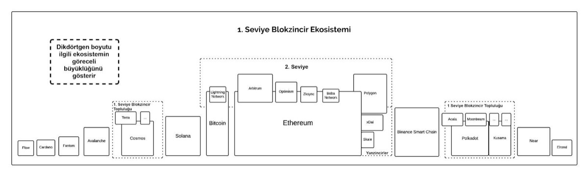

Bu kısmımızda, 2022 yılında yaşanan olaylar nedeniyle çok konuştuğumuz köprüler konusuna değiniyoruz. İlk cevaplamaya çalışacağımız soru “Blokzincirlerde neden köprülere ihtiyaç duyuyoruz?” olacak.

## Blokzincirler birer ada mı? {#blokzincirler-birer-ada-mi}

Sıkça kullandığım bir benzetme var: Yaşadığımız ‘fiziki’ dünyayı bir kıtaya benzetirsek, blokzincirler ana kara çevresine sıralanmış küçük adalar gibiler. Bizim bu adalara gidebilmemizi, yani itibari (fiat) paradan kriptoparaya geçişimizi genelde kripto alım-satım platformları sağlıyorlar. Peki bu adalar arasında gidip gelmek istersek? Bir blokzincirden öbürüne geçmek istersek? O zaman birkaç yol var ama önümüzdeki dönemde en sık konuşacağımız yol köprüler olacak gibi görünüyor.

## Blokzincir ve köprü ilişkisi {#blokzincir-ve-kopru-iliskisi}

Blokzincir dediğimiz esasında bir yazılım ve temel işlevi, üzerine kurulu olan projelere altyapı olmak. Blokzincir genelde kapalı bir dünya olarak kurulur, üzerindeki uygulamalar da esasında dış dünyaya erişimi olmayan akıllı kontratlardır. Ne yaparsanız, bu ‘ada’ içinde yapıyorsunuz.

Peki, o zaman bir blokzincirden diğerine nasıl geçiş yapılabilir? Örneğin, bir kullanıcı Ethereum üzerindeki kriptoparasını Avalanche ağına nasıl geçirebilir?

<figure><figcaption><em>Blokzincir Dünyası. (Kaynak: <a href="https://blockchain-comparison.com/blockchain-protocols/">Blockchain Comparison</a></em>)</figcaption></figure>

Bunun iki temel yolu var. Birincisi, bir kriptopara borsası kullanabilir. Bunun oldukça zahmetli bir yöntem olduğunu belirtelim. Yukarıdaki örnekten devam edelim: Kullanıcının elinde Ethereum ağında tuttuğu bir ETH var ve bunu Avalanche ağına geçirmek istiyor. ETH’sini bir borsada bulunan hesabına aktaracak. Sonra o ETH’yi satacak (muhtemelen USDT ya da USDC gibi en likit stabil paralardan biri aracılığı ile). Arkasından aldığı stabil para ile AVAX satın alacak. En sonunda ise satın aldığı bu AVAX’ı borsadaki hesabından Avalanche üzerindeki cüzdanına çekecek. Tam dört adım. Boşa zaman üstüne üstlük para kaybı; Ethereum ve Avalanche üzerinde transfer için ödeyeceği işlem ücretinin üzerine bir de kriptopara alım-satımı sırasında kayıp yaşayacak.

İkinci yol ise bu iş için bir köprü kullanmak. Köprüler sayesinde kullanıcı, bir blokzincir üzerindeki kriptoparasını diğer blokzincir üzerindeki hesabına direkt olarak aktarabilir. Hangisi kulağa daha kolay geliyor? Teoride ikincisi tabii ama pratiğe gelince henüz orada değiliz.

## Neden ihtiyaç duyuyoruz köprülere? {#neden-ihtiyac-duyuyoruz-koprulere}

Köprülere duyulan ihtiyaç nereden geliyor? Gelin kısaca bir bakalım:

### Ethereum’un yüksek işlem ücretleri {#ethereumun-yuksek-islem-ucretleri}

Öncelikle sorunun temeli, 2020 yılı ortalarından beri hayatımıza giren DeFi yani merkeziyetsiz finans ürünleri ile sonrasında piyasayı sarsan NFT’lere dayanıyor. Gerek DeFi gerekse NFT’lerin ağırlıklı olarak ortaya çıktığı ağ Ethereum oldu. Neden? Çok basit. Para yani değer Ethereum blokzincirinde toplanmıştı ve girişimler için ilk adres hep Ethereum oldu.

Ne yazık ki, geçtiğimiz yıllarda Ethereum’un DeFi ve NFT’ler tarafından gelen yoğun talebi karşılayamadığını gördük. İşlemler hiçbir zaman durmadı ancak oldukça pahalılandı. Makul fiyatlar ile işlem yapmak isteyenlerin saatlerce beklemek zorunda kaldığını gördük.

Bunu fırsat bilen Ethereum rakibi blokzincirler hızlı ve ucuz işlem önerisi ile ciddi bir yatırımcı kitlesini kendilerine çektiler. 2021 yılı başlarında ‘tüm DeFi Ethereum üzerinde döner’ diye konuşurken son zamanlarda bunun böyle olmadığını görmeye başladık (bir paragraf aşağıdaki tablo bunu rakamlar ile gözler önüne seriyor).

### Alternatif zincirler tarafından verilen teşvikler {#alternatif-zincirler-tarafindan-verilen-tesvikler}

Tabii kitleleri diğer blokzincirlere yönlendiren sadece düşük işlem ücretleri değil. Herhangi bir blokzincirde özellikle finans alanında bir işlem yapmak isteyen yatırımcının baktığı iki temel kriter var: Birincisi getiri, ikincisi ise likidite. Ethereum üzerine kurulan DeFi protokolleri likidite yaratabilmek için 2020 yılı yaz aylarında kullanıcılara token dağıtarak ciddi teşvikler verdiler. İşte alternatif blokzincirler de benzer yöntemi kullanarak, Ethereum üzerindeki yoğunluk nedeniyle gidecek başka yer arayan likiditeyi çekebilmek için kendi tokenlerini verdikleri teşvik programları açıkladılar.

### Ethereum üzerine kurulu ikinci seviye çözümler {#ethereum-uzerine-kurulu-ikinci-seviye-cozumler}

Ethereum geliştiricilerinin, kullanıcılara ait varlıkların kendi ağlarında kalması için gösterdikleri yoğun bir çaba var. Bu çabanın en somut örneğinin ikinci seviye çözümler olduğuna önceki sayfalarda değindik. İşte bu çözümleri kullanabilmek için kullanıcıların aynı alternatif zincirlerde olduğu gibi köprüleri kullanmaları gerekiyor.

## İyi de tam olarak ne yapar köprüler? {#iyi-de-tam-olarak-ne-yapar-kopruler}

En basit haliyle bir köprünün temel işlevini, kullanıcının sahip olduğu dijital varlığı, bulunduğu ağ üzerinde kilitlemek ve bunun karşılığında kullanıcıya aynı değere sahip dijital varlığı başka bir ağda sunmak olarak tanımlayabiliriz.

Şimdiye kadar hep değer transferi üzerinden örneklendirdiğimiz bu özellik, aslına bakarsanız özünde bilginin (verinin) bir ağda teyit edilip diğer ağa gönderilmesi demek. Bu nedenle köprüler, sadece dijital varlık (değer) değil, herhangi bir bilginin transferi için de kullanılabiliyor.

Kullanıcıya diğer ağda verilen değerin ne olduğu köprülerin temel dizayn farklılıklarına göre değişebiliyor. Örneğin elinizde Ethereum ağında bulunan ETH’niz var ise, bunu Avalanche ağına geçirdiğinizde köprü size WTH.e adında değeri ETH’ye eşit başka bir token veriyor. Kimi ağlarda ise aynı merkeziyetsiz borsalarda olduğu gibi, bir ağın temel tokenini diğer ağın tokeni ile takas edebiliyorsunuz. Örneğin, Ethereum’da ETH verip yerine Solana’da o ağın tokeni SOL’u alabiliyorsunuz.

## Ne tip köprüler var? {#ne-tip-kopruler-var}

Şimdi teknolojik ayrıntılarına girmeden kullanıcı açısından farklılık gösteren üç temel köprü kategorisine değineceğiz.

### Farklı blokzincirler arası köprüler {#farkli-blokzincirler-arasi-kopruler}

Az önceki örneklerde ağırlıklı olarak bahsettiğimiz blokzincir arası köprü çözümleri bu aralar en popüler olan kategori. Farklı iki zincir arasında değer ya da bilgi transferine yarayan bu köprü çözümlerinin birkaç çeşidi var.

Bu köprülerin ilk çıkanlarından bir tanesi, Bitcoin blokzincirinden Ethereum’a değer geçişini sağlayan WBTC, HBTC, tBTC gibi köprüler. Bu köprülerin özelliği sadece tek bir dijital varlığa (burada BTC’ye) odaklanmış olmaları. Ethereum üzerindeki DeFi uygulamalarının getirilerinden faydalanmak isteyen ama BTC’sinden de uzak kalamayan bir kitlenin bir zamanlar çok kullandığı bu köprüler üzerinden yaklaşık [20 milyar ABD Doları](https://dune.com/hashed_official/btc-on-ethereum) gibi bir tutar Ethereum’a aktarılmış durumda. Yeterli likiditeye sahip bu havuzlar sadece tek bir varlık üzerinden değer transferi yapmak isteyenler için ideal.

Popüler köprülerden bir diğeri, iki blokzincir arasındaki değer transferi için blokzincirin kendisi tarafından kurulan köprüler. Genelde bu tip çözümler, Ethereum ile alternatif ağ üzerinde oluşturuluyor. Ethereum ve Avalanche arasında kurulan [Avalanche Bridge](https://bridge.avax.network/) bunun örneklerinden bir tanesi.

Son olarak, birden fazla blokzincir arasında birden fazla tokenin transfer edilebilmesini sağlayan, genel kullanım maksatlı köprüler. Bu tip köprülerin kullanımlarının gün geçtikçe arttığını görüyoruz. Tek bir adres üzerinden farklı zincirlere ulaşım büyük kolaylık olsa da, bu tip köprülerin kullanıcı açısından en büyük sıkıntısı yeterli likiditeye sahip olmamaları. Genel olarak en büyük likidite stabil paralarda oluyor ve kullanıcılar USDT, USDC gibi paraları bir ağdan diğerine geçirmek için bu köprüleri kullanıyorlar. Bu tip zincirlerin en büyükleri bir süre önce tokenini çıkaran ve zamanında a16z gibi devlerden ciddi bir fonlama sağlayan [Layer Zero](https://www.layerzero.foundation/). Bir diğeri ise havuz kullanmak yerine kitabımızda ‘intent’ kısmında bahsedeceğimiz, her zincirde farklı likidite sağlayıcıları arasında rekabet yaratarak kullanıcıya en ucuz hizmeti vermeye çalışan [Across](https://across.to/) Protokolü.

### 0-seviye (Layer 0) köprü çözümleri {#b-0-seviye-layer-0-kopru-cozumleri}

Yukarıda bahsettiğimiz köprülerin yanında, blokzincirler arası değer transferini doğal bir şekilde yapmaya aday 0 seviye dediğimiz daha temel çözümler de mevcut. Üstelik birlikte çalışılabilirlik olarak adlandırılan bu çözümler için uzun süredir geliştirme yapılıyor. Farklı blokzincirleri birbirine bağlayan [Polkadot](https://polkadot.network/) ve [Cosmos](https://cosmos.network/) bunların en ünlüleri.

## Sıkıntıları neler? {#sikintilari-neler}

Köprüler ile ilgili en büyük sıkıntı, sonuçta bu araçların da birer akıllı kontrat olmaları. Bu nedenle akıllı kontratların yazım hatalarından dolayı oluşabilecek sıkıntılar burada da yaşanıyor.

Bir diğer konu, köprülerin genelde merkeziyetsiz olmamaları nedeniyle değer transferi yapan aracıların kullanıcılara getirdiği riskler. Az sayıda aracının olması merkezilik ve bunun sonucunda kötü niyetli oyuncuların sistemi ele geçirmesi gibi bir risk barındırıyor. Hep söylüyoruz: Merkeziyetsizlik uzun ince bir yol. Bu alanda ortaya çıkan tüm girişimler gibi köprüler de merkezi olarak başladılar ve yavaş yavaş merkeziyetsizliğe doğru yol alıyorlar.

Bunun yanında fonksiyon anlamında köprülerin henüz yolun başında olduğunu söyleyebiliriz. Kullanım kolaylığı, yapılan transferlerin gerçekleşme hızı, işlemlerin gerçekleşebilmesini sağlayacak gerekli likidite, farklı amaçlar için kullanılabilme gibi köprülerin gelişmeleri gereken pek çok alan var. Önümüzdeki dönemde bu alanlarda pek çok yeniliğin biz kullanıcılara sunulacağını söyleyebiliriz.
