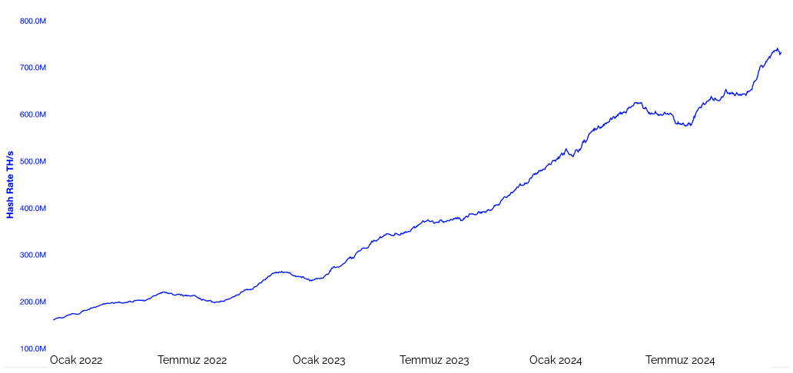
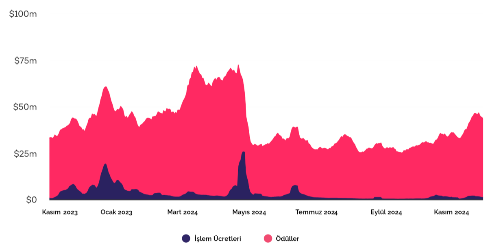

Bu kısımda özellikle son bir yıldır adını daha sık duymaya başladığımız Bitcoin üzerine geliştirilen ikinci seviye çözümlere bakacağız.

## Blokzincirlerin ölçeklenme sorununa Bitcoin’in yaklaşımı ne? {#blokzincirlerin-olceklenme-sorununa-bitcoinin-yaklasimi-ne}

Blokzincirlerin artan talebe yetişebilmek için ciddi çaba gösterdiğini bundan önceki sayfalarımızda detaylıca anlattık. Peki ya en büyük blokzincir olan Bitcoin bu konuda ne yapıyor?

Öncelikle şunu belirtelim, Ethereum ya da Solana gibi zincirler tüm dünyanın üzerinde farklı farklı işlemler yapacakları bir altyapı kurmaya çalışıyorlar. Bu nedenle bu zincirlere aynı zamanda ‘akıllı kontrat platformu’ deniyor. Bitcoin’in ise böyle bir derdi yok! Bitcoin’i geliştirenlerin temel derdi, sadece ve sadece değer transferinde kullanılacak, sansüre dayanıklı bir paraya sahip bir sistem kurmak. Akıllı kontratlar ile yapılacak farklı işlemlerin sistemi yoracağından endişe eden Bitcoin, ‘basitleşmek’ adına akıllı kontratlara karşı hasmane bir tutum sergiliyor.

Yukarıdaki paragrafta, ‘Bitcoin sistemini geliştirenler’ diye bir tanım kullandık. Temel sistemi kuran geliştiriciler dediğimiz bu grup, Bitcoin’in lokomotifi olsa da aslında tüm ekosistemin sadece bir parçasını oluşturuyor. Ekosistem içinde başka oyuncular da var ve bu oyuncuların talep ve beklentileri geliştiricilerden farklı olabiliyor.

## Bitcoin ekosisteminde geliştiriciler dışında başka kimler var? {#bitcoin-ekosisteminde-gelistiriciler-disinda-baska-kimler-var}

### Bitcoin ekosisteminde madenciler {#madenciler}

Bitcoin ekosisteminin geliştiriciler dışında bir başka önemli aktörü sistemin operasyonel olarak güvenli bir şekilde işlemesini sağlayan madenciler. Madenciler, bir yandan sistemin cefakar ‘hamalları’ olarak bütün yükü çekerken, bir yandan da dış dünyadan gelen “ama Bitcoin de çok fazla enerji harcıyor” gibi söylemleri göğüslemek zorunda kalıyorlar.

Bununla da bitmiyor madencilerin çilesi. Ödül kazanmak için amansız bir mücadele içindeler. Rekabetin gün be gün arttığını çok net bir şekilde izleyebiliyoruz. Madencilerin ödül kazanmak için sarf ettikleri efor, ödüle hak kazanmak için kendilerine verilen bir bulmacayı çözerken yaptıkları deneme sayısı (İngilizce ‘hash rate’) ile ölçülüyor ve bu rakam gün geçtikçe artıyor.

<figure><figcaption>Bitcoin madenci ödül kazanma çabası</figcaption></figure>

*Madencilerin saniyede yaptıkları deneme sayısı (terahash/saniye). (Kaynak: [Bitcoin.com](https://www.blockchain.com/explorer/charts/hash-rate))*

Öte yandan diğer bir temel sorun ise, verilen ödüllerin her dört yılda bir azalıyor olması. Peki ne yapacak bu durumda madenciler? Taş mı yesinler? Uzun vadede madenciler için kurtuluşun temel yolu diğer gelir kalemleri olan Bitcoin üzerinde yapılan işlemlerden alacakları komisyonların artmasından geçiyor.

Uzunca bir süredir Bitcoin üzerinde ödenen işlem ücretleri ödüllerin yanında yok denecek kadar az idi, ta ki 2023 yılı başınan kadar. O dönemde ortaya çıkan ve Bitcoin bloklarına BTC transferi dışında NFT’lerin de yazılabilmesine olanak sağlayan Ordinals protokolü sayesinde, işlem ücretlerinin madencilerin gelir kalemleri içinde %5 civarına çıktığını gördük.

<figure><figcaption>Bitcoin madencilerinin ödül ve işlem ücreti kazancı</figcaption></figure>

*Madencilerin günlük kazançları (milyon ABD Doları - 7 günlük ortalamalar.) (Kaynak: [TheBlock](https://www.theblock.co/data/on-chain-metrics/bitcoin))*

Bitcoin üzerinde işlem sayısının artması madencilerin uzun vadede yaşayabilmeleri için oldukça kritik ve bunun için para transferlerinin ötesinde yeni işlemlere ihtiyaçları var.

### Bitcoin ekosisteminde kullanıcılar {#kullanicilar}

Bitcoin ağı içindeki en önemli aktör elbette kullanıcılar. Sistemin gerçek bir değer ifade etmesi için geniş kitleler tarafından sürekli bir şekilde kullanılması gerekiyor.

Bitcoin sistemini kurgulayan Satoshi Nakamoto, yarattığı [tanıtım dokümanının](https://bitcoin.org/files/bitcoin-paper/bitcoin_tr.pdf) (İngilizcesi ‘White Paper) başlığını ‘Bitcoin: Eşler Arası Elektronik Ödeme Sistemi’ (İngilizcesi ‘Bitcoin: A Peer-to-Peer Electronic Cash System’) koymuştu. Ne var ki, Bitcoin’in bu vizyona ulaşabildiğini söylemek şu an için zor. Hatta bana sorarsanız, bu vizyonda bir gerileme bile var. Zira, 2010’lu yıllarda Bitcoin en azından kriptopara borsalarında alım satım yaparken işlem çifti olarak kullanılıyordu, bu konudaki liderliğini bile zaman içinde USDT, USDC gibi stabil paralara kaybetti. Şu an elinde kala kala, ‘sansüre dayanıklı dijital altın’ söylemi kaldı sadece. Bu nedenle Bitcoin’in kullanıcılara farklı değer önerileri ile gelmesi geniş kesimlerce kullanılabilmesinin tek yolu gibi görünüyor.

Öte yandan, Bitcoin’in bu satırlar yazıldığı sırada 2 trilyon ABD Doları civarında dolaşan bir piyasa değeri var. Kullanıcılar için büyük bir değer ama finansal olarak verimli kullanıldığını söylemek zor. Finansal piyasalarda ya da Ethereum gibi akıllı kontrat platformlarında, elinizde bir değer varsa bunu başkalarına kullandırarak (ya da teminat olarak koyup borç alarak) ekstra bir kazanç elde etmeniz, bir başka deyişle kapitalinizin verimini artırmanız mümkün. Bitcoin sistemi için aynısını söylemek mümkün değil. Dolayısıyla, büyük bir değer sistem içinde atıl olarak duruyor.

### Bitcoin ekosisteminde geliştiriciler {#gelistiriciler}

Bitcoin’in sadece bir ‘değer saklama aracı’ olarak kalması yerine geniş kesimlerce farklı şekillerde kullanılmasını hayal eden bir grup geliştirici Bitcoin sistemi üzerine aynı Ethereum’da olduğu gibi ikinci seviye çözümler üretmek için kolları sıvadılar. Bu geliştiriciler için bu tip çözümlerin üretilmesi hem Bitcoin üzerindeki işlem gelirini artırarak madencilere ek gelir kapısı yaratacak, hem de kullanıcılar için ellerindeki kapitali daha verimli kullanma fırsatı sunacak. Bütün bunların sonunda da geniş kesimler tarafından daha çok kullanılan Bitcoin sistemi değer kazanacak.

## “Çok güzelmiş, neden Bitcoin üzerinde daha önce düşünülmedi bu çözümler?” {#cok-guzelmis-neden-daha-once-dusunulmedi-bu-cozumler}

Aslına bakarsanız Bitcoin üzerine farklı çözüm bulma serüveni bir hayli eskilere dayanıyor. Bu alandaki ilk örneklerden biri, halen süregelmekte olan ‘Lightning Network’.

### Lightning Network {#lightning-network}

Lightning Network (LN), kişiler arası para transferini daha hızlı ve ucuz yapmaya çalışan bir protokol. Temeli, iki partinin Bitcoin üzerinde bir kanal açarak ortak bir adrese para kilitlemeleri ve sonrasında kullanıcıların bu kanal üzerinden birbirine para göndermeleri esasına dayanıyor. Yapılan işlemler, pahalı olmaları nedeniyle Bitcoin üzerine yazılmıyor ve LN’de tutuluyor. Eğer partiler bir süre sonra bu kanalı kapatmak isterlerse, işte o zaman taraflar geçmiş işlemleri bir araya toplayarak sadece son bakiyelerini Bitcoin ağı üzerine kaydedip ayrılıyorlar.

Bitcoin’i bir ödeme sistemi olarak ölçeklemek için oldukça fonksiyonel olan LN, istenen ölçeğe bir türlü ulaşamadı. Bunun temel nedenleri arasında kanalların içinde yeterince likidite olmadığını ya da kanal açıp kapamanın çok teknik ve karmaşık olduğunu öne sürenler var. Bir dereceye kadar makul olsa da, bana sorarsanız LN’in yeterince yaygınlaşmamasının temel nedeni yine Bitcoin. BTC’nin inişli-çıkışlı değeri, para değişim aracı olarak kullanılmasının önündeki en büyük engel. İnsanların gözünde BTC’nin en büyük değer önerisi, sayıca sınırlı olması ve uzun vadede sürekli yükseliş göstermesi nedeniyle bir ‘değer saklama aracı’ olarak görülmesi. Bir diğer neden ise salt ‘para transferi’ işleminin ölçeklenmesinin yeterli olmaması. Çok daha farklı işlevlere sahip ölçeklenme sistemlerinin geliştirilmesi gerekli.

## Peki Bitcoin üzerinde nasıl yapılacak bu çözümler? {#peki-nasil-yapilacak-bu-cozumler}

Bitcoin’in daha geniş kesimlerce kullanılması için üzerinde sadece para transferi değil her tür işlemin yapılabilmesi gerekiyor. Ancak yukarıda da belirttiğimiz gibi Bitcoin’in üzerinde akıllı kontrat çalıştırabilmek mümkün değil, daha doğrusu çok çok sınırlı.

Peki ya Ethereum’da olduğu gibi ikinci seviye çözümler ile Bitcoin’i ölçeklendirsek? Onda da en büyük problem, Bitcoin’in kendi üzerinde çalışacak herhangi bir çözümü destekleyecek bir ortam sunmuyor olması. Ne demek tam olarak bu? Kısaca açıklayalım:

Ethereum gibi sistemlerde, üzerine kurulu çözümlerin (ki bunlara roll-up çözümler deniyor) yaptığı işlemler toplanıp deste haline getirilerek Ethereum üzerine atılıyor. Ethereum, üzerine atılan bu işlemleri bir akıllı kontrat aracılığıyla kontrol edip onaylıyor. Bu onaylama ile Ethereum, ikinci seviye üzerinde yapılan işlemler sonrası değişen kullanıcı bakiyelerini teyid etmiş oluyor. Teyid edince ne oluyor? Yarın öbür gün ikinci seviye üzerinde bir sorun çıkarsa, Ethereum kullanıcıya “gel yapmak istediğin işlemi benim üzerimden de yapabilirsin” diye bir garanti veriyor.

İşte Bitcoin’de bu yok. Yani Bitcoin kendi üzerine yazılan herhangi bir şeyin sadece ‘değiştirilemeyeceği’ garantisini veriyor. Yazılan bilginin doğruluğunu kontrol etmiyor, dolayısıyla herhangi bir garanti vermiyor.

## Bitcoin için yan-zincirler {#yan-zincirler}

Peki Bitcoin üzerindeki çözümler buna karşı nasıl bir strateji izliyorlar? Öncelikle ilk piyasaya çıkan Stacks benzeri zincirler Bitcoin’e ‘yan zincir’ (İngilizcesi side-chain) olarak çalıştılar. Ne demek bu? Bu zincirler, kendi üzerlerinde yaptıkları işlemleri arada bir Bitcoin üzerine yazıyorlar. Bu sayede “bakın işlemler değişmedi” diyorlar dış dünyaya. Kendi içlerinde ise kullanıcılara aynı Ethereum gibi bir akıllı kontrat platformu olarak her tür işlemi yaptırabiliyorlar.

Yine de yukarıda da belirttiğimiz gibi Bitcoin bu işlemlerin doğruluğunu kontrol etmiyor. Dolayısıyla bu zincirlerin güvenliğinin Bitcoin’in güvenliği ile uzaktan yakından bir alakası yok. Ne demek bu? Bitcoin güvenliğini kendi üzerindeki binlerce madencinin bir protokol dahilinde uzlaşması ile sağlıyor. Bu yan zincirler ise farklı uzlaşma mekanizmaları kullanıyorlar[^1]. Bu nedenle Bitcoin’deki binlerce madencinin, kullanıcıların varlıklarının doğru şekilde tutulduğu ve yapılan herhangi bir işlemin kesin ve kati olarak gerçekleşeceği konusunda kullanıcılara verdiği güven bu zincilerde yok.

## Bitcoin’deki son dönem geliştirmeler {#bitcoindeki-son-donem-gelistirmeler}

LN ya da yan-zincirler dışında Bitcoin ölçeklenmesi için çalışan yeni çözümler özellikle Bitcoin üzerinde gerçekleşen son iki güncelleme sonrası giderek daha fazla konuşulmaya başlandı. Taproot ve SegWit isimli bu güncellemeler sayesinde Bitcoin’in algılama (işlem yapabilme) ve depolama kapasitesinde ciddi artışlar meydana geldi. Ne oldu tam olarak?

### Taproot ve SegWit {#taproot-ve-segwit}

Normalde Bitcoin üzerinde akıllı kontrat yani uygulama çalıştırmak ancak çok sınırlı bir şekilde mümkün. Bitcoin sisteminin temelde yapabildiği ‘şey’, kendisi üzerinde gerçekleşen para transferlerinin doğruluğunu kontrol edebilmek. Taproot ve SegWit, bu transfer işlemleri üzerine yazılabilecek bilgi miktarını artırma ve sistemin bu bilgileri sınırlı da olsa daha fazla kontrol edebilme (hesaplama yaparak doğrulayabilme) yetisini getirdiler. Bir nevi, sıkı sıkıya kapalı olan Bitcoin sisteminin kapısını ufak bir miktar araladılar.

### Ordinals, BRC-20 ve Runes {#ordinals-brc-20-ve-runes}

Aralanan bu kapının içinden önce Ordinals ile NFT’ler girdi. Sonrasında yine aynı mantığı kullanarak değiştirilebilir token üretmek için BRC-20 standardı geliştirildi. Son olarak da Ordinals’i geliştiren Casey Rodarmor değiştirilebilir tokenler için Runes Protocol standardını yarattı.

### BitVM {#bitvm}

Son zamanlarda ise bu aralanan kapıyı zorlayan yeni teknolojiler sahneye çıkmaya başladı. Bunların içinde en popüler olanı BitVM çözümü. BitVM’in temel olarak yaptığı, Ethereum’un üzerine kurulu ikinci seviye çözümler için verdiği hizmeti Bitcoin’e getirmek. Peki nasıl yapıyor bunu?

Yukarıda yazdığımızı tekrar edelim. Ethereum, üzerine kurulu roll-up çözümlerin kendisine gönderdiği hesaplamaları tekrar yaparak kontrol ediyordu. Nasıl yapıyor? Ethereum üzerine koyduğunuz bir akıllı kontrat ile ona “bu zincirden gelen bilgileri kontrol et” diyorsunuz, sistem de akıllı kontrat çalıştırarak bunu yapıyor. Bitcoin üzerinde ise bu hesaplamaları yapmanın imkanı yok. BitVM, ikinci seviye çözümlerin kendisine gönderdiği hesaplamaları küçük parçalara ayırarak kendi içinde (bitcoin üzerinde değil) tutuyor. Bir başka deyişle Bitcoin sisteminin yapamayacağı kompleks işlemleri basit küçük parçalara bölüp Bitcoin sisteminin algılayabileceği ve kontrol edebileceği hale getiriyor.

Peki ya BitVM’e gönderilen işlemlerde ya da BitVM’in yaptığı kayıtlarda bir sorun varsa o zaman ne olacak? Normalde bir itiraz olmaz ise kayıtlar doğru kabul ediliyor. Eğer bu işlemleri kontrol edenlerden bir tanesi bile bir hata olduğunu iddia ederse, o zaman yeni bir süreç başlıyor. İşlemlerin BitVM tarafından ayrılmış parçalarından hatalı olduğu düşünülenler Bitcoin üzerinde çalıştırılarak doğru olup olmadıkları kontrol ediliyor[^2].

Bu teknolojinin en önemli kullanım noktası, Bitcoin üzerindeki bir değeri ikinci seviye çözüme taşırken ortaya çıkıyor. Örneğin; normalde elinizde tuttuğunuz bir BTC’yi Ethereum zincirine geçirmek isterseniz, bunu yapmanın tek yolu, paranızı bir hesaba kilitlemek, sonrasında bu paranın bir türevini (örneğin WBTC) Ethereum üzerinde yaratmak. Gayet güzel ama bunu yaparken bir ‘aracı’ kullanıyorsunuz. BTC’nizi bir aracıya gönderiyorsunuz. Ya aracıya bir şey olursa[^3]? Ayrıca unutmayın bu aracının işlemlerinin hepsi Bitcoin zinciri dışında gerçekleşiyor. BitVM, bu aracıya olan güven ihtiyacını azaltıyor. Bunu da, para transferinin doğruluğunun kontrolünü Bitcoin sisteminin yapabileceği bir ortam yaratarak yapıyor. Bu da size daha güvenli işlem yapma imkanı veriyor. Burada en mükemmeli aracıyı toptan ortadan kaldırmak olur ama bu şu an için mümkün değil[^4].

BitVM teknolojisinin henüz yeni gelişen bir teknoloji olduğunu ve tam olarak kullanıma hazır olması için beklenen tarihin (yazı hazırlandığı sırada) 2024 yılı sonu olduğunu belirtelim. BitVM’in en büyük avantajı, Bitcoin üzerinde herhangi bir yeni geliştirmeye ihtiyaç duymadan çalışabilmesi.

BitVM’i kullanan çözümler teknik olarak Ethereum üzerinde zk (İngilizce ‘zero-knowledge’, Türkçesi ‘sıfır-bilgi kanıtı’) teknolojisi kullanan çözümlere benziyorlar[^5]. Bitcoin üzerinde bu teknolojiyi kullanan Alpen Labs projesinin yanında ülkemizden çıkmış olan Citrea projesi dikkat çekiyor. Burada Citrea’ya kısaca değinmek istiyorum:

Daha önce Ethereum üzerinde proof-of-innocence (masumiyet kanıtı) kavramı ile Ethereum kurucusu Vitalik Buterin’in de dikkatini çekmiş olan Chainway ekibinin bir ürünü [Citrea](https://citrea.xyz/). Şu an Bitcoin dünyasının ikinci seviye çözümleri içinde cephede en önde savaşan ekip diyebiliriz kendileri için. 2024 yılı sonunda canlıya geçirmeye çalıştıkları sistemleri sayesinde, hem akıllı kontrat platformlarının getirdiği esnekliğe hem de Bitcoin’in sağladığı güvenliğe olabildiğince sahip yeni bir zincir sunacaklar piyasaya. Yaptıkları geliştirmeleri heyecanla takip ediyoruz.

### opCAT {#opcat}

Yukarıda saydığımız çözümler dışında, gündemde bir de Taproot ile başlayan geliştirmeleri bir adım daha öteye götürüp Bitcoin’in işlem yapma kabiliyetini daha da yukarı çıkaracak güncellemeler var. Bu geliştirmelerin hayata geçmesi, ikinci seviye çözümlerin Bitcoin’in güvenliğini daha da sağlam bir şekilde kullanmasını sağlayacak[^6].

Buradaki tek sorun, Bitcoin üzerindeki geliştirmelerin topluluk tarafından benimsenmesinin çok yavaş olması. Son iki güncellemeden SegWit’in 2017, Taproot’un ise 2021 yılında olduğunu söylersek, ne dediğimiz daha iyi anlaşılacaktır herhalde. Yine de, Ordinals ile başlayan ve Runes Protokol ile devam eden Bitcoin üzerindeki işlem artışı, bu güncellemelerin ilerletilmesi sürecine ivme kazandırdı. Rüzgarı arkasına alan opCAT gibi geliştirmeler eğer hızlı bir şekilde adapte edilirse, o zaman Bitcoin’in geniş kesimlerce daha fazla kullanılması için önemli bir eşik atlanmış olacak[^7].

## Sonuç {#sonuc}

Bitcoin ‘sansürlenemez bir değer saklama aracı’ değer önerisi içine sıkışmış durumda. Ödemeler için kullanılması zaman içinde yaygınlaşmadı, hatta tam tersine gerilemeye başladı. Lightning Network benzeri üzerine kurulu ödeme odaklı ölçeklenme çözümleri ise güdük kaldı.

Bitcoin’in kullanımının ödemeler ile sınırlı kalması, sistemin güvenliğini sağlayan madencilere gelir kapısı olarak sadece blok yaratmada kazanılan ödülleri bırakıyor. Ödüllerin dört yılda bir yarılanması ise ileride madencilerin yavaş yavaş devre dışı kalması ve sistemin sürdürülebilirliğinin uzun vadede sıkıntıya girmesi ihtimalini doğuruyor.

Bitcoin’in ödemeler dışında kullanımı ise Ordinals ile başladı ve işlem gelirlerini artırarak madenciler için bir çıkış yolu açtı.

Ordinals’ın araladığı kapıdan girmeye çalışan farklı çözümler, Bitcoin üzerinde yeni pek çok senaryonun kurgulanmasını sağlayabilir. Bu senaryolar sayesinde, Bitcoin üzerinde atıl olarak duran kapitalin çok daha verimli olarak kullanılması mümkün olabilir.

Şu an için bu çözümler, Ethereum’un ikinci seviye çözümlerine verdiği desteği Bitcoin’den görmüyorlar, uzun vadede de göremeyecekler. Ancak kriptografik gelişmeler (ve güncellemeler) sayesinde bu çözümlerin önümüzdeki dönemde Bitcoin’in güvenliğinden daha fazla yararlanmaları mümkün. Bunun ne kadar zaman alacağı bir soru işareti ama gerçekleştiği noktada Bitcoin üzerindeki çözümlerin önü çok açık.

[^1]: Yan zincirler (örneğin Stacks) güvenlik için farklı protokoller kullanırken, yapılan işlemlerin mahsuplaşmasını da üzerine kurulu oldukları ana zincirin parası olan bitcoin üzerinden değil, kendi paraları üzerinden yapıyorlar.

[^2]: Yukarıda Bitcoin'in akıllı kontrat çalıştırma kapasitesinin çok sınırlı olduğundan bahsetmiştik. O zaman aklınıza "Nasıl oluyor da bu işlemleri Bitcoin üzerinde yapabiliyoruz?" sorusu gelebilir. Taproot güncellemesi sınırlı da olsa işlem yapabilme kapasitesi getirdi, o sayede yapılabiliyor. Bir diğer soru "O zaman bütün işlemleri Bitcoin üzerinde yapalım" olabilir - o zaman da aynı Ethereum'un yaşadığı sorunla karşılaşıyorsunuz. Bütün işlemleri Bitcoin üzerinde yapmak oldukça pahalı!

[^3]: Aracının Ethereum üzerindeki akıllı kontratında bir sorun çıkarsa; köprü işlemi dediğimiz bu transferi gerçekleştirenler, merkezileşmenin önüne geçmek için genelde bir grup aracıyı kullanıp, bu aracıların çoğunluğunun transfer işlemini onaylarlar. O zaman da bu sınırlı sayıdaki aracı topluluğunun çoğunluğunun dürüst davranacağına güvenmeniz gerekiyor.

[^4]: Aracıya olan ihtiyaç ancak Bitcoin kendi içinde daha geniş bir sorgulama yeteneğine sahip olursa gelir. Bu da örneğin bir sonraki kısımda bahsettiğimiz opCAT ile mümkün. opCAT’in gelmesi için de Bitcoin üzerinde bir güncelleme yapılması gerekiyor (bir diğer deyişle ‘Godot’u beklemek’).

[^5]: Ethereum üzerindeki Starknet, zkSync, Scroll ve Taiko benzeri roll-up çözümler zk-proof teknolojisini kullanıyorlar.

[^6]: Örneğin bu geliştirmelerden opCAT, yukarıda bahsettiğimiz ikinci seviye zincir ile Bitcoin arasındaki köprü bağlantılarını 'aracısız' hale getirerek, ikinci seviyede kullanılan BTC'lerin güvenliğinin tamamen Bitcoin sistemi tarafından korunmasını sağlayacak.

[^7]: opCAT aslında Bitcoin üzerinde daha önce olan ama Satoshi'nin kaldırdığı bir özellik. Temel olarak akıllı kontrat gibi işlemleri anlayabilme kabiliyeti getiriyor Bitcoin üzerine. Peki Satoshi neden kaldırmış? opCAT ile işlemlerin içine konacak mantıkların bir sarmala (loop) girerek Bitcoin sistemini 'patlatmasından' korkmuş Satoshi. Halbuki bu sorun, opCAT'a bir limit konarak basitçe çözülebilir.
